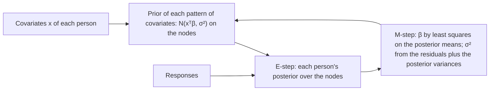
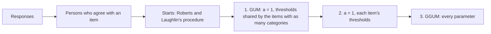
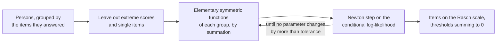

# Item response theory

`@measurekit/psychometrics/irt` calibrates items by marginal maximum likelihood, in one or several groups of
persons, with the distribution of theta fixed or estimated, Rasch, partial credit and rating scale items also by
joint or conditional maximum likelihood, and agree-disagree items by the generalized graded unfolding model. It estimates
abilities, converts summed scores to theta, and computes information and reliability. Every estimate is validated
against mirt, ltm, TAM, the GGUM package and base R ([validation](validation.md)). Theta is
on the N(0, 1) scale unless a calibration estimates its distribution.

## Models

An item with K categories is scored 0 to K - 1. Parameters follow mirt's `coef(model, IRTpars = TRUE)` with D = 1
([parameterization](parameterization.md) converts them).

### Dichotomous

A dichotomous item answers correctly with probability P(θ) = c + (d - c) / (1 + exp(-a (θ - b))). Its parameters are a
`LogisticItem` object `{ a, b, c, d }`: mirt's IRT coefficients with g, u named c, d.

| Model                    | Estimated per item | Fixed        |
| ------------------------ | ------------------ | ------------ |
| `oneParameterLogistic`   | b; one a for all   | c = 0, d = 1 |
| `twoParameterLogistic`   | a, b               | c = 0, d = 1 |
| `threeParameterLogistic` | a, b, c            | d = 1        |
| `fourParameterLogistic`  | a, b, c, d         |              |

The 1PL is the Rasch model on the N(0, 1) scale: the Rasch difficulty is a · b and the Rasch ability a · θ.

### Polytomous

| Model                      | Parameters                       | P(k \| θ)                                                       | mirt item type               |
| -------------------------- | -------------------------------- | --------------------------------------------------------------- | ---------------------------- |
| `gradedResponse` (GRM)     | `{ a, b: [b1, ...] }`            | P(X ≥ k) - P(X ≥ k + 1), P(X ≥ k) = 1 / (1 + exp(-a (θ - b_k))) | `graded`                     |
| `generalizedPartialCredit` | `{ a, b: [b1, ...] }`            | ∝ exp(Σ_(j ≤ k) a (θ - b_j))                                    | `gpcm`                       |
| `partialCredit` (PCM)      | `{ a, b: [b1, ...] }`            | as the GPCM, one a for all PCM items                            | `gpcm` with equal slopes     |
| `ratingScale` (RSM)        | `{ a, b, steps: [τ1, ...] }`     | ∝ exp(Σ_(j ≤ k) a (θ - b - τ_j)), a and τ shared                | `rsm` with equal free slopes |
| `nominalResponse` (NRM)    | `{ a: [a1, ...], c: [c1, ...] }` | ∝ exp(a_k θ + c_k)                                              | `nominal`                    |

The type `ThresholdItem` is `{ a, b }`; `RatingScaleParameters` and `NominalParameters` are the others.

- **GRM** (Samejima). b1 to b(K-1) increase when a > 0 and decrease when a < 0.
- **GPCM** (Muraki). The step thresholds b1 to b(K-1) need not be ordered.
- **PCM** (Masters). The GPCM with one estimated a for all its items, so that theta keeps the N(0, 1) scale, as for the
  1PL: the Rasch thresholds are a · b. With two categories it is the 1PL. mirt's `Rasch` item type fixes a = 1 and
  frees the variance of theta instead.
- **RSM** (Andrich). The PCM with thresholds b + τ_k: b is the item's location, the mean of its thresholds, and the
  steps τ_1 to τ_(K-1), which sum to 0, are shared by all RSM items, as a is. mirt's `rsm` writes the thresholds as
  b_j - c / a1 with shared b_j and an item location c, fixes a1 = 1 and the first c at 0, and frees the variance.
- **NRM** (Bock). One slope and one intercept per category, for unordered categories. Adding a constant to all slopes
  or all intercepts changes nothing; calibration reports both summing to 0, as mirt does.

### Unfolding

An unfolding item, such as an attitude statement rated from strongly disagree (0) to strongly agree (C), is agreed with
most by the persons near its location b, and less the farther they are from it on either side: a person far below and a
person far above both disagree. `generalizedGradedUnfolding` (GGUM, Roberts, Donoghue and Laughlin) gives an item of C +
1 categories the parameters `UnfoldingParameters`, `{ a, b, t: [t1, ..., tC] }`, and

P(z | θ) ∝ exp(a (z (θ - b) - T_z)) + exp(a ((M - z) (θ - b) - T_z)), M = 2C + 1, T_z = t_1 + ... + t_z, T_0 = 0.

Each observed category z joins two subjective ones, z below the item and M - z above it, of a partial credit item of
2C + 2 categories with thresholds b + t_1, ..., b + t_C, b, b - t_C, ..., b - t_1. a, b and t are the GGUM package's α,
δ and τ_1 to τ_C; mirt's `ggum` item type has the same a and b and writes the thresholds with the opposite sign.
Reflecting theta and every b, θ → -θ and b → -b, changes no probability. [Unfolding calibration](#unfolding-calibration) estimates them.

### Estimated parameters

Calibration estimates each model's parameter vector. Its entries name the standard errors and the priors.

| Model         | Vector entries                                   | Shared by the model's items |
| ------------- | ------------------------------------------------ | --------------------------- |
| 1PL           | a, b                                             | a                           |
| 2PL, 3PL, 4PL | a, b, then c, d where estimated                  |                             |
| GRM, GPCM     | a, b1 to b(K-1)                                  |                             |
| PCM           | a, b1 to b(K-1)                                  | a                           |
| RSM           | a, b, step1 to step(K-2); τ_(K-1) = -(τ_1 + ...) | a, the steps                |
| NRM           | a1 to a(K-1), c1 to c(K-1); aK and cK = -(sums)  |                             |
| GGUM          | a, b, t1 to tC                                   |                             |

A shared parameter has one value for all estimated items of its model in a calibration, so all RSM items need the same
number of categories.

## Calibration

```ts
import { responseMatrix } from "@measurekit/psychometrics/data";
import {
  betaPrior,
  calibrate,
  generalizedPartialCredit,
  type IrtModel,
  type LogisticItem,
  logNormalPrior,
  threeParameterLogistic,
  type ThresholdItem,
} from "@measurekit/psychometrics/irt";

// Items 1 to 3 are multiple choice, scored 0 or 1; item 4 is a constructed response, scored 0 to 2.
const matrix = responseMatrix([
  [1, 0, 1, 2],
  [0, 0, 1, 0],
  [1, 1, 1, 2],
  [0, 1, 0, 1],
  [1, 1, 1, 1],
  [0, 0, 0, 0],
  [1, 0, 0, 1],
  [1, 1, 0, 2],
]);
// TypeScript does not infer a list of models with different parameters: write its type.
const models: IrtModel<LogisticItem | ThresholdItem>[] = [
  threeParameterLogistic,
  threeParameterLogistic,
  threeParameterLogistic,
  generalizedPartialCredit,
];
const result = calibrate(matrix, {
  model: models,
  fixed: { item1: { a: 1.2, b: -0.5, c: 0.2, d: 1 } },
  priors: { a: logNormalPrior(0, 0.5), c: betaPrior(5, 17) },
  standardErrors: "hessian",
});

result.items[3]; // { id: "item4", model, parameters: { a: 0.93, b: [-0.97, 0.26] }, standardErrors: { a, b1, b2 } }
result.logLikelihood; // also aic, bic, converged and iterations
```

`calibrate(data, options)` takes a [response matrix](data.md) or, for sparse
data, [response records](data.md#response-records): both give the same calibration, and records take memory
in proportion to the responses only.

| Option           | Default             | Meaning                                                                                                                  |
| ---------------- | ------------------- | ------------------------------------------------------------------------------------------------------------------------ |
| `model`          | required            | One model for every item, or an array with one per item, such as the 3PL and the GPCM.                                   |
| `fixed`          | none                | Parameters of anchor items by item id. They are not estimated; the others take their scale.                              |
| `priors`         | none                | A prior per vector entry name, such as `{ c: betaPrior(5, 17) }`, for every item estimating it.                          |
| `itemPriors`     | none                | Priors by item id, then entry name, such as `{ new1: { b: normalPrior(0.4, 0.8) } }`: [priors of single items](#priors). |
| `quadrature`     | 61 rectangular      | Nodes over theta: `{ method: "rectangular" \| "gauss-hermite", points }`.                                                |
| `groups`         | one group           | Each person's group label, for [several groups on one scale](#groups-and-distributions-of-theta).                        |
| `latent`         | `"standard-normal"` | The distribution of theta, for every group or by group label: `"standard-normal"`, `"normal"`, `"empirical-histogram"`.  |
| `covariates`     | none                | Each person's covariates by name, for a [latent regression](#latent-regression) of theta.                                |
| `standardErrors` | `"none"`            | `"none"`, `"hessian"` or `"cross-product"`: [standard errors](#standard-errors).                                         |
| `testlets`       | none                | Item ids by testlet id, for the [testlet model](#testlets).                                                              |
| `tolerance`      | `1e-4`              | EM stops when no estimated parameter or histogram weight changes by more than this in an iteration.                      |
| `maxIterations`  | `500`               | The most EM iterations.                                                                                                  |

The estimates maximize the marginal log-likelihood, theta integrated over its distribution, N(0, 1) by default; with
priors, the log-likelihood plus the log prior densities. Bock-Aitkin EM alternates two steps:

- **E-step:** each person's posterior over the quadrature nodes gives the expected number of persons in each category
  of each item at each node, and of each group at each node.
- **M-step:** one Fisher-scoring step with a line search on each item's expected log-likelihood, a generalized EM step
  that never lowers it. Items sharing a parameter step together. Bounded parameters (c and d, in (0, 1)) are estimated
  on the logit scale.

Every second EM step is followed by a jump along the line of the two steps, the squared extrapolation SQUAREM (Varadhan
and Roland, 2008), as mirt accelerates EM by default. The jump is kept only where the log-likelihood does not fall below
that of the first step; otherwise the plain steps go on. It reaches the same estimates in about half the iterations, and
in a fifth of them for testlets. A histogram of theta is estimated by plain EM. `iterations` counts the E-steps.

A result that has not converged within `maxIterations`, or that has a degenerate normal distribution of theta (see
[small groups](#groups-and-distributions-of-theta)), has `converged: false`; it does not throw.

| Result          | Meaning                                                                                                  |
| --------------- | -------------------------------------------------------------------------------------------------------- |
| `items`         | Per item: `id`, `model`, `parameters` and `standardErrors` of the vector entries by name.                |
| `groups`        | Per group: `group`, `distribution`, `mean`, `sd`, their `standardErrors`, and the `nodes` and `weights`. |
| `testlets`      | Per testlet: `id`, `items`, `sd` of its effect and its `standardError`; empty without testlets.          |
| `logLikelihood` | The marginal log-likelihood at the estimates, without the priors.                                        |
| `aic`, `bic`    | -2 logLikelihood + 2p and -2 logLikelihood + p ln n: p estimated parameters, n persons with responses.   |
| `converged`     | Whether EM reached `tolerance` and no estimated normal distribution of theta is degenerate.              |
| `iterations`    | EM iterations run.                                                                                       |

p counts the items' parameters, 2 per estimated normal distribution, 1 per testlet and the nodes less 1 per histogram,
as mirt.

### Standard errors

| `standardErrors`  | Information                                                                                       | mirt                     | Cost                                      |
| ----------------- | ------------------------------------------------------------------------------------------------- | ------------------------ | ----------------------------------------- |
| `"none"`          |                                                                                                   | `SE = FALSE`             | none                                      |
| `"hessian"`       | Observed: the Hessian of the negative log-posterior, by central differences of its exact gradient | `SE.type = "Richardson"` | 2 E-steps per estimated parameter, and P³ |
| `"cross-product"` | Σ over persons of s sᵀ, s the person's score vector, plus minus the priors' second derivatives    | `SE.type = "crossprod"`  | one pass over the persons, and P³ / 2     |

P is the number of estimated parameters. The gradient is exact by Fisher's identity: the posterior mean of the
complete-data gradient. On 20,000 persons and 60 2PL items, EM takes about 3.5 s, Hessian standard errors 27 s more
and cross-product ones 0.2 s more; on 4,000 persons answering 40 of 1,000 items, cross-product standard errors take
about 3 s. Both methods estimate the same covariance in large samples; the Hessian is the reference for small ones.
Standard errors are `null` for fixed items, and for every item when the information cannot be inverted or gives a
variance that is not positive.

Missing responses are skipped; persons without responses change nothing. An estimated item has the categories up to
its highest response; it needs responses in every one of them, at least two, and no more than its model allows: a
dichotomous item with only correct responses throws `DataError`, as its difficulty has no finite estimate. A fixed item
may have more categories than its responses reach.

### Covariance of the item parameters

`calibrateWithCovariance(data, options)` calibrates as `calibrate` does, with the same options, and also returns the
covariance matrix of all the estimated item parameters, with the covariances between items that the items' own
standard errors leave out. A function of the parameters of several items, such as an equated score, has the variance
gᵀ Σ g by the delta method, g its gradient and Σ this matrix.

```ts continues
import { betaPrior, calibrateWithCovariance, logNormalPrior } from "@measurekit/psychometrics/irt";

// `matrix` and `models` are those of the example above.
const { covariance } = calibrateWithCovariance(matrix, {
  model: models,
  fixed: { item1: { a: 1.2, b: -0.5, c: 0.2, d: 1 } },
  priors: { a: logNormalPrior(0, 0.5), c: betaPrior(5, 17) },
  standardErrors: "hessian",
});

covariance?.parameters; // [{ item: "item2", name: "a" }, ..., { item: "item4", name: "b2" }]
covariance?.matrix[0]?.[0]; // 0.160, the square of the standard error of item2's a
```

| Member        | Meaning                                                                                                                                          |
| ------------- | ------------------------------------------------------------------------------------------------------------------------------------------------ |
| `calibration` | The result of `calibrate`.                                                                                                                       |
| `covariance`  | `{ parameters, matrix }`, or `null`.                                                                                                             |
| `parameters`  | The `item` and `name` of each row and column: the estimated items in item order, each with the names of its `standardErrors`.                    |
| `matrix`      | The covariance matrix by rows, symmetric, on the parameters' own scale: `matrix[i][j]` is the covariance of `parameters[i]` and `parameters[j]`. |

- **Which parameters.** The matrix is the part for the item parameters of the covariance matrix of all the estimated
  parameters, so it includes the uncertainty of estimated distributions of theta and of testlets, whose own parameters
  it does not list. Fixed items are not listed.
- **Shared parameters.** Items whose model shares a parameter, as RSM items share a and the steps, list it once for each
  item, with the same variance and a correlation of 1.
- **`null`.** Without standard errors (`standardErrors: "none"`), with no estimated item, and where the information
  cannot be inverted or gives a variance that is not positive.
- **Plain data.** The matrix is nested arrays, so it round-trips through JSON.

### Groups and distributions of theta

By default every person's theta is N(0, 1), which sets the scale. `latent` estimates the distribution instead, when
fixed items or a standard normal group set the scale:

| `latent`                | Distribution                                      | Estimated each EM iteration                                            |
| ----------------------- | ------------------------------------------------- | ---------------------------------------------------------------------- |
| `"standard-normal"`     | N(0, 1)                                           | nothing                                                                |
| `"normal"`              | N(μ, σ²), weights ∝ φ((θ_q - μ) / σ) on the nodes | μ and σ whose weights have the mean and variance of the group's counts |
| `"empirical-histogram"` | a weight at each node (Bock and Aitkin, 1981)     | each node's weight: the group's expected count there over the total    |

Both updates maximize Σ n_q ln w_q, the group's part of the expected complete-data log-likelihood, so the estimates
maximize the log-likelihood that calibration reports. A distribution other than the standard normal needs the
rectangular rule: its nodes stay at -6 to 6 and their weights move.

- **Anchors.** With `fixed` items, `latent: "normal"` estimates the mean and SD of the sample on the anchors' scale, as
  mirt with `MEAN_1` and `COV_11` freed.
- **Groups.** `groups` gives each person's group label; every item has the same parameters in all groups, and each
  group has its own distribution, `latent: { grade4: "standard-normal", grade5: "normal" }`: mirt's `multipleGroup`
  with `invariance = c(items, "free_means", "free_var")`. Groups not named take the standard normal. Results list the
  groups in order of first appearance. Groups are independent samples: stacking the occasions of repeated persons as
  groups treats each person as two or three persons and ignores the correlation between a person's occasions, so the
  means and standard errors of the change are wrong. [`calibrateLongitudinal`](multidimensional.md#longitudinal-calibration)
  estimates the correlations between occasions.
- **Histograms.** The weights of a histogram creep toward a few spikes, the maximum of the likelihood, without
  reaching it, so a histogram is where EM stops: `tolerance` covers its weights. Its weights have no standard errors;
  the items' standard errors treat them as known, as mirt does.
- **Small groups.** A few persons can leave a normal distribution without a maximum: its SD shrinks toward 0 when
  their likelihoods agree, or its mean and SD run far beyond the nodes when they all sit at one end. Such a
  distribution is degenerate: its mean lies outside the nodes, or its SD is below their spacing or above their range.
  The result then has `converged: false`, even when the parameters have stopped changing. The weights stay valid, and
  the standard errors are `null` where the information cannot be inverted.

```ts
import { createRandom } from "@measurekit/psychometrics";
import { calibrate, twoParameterLogistic } from "@measurekit/psychometrics/irt";
import { normalDistribution, simulateItems, simulateResponses, simulateThetas } from "@measurekit/psychometrics/sim";

// 500 persons of 2025 from N(0, 1) and 500 of 2026 from N(0.5, 1.2²) answer the same 20 items.
const random = createRandom(2026);
const items = simulateItems(twoParameterLogistic, 20, random);
const thetas = [...simulateThetas(500, random), ...simulateThetas(500, random, normalDistribution(0.5, 1.2))];
const result = calibrate(simulateResponses(items, thetas, random), {
  model: twoParameterLogistic,
  groups: thetas.map((_, person) => (person < 500 ? "2025" : "2026")),
  latent: { "2026": "normal" },
});
result.groups[1]; // { group: "2026", distribution: "normal", mean: 0.54, sd: 1.21, standardErrors: null, ... }
```

### Latent regression

`covariates` replaces the distribution of theta with a regression on the persons' covariates: θ ~ N(xᵀβ, σ²), the
coefficients β estimated with the items. Persons with the same covariates share one prior, so the E-step integrates once
for each distinct pattern of covariates.



| Rule                 | Definition                                                                                                                                    |
| -------------------- | --------------------------------------------------------------------------------------------------------------------------------------------- |
| Covariates           | An object of arrays by name, each with a finite number for every person, aligned with the rows of the responses or the `personIds` of records |
| No intercept         | The mean of theta is xᵀβ, so a covariate with a mean other than 0 moves the scale; center the covariates to keep the mean near 0              |
| Scale                | Items with estimated slopes fix the unit of theta, so σ is 1 and β is in units of the residual SD; with `fixed` items, σ is estimated         |
| Result               | `regression`: `coefficients` by name, `residualSd` and `standardErrors` of the coefficients; `groups` is empty                                |
| Estimates            | β = (XᵀX)⁻¹ Σ x · (posterior mean); σ² is the mean over persons of the squared residual of the posterior mean plus the posterior variance     |
| Information criteria | The coefficients, and σ when estimated, count as parameters                                                                                   |

```ts
import { createRandom } from "@measurekit/psychometrics";
import { calibrate, posteriorMeanEstimate, twoParameterLogistic } from "@measurekit/psychometrics/irt";
import { normalDistribution, simulateItems, simulateResponses, simulateThetas } from "@measurekit/psychometrics/sim";

// 1,500 persons answer 20 items. Their theta is 0.6 x + e, e ~ N(0, 0.8²), with the covariate x centered.
const random = createRandom(2026);
const items = simulateItems(twoParameterLogistic, 20, random);
const raw = simulateThetas(1500, random);
const mean = raw.reduce((sum, value) => sum + value, 0) / raw.length;
const x = raw.map((value) => value - mean);
const noise = simulateThetas(1500, random, normalDistribution(0, 0.8));
const thetas = x.map((value, person) => 0.6 * value + (noise[person] ?? 0));
const responses = simulateResponses(items, thetas, random);

// Free slopes: sigma is 1, so the coefficient is 0.6 / 0.8 in units of the residual SD.
const free = calibrate(responses, { model: twoParameterLogistic, covariates: { x }, standardErrors: "hessian" });
free.regression; // { coefficients: { x: 0.72 }, residualSd: 1, standardErrors: { x: 0.04 } }

// Six items fixed at their generating values fix the scale, so sigma is estimated.
const anchors = Object.fromEntries(items.slice(0, 6).map((item, j) => [`item${j + 1}`, item.parameters]));
const anchored = calibrate(responses, { model: twoParameterLogistic, covariates: { x }, fixed: anchors });
anchored.regression; // { coefficients: { x: 0.57 }, residualSd: 0.79, standardErrors: null }

// A person's ability given the responses: the prior is N(xᵀβ, σ²) with the person's own mean.
const prior = {
  mean: (anchored.regression?.coefficients.x ?? 0) * (x[0] ?? 0),
  sd: anchored.regression?.residualSd ?? 1,
};
posteriorMeanEstimate(anchored.items, responses.responses[0] ?? [], { prior }); // { theta: -1.80, standardError: 0.48 }
```

The 1PL and the PCM estimate one slope `a` for all items, so they belong to the free-slope row: σ is 1. Their Rasch
equivalents, which mirt's `Rasch` and TAM's `tam.mml(Y = x)` estimate, are the residual SD `a`, the coefficients `a β`
and the locations `a b`.

| `covariates` cannot be used with        | Because                                                                          |
| --------------------------------------- | -------------------------------------------------------------------------------- |
| `groups`                                | A group is a covariate in a latent regression: give it as a (centered) indicator |
| `latent` other than `"standard-normal"` | The regression is the distribution of theta                                      |
| `quadrature` other than rectangular     | The priors are normal densities on the nodes, as for an estimated distribution   |
| `testlets`                              | The testlet effects are added to a standard normal theta                         |
| `standardErrors: "cross-product"`       | It has no score for the coefficients; use `"hessian"`                            |

### Online calibration

Pretest items seeded into adaptive tests are calibrated with the operational items fixed (fixed parameter
calibration): pass the sessions as [response records](data.md#response-records), the operational items as `fixed`,
and `latent: "normal"` or `"empirical-histogram"`. Re-estimating the distribution every iteration, rather than keeping
N(0, 1), is Kim's (2006) multiple-weights-updating, multiple-EM-cycles method, which keeps the pretest items on the
operational scale when the tested population is not N(0, 1).

```ts
import { createRandom } from "@measurekit/psychometrics";
import { responseRecords } from "@measurekit/psychometrics/data";
import { calibrate, twoParameterLogistic } from "@measurekit/psychometrics/irt";
import { normalDistribution, simulateItems, simulateResponses, simulateThetas } from "@measurekit/psychometrics/sim";

// Items 1 to 20 are operational, 21 and 22 pretest; each of 2,000 sessions takes 10 operational items and one pretest
// item, from a population N(0.3, 1.1²).
const random = createRandom(2026);
const items = simulateItems(twoParameterLogistic, 22, random);
const thetas = simulateThetas(2000, random, normalDistribution(0.3, 1.1));
const data = responseRecords(
  simulateResponses(items, thetas, random).responses.flatMap((row, person) =>
    row.flatMap((response, j) => {
      const taken = j < 20 ? Math.floor(j / 10) === person % 2 : j - 20 === person % 2;
      return taken && response !== null ? [{ person: `s${person}`, item: `item${j + 1}`, response }] : [];
    }),
  ),
);
const fixed = Object.fromEntries(items.slice(0, 20).map((item, j) => [`item${j + 1}`, item.parameters]));
const result = calibrate(data, {
  model: twoParameterLogistic,
  fixed,
  latent: "normal",
  standardErrors: "cross-product",
});
result.items.find((item) => item.id === "item21"); // parameters { a: 0.84, b: 0.15 }, simulated from a = 0.86, b = 0.24
result.groups[0]; // { mean: 0.28, sd: 1.12, ... }: the population, on the operational scale
```

### Testlets

Items that share a stimulus, such as the questions on one reading passage, depend on each other beyond theta: a
person who understood the passage does better on all its questions. The testlet response model (Bradlow, Wainer and
Wang, 1999) adds a person's effect γ for each testlet: an item of testlet d answers at θ + γ_d, γ_d ~ N(0, σ_d²),
independent of θ and of the other testlets. It is the bifactor model whose specific slope equals the general one (Li,
Bolt and Fu, 2006), and it works for items of any model. Use it when local dependence shows within passages, such as
Yen's Q3 ([fit](fit.md#yens-q3)) well above the average for their pairs: ignoring it overstates the information of the
passage's items and the precision of theta.

`testlets` declares the testlets, `{ passage1: ["q1", "q2", "q3"], passage2: [...] }`, two items or more each; items in
none are ordinary. Calibration integrates by the bifactor dimension reduction (Gibbons and Hedeker, 1992): at each node
of theta, each testlet contributes Σ_g w_g Π_j P_j(x_j | θ + γ_g), so the quadrature is two-dimensional whatever the
number of testlets. γ's nodes are those of theta with weights ∝ φ(γ / σ_d), as mirt's `bfactor`; θ + γ falls on a grid
of 2Q - 1 points, at which each testlet item's probabilities are computed once per iteration. Each σ_d is updated, as a
normal distribution's SD is, to match its weights' second moment to that of its expected counts.

| Option             | With `testlets`                                                                                                            |
| ------------------ | -------------------------------------------------------------------------------------------------------------------------- |
| `groups`, `latent` | Allowed: theta follows the [group distributions](#groups-and-distributions-of-theta), with one σ per testlet in all groups |
| `quadrature`       | The rectangular rule                                                                                                       |
| `standardErrors`   | `"none"` or `"hessian"`                                                                                                    |
| `covariates`       | Not allowed: the [latent regression](#latent-regression) replaces the distribution of theta                                |

The testlet's integral does not depend on the group, so the groups share each σ, as they share the items' parameters:
the effect of a passage is taken as a property of the passage. The scale is set as without testlets, by a standard normal
group or `fixed` items, and a group with no respondents to a testlet adds nothing to its σ. A σ for each group is not
estimated.

`posteriorMeanEstimate(items, responses, { testlets })` scores the general theta with each testlet's effect integrated
out: `testlets` lists `{ items, sd }`, the ids of each testlet's items and the calibrated SD, such as a calibration's
`testlets`. Items are matched by id, and ids that none of `items` has are skipped, so the same testlets score each
person of `abilityEstimates` from the items the person answered.

```ts
import { responseMatrix } from "@measurekit/psychometrics/data";
import {
  abilityEstimates,
  calibrate,
  posteriorMeanEstimate,
  twoParameterLogistic,
} from "@measurekit/psychometrics/irt";

const matrix = responseMatrix(
  [
    [1, 1, 0, 1, 0, 1],
    [0, 0, 1, 1, 1, 0],
    [1, 1, 1, 0, 1, 1],
    [0, 1, 0, 0, 0, 1],
    [1, 0, 1, 1, 1, 1],
    [0, 0, 0, 1, 0, 0],
  ],
  { itemIds: ["p1q1", "p1q2", "p1q3", "p2q1", "p2q2", "p2q3"] },
);
const result = calibrate(matrix, {
  model: twoParameterLogistic,
  testlets: { passage1: ["p1q1", "p1q2", "p1q3"], passage2: ["p2q1", "p2q2", "p2q3"] },
});
const { testlets } = result;
posteriorMeanEstimate(result.items, [1, 0, 1, 1, null, 0], { testlets });
abilityEstimates(matrix, result.items, (items, responses) => posteriorMeanEstimate(items, responses, { testlets }));
```

The testlet EM converges slowly when a testlet has few items, as variance components do; a tight `tolerance` takes
thousands of iterations. Adaptive tests select single items; selecting whole testlets is not part of
`@measurekit/psychometrics/cat`.

### Priors

| Prior                            | Log density, up to a constant           | mirt      |
| -------------------------------- | --------------------------------------- | --------- |
| `normalPrior(mean, sd)`          | -(x - mean)² / (2 sd²)                  | `norm`    |
| `logNormalPrior(meanLog, sdLog)` | -ln x - (ln x - meanLog)² / (2 sdLog²)  | `lnorm`   |
| `betaPrior(alpha, beta)`         | (alpha - 1) ln x + (beta - 1) ln(1 - x) | `expbeta` |

Priors apply to a parameter on its own scale, not on the logit scale. A custom prior implements `ParameterPrior`:
`logDensity`, `logDensityDerivative` and `logDensitySecondDerivative`.

`priors` applies one prior per parameter name to every estimated item whose model has it. `itemPriors` sets the prior
of a parameter of one item, by item id and then name, and replaces the `priors` entry of that name for that item:
information about a new item from outside its responses, such as a regression of difficulty on its features.

```ts
import { createRandom } from "@measurekit/psychometrics";
import { calibrate, normalPrior, twoParameterLogistic } from "@measurekit/psychometrics/irt";
import { simulateItems, simulateResponses, simulateThetas } from "@measurekit/psychometrics/sim";

// Five anchor items, whose parameters `fixed` gives, and a new one, with a prior on its difficulty.
const random = createRandom(2026);
const items = simulateItems(twoParameterLogistic, 6, random);
const responses = simulateResponses(items, simulateThetas(300, random), random);
const fixed = Object.fromEntries(items.slice(0, 5).map((item, j) => [`item${j + 1}`, item.parameters]));
calibrate(responses, {
  model: twoParameterLogistic,
  fixed,
  itemPriors: { item6: { b: normalPrior(0.4, 0.8) } },
});
```

The items must be estimated, ones in `fixed` have no prior, and the names must be ones the item's model has. A parameter
that items of a model share, as RSM items share a and the steps, takes `priors` only. Each of these cases throws
`DataError`.

### Quadrature

| `method`        | Nodes                                                                                   |
| --------------- | --------------------------------------------------------------------------------------- |
| `rectangular`   | `points` equally spaced from -6 to 6, weights proportional to the density: mirt's rule. |
| `gauss-hermite` | The Gauss-Hermite rule for the normal density: ltm's rule.                              |

### In a browser

Calibration runs synchronously and can take seconds on large data. In a browser, run it in a Web Worker so that the
page stays responsive: `@measurekit/psychometrics` uses no platform API, so the worker imports it as any module
does, and the data and the result pass as plain objects.

```ts no-run
// calibrate.worker.ts, started with new Worker(new URL("./calibrate.worker.ts", import.meta.url), { type: "module" })
import type { ResponseMatrix } from "@measurekit/psychometrics/data";
import { calibrate, twoParameterLogistic } from "@measurekit/psychometrics/irt";

self.onmessage = (event: MessageEvent<ResponseMatrix>) => {
  const { items, logLikelihood, converged } = calibrate(event.data, { model: twoParameterLogistic });
  // Models hold functions, which postMessage cannot copy: send the ids and parameters.
  self.postMessage({ items: items.map(({ id, parameters }) => ({ id, parameters })), logLikelihood, converged });
};
```

## Unfolding calibration

`calibrateUnfolding(data, options)` calibrates the GGUM as the GGUM package and GGUM2004 do, in three stages, each the
EM of `calibrate` with a standard normal theta, started from the stage before.



```ts
import { createRandom } from "@measurekit/psychometrics";
import { calibrateUnfolding, generalizedGradedUnfolding, posteriorMeanEstimate } from "@measurekit/psychometrics/irt";
import { simulateResponses, simulateThetas } from "@measurekit/psychometrics/sim";

// Nine statements of four categories, from strongly disagree (0) to strongly agree (3), placed from -2 to 2.
const random = createRandom(5);
const items = [-2, -1.5, -1, -0.5, 0, 0.5, 1, 1.5, 2].map((b) => ({
  model: generalizedGradedUnfolding,
  parameters: { a: 1.2, b, t: [-1.4, -1, -0.6] },
}));
const matrix = simulateResponses(items, simulateThetas(1000, random), random);
const result = calibrateUnfolding(matrix, { standardErrors: "cross-product" });
result.items[0]?.parameters; // { a: 1.22, b: 2.11, t: [-1.63, -1.11, -0.51] }: this scale is reflected
result.persons; // 998: two persons disagreed with every statement
posteriorMeanEstimate(result.items, [3, 2, 1, 0, 0, 0, 0, 0, 0]); // { theta: 2.30, standardError: 0.37 }
```

| Option           | Default        | Meaning                                                                          |
| ---------------- | -------------- | -------------------------------------------------------------------------------- |
| `quadrature`     | 61 rectangular | Nodes over theta, as `calibrate`'s.                                              |
| `standardErrors` | `"none"`       | `"none"`, `"hessian"` or `"cross-product"`, of the last stage, as `calibrate`'s. |
| `tolerance`      | `1e-4`         | Each stage stops when no parameter changes by more than this in an iteration.    |
| `maxIterations`  | `500`          | The most EM iterations of each stage.                                            |

| Step       | Rule                                                                                                                                                                                                                                                                                                                       |
| ---------- | -------------------------------------------------------------------------------------------------------------------------------------------------------------------------------------------------------------------------------------------------------------------------------------------------------------------------- |
| Persons    | A person whose every response is below its item's agree category, the middle category or, with an even number of categories, the first agree category, is left out, as the GGUM package and GGUM2004 leave them: a person who disagrees with everything may sit beyond either end of the items. `persons` counts the rest. |
| Starts     | Roberts and Laughlin's procedure, as the GGUM package's: a = 1; the most endorsed item at 0; each other location's distance from it from the item's share of responses at or above its agree category; its sign from its loading on the leading eigenvector of the pairwise item correlations; thresholds from that share. |
| Stages     | The graded unfolding model (a = 1, thresholds shared by the items with the same number of categories), then each item's thresholds with a = 1, then every parameter. A stage that does not converge starts the next; `converged` and `iterations` are the last stage's.                                                    |
| Reflection | θ → -θ with every b → -b leaves the likelihood unchanged. The starts' signs fix the orientation, the loadings summing to at least 0. Compare two solutions after reflecting one whose locations correlate negatively with the other's.                                                                                     |
| Bounds     | a in (0.1, 10) and b in (-10, 10), the GGUM package's; the thresholds are free.                                                                                                                                                                                                                                            |
| Result     | A `Calibration` of `generalizedGradedUnfolding` items with `persons`: the log-likelihood, AIC and BIC are those of the persons kept.                                                                                                                                                                                       |

`calibrate` takes `generalizedGradedUnfolding` as any model, from starts by each item's shares alone: a = 1, b from its
agreement at 0 or above, which cannot place the sign of a location, so it may stop at a local maximum. Unfolding data go
to `calibrateUnfolding`. Ability estimation, information, fit and adaptive tests take the calibrated items as they take
any; linking, equating, the Bookmark method, `simulateItems` and the conversions to mirt do not take GGUM items.

| `DataError`                                                                 | What to do                                                                            |
| --------------------------------------------------------------------------- | ------------------------------------------------------------------------------------- |
| An item has responses in fewer than two categories                          | Leave the item out                                                                    |
| An item has no response in a category below its highest                     | Merge the empty category with a neighbor                                              |
| An item has no response in a category from a person who agrees with an item | Merge the category with a neighbor: only persons who disagree with every item used it |

## Joint maximum likelihood

`jointMaximumLikelihood` estimates the Rasch model for dichotomous items and the PCM for the others jointly with the
persons' thetas, as TAM's `tam.jml`. Both are on the Rasch scale, a = 1, not on N(0, 1).

```ts
import { responseMatrix } from "@measurekit/psychometrics/data";
import { jointMaximumLikelihood } from "@measurekit/psychometrics/irt";

const result = jointMaximumLikelihood(
  responseMatrix([
    [1, 0, 2],
    [0, 0, 1],
    [1, 1, 2],
    [0, 1, 0],
    [1, 1, 1],
    [0, 0, 0],
  ]),
);
result.items[0]; // { id: "item1", model: oneParameterLogistic, parameters: { a: 1, b, c: 0, d: 1 }, standardErrors: { b } }
result.items[2]; // { id: "item3", model: partialCredit, parameters: { a: 1, b: [b1, b2] }, standardErrors: { b1, b2 } }
result.persons[5]; // { id: "person6", theta, standardError }
```

- **Iteration.** Each iteration solves each person's score equation Σ E(X_i | θ) = total score, centers theta on the
  persons, and takes one Newton step on each item's thresholds. Persons with the same answered items and total score
  share theta. It stops when no theta or threshold changes by more than `tolerance` (default `1e-4`), or after
  `maxIterations` (default `500`), and reports `converged` and `iterations`.
- **Extreme scores.** A total score of 0 or of the maximum over the answered items has no finite estimate. It moves 0.3
  points inward, TAM's and Winsteps' default, and the person takes part in the item estimation with that score. The
  adjusted scores no longer add up to the item scores, so the estimates are the fixed point of the iteration: the
  thresholds solve their score equations, and the thetas solve theirs up to the shift that centers them.
- **Bias correction.** JML item estimates are biased outward, more so with few items. The thresholds and their standard
  errors are multiplied by (k - 1) / k for k items (Wright and Douglas, 1977). `persons` and `logLikelihood` belong to
  the joint solution, before the correction.
- **Standard errors.** An item's: the square roots of the diagonal of the inverse of its threshold information matrix,
  given the thetas. A person's: 1 / √I(θ). Persons without responses have `null` for both.

[Conditional maximum likelihood](#conditional-maximum-likelihood) is a different estimator. It conditions on the total
scores, so it needs neither the correction nor the extreme-score adjustment, and it estimates no persons. Its thresholds
differ from corrected JML thresholds ([validation](validation.md)).

## Conditional maximum likelihood

`conditionalMaximumLikelihood` estimates the Rasch, partial credit or rating scale model by conditional maximum
likelihood (CML), as eRm's `RM`, `PCM` and `RSM`. Given a person's total score on the items the person answered, the
responses do not depend on theta, so CML needs no distribution of theta and is consistent where JML is not.



```ts
import { responseMatrix } from "@measurekit/psychometrics/data";
import { conditionalMaximumLikelihood } from "@measurekit/psychometrics/irt";

const result = conditionalMaximumLikelihood(
  responseMatrix([
    [1, 0, 2],
    [0, 0, 1],
    [1, 1, 2],
    [0, 1, 0],
    [1, 1, 1],
    [0, 0, 0],
  ]),
);
result.items[2]; // { id: "item3", model: partialCredit, parameters: { a: 1, b: [-0.693, 0.693] }, standardErrors: { b1: 1.12, b2: 1.12 } }
result.persons; // 4: persons 3 and 6 have extreme scores
```

With γ_r(A) the elementary symmetric function of total r over the items A a person answered, the sum over every response
pattern of total r of Π_i e^(-η_(i x_i)), and η_ik the sum of item i's thresholds up to category k:

P(x | r) = Π_i e^(-η_(i x_i)) / γ_r(A).

| Model              | Items                                            | Thresholds of item i          | Parameters                         |
| ------------------ | ------------------------------------------------ | ----------------------------- | ---------------------------------- |
| `"rasch"`          | 0/1, as 1PL items with a = 1                     | b_i                           | The items less 1                   |
| `"partial-credit"` | Any; a 0/1 item as a 1PL item, the others as PCM | b_i1 to b_im, each its own    | The thresholds less 1              |
| `"rating-scale"`   | The same number of categories each, as RSM items | b_i + τ_k, the steps τ shared | The items less 1, the steps less 1 |

- **Scale.** CML identifies the thresholds up to a common shift. The thresholds of all items sum to 0, as eRm's
  `sum0 = TRUE` does for its easiness parameters; the steps of the rating scale model sum to 0 too.
- **Persons used.** A person who answered fewer than two items, or whose total is 0 or the highest possible on the items
  answered, adds nothing to the conditional likelihood: `persons` counts the others. Persons are grouped by the items they
  answered, each group with its own functions, so missing responses need no imputation.
- **Categories.** An item's categories run from 0 to its highest response in the matrix, and the persons used need a
  response in each: an item they all answered right or all wrong throws `DataError`, as its estimate would be infinite.
- **Estimation.** The functions come from the summation algorithm, one item at a time, kept as values times a common
  factor so that long tests stay finite; those with one or two items left out give the gradient and the Hessian.
  Newton's method starts from thresholds of 0, halves a step that lowers the log-likelihood, and stops when no parameter
  changes by more than `tolerance`. The standard errors come from the inverse of the Hessian at the estimates.

| Option          | Default                                                          | Meaning                |
| --------------- | ---------------------------------------------------------------- | ---------------------- |
| `model`         | `"rasch"` when every response is 0 or 1, else `"partial-credit"` | The model              |
| `tolerance`     | `1e-6`                                                           | Newton's stopping rule |
| `maxIterations` | `100`                                                            | The most Newton steps  |

The result holds `items`, `logLikelihood` (conditional), `parameters`, `persons`, `converged` and `iterations`. The items
take theta on the Rasch scale, and `itemFit` reads them. On 40 seeded sets of 2,000 persons and 15 items,
the difficulties have an RMSE of 0.052 and their 95% intervals cover them in 96.3% of cases. The Andersen, Martin-Löf and
Wald tests of [fit](fit.md#rasch-tests) compare CML fits in parts of the matrix.

### Differences from eRm

| Topic                                 | This package                                                      | eRm                                                                                                                                                |
| ------------------------------------- | ----------------------------------------------------------------- | -------------------------------------------------------------------------------------------------------------------------------------------------- |
| Normalization                         | The thresholds sum to 0                                           | `sum0 = TRUE`: the easiness parameters, -(b1 + ... + bk) for category k, sum to 0, which shifts every threshold of a polytomous test by a constant |
| Optimizer                             | Newton's method on the exact gradient and Hessian, to `tolerance` | `nlm` with numerical derivatives, which stops up to 1e-4 short in the thresholds                                                                   |
| Missing responses of polytomous items | The conditional likelihood of each person's answered items        | `PCM` maximizes another function: on a seeded test that likelihood is -780.5 at its estimates, 3.4 below its maximum, and eRm reports -812.1       |

## Ability estimation

Each estimator takes items with known parameters, of any models, such as a calibration's `items`, and one response per
item, `null` when missing.

```ts
import { posteriorMeanEstimate, twoParameterLogistic, weightedLikelihoodEstimate } from "@measurekit/psychometrics/irt";

const items = [
  { model: twoParameterLogistic, parameters: { a: 1.2, b: -0.5, c: 0, d: 1 } },
  { model: twoParameterLogistic, parameters: { a: 0.8, b: 0.3, c: 0, d: 1 } },
  { model: twoParameterLogistic, parameters: { a: 1.5, b: 1.1, c: 0, d: 1 } },
];
weightedLikelihoodEstimate(items, [1, 0, null]); // { theta, standardError }
posteriorMeanEstimate(items, [1, 0, null], { prior: { mean: 0, sd: 1 } });
```

| Function                     | Estimate                                                         | Standard error   |
| ---------------------------- | ---------------------------------------------------------------- | ---------------- |
| `maximumLikelihoodEstimate`  | MLE: the maximum of the likelihood L(θ) in `range`               | 1 / √I(θ)        |
| `weightedLikelihoodEstimate` | WLE (Warm): the root of d ln L / dθ + J(θ) / (2 I(θ)) in `range` | 1 / √I(θ)        |
| `posteriorModeEstimate`      | MAP: the maximum of L(θ) times a normal prior in `range`         | 1 / √(I + 1/sd²) |
| `posteriorMeanEstimate`      | EAP: the posterior mean, by quadrature placed on the prior       | Posterior SD     |

I(θ) is the test information of the answered items and J(θ) = Σ P'(θ) P''(θ) / P(θ) over their categories. `range`
defaults to `[-6, 6]`, `prior` to `{ mean: 0, sd: 1 }` and `quadrature` to 61 rectangular points.

- **Extreme patterns.** When every response is in its item's lowest or highest category, the likelihood grows
  toward -∞ or +∞, and the MLE is that end of `range`, with the standard error there. So is the MLE of any pattern
  whose likelihood grows toward an end, as some 3PL patterns' does. Under the 1PL, the 2PL and the polytomous models the
  WLE of such patterns exists; where it lies outside `range`, or the weighted likelihood grows toward an end, the WLE is
  that end of `range`. MAP and EAP estimates are finite for every pattern.
- **No responses.** MLE and WLE throw `DataError`; MAP and EAP return the prior.
- **Several maxima.** The 3PL and 4PL likelihood can have several local maxima. The estimators scan `range` in steps
  of 0.25 for changes of sign of the derivative, refine each, and return the one with the largest likelihood, weighted
  likelihood or posterior. For the WLE, whose weighted likelihood has no closed form in general, that value is the
  integral of its estimating function.

Estimates are never `NaN`. A standard error is `Infinity` only where the items give no information.

`abilityEstimates(data, items, estimator)` estimates every person of a response matrix or response records from the
person's answered items, matched to `items` by id, as a calibration's items are; `estimator` defaults to
`posteriorMeanEstimate` and can be any of the four or `untilMixed` of two. It returns `{ id, theta, standardError }` per
person, `null` for a person without responses.

### Posterior distribution

`thetaPosterior(items, responses, options)` returns the whole posterior of theta that `posteriorMeanEstimate`
summarizes, as a `ThetaDistribution`: `nodes`, the quadrature nodes placed on the prior, and `weights`, their
probabilities, which sum to 1. `options` are the `prior` and the `quadrature` of the estimators; testlets are not
taken. Without responses the posterior is the prior's quadrature.

```ts continues
import { thetaPosterior } from "@measurekit/psychometrics/irt";

const { nodes, weights } = thetaPosterior(items, [1, 0, null]);
nodes.length; // 61, from -6 to 6
weights.reduce((sum, weight, q) => ((nodes[q] ?? 0) > 0 ? sum + weight : sum), 0); // 0.482, P(theta > 0)
```

A calibration's `GroupDistribution` has the same `nodes` and `weights`, so it is a `ThetaDistribution` too: the
distribution of theta in a population. `@measurekit/knowledge-tracing` returns the same type, of `@measurekit/core`, from its online IRT model.

## Summed-score tables

`summedScoreTable(items, options)` converts each total score of a fixed form to theta (Thissen et al., 1995), as mirt's
`fscores(method = "EAPsum")`: for each score s from 0 to the highest, the posterior mean and SD of theta given s, and
the probability of s, Σ_q w_q L(s | θ_q). The probability of each score at each node comes from the recursion of Lord
and Wingersky (1984). `options` are the prior and the quadrature of `posteriorMeanEstimate`, without testlets: the
table assumes the items independent given theta. A person's table entry depends only on the total score, which suits
reporting; the EAP of the response pattern uses more information.

```ts
import { summedScoreTable, twoParameterLogistic } from "@measurekit/psychometrics/irt";

const form = [
  { model: twoParameterLogistic, parameters: { a: 1.2, b: -0.5, c: 0, d: 1 } },
  { model: twoParameterLogistic, parameters: { a: 0.8, b: 0.3, c: 0, d: 1 } },
  { model: twoParameterLogistic, parameters: { a: 1.5, b: 1.1, c: 0, d: 1 } },
];
summedScoreTable(form); // [{ score: 0, theta, standardError, probability }, ..., { score: 3, ... }]
```

## Reliability

| Function                              | Value                                                                                                                           | mirt            |
| ------------------------------------- | ------------------------------------------------------------------------------------------------------------------------------- | --------------- |
| `marginalReliability(items, options)` | The mean of σ² I(θ) / (σ² I(θ) + 1) over θ ~ N(μ, σ²), by the prior and quadrature of `posteriorMeanEstimate`, without testlets | `marginal_rxx`  |
| `empiricalReliability(estimates)`     | var(θ̂) / (var(θ̂) + mean(SE²)) over a sample's estimates, variance with denominator n - 1                                        | `empirical_rxx` |

mirt's `marginal_rxx` integrates I(θ) / (I(θ) + σ²) under its `density`, which equals the formula above for N(0, 1)
only. `empiricalReliability` takes estimates with finite thetas and standard errors, such as EAP estimates.

## Information

| Function                                 | Value                                                          |
| ---------------------------------------- | -------------------------------------------------------------- |
| `itemInformation(item, theta)`           | Fisher information: Σ P'(θ)² / P(θ) over the item's categories |
| `testInformation(items, theta)`          | The sum of the items' information                              |
| `conditionalStandardError(items, theta)` | 1 / √I(θ): the standard error of measurement at theta          |

For a logistic item the information is a² (P - c)² (d - P)² / ((d - c)² P (1 - P)). For the partial credit models it
is a² times the variance of the category, and for the NRM the variance of the slopes a_k, under P(k | θ).

## Adding a model

A model is an object implementing `IrtModel<TParameters>`. Calibration, ability estimation, information, adaptive and
multistage tests, fit, characteristic curve linking and `simulateResponses` use only its members, so a model defined
outside the package works there as a built-in one does. Functions that rely on the parameters of the built-in
models take those only, the GGUM excepted: moment linking, `transformItem`, true-score equating, Lord's chi-square,
`simulateItems`, the Bookmark method and the conversions of `@measurekit/psychometrics/parameterization`.

| Member                                               | Purpose                                                                                                         |
| ---------------------------------------------------- | --------------------------------------------------------------------------------------------------------------- |
| `name`                                               | A short name for messages.                                                                                      |
| `maxCategories`                                      | The most response categories an item can have: 2 for a dichotomous model, `Infinity` without a limit.           |
| `categoryCount(parameters)`                          | The number of categories of an item.                                                                            |
| `parameters(categoryCount)`                          | The estimated parameters as `ModelParameter`s, in vector order: `name`, `lower` and `upper` bounds, `shared`.   |
| `startingValues(proportions)`                        | Parameters to start calibration from, given the share of persons in each category.                              |
| `toVector(parameters)`, `fromVector(vector)`         | Conversion to and from the vector the optimizer works on. `toVector` throws `DataError` for invalid parameters. |
| `probabilities(parameters, theta, out)`              | Writes P(k \| θ) for each category k.                                                                           |
| `thetaDerivatives(parameters, theta, first, second)` | Writes dP/dθ and d²P/dθ² for each category.                                                                     |
| `parameterDerivatives(parameters, theta, out)`       | Writes dP(k)/dξⱼ for each category k and vector entry j at `out[k * size + j]`.                                 |
| `information(parameters, theta)`                     | Fisher information at theta.                                                                                    |

A parameter with finite bounds is estimated on the logit scale between them (exponential with one bound); a
`shared` parameter has one value for all estimated items of the model, which therefore need the same shared
parameters. Methods that write into `out` must not allocate: they run in the inner loops. This Rasch model fixes a = 1:

```ts
import { DataError } from "@measurekit/psychometrics";
import { responseMatrix } from "@measurekit/psychometrics/data";
import { calibrate, type IrtModel } from "@measurekit/psychometrics/irt";

const logistic = (z: number): number => 1 / (1 + Math.exp(-z));

export const rasch: IrtModel<{ b: number }> = {
  name: "Rasch",
  maxCategories: 2,
  categoryCount: () => 2,
  parameters: () => [{ name: "b" }],
  startingValues: (proportions) => ({ b: Math.log((proportions[0] ?? 0.5) / (proportions[1] ?? 0.5)) }),
  toVector({ b }) {
    if (!Number.isFinite(b)) throw new DataError(`A Rasch item needs a finite b, found ${b}.`);
    return Float64Array.of(b);
  },
  fromVector: (vector) => ({ b: vector[0] ?? 0 }),
  probabilities({ b }, theta, out) {
    out[0] = logistic(b - theta);
    out[1] = logistic(theta - b);
  },
  thetaDerivatives({ b }, theta, first, second) {
    const p = logistic(theta - b);
    const slope = p * (1 - p);
    first[0] = -slope;
    first[1] = slope;
    second[0] = -slope * (1 - 2 * p);
    second[1] = slope * (1 - 2 * p);
  },
  parameterDerivatives({ b }, theta, out) {
    const p = logistic(theta - b);
    out[0] = p * (1 - p);
    out[1] = -p * (1 - p);
  },
  information({ b }, theta) {
    const p = logistic(theta - b);
    return p * (1 - p);
  },
};

calibrate(
  responseMatrix([
    [1, 0, 1],
    [0, 1, 1],
    [1, 1, 0],
    [0, 0, 1],
  ]),
  { model: rasch },
);
```

Validate a new model against an R reference before relying on it, as [validation](validation.md) describes.

## Differences from the references

| Topic                                                        | This package                                                           | Reference                                                                                                                                                                                                                                                              |
| ------------------------------------------------------------ | ---------------------------------------------------------------------- | ---------------------------------------------------------------------------------------------------------------------------------------------------------------------------------------------------------------------------------------------------------------------- |
| Stopping of an unfolding calibration                         | Each stage's EM to `tolerance` on every parameter                      | The GGUM package stops when an EM cycle changes no parameter by more than 0.001, short of the maximum on a slow item: on the fixtures' seed 1, a location by 0.16, and its own log-likelihood 0.149 below that at `tol = 1e-6`                                         |
| Standard errors of an unfolding item                         | The information of all the items inverted whole, as `"cross-product"`  | The GGUM package inverts each item's block of the same information alone, which leaves out the covariance between items: this package's errors of b are 1.03 to 1.73 times its, and their 95% intervals cover the true b of 142 of the fixtures' 150 items, its of 125 |
| Names of the GGUM package's threshold errors                 | `t1` to `tC`, in the order of the thresholds                           | Its `SE.tau1` to `SE.tauC` are the errors of τ_C to τ_1                                                                                                                                                                                                                |
| Quadrature of an unfolding calibration                       | 61 nodes from -6 to 6                                                  | The GGUM package's 30 nodes from -4 to 4: estimates differ by up to 2.2e-3, the most on an item far from the persons                                                                                                                                                   |
| Starts of an item of six or more categories                  | Its share at or above the middle category, or the first agree category | The GGUM package's share at or above category 2                                                                                                                                                                                                                        |
| Start of an item agreed with too little to find its distance | 6, the end of the bracket of distances                                 | The GGUM package's 2                                                                                                                                                                                                                                                   |
| First stage with items of different numbers of categories    | Thresholds shared by the items with the same number                    | The GGUM package's one set, each item taking its last thresholds                                                                                                                                                                                                       |

## Not included

- **Pairwise, PML, PROX and eigenvector Rasch estimators.** Outside the sources: CML, MML and JML are the practice, and
  are built.
- **Hyperbolic cosine model.** No reference: no package fits it; the GGUM, the chapter's other unfolding model, is
  built.
- **Ideal-point, ALM, SSLM and parallelogram items.** Outside the sources: unfolding forms of mirt; the GGUM is the
  Handbook's model, and is built.
- **Linking and equating of unfolding items.** No reference: equateIRT links the dominance models only, and a GGUM
  item's expected score falls on both sides of its location, where true-score equating needs it to increase.
