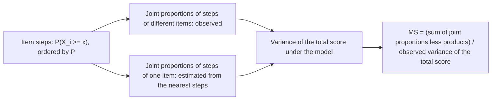

# Mokken scale analysis

`@measurekit/psychometrics/mokken` analyses a set of items with nonparametric item response theory, without a model of
the items' curves: it measures how well items scale together, selects items into scales, and checks the two
assumptions that make the total score a good measure. It suits questionnaires and attitude scales, and screens
achievement items for response curves that fall with ability. The coefficients and their standard errors, the
item selection, the monotonicity check, the invariant item ordering check and the reliability of the total score are
validated against the mokken package ([validation](validation.md)).

Items may be dichotomous or polytomous: scores are integers, and the lowest score of all items is taken as 0, so scores
from 1 to 5 work as scores from 0 to 4. Scores may span at most 10 categories, as in mokken. Every function uses the
persons who answered every item, and needs at least two of them. The functions take a `ResponseMatrix`.

| Function                                  | Result                                                                |
| ----------------------------------------- | --------------------------------------------------------------------- |
| `scalability(matrix)`                     | H, H_i and H_ij with standard errors                                  |
| `automatedItemSelection(matrix, options)` | Scales of items, and the items in none                                |
| `monotonicity(matrix, options)`           | Violations of monotone response curves, by item                       |
| `invariantItemOrdering(matrix, options)`  | Violations of the order of items, by item, the items removed, and H^T |
| `molenaarSijtsmaReliability(matrix)`      | The reliability of the total score, MS                                |

## Scalability

Items scale together when persons who pass a harder item pass the easier ones. For two items, the number of Guttman
errors is the number of persons who fail the easier item and pass the harder. H_ij = Cov(X_i, X_j) / Cov_max(X_i, X_j),
with Cov_max the largest covariance that the items' score distributions allow, that of the two columns of scores each
sorted. H_i and H are ratios of sums: of the covariances of an item with the others, and of all pairs, over the
corresponding maxima. A perfect Guttman scale has H = 1, independent items 0. By Mokken's rule of thumb, a scale is weak
from 0.3, medium from 0.4 and strong from 0.5.

Standard errors come from the delta method over the numbers of persons with each response pattern (Kuijpers, van der Ark
and Croon, 2013).

```ts
import { createRandom, responseMatrix } from "@measurekit/psychometrics";
import { twoParameterLogistic } from "@measurekit/psychometrics/irt";
import { scalability } from "@measurekit/psychometrics/mokken";
import { simulateItems, simulateResponses, simulateThetas } from "@measurekit/psychometrics/sim";

// 8 items of a 2PL simulation for 400 persons, and a ninth, the reverse of item 5: passed by those who fail it.
const random = createRandom(11);
const items = simulateItems(twoParameterLogistic, 8, random);
const simulated = simulateResponses(items, simulateThetas(400, random), random);
const matrix = responseMatrix(
  simulated.responses.map((row) => [...row, 1 - (row[4] ?? 0)]),
  { itemIds: [...simulated.itemIds, "reversed"] },
);

const result = scalability(matrix);
const round = (value: number | null) => (value === null ? null : Math.round(value * 1000) / 1000);
[round(result.scale.coefficient), round(result.scale.standardError)]; // [0.076, 0.018]
result.items.map(({ id, coefficient }) => [id, round(coefficient)]);
// [["item1", 0.074], ["item2", 0.173], ["item3", 0.108], ["item4", 0.175], ["item5", 0.043], ["item6", 0.191],
//  ["item7", 0.145], ["item8", 0.153], ["reversed", -0.381]]
```

| Field         | Meaning                                                                |
| ------------- | ---------------------------------------------------------------------- |
| `scale`       | H and its standard error                                               |
| `items[i]`    | The id, H_i and its standard error, in the order of the matrix's items |
| `pairs[i][j]` | H_ij and its standard error; `null` on the diagonal                    |

An item without variance has no coefficient: its `coefficient` and `standardError` are `null`, so are those of its pairs,
and the other coefficients leave it out.

## Automated item selection

`automatedItemSelection(matrix, options)` divides items into scales one scale at a time (Sijtsma and Molenaar, 2002):

1. Among the items in no scale, take the pair with the largest H_ij among those significantly above 0: a one-sided z test
   of the correlation, with the level `alpha` divided by the number of pairs. If H_ij is below `lowerBound`, stop.
2. Add the item that makes the scale's H largest, among the items that have no negative H_ij with an item of the scale,
   an H_i with the scale of at least `lowerBound`, and a significant z test of H_i above 0. The level is divided by all the
   tests of the scale so far. Stop when that H is below `lowerBound`, or no item qualifies.
3. Start the next scale with the items left, until fewer than two remain or no pair qualifies.

| Option       | Default | Meaning                                                      |
| ------------ | ------- | ------------------------------------------------------------ |
| `lowerBound` | `0.3`   | The lowest H_i that an item may have in a scale, from 0 to 1 |
| `alpha`      | `0.05`  | The familywise level of the tests, above 0 and below 1       |

The result lists `scales`, each the ids of its items in the order of the matrix, in the order the scales were formed,
and the `unscalable` items, including those without variance. Raising `lowerBound` makes scales smaller and stronger.

```ts
import { createRandom, responseMatrix } from "@measurekit/psychometrics";
import { twoParameterLogistic } from "@measurekit/psychometrics/irt";
import { automatedItemSelection } from "@measurekit/psychometrics/mokken";
import { simulateItems, simulateResponses, simulateThetas } from "@measurekit/psychometrics/sim";

const random = createRandom(11);
const items = simulateItems(twoParameterLogistic, 8, random);
const simulated = simulateResponses(items, simulateThetas(400, random), random);
const matrix = responseMatrix(
  simulated.responses.map((row) => [...row, 1 - (row[4] ?? 0)]),
  { itemIds: [...simulated.itemIds, "reversed"] },
);

automatedItemSelection(matrix);
// { scales: [["item2", "item4", "item5", "item6"], ["item3", "item8"]], unscalable: ["item1", "item7", "reversed"] }
```

## Monotonicity

A scale of items that measure one thing has item response curves that do not fall: the probability of passing an item, or
of scoring at least each of its steps, does not decrease as the rest of the test is passed. `monotonicity(matrix, options)`
checks it with the rest score, the sum of the other items, for each item:

1. Persons are split into groups of similar rest scores of at least `minimumGroupSize` persons. Persons with one rest
   score are in one group, and the last group takes the persons left.
2. For each step of the item, the proportion of a group that scores at least the step is compared with that of every group
   of lower rest scores. A _comparison_ is active when the lower group's proportion is above 0 and the higher group's below
   1. A decrease of more than `minimumViolation` is a _violation_.
3. Each violation is tested with Molenaar and Sijtsma's z, one-sided at level `alpha`.

| Option             | Default                                                                             | Meaning                                           |
| ------------------ | ----------------------------------------------------------------------------------- | ------------------------------------------------- |
| `minimumViolation` | `0.03`                                                                              | The smallest decrease that counts as a violation  |
| `minimumGroupSize` | A tenth of the persons from 500, a fifth up to 499, a third up to 250; 50 below 150 | The fewest persons in a group; a positive integer |
| `alpha`            | `0.05`                                                                              | The level of the tests, above 0 and below 1       |

The persons must be at least `minimumGroupSize`, and `minimumGroupSize` at most half of them.

Each `ItemCheck` has:

| Field                   | Meaning                                                                                                                                        |
| ----------------------- | ---------------------------------------------------------------------------------------------------------------------------------------------- |
| `id`                    | The item id                                                                                                                                    |
| `activeComparisons`     | The comparisons where a violation could happen, over the item's steps                                                                          |
| `violations`            | The violations                                                                                                                                 |
| `maximumViolation`      | The largest decrease; 0 without violations                                                                                                     |
| `violationSum`          | The sum of the decreases                                                                                                                       |
| `maximumZ`              | The largest z of a violation; `null` without violations                                                                                        |
| `significantViolations` | The violations with z above the critical value: the quantile of the standard normal distribution for `alpha`, 1.6449 for 0.05 to four decimals |
| `criterion`             | Molenaar and Sijtsma's criterion, rounded down: 0 without violations, below 40 negligible, above 80 serious                                    |

The criterion is 50 (0.3 - H_i) + √#vi + 100 #vi / #ac + 100 maxvi + 10 √sum + 1000 sum / #ac + 5 zmax + 10 √#zsig +
100 #zsig / #ac, with the counts of the item. By the guideline of Molenaar and Sijtsma, an item above 80 violates the assumption seriously and one from 40 to 80 is to
be inspected.

```ts
import { createRandom, responseMatrix } from "@measurekit/psychometrics";
import { twoParameterLogistic } from "@measurekit/psychometrics/irt";
import { monotonicity } from "@measurekit/psychometrics/mokken";
import { simulateItems, simulateResponses, simulateThetas } from "@measurekit/psychometrics/sim";

const random = createRandom(11);
const items = simulateItems(twoParameterLogistic, 8, random);
const simulated = simulateResponses(items, simulateThetas(400, random), random);
const matrix = responseMatrix(
  simulated.responses.map((row) => [...row, 1 - (row[4] ?? 0)]),
  { itemIds: [...simulated.itemIds, "reversed"] },
);

const round = (value: number | null) => (value === null ? null : Math.round(value * 1000) / 1000);
monotonicity(matrix)
  .filter(({ violations }) => violations > 0)
  .map((check) => [
    check.id,
    check.violations,
    round(check.maximumViolation),
    round(check.maximumZ),
    check.significantViolations,
    check.criterion,
  ]);
// [["item5", 1, 0.077, 1.138, 0, 59], ["reversed", 3, 0.444, 9.744, 3, 651]], after rounding
```

## Invariant item ordering

Items have an invariant ordering when they are in the same order of difficulty for every person, which lets the items'
order carry over to every group of persons. `invariantItemOrdering(matrix, options)` checks the manifest version:

1. Items are put in the order of their means, the highest first; ties put the later item first.
2. For each pair, persons are split into groups of similar rest scores, the rest score being the sum of the other items,
   as in the monotonicity check. A group in which the harder item has the higher mean, by more than `minimumViolation`,
   is a violation.
3. A violation is tested one-sided at level `alpha`: for dichotomous items with the Freeman-Tukey transformation of the
   numbers of persons who pass only one item, for the others with a paired t test. A group in which every person scores
   the same amount higher on the harder item has no t statistic; it counts as significant.
4. With `selection`, the item with significant violations against most other items is removed, the one that leaves the
   larger H among those that tie, and the counts are made again without it, until no violation is significant.

The options are those of the monotonicity check, with another default of the minimum violation, and `selection`:

| Option             | Default                        | Meaning                                                         |
| ------------------ | ------------------------------ | --------------------------------------------------------------- |
| `minimumViolation` | `0.03` times the highest score | The smallest difference of two items' means that is a violation |
| `minimumGroupSize` | As in the monotonicity check   | A positive integer of at least 2                                |
| `alpha`            | `0.05`                         | The level of the tests                                          |
| `selection`        | `true`                         | Whether to remove items until none violates the order           |

The result has an `ItemCheck` for each item, with the counts of all its pairs: `activeComparisons` is the sum over its pairs of
the groups less 1, `violations` the groups in violation, `maximumViolation` the largest difference of means, `maximumZ`
the largest z or t, and `significantViolations` the groups with a significant violation. Its criterion is that of the
monotonicity check, over the counts of all its pairs. `removed` lists the ids removed, in order, and `coefficient` is H^T of the
items that remain: the scalability of the persons over the items, which is high when persons' response profiles agree
about the order of the items; `null` when fewer than two items remain. The check needs at least three items.

```ts
import { createRandom, responseMatrix } from "@measurekit/psychometrics";
import { twoParameterLogistic } from "@measurekit/psychometrics/irt";
import { invariantItemOrdering } from "@measurekit/psychometrics/mokken";
import { simulateItems, simulateResponses, simulateThetas } from "@measurekit/psychometrics/sim";

const random = createRandom(11);
const items = simulateItems(twoParameterLogistic, 8, random);
const simulated = simulateResponses(items, simulateThetas(400, random), random);
const matrix = responseMatrix(
  simulated.responses.map((row) => [...row, 1 - (row[4] ?? 0)]),
  { itemIds: [...simulated.itemIds, "reversed"] },
);

const result = invariantItemOrdering(matrix);
result.removed; // ["reversed"]
Math.round((result.coefficient ?? 0) * 1000) / 1000; // 0.366
Math.round((invariantItemOrdering(matrix, { selection: false }).coefficient ?? 0) * 1000) / 1000; // 0.3
```

## Reliability

The total score of items that fit the model of double monotonicity has a reliability that coefficient alpha, a lower bound,
understates. `molenaarSijtsmaReliability(matrix)` returns the Molenaar-Sijtsma coefficient MS, the method that Sijtsma and
van der Ark (2017) name as the last step of a Mokken scale analysis.



Under local independence, the variance of the true score is the sum over all pairs of item steps of P(pass both) - P(pass
one) P(pass the other), the pairs of steps of one item included; the reliability is that variance over the variance of the
total score. The pairs of steps of one item are never observed together, so the method estimates each from the pairs of that step with the steps next to it
in the order of the proportions, which double monotonicity fixes for every person, and bounds it by the product of the two
proportions and the smaller of them. Steps that every person or no person passes drop out.

```ts
import { createRandom, responseMatrix } from "@measurekit/psychometrics";
import { cronbachAlpha } from "@measurekit/psychometrics/ctt";
import { twoParameterLogistic } from "@measurekit/psychometrics/irt";
import { molenaarSijtsmaReliability } from "@measurekit/psychometrics/mokken";
import { simulateItems, simulateResponses, simulateThetas } from "@measurekit/psychometrics/sim";

// The 8 items of the simulation above, without the reversed item.
const random = createRandom(11);
const items = simulateItems(twoParameterLogistic, 8, random);
const simulated = simulateResponses(items, simulateThetas(400, random), random);
const matrix = responseMatrix(simulated.responses, { itemIds: simulated.itemIds });

Math.round(molenaarSijtsmaReliability(matrix) * 1000) / 1000; // 0.541
Math.round(cronbachAlpha(matrix) * 1000) / 1000; // 0.531
```

MS is not limited to 1 and is meant for items that fit the model: check [monotonicity](#monotonicity) first. On 20 seeded
data sets of the graded response model with one slope, which has double monotonicity, MS averages 0.737 against 0.751 for
the correlation of two parallel forms, and alpha 0.733 ([validation](validation.md)).

| Situation                              | Result                                      |
| -------------------------------------- | ------------------------------------------- |
| Total scores without variance          | Throws                                      |
| Fewer than two items or complete cases | Throws, as every function of the module     |
| An item without variance               | Its steps drop out; the other items give MS |

## Not included

- **The genetic algorithm of the automated item selection.** Outside the sources: an option of `mokken::aisp`
  (`search`), off by default.
- **The extended search of the automated item selection.** Outside the sources: an option of `mokken::aisp`, off by
  default.
- **The Wald-based test of the item selection (`type.z`).** Outside the sources: an option of `mokken::aisp`, off by
  default.
- **The range-preserving test of the item selection (`type.z`).** Outside the sources: an option of `mokken::aisp`, off
  by default.
- **The test of H_i against the lower bound (`test.Hi`).** Outside the sources: an option of `mokken::aisp`, off by
  default.
- **The coefficient λ₂ of `check.reliability`.** Outside the sources: Sijtsma and van der Ark (2017) name the
  Molenaar-Sijtsma coefficient as a step, and it is built.
- **The coefficient LCRC of `check.reliability`.** Outside the sources: Sijtsma and van der Ark (2017) name the
  Molenaar-Sijtsma coefficient as a step, and it is built; LCRC needs a latent class model.
- **`check.pmatrix`.** Outside the sources: `monotonicity` covers the checks of the curves.
- **`check.restscore`.** Outside the sources: `monotonicity` covers the checks of the curves.
- **Invariant item ordering by item steps (`IT`).** Outside the sources: the method of manifest invariant item ordering
  (MIIO) is the practice, and is built.
- **Invariant item ordering by the scale-level conditional proportions (`MSCPM`).** Outside the sources: the method of
  manifest invariant item ordering (MIIO) is the practice, and is built.
- **Clustered items with a fixed item order.** Outside the sources: the method of manifest invariant item ordering
  (MIIO) is the practice, and is built.
- **Two-level scalability for clustered persons, such as raters.** Outside the sources: a multilevel option of mokken
  (`MLcoefH`).
- **The imputation of missing responses.** Outside the sources: an option of mokken, beside the pairwise treatment that
  is built.

## Differences from the references

| Topic                                   | This package                                                                 | mokken                                                                                                                                                                                                                                         |
| --------------------------------------- | ---------------------------------------------------------------------------- | ---------------------------------------------------------------------------------------------------------------------------------------------------------------------------------------------------------------------------------------------- |
| Missing responses                       | The persons who answered every item are used                                 | Stops at a missing response; the references run on the complete cases                                                                                                                                                                          |
| Items without variance                  | `null` coefficients; unscalable; left out of the other coefficients          | `coefH` and `aisp` stop                                                                                                                                                                                                                        |
| Lower bound above every H_ij            | All items unscalable                                                         | `aisp` stops                                                                                                                                                                                                                                   |
| Critical z of the monotonicity check    | The quantile of the standard normal distribution for `alpha`                 | The constant 1.6449; the check has no level                                                                                                                                                                                                    |
| H_i in the criterion of the order check | Not rounded                                                                  | Rounded to three decimals by `summary`, which can change the criterion by 1                                                                                                                                                                    |
| z of an item without violations         | `null`                                                                       | 0                                                                                                                                                                                                                                              |
| Ties in the item selection of the order | The candidate that leaves the larger H, else the first in the order of means | The larger H plus random noise of SD 1e-5                                                                                                                                                                                                      |
| Groups with equal paired differences    | Significant, without a statistic                                             | `t.test` stops                                                                                                                                                                                                                                 |
| Order of the results                    | The order of the matrix's items                                              | `check.iio` lists items from the highest mean to the lowest                                                                                                                                                                                    |
| Item steps passed by equal numbers      | Tied exactly, by their counts                                                | Tied when the proportions from `mean()` agree to the last bit, which depends on the order of the persons; the references run mokken's own code with exact proportions, and differ from `check.reliability` by up to 0.021 where it splits ties |
