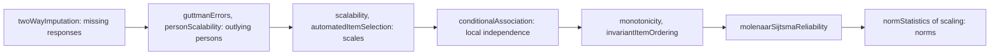
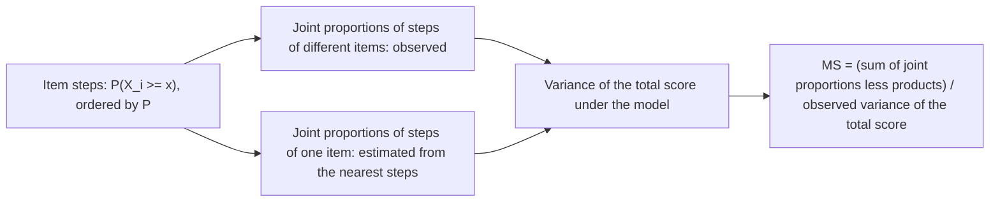

# Mokken scale analysis

`@measurekit/psychometrics/mokken` analyses a set of items with nonparametric item response theory, without a model of
the items' curves: it imputes missing responses, finds persons whose responses contradict the order of the items, measures how well items scale
together, selects items into scales, checks the local independence of the items and the two assumptions that make the
total score a good measure. It suits questionnaires and attitude scales, and screens achievement items for response
curves that fall with ability. The imputation, the Guttman errors, the coefficients and their standard errors, the item selection, the
conditional association, the monotonicity check, the invariant item ordering check and the reliability of the total
score are validated against the mokken package, and the person fit indices against PerFit ([validation](validation.md)).



The steps follow Sijtsma and van der Ark's (2017) ten, whose ninth, norms of the total score, is
[`normStatistics`](scaling.md#norms) of the scaling module.

Items may be dichotomous or polytomous: scores are integers, and the lowest score of all items is taken as 0, so scores
from 1 to 5 work as scores from 0 to 4. Scores may span at most 10 categories, as in mokken. Every function but
`personScalability` uses the persons who answered every item, and needs at least two of them. The functions take a
`ResponseMatrix`. Every function but `twoWayImputation` and `personScalability` compares every pair of items, so it takes
at most 1,000 items, the limit of the analyses of pairs of items in [dimensionality](dimensionality.md#correlations):
at that limit the coefficients of `scalability` and the indices of `conditionalAssociation` hold a million entries, up
to about 150 MB ([peak memory](../performance.md#peak-memory)). Their time grows with the pairs times the persons, and
that of `conditionalAssociation`, whose W1 conditions every pair on a third item, with the cube of the items times the
persons, 14 s for 1,000 items of 8 persons: on matrices from users, run them in a worker with a deadline.

| Function                                    | Result                                                                |
| ------------------------------------------- | --------------------------------------------------------------------- |
| `twoWayImputation(matrix, random, options)` | A copy of the matrix with each missing response imputed               |
| `guttmanErrors(matrix)`                     | G+ of each person, Tukey's upper fence, and the persons above it      |
| `personScalability(matrix)`                 | Normed G, U3 and Ht of each person, for 0/1 items                     |
| `scalability(matrix)`                       | H, H_i and H_ij with standard errors                                  |
| `automatedItemSelection(matrix, options)`   | Scales of items, and the items in none                                |
| `conditionalAssociation(matrix, options)`   | The indices W1, W2 and W3, and the items and pairs they flag          |
| `monotonicity(matrix, options)`             | Violations of monotone response curves, by item                       |
| `invariantItemOrdering(matrix, options)`    | Violations of the order of items, by item, the items removed, and H^T |
| `molenaarSijtsmaReliability(matrix)`        | The reliability of the total score, MS                                |

## Missing responses

Every other function of the module uses the persons who answered every item. `twoWayImputation(matrix, random,
options)` fills the missing responses instead, step 2 of the analysis, by van Ginkel, van der Ark and Sijtsma's two-way
imputation with a random error, as mokken's `twoway`:

1. A missing response of person i to item j takes TW = PM_i + IM_j - OM, the person's mean response plus the item's
   less the mean of all observed responses.
2. A normal error is added, of variance the sample variance of the observed responses less their TW.
3. The value is rounded, a half to the even integer as R's `round`, and kept from `minimum` to `maximum`.

| Option    | Default                            | Meaning                                                                                 |
| --------- | ---------------------------------- | --------------------------------------------------------------------------------------- |
| `minimum` | The lowest response of the matrix  | The lowest imputed score, an integer at most the lowest response                        |
| `maximum` | The highest response of the matrix | The highest imputed score, an integer at least the highest response and at most 2³¹ - 1 |

```ts
import { buildResponseMatrix, createRandom } from "@measurekit/psychometrics";
import { twoWayImputation } from "@measurekit/psychometrics/mokken";

const matrix = buildResponseMatrix([
  [3, 4, null, 4],
  [1, 2, 1, null],
  [2, 3, 2, 3],
  [null, 1, 0, 1],
]);
twoWayImputation(matrix, createRandom(1)).responses; // [[3, 4, 3, 4], [1, 2, 1, 2], [2, 3, 2, 3], [1, 1, 0, 1]]
twoWayImputation(matrix, createRandom(2)).responses[3]; // [0, 1, 0, 1]: another draw of the error
```

The result is a new matrix with the same ids and times; a matrix without missing responses comes back as a copy. Each
call draws one completion: for multiple imputation, impute several times with one generator and run the analysis on
each. A person or an item without any response throws `DataError`.

## Guttman errors

A person whose responses contradict the order of the items, passing hard steps and failing easy ones, may have answered
carelessly or misread the questions. `guttmanErrors(matrix)` counts each person's Guttman errors and marks the outliers,
step 3 of the analysis of Sijtsma and van der Ark (2017):

1. Each item has a step for every score above the lowest, which a person passes by scoring at least that high. The steps
   of all items are ordered by how many persons pass them, the most first.
2. A person's G+ counts the pairs of a step passed and a step failed that comes before it. On dichotomous items it is G,
   the pairs of an easier item failed and a harder one passed.
3. Steps that as many persons pass take every order with equal weight, so that such a pair counts 1/2.
4. A person whose G+ is above Tukey's upper fence, Q3 + 1.5 (Q3 - Q1), is an outlier.

| Field        | Meaning                                                                               |
| ------------ | ------------------------------------------------------------------------------------- |
| `errors`     | G+ of each person, in the matrix's order; `null` for a person with a missing response |
| `upperFence` | Q3 + 1.5 IQR of G+, with quartiles by linear interpolation, R's default               |
| `outliers`   | The indices of the persons above the fence                                            |

```ts
import { buildResponseMatrix, createRandom } from "@measurekit/psychometrics";
import { twoParameterLogistic } from "@measurekit/psychometrics/irt";
import { guttmanErrors } from "@measurekit/psychometrics/mokken";
import { simulateItems, simulateResponses, simulateThetas } from "@measurekit/psychometrics/sim";

// The 8 items of the 2PL simulation of the sections below, for 400 persons.
const random = createRandom(11);
const items = simulateItems(twoParameterLogistic, 8, random);
const simulated = simulateResponses(items, simulateThetas(400, random), random);
const matrix = buildResponseMatrix(simulated.responses, { itemIds: simulated.itemIds });

const { errors, upperFence, outliers } = guttmanErrors(matrix);
errors.slice(0, 8); // [1, 3, 5, 0, 2, 0, 0, 4]
upperFence; // 10
outliers; // [217]: one person with more than 10 errors
```

The order of the steps and the fence come from the persons who answered every item: a person with fewer responses has
fewer steps to err on, and has no count. The tutorial inspects the outliers' responses and repeats the analysis without
them, to see whether its conclusions change.

## Person fit

`personScalability(matrix)` gives three nonparametric person fit indices of 0/1 items, as PerFit's `Gnormed`, `U3` and
`Ht`: the Guttman structure of the items, and H of the transposed matrix. Of the 36 statistics Karabatsos (2003)
compared, Ht detected aberrant patterns best.

| Field                 | Definition, over the person's n answered items and NC correct                                                           | Range                                     |
| --------------------- | ----------------------------------------------------------------------------------------------------------------------- | ----------------------------------------- |
| `normedGuttmanErrors` | G / (NC (n - NC)): G counts the pairs of an item failed and a harder one passed, a half for a pair of equal proportions | 0, a Guttman pattern, to 1, its reverse   |
| `u3`                  | (Σ_(first NC) λ - Σ x λ) / (Σ_(first NC) λ - Σ_(last NC) λ), λ = ln(p / (1 - p)) of the items, ordered from the largest | 0 to 1, as G                              |
| `ht`                  | Cov(x_n, Σ_(m ≠ n) x_m) over the items, against Σ_(m ≠ n) min(p_n, p_m) - p_n p_m, p the persons' proportions correct   | At most 1; low or negative flags a misfit |

Items are ordered by their proportions correct over the persons who answered them, PerFit's `"Pairwise"`, and each
person's indices use the items the person answered; Ht's other persons are those of a score between the extremes. An
item that every person who answered it passed, or failed, has λ = 0, as in PerFit. A person of an extreme score, every
answered item wrong or right, has none of the three, and Ht has none without another such person. On complete data G
is `guttmanErrors`' G+ over its largest value.

```ts continues
import { personScalability } from "@measurekit/psychometrics/mokken";

const fit = personScalability(matrix);
fit[0]; // { id: "person1", normedGuttmanErrors: 0.067, u3: 0.025, ht: 0.53 }
fit[217]; // { id: "person218", normedGuttmanErrors: 0.75, u3: 0.66, ht: -0.19 }: the outlier above
```

The parametric lz and lz*, which need calibrated items, are in [fit](fit.md#lz).

## Scalability

Items scale together when persons who pass a harder item pass the easier ones. For two items, the number of Guttman
errors is the number of persons who fail the easier item and pass the harder. H_ij = Cov(X_i, X_j) / Cov_max(X_i, X_j),
with Cov_max the largest covariance that the items' score distributions allow, that of the two columns of scores each
sorted. H_i and H are ratios of sums: of the covariances of an item with the others, and of all pairs, over the
corresponding maxima. A perfect Guttman scale has H = 1, independent items 0. By Mokken's rule of thumb, a scale is weak
from 0.3, medium from 0.4 and strong from 0.5.

Standard errors come from the delta method over the numbers of persons with each response pattern (Kuijpers, van der Ark
and Croon, 2013).

```ts
import { buildResponseMatrix, createRandom } from "@measurekit/psychometrics";
import { twoParameterLogistic } from "@measurekit/psychometrics/irt";
import { scalability } from "@measurekit/psychometrics/mokken";
import { simulateItems, simulateResponses, simulateThetas } from "@measurekit/psychometrics/sim";

// 8 items of a 2PL simulation for 400 persons, and a ninth, the reverse of item 5: passed by those who fail it.
const random = createRandom(11);
const items = simulateItems(twoParameterLogistic, 8, random);
const simulated = simulateResponses(items, simulateThetas(400, random), random);
const matrix = buildResponseMatrix(
  simulated.responses.map((row) => [...row, 1 - (row[4] ?? 0)]),
  { itemIds: [...simulated.itemIds, "reversed"] },
);

const result = scalability(matrix);
const round = (value: number | null) => (value === null ? null : Math.round(value * 1000) / 1000);
[round(result.scale.coefficient), round(result.scale.standardError)]; // [0.076, 0.018]
result.items.map(({ id, coefficient }) => [id, round(coefficient)]);
// [["item1", 0.074], ["item2", 0.173], ["item3", 0.108], ["item4", 0.175], ["item5", 0.043], ["item6", 0.191],
//  ["item7", 0.145], ["item8", 0.153], ["reversed", -0.381]]
```

| Field         | Meaning                                                                |
| ------------- | ---------------------------------------------------------------------- |
| `scale`       | H and its standard error                                               |
| `items[i]`    | The id, H_i and its standard error, in the order of the matrix's items |
| `pairs[i][j]` | H_ij and its standard error; `null` on the diagonal                    |

An item without variance has no coefficient: its `coefficient` and `standardError` are `null`, so are those of its pairs,
and the other coefficients leave it out.

## Automated item selection

`automatedItemSelection(matrix, options)` divides items into scales one scale at a time (Sijtsma and Molenaar, 2002):

1. Among the items in no scale, take the pair with the largest H_ij among those significantly above 0: a one-sided z test
   of the correlation, with the level `alpha` divided by the number of pairs. If H_ij is below `lowerBound`, stop.
2. Add the item that makes the scale's H largest, among the items that have no negative H_ij with an item of the scale,
   an H_i with the scale of at least `lowerBound`, and a significant z test of H_i above 0. The level is divided by all the
   tests of the scale so far. Stop when that H is below `lowerBound`, or no item qualifies.
3. Start the next scale with the items left, until fewer than two remain or no pair qualifies.

| Option       | Default | Meaning                                                      |
| ------------ | ------- | ------------------------------------------------------------ |
| `lowerBound` | `0.3`   | The lowest H_i that an item may have in a scale, from 0 to 1 |
| `alpha`      | `0.05`  | The familywise level of the tests, above 0 and below 1       |

The result lists `scales`, each the ids of its items in the order of the matrix, in the order the scales were formed,
and the `unscalable` items, including those without variance. Raising `lowerBound` makes scales smaller and stronger.

```ts
import { buildResponseMatrix, createRandom } from "@measurekit/psychometrics";
import { twoParameterLogistic } from "@measurekit/psychometrics/irt";
import { automatedItemSelection } from "@measurekit/psychometrics/mokken";
import { simulateItems, simulateResponses, simulateThetas } from "@measurekit/psychometrics/sim";

const random = createRandom(11);
const items = simulateItems(twoParameterLogistic, 8, random);
const simulated = simulateResponses(items, simulateThetas(400, random), random);
const matrix = buildResponseMatrix(
  simulated.responses.map((row) => [...row, 1 - (row[4] ?? 0)]),
  { itemIds: [...simulated.itemIds, "reversed"] },
);

automatedItemSelection(matrix);
// { scales: [["item2", "item4", "item5", "item6"], ["item3", "item8"]], unscalable: ["item1", "item7", "reversed"] }
```

## Conditional association

Items of one scale are associated positively within every group of persons who agree on the other items; a negative
association there points to local dependence, such as two items that ask the same thing or one that contradicts another.
`conditionalAssociation(matrix, options)` computes the three indices of Straat, van der Ark and Sijtsma (2016), step 5
of the analysis, as the first pass of mokken's `check.ca`.

| Index      | Sums over                                                                                   | High when                                                             |
| ---------- | ------------------------------------------------------------------------------------------- | --------------------------------------------------------------------- |
| `w1[a][c]` | The groups of persons with each score on item c, the covariances of a with every other item | a and c are positively locally dependent, or a runs against the scale |
| `w2[a]`    | The groups of the rest score of each pair of a and another item, their covariances          | a is negatively locally dependent on another                          |
| `w3[a][b]` | The groups of the rest score of a and b, their covariance                                   | a and b are negatively locally dependent                              |

A rest score is the sum of the items other than the pair, and its groups hold at least `minimumSize` persons, cut as in
the [monotonicity check](#monotonicity). A group's covariance enters as Φ(-z √(n - 3)), with z Fisher's transformation
of the two items' correlation in the group: 1/2 for no correlation, near 1 for a clearly negative one, near 0 for a
positive one, and 0 for a group below 4 persons or with an item that is constant in it. W2[a] is the sum of W3[a][b] over
b. An index flags each value above Q3 + 3 (Q3 - median) of all of its values.

| Option        | Default | Meaning                                                                                |
| ------------- | ------- | -------------------------------------------------------------------------------------- |
| `minimumSize` | `4`     | The fewest persons in a group of a rest score, mokken's `MINSIZE`; at most the persons |

| Field        | Meaning                                                                            |
| ------------ | ---------------------------------------------------------------------------------- |
| `items`      | The item ids, which index the rows and columns                                     |
| `w1`, `w3`   | By item, then item; `null` on the diagonal. W1's column is the item conditioned on |
| `w2`         | By item                                                                            |
| `flagged.w1` | The pairs [a, c] whose W1 is flagged                                               |
| `flagged.w2` | The items whose W2 is flagged                                                      |
| `flagged.w3` | The pairs [a, b], a before b in the matrix, whose W3 is flagged                    |

```ts
import { buildResponseMatrix, createRandom } from "@measurekit/psychometrics";
import { twoParameterLogistic } from "@measurekit/psychometrics/irt";
import { conditionalAssociation } from "@measurekit/psychometrics/mokken";
import { simulateItems, simulateResponses, simulateThetas } from "@measurekit/psychometrics/sim";

// The simulation of the sections above, with the reverse of item 5.
const random = createRandom(11);
const items = simulateItems(twoParameterLogistic, 8, random);
const simulated = simulateResponses(items, simulateThetas(400, random), random);
const matrix = buildResponseMatrix(
  simulated.responses.map((row) => [...row, 1 - (row[4] ?? 0)]),
  { itemIds: [...simulated.itemIds, "reversed"] },
);

const { flagged } = conditionalAssociation(matrix);
flagged.w1; // [["reversed", "item1"], ["reversed", "item2"], ..., ["reversed", "item8"]]: all but item 5
flagged.w2; // ["reversed"]
flagged.w3; // [["item5", "reversed"]]: the pair that contradicts itself
```

`check.ca` then removes the item with the most flags, the one with the lowest H_i among ties and a random one among
those, and runs again until nothing is flagged or fewer than four items remain: to do the same, drop that item from the
matrix and call the function again. W1 sums over every item, conditioning item and third item, so the time grows with
the cube of the items times the persons: 0.26 s for 40 items and 433 persons.

## Monotonicity

A scale of items that measure one thing has item response curves that do not fall: the probability of passing an item, or
of scoring at least each of its steps, does not decrease as the rest of the test is passed. `monotonicity(matrix, options)`
checks it with the rest score, the sum of the other items, for each item:

1. Persons are split into groups of similar rest scores of at least `minimumGroupSize` persons. Persons with one rest
   score are in one group, and the last group takes the persons left.
2. For each step of the item, the proportion of a group that scores at least the step is compared with that of every group
   of lower rest scores. A _comparison_ is active when the lower group's proportion is above 0 and the higher group's below
   1. A decrease of more than `minimumViolation` is a _violation_.
3. Each violation is tested with Molenaar and Sijtsma's z, one-sided at level `alpha`.

| Option             | Default                                                                             | Meaning                                           |
| ------------------ | ----------------------------------------------------------------------------------- | ------------------------------------------------- |
| `minimumViolation` | `0.03`                                                                              | The smallest decrease that counts as a violation  |
| `minimumGroupSize` | A tenth of the persons from 500, a fifth up to 499, a third up to 250; 50 below 150 | The fewest persons in a group; a positive integer |
| `alpha`            | `0.05`                                                                              | The level of the tests, above 0 and below 1       |

The persons must be at least `minimumGroupSize`, and `minimumGroupSize` at most half of them.

Each `ItemCheck` has:

| Field                   | Meaning                                                                                                                                        |
| ----------------------- | ---------------------------------------------------------------------------------------------------------------------------------------------- |
| `id`                    | The item id                                                                                                                                    |
| `activeComparisons`     | The comparisons where a violation could happen, over the item's steps                                                                          |
| `violations`            | The violations                                                                                                                                 |
| `maximumViolation`      | The largest decrease; 0 without violations                                                                                                     |
| `violationSum`          | The sum of the decreases                                                                                                                       |
| `maximumZ`              | The largest z of a violation; `null` without violations                                                                                        |
| `significantViolations` | The violations with z above the critical value: the quantile of the standard normal distribution for `alpha`, 1.6449 for 0.05 to four decimals |
| `criterion`             | Molenaar and Sijtsma's criterion, rounded down: 0 without violations, below 40 negligible, above 80 serious                                    |

The criterion is 50 (0.3 - H_i) + √#vi + 100 #vi / #ac + 100 maxvi + 10 √sum + 1000 sum / #ac + 5 zmax + 10 √#zsig +
100 #zsig / #ac, with the counts of the item. By the guideline of Molenaar and Sijtsma, an item above 80 violates the assumption seriously and one from 40 to 80 is to
be inspected.

```ts
import { buildResponseMatrix, createRandom } from "@measurekit/psychometrics";
import { twoParameterLogistic } from "@measurekit/psychometrics/irt";
import { monotonicity } from "@measurekit/psychometrics/mokken";
import { simulateItems, simulateResponses, simulateThetas } from "@measurekit/psychometrics/sim";

const random = createRandom(11);
const items = simulateItems(twoParameterLogistic, 8, random);
const simulated = simulateResponses(items, simulateThetas(400, random), random);
const matrix = buildResponseMatrix(
  simulated.responses.map((row) => [...row, 1 - (row[4] ?? 0)]),
  { itemIds: [...simulated.itemIds, "reversed"] },
);

const round = (value: number | null) => (value === null ? null : Math.round(value * 1000) / 1000);
monotonicity(matrix)
  .filter(({ violations }) => violations > 0)
  .map((check) => [
    check.id,
    check.violations,
    round(check.maximumViolation),
    round(check.maximumZ),
    check.significantViolations,
    check.criterion,
  ]);
// [["item5", 1, 0.077, 1.138, 0, 59], ["reversed", 3, 0.444, 9.744, 3, 651]], after rounding
```

## Invariant item ordering

Items have an invariant ordering when they are in the same order of difficulty for every person, which lets the items'
order carry over to every group of persons. `invariantItemOrdering(matrix, options)` checks the manifest version:

1. Items are put in the order of their means, the highest first; ties put the later item first.
2. For each pair, persons are split into groups of similar rest scores, the rest score being the sum of the other items,
   as in the monotonicity check. A group in which the harder item has the higher mean, by more than `minimumViolation`,
   is a violation.
3. A violation is tested one-sided at level `alpha`: for dichotomous items with the Freeman-Tukey transformation of the
   numbers of persons who pass only one item, for the others with a paired t test. A group in which every person scores
   the same amount higher on the harder item has no t statistic; it counts as significant.
4. With `selection`, the item with significant violations against most other items is removed, the one that leaves the
   larger H among those that tie, and the counts are made again without it, until no violation is significant.

The options are those of the monotonicity check, with another default of the minimum violation, and `selection`:

| Option             | Default                        | Meaning                                                         |
| ------------------ | ------------------------------ | --------------------------------------------------------------- |
| `minimumViolation` | `0.03` times the highest score | The smallest difference of two items' means that is a violation |
| `minimumGroupSize` | As in the monotonicity check   | A positive integer of at least 2                                |
| `alpha`            | `0.05`                         | The level of the tests                                          |
| `selection`        | `true`                         | Whether to remove items until none violates the order           |

The result has an `ItemCheck` for each item, with the counts of all its pairs: `activeComparisons` is the sum over its pairs of
the groups less 1, `violations` the groups in violation, `maximumViolation` the largest difference of means, `maximumZ`
the largest z or t, and `significantViolations` the groups with a significant violation. Its criterion is that of the
monotonicity check, over the counts of all its pairs. `removed` lists the ids removed, in order, and `coefficient` is H^T of the
items that remain: the scalability of the persons over the items, which is high when persons' response profiles agree
about the order of the items; `null` when fewer than two items remain. The check needs at least three items.

```ts
import { buildResponseMatrix, createRandom } from "@measurekit/psychometrics";
import { twoParameterLogistic } from "@measurekit/psychometrics/irt";
import { invariantItemOrdering } from "@measurekit/psychometrics/mokken";
import { simulateItems, simulateResponses, simulateThetas } from "@measurekit/psychometrics/sim";

const random = createRandom(11);
const items = simulateItems(twoParameterLogistic, 8, random);
const simulated = simulateResponses(items, simulateThetas(400, random), random);
const matrix = buildResponseMatrix(
  simulated.responses.map((row) => [...row, 1 - (row[4] ?? 0)]),
  { itemIds: [...simulated.itemIds, "reversed"] },
);

const result = invariantItemOrdering(matrix);
result.removed; // ["reversed"]
Math.round((result.coefficient ?? 0) * 1000) / 1000; // 0.366
Math.round((invariantItemOrdering(matrix, { selection: false }).coefficient ?? 0) * 1000) / 1000; // 0.3
```

## Reliability

The total score of items that fit the model of double monotonicity has a reliability that coefficient alpha, a lower bound,
understates. `molenaarSijtsmaReliability(matrix)` returns the Molenaar-Sijtsma coefficient MS, the method that Sijtsma and
van der Ark (2017) name as the last step of a Mokken scale analysis.



Under local independence, the variance of the true score is the sum over all pairs of item steps of P(pass both) - P(pass
one) P(pass the other), the pairs of steps of one item included; the reliability is that variance over the variance of the
total score. The pairs of steps of one item are never observed together, so the method estimates each from the pairs of that step with the steps next to it
in the order of the proportions, which double monotonicity fixes for every person, and bounds it by the product of the two
proportions and the smaller of them. Steps that every person or no person passes drop out. The method holds a matrix of
every pair of the steps left, so it takes at most 1,000 of them, as 111 items of 10 categories have.

```ts
import { buildResponseMatrix, createRandom } from "@measurekit/psychometrics";
import { cronbachAlpha } from "@measurekit/psychometrics/ctt";
import { twoParameterLogistic } from "@measurekit/psychometrics/irt";
import { molenaarSijtsmaReliability } from "@measurekit/psychometrics/mokken";
import { simulateItems, simulateResponses, simulateThetas } from "@measurekit/psychometrics/sim";

// The 8 items of the simulation above, without the reversed item.
const random = createRandom(11);
const items = simulateItems(twoParameterLogistic, 8, random);
const simulated = simulateResponses(items, simulateThetas(400, random), random);
const matrix = buildResponseMatrix(simulated.responses, { itemIds: simulated.itemIds });

Math.round(molenaarSijtsmaReliability(matrix) * 1000) / 1000; // 0.541
Math.round(cronbachAlpha(matrix) * 1000) / 1000; // 0.531
```

MS is not limited to 1 and is meant for items that fit the model: check [monotonicity](#monotonicity) first. On 20 seeded
data sets of the graded response model with one slope, which has double monotonicity, MS averages 0.737 against 0.751 for
the correlation of two parallel forms, and alpha 0.733 ([validation](validation.md)).

| Situation                              | Result                                      |
| -------------------------------------- | ------------------------------------------- |
| Total scores without variance          | Throws                                      |
| Fewer than two items or complete cases | Throws, as every function of the module     |
| An item without variance               | Its steps drop out; the other items give MS |

## Not included

- **The genetic algorithm of the automated item selection.** Outside the sources: an option of `mokken::aisp`
  (`search`), off by default.
- **The extended search of the automated item selection.** Outside the sources: an option of `mokken::aisp`, off by
  default.
- **The Wald-based test of the item selection (`type.z`).** Outside the sources: an option of `mokken::aisp`, off by
  default.
- **The range-preserving test of the item selection (`type.z`).** Outside the sources: an option of `mokken::aisp`, off
  by default.
- **The test of H_i against the lower bound (`test.Hi`).** Outside the sources: an option of `mokken::aisp`, off by
  default.
- **The coefficient λ₂ of `check.reliability`.** Outside the sources: Sijtsma and van der Ark (2017) name the
  Molenaar-Sijtsma coefficient as a step, and it is built.
- **The coefficient LCRC of `check.reliability`.** Outside the sources: Sijtsma and van der Ark (2017) name the
  Molenaar-Sijtsma coefficient as a step, and it is built; LCRC needs a latent class model.
- **`check.pmatrix`.** Outside the sources: `monotonicity` covers the checks of the curves.
- **`check.restscore`.** Outside the sources: `monotonicity` covers the checks of the curves.
- **Invariant item ordering by item steps (`IT`).** Outside the sources: the method of manifest invariant item ordering
  (MIIO) is the practice, and is built.
- **Invariant item ordering by the scale-level conditional proportions (`MSCPM`).** Outside the sources: the method of
  manifest invariant item ordering (MIIO) is the practice, and is built.
- **Clustered items with a fixed item order.** Outside the sources: the method of manifest invariant item ordering
  (MIIO) is the practice, and is built.
- **`check.bounds`.** Outside the sources: not a step of the tutorial of Sijtsma and van der Ark (2017).
- **The adjusted boxplot of G+.** Outside the sources: Tukey's fence is the tutorial's rule, which mentions the adjusted
  boxplot for skewed counts.
- **The O+ outlier score.** Outside the sources: the tutorial uses G+.
- **Polytomous U3 and normed G.** Outside the sources: variants of the dichotomous indices that `personScalability`
  builds.
- **ZU3, the standardized U3.** Outside the sources: a variant of the U3 that `personScalability` builds.
- **The caution index C, the modified caution index, NCI, A, D and E.** Outside the sources: beside G, U3 and Ht, which are the practice.
- **Two-level scalability for clustered persons, such as raters.** Outside the sources: a multilevel option of mokken
  (`MLcoefH`).

## Errors

Invalid input throws `DataError` naming the value found.

| Error                                                                                           | What to do                                                                                               |
| ----------------------------------------------------------------------------------------------- | -------------------------------------------------------------------------------------------------------- |
| Fewer than two items, or fewer than three for the item ordering and the conditional association | Give the items the method compares: two for the coefficients, three for the ordering and the association |
| More than 1,000 items                                                                           | Analyse a part of the items; a Mokken scale has far fewer                                                |
| More than 1,000 item steps for the reliability                                                  | Group the scores into fewer categories, or analyse fewer items                                           |
| Fewer than two persons answered every item                                                      | Keep the persons who answered every item, or the items they all answered                                 |
| The scores span more than 10 categories                                                         | Group the scores into at most 10 categories                                                              |
| The minimum group size is more than half of the persons                                         | Lower `minimumGroupSize`, or give more persons                                                           |
| `minimumSize` is above the persons who answered every item                                      | Lower `minimumSize`                                                                                      |
| The total scores have no variance, for the reliability                                          | The coefficient is undefined for persons who all score alike                                             |
| A response other than 0 and 1, for the person fit indices                                       | Dichotomize the items, or use `guttmanErrors`, whose G+ takes polytomous items                           |

## Differences from the references

| Topic                                   | This package                                                                   | mokken                                                                                                                                                                                                                                         |
| --------------------------------------- | ------------------------------------------------------------------------------ | ---------------------------------------------------------------------------------------------------------------------------------------------------------------------------------------------------------------------------------------------- |
| Missing responses                       | The persons who answered every item are used, or `twoWayImputation` fills them | Stops at a missing response; the references run on the complete cases                                                                                                                                                                          |
| Items without variance                  | `null` coefficients; unscalable; left out of the other coefficients            | `coefH` and `aisp` stop                                                                                                                                                                                                                        |
| Lower bound above every H_ij            | All items unscalable                                                           | `aisp` stops                                                                                                                                                                                                                                   |
| Critical z of the monotonicity check    | The quantile of the standard normal distribution for `alpha`                   | The constant 1.6449; the check has no level                                                                                                                                                                                                    |
| H_i in the criterion of the order check | Not rounded                                                                    | Rounded to three decimals by `summary`, which can change the criterion by 1                                                                                                                                                                    |
| z of an item without violations         | `null`                                                                         | 0                                                                                                                                                                                                                                              |
| Ties in the item selection of the order | The candidate that leaves the larger H, else the first in the order of means   | The larger H plus random noise of SD 1e-5                                                                                                                                                                                                      |
| Groups with equal paired differences    | Significant, without a statistic                                               | `t.test` stops                                                                                                                                                                                                                                 |
| Order of the results                    | The order of the matrix's items                                                | `check.iio` lists items from the highest mean to the lowest                                                                                                                                                                                    |
| Item steps passed by equal numbers      | Tied exactly, by their counts                                                  | Tied when the proportions from `mean()` agree to the last bit, which depends on the order of the persons; the references run mokken's own code with exact proportions, and differ from `check.reliability` by up to 0.021 where it splits ties |
| Error of the two-way imputation         | Normal, of the residuals' variance                                             | `twoway` passes the variance to `rnorm` as the standard deviation                                                                                                                                                                              |
| A matrix without missing responses      | A copy                                                                         | `twoway` warns and returns it                                                                                                                                                                                                                  |
| A person or an item without responses   | Throws                                                                         | `twoway` stops                                                                                                                                                                                                                                 |
| G+ of tied item steps                   | The mean over the orders of the tied steps, a multiple of 1/2                  | `check.errors` takes the mean over 1,000 random orders, rounded to an integer: up to 1/2 away                                                                                                                                                  |
| The steps of `check.ca`                 | One pass; the caller removes an item and calls again                           | Removes items until nothing is flagged, breaking the last ties at random                                                                                                                                                                       |
| Conditional association of three items  | Computed: each pair's rest score is the third item                             | `check.ca` stops, as `apply` needs at least two rest items                                                                                                                                                                                     |

| Topic                                  | This package                                                         | PerFit                                                                                                                        |
| -------------------------------------- | -------------------------------------------------------------------- | ----------------------------------------------------------------------------------------------------------------------------- |
| Rounding                               | None                                                                 | `Gnormed`, `U3` and `Ht` round to 4 decimals                                                                                  |
| Normed G of items of equal proportions | The mean over their orders, a half for each pair, as `guttmanErrors` | `Gnormed` orders them by their columns                                                                                        |
| Normed G of an extreme score           | None                                                                 | 0                                                                                                                             |
| U3 with missing responses              | Over the person's answered items                                     | Takes the sorted log-odds at the positions of the person's answered columns, so its value changes with the order of the items |
