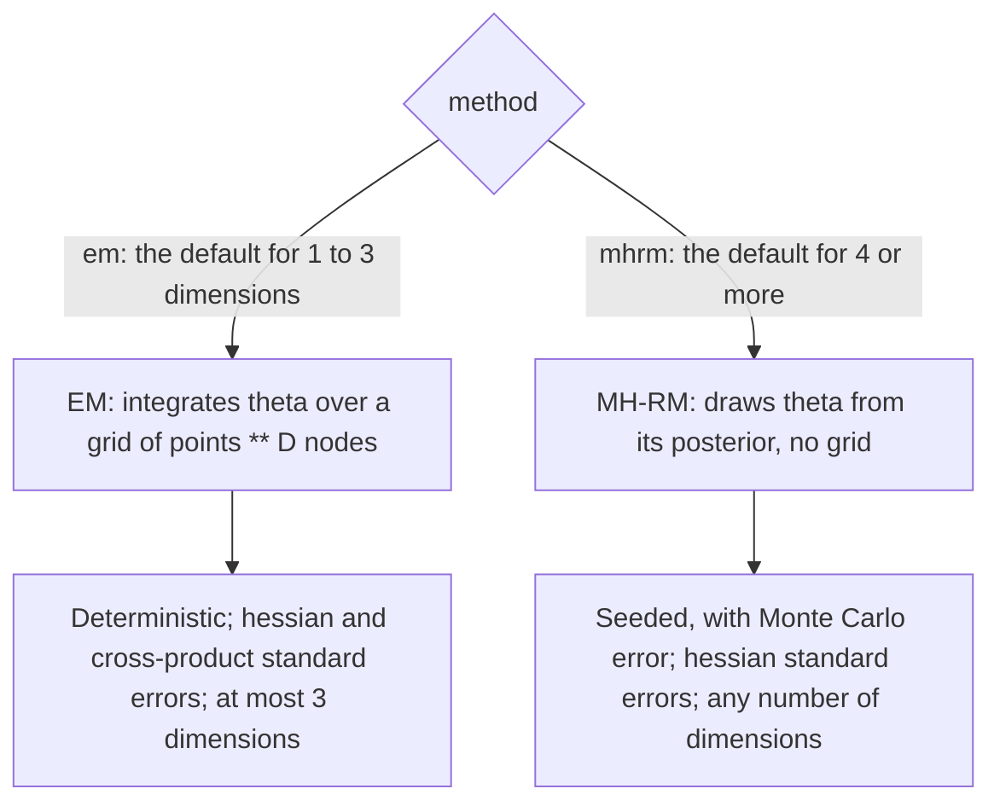
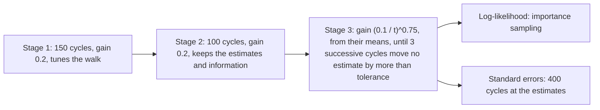

# Multidimensional item response theory

`@measurekit/psychometrics/multidimensional` models a person by a vector of thetas, one per dimension, and an item by a
slope on each dimension: a high theta on one dimension makes up for a low one on another (compensatory models). It
calibrates items and the correlations between dimensions by marginal maximum likelihood, exploratory and confirmatory,
with EM for up to three dimensions and with MH-RM for any number; computes standard errors; rotates exploratory
solutions; estimates thetas by EAP and MAP in any number of dimensions; and computes information matrices. Every estimate is validated against
mirt, GPArotation and base R ([validation](validation.md)). The dimensions have mean 0 and variance 1.

```ts
import { createRandom } from "@measurekit/psychometrics";
import {
  calibrateMultidimensional,
  multidimensionalPosteriorModeEstimate,
  multidimensionalTwoParameterLogistic,
} from "@measurekit/psychometrics/multidimensional";
import { simulateMultidimensionalResponses } from "@measurekit/psychometrics/sim";

// Eight items, four on each of two correlated dimensions; 1,000 persons.
const random = createRandom(11);
const items = Array.from({ length: 8 }, (_, i) => ({
  model: multidimensionalTwoParameterLogistic,
  parameters: { a: [i < 4 ? 1.2 : 0, i < 4 ? 0 : 1.4], intercept: (i % 4) - 1.5, c: 0, d: 1 },
}));
const thetas = Array.from({ length: 1000 }, () => {
  const [z1, z2] = [random.normal(), random.normal()];
  return [z1, 0.5 * z1 + Math.sqrt(0.75) * z2];
});
const matrix = simulateMultidimensionalResponses(items, thetas, random);

// Confirmatory: the dimensions of each item by id.
const loadings = Object.fromEntries(matrix.itemIds.map((id, i) => [id, [i < 4 ? "verbal" : "quantitative"]]));
const fit = calibrateMultidimensional(matrix, {
  model: multidimensionalTwoParameterLogistic,
  loadings,
  standardErrors: "hessian",
});
fit.dimensions; // ["verbal", "quantitative"]
fit.items[0]?.parameters; // { a: [1.17, 0], intercept: -1.34, c: 0, d: 1 }
fit.items[0]?.standardErrors; // { a1: 0.18, intercept: 0.12 }
fit.correlations; // [[1, 0.46], [0.46, 1]]
fit.converged; // true

// A person's thetas, with the calibration's correlations as the prior.
const prior = { mean: [0, 0], covariance: fit.correlations };
multidimensionalPosteriorModeEstimate(fit.items, [1, 1, 0, 1, null, 1, 1, 0], { prior }).theta; // [0.61, 0.32]
```

## Models

Items have K ordered categories scored 0 to K - 1. With the slopes `a` and the thetas θ of a person, z = a · θ. The
parameters follow mirt's slope-intercept form, `coef(model, IRTpars = FALSE)`, with D = 1 ([interop](interop.md)
converts them); the intercept is mirt's `d`, named in full because `d` is the upper asymptote of the IRT form.

| Model                                    | Parameters                                 | P(X = 1) or P(X ≥ k)                                                 | mirt item type |
| ---------------------------------------- | ------------------------------------------ | -------------------------------------------------------------------- | -------------- |
| `multidimensionalTwoParameterLogistic`   | `{ a, intercept, c, d }` with c = 0, d = 1 | 1 / (1 + exp(-(z + intercept)))                                      | `2PL`          |
| `multidimensionalThreeParameterLogistic` | `{ a, intercept, c, d }` with d = 1        | c + (1 - c) / (1 + exp(-(z + intercept)))                            | `3PL`          |
| `multidimensionalGradedResponse`         | `{ a, intercepts: [d1, ..., d(K-1)] }`     | P(X ≥ k) = 1 / (1 + exp(-(z + d_k))), P(k) = P(X ≥ k) - P(X ≥ k + 1) | `graded`       |

Valid input: the slopes are finite numbers of any sign, one or more; the intercepts are finite; `c` is from 0 to below
1 and `d` is 1; the graded intercepts strictly decrease; thetas are finite. All items of a test have the same number of
dimensions, and the slopes of a dimension an item does not load on are 0.

The multidimensional discrimination of an item is MDISC = √(Σ a_d²), and its multidimensional difficulty, for a
dichotomous item, MDIFF = -intercept / MDISC.

A model implemented outside the package works as the built-in ones do if it has the members of
`MultidimensionalModel`. The first `dimensions` entries of its parameter vector are the slopes, `parameterDerivatives`
differentiates with respect to the vector, and `information` writes the Fisher information matrix.

## Calibration



|                      | EM                                                   | MH-RM                                                                               |
| -------------------- | ---------------------------------------------------- | ----------------------------------------------------------------------------------- |
| Dimensions           | 1 to 3                                               | Any number; the default above 3                                                     |
| Integration of theta | Quadrature on a grid of `points` nodes per dimension | Metropolis-Hastings draws, no grid                                                  |
| Result               | Deterministic, exact to `tolerance`                  | Seeded, within a Monte Carlo error                                                  |
| Standard errors      | `"hessian"` and `"cross-product"`                    | `"hessian"`                                                                         |
| Log-likelihood       | Exact on the grid                                    | Importance sampling                                                                 |
| Time                 | Grows with the responses times `points ** D`         | Grows with the persons, responses and parameters; slower than EM below 4 dimensions |

`calibrateMultidimensional(data, options)` takes a response matrix or response records, and a model, one for all items
or one per item. Missing responses are skipped, and persons without responses change nothing.

| Option           | Default                                   | Meaning                                                                                                    |
| ---------------- | ----------------------------------------- | ---------------------------------------------------------------------------------------------------------- |
| `model`          | required                                  | One model, or one per item in item order                                                                   |
| `method`         | `"em"` up to 3 dimensions, `"mhrm"` above | `"em"` or `"mhrm"`                                                                                         |
| `dimensions`     | none; one of `dimensions` and `loadings`  | Exploratory: the number of dimensions, a positive integer, at most 3 for EM; every item loads on each      |
| `loadings`       | none; one of `dimensions` and `loadings`  | Confirmatory: the names of the dimensions of each item, by item id, of every item                          |
| `correlated`     | `true`                                    | Confirmatory: estimate the correlations; variances are 1 and means 0. Ignored when exploratory             |
| `priors`         | none                                      | Priors by parameter name: `"a"` for every slope, `"intercept"` and `"c"`; estimates are posterior modes    |
| `points`         | `61`, `31`, `15` for 1, 2, 3 dimensions   | EM only: nodes per dimension of the grid, at least 2, from -6 to 6 standard deviations: mirt's `quadpts`   |
| `standardErrors` | `"none"`                                  | `"hessian"`, or `"cross-product"` for EM only                                                              |
| `seed`           | `0`                                       | MH-RM only: a safe integer; the same seed gives the same calibration                                       |
| `tolerance`      | `1e-4` for EM, `1e-3` for MH-RM           | Converged when no parameter changes by more than this: in an EM iteration, or in 3 successive MH-RM cycles |
| `maxIterations`  | `500` for EM, `2000` for MH-RM            | The most EM iterations, or the most cycles of MH-RM's last stage, after the 250 of its first two stages    |

- **Confirmatory.** Each item loads on the dimensions named for it; the dimensions are named in order of first
  appearance among the items, in item order, and their slopes on the other dimensions are fixed at 0. With
  `correlated` the correlations are estimated, on a unit diagonal.
- **Exploratory.** Every item loads on every dimension and the dimensions are uncorrelated. Rotating the loadings
  leaves the likelihood unchanged, so the first D - 1 items' slopes beyond their own index are fixed at 0 (item j loads
  on the first j dimensions): the solution is then determined up to the signs of the dimensions. The dimensions are
  named `F1` to `FD`. EM starts from the first D eigenvectors of the items' correlations as loadings, converted to
  slopes by a = 1.702 λ / √(1 - h²). Use `rotateLoadings` for a simpler structure.
- **One dimension.** The model equals the one-dimensional model in the slope-intercept form: slope a, intercept
  -a b.
- **EM.** The grid is the product of `points` equally spaced nodes per dimension, weighted by the normal density of the
  correlations and normalized to sum to 1. The E-step accumulates each item's expected counts at every node; the M-step
  takes a Fisher-scoring step for each item, halved until the expected log-likelihood does not fall, and maximizes the
  correlations, which keep a unit diagonal and stay positive definite, with BFGS on the weights of the grid, so that
  it maximizes the reported likelihood.
- **MH-RM.** Each cycle draws every person's theta from its posterior given the current estimates, by 5 random-walk
  Metropolis-Hastings steps whose variance is tuned to an acceptance of 0.35, and moves the estimates by γ Γ⁻¹ g, with g
  the complete-data score at the draws and Γ the observed complete-data information. The stages, gains and tolerance
  are mirt's defaults (below). The dimensions are not integrated, so their number is not limited, and the cost grows with
  the persons, responses and parameters, not with a grid. The result is stochastic, with a Monte Carlo error that
  [validation](validation.md) measures, and seeded: `seed` fixes the draws. MH-RM does not compute the log-likelihood,
  which is estimated by importance sampling with 5,000 draws per person, from the normal approximation of each person's
  posterior.
- **Priors.** A prior of `"c"` is on the probability scale; mirt's `norm` prior is on logit c, which a custom
  `ParameterPrior` reproduces ([IRT](irt.md#priors)). A prior of `"a"` applies to every estimated slope.



The result:

| Field                         | Content                                                                                                                        |
| ----------------------------- | ------------------------------------------------------------------------------------------------------------------------------ |
| `dimensions`                  | The names of the dimensions, in the order of the slopes                                                                        |
| `items`                       | Each item's `id`, `model`, `parameters` and `standardErrors`                                                                   |
| `correlations`                | The correlations between dimensions, by rows                                                                                   |
| `correlationStandardErrors`   | By rows with a zero diagonal; `null` if the correlations are not estimated or there are no standard errors                     |
| `loadings`                    | The standardized loadings, items by dimensions                                                                                 |
| `communalities`               | λᵀ Φ λ of each item                                                                                                            |
| `logLikelihood`, `aic`, `bic` | The marginal log-likelihood at the estimates, without priors, by importance sampling for MH-RM; -2 ln L + 2p; -2 ln L + p ln n |
| `converged`, `iterations`     | Whether `tolerance` was reached, and the iterations run: EM's, or the cycles of MH-RM's last stage                             |

The number of parameters p counts the estimated slopes, intercepts and asymptotes, and the correlations; n is the
number of persons with a response.

The standardized loadings follow mirt's `summary`: λ = (a / 1.702) / √(1 + (a / 1.702)ᵀ Φ (a / 1.702)), where Φ is the
correlation matrix, and the communality is λᵀ Φ λ.

### Standard errors

| `standardErrors`  | Method                                                                                                                                                                                                                                                                       | Cost                                                       |
| ----------------- | ---------------------------------------------------------------------------------------------------------------------------------------------------------------------------------------------------------------------------------------------------------------------------- | ---------------------------------------------------------- |
| `"hessian"`       | The inverse of the observed information of the log-posterior in unbounded coordinates, with the delta method for c, by Louis' formula: the complete-data information minus the covariance of the complete-data score under the posterior. For EM, mirt's `SE.type = "Oakes"` | EM: one pass over the posterior; MH-RM: 400 further cycles |
| `"cross-product"` | The inverse of the sum over persons of the outer products of their score vectors, plus the curvature of the priors; mirt's `"crossprod"`; EM only                                                                                                                            | One pass over the persons                                  |

Oakes' formula differentiates the EM map and needs two E-steps for each estimated parameter. Louis' formula gives the
same matrix from the posterior of one E-step: the complete-data information is the second derivative of the M-step's
objective, and the covariance of the scores is summed over the grid, for an item over the marginal of the posterior on
the dimensions the item loads on. MH-RM has no grid: the covariance is that of each person's score over the draws of 400
cycles at the estimates, summed over persons, and the information is the observed complete-data information at the
draws. The standard errors of MH-RM are therefore stochastic, as mirt's are; the person-wise covariance leaves out the
covariance between persons, which is 0 given the parameters and would add noise.

A standard error is listed by the name of the parameter: `a1` to `aD` for the slopes the item loads on, `intercept` or
`intercept1`, `intercept2`, ..., and `c`. Slopes fixed at 0 have none. All standard errors of a calibration are `null`
if the information matrix cannot be inverted or gives a variance that is not positive.

### Time

CPU time of one calibration on an Apple M5 with Node.js 26, simulated data, each item loading on one dimension, the
default `tolerance`. EM:

| Data                                                                       | `"none"` | `"cross-product"` | `"hessian"` |
| -------------------------------------------------------------------------- | -------- | ----------------- | ----------- |
| 2 dimensions, M2PL, 20 items, 2,000 persons, 31 points                     | 1.1 s    | 1.4 s             | 3.3 s       |
| 3 dimensions, M2PL, 30 items, 2,000 persons, 15 points                     | 7.3 s    | 7.6 s             | 11.6 s      |
| 3 dimensions, graded with 5 categories, 15 items, 1,000 persons, 15 points | 3.6 s    | 3.3 s             | 5.7 s       |

MH-RM, seeded, with the cycles of its last stage:

| Data                                                            | Cycles | `"none"` | `"hessian"` |
| --------------------------------------------------------------- | ------ | -------- | ----------- |
| 2 dimensions, M2PL, 20 items, 2,000 persons                     | 44     | 16.1 s   | 23.8 s      |
| 3 dimensions, M2PL, 30 items, 2,000 persons                     | 45     | 27.3 s   | 38.1 s      |
| 3 dimensions, graded with 5 categories, 15 items, 1,000 persons | 53     | 21.5 s   | 30.0 s      |
| 5 dimensions, M2PL, 30 items, 2,000 persons                     | 54     | 31.9 s   | 43.8 s      |
| 5 dimensions, graded with 5 categories, 25 items, 1,000 persons | 57     | 38.6 s   | 53.6 s      |

Differences under 10% are noise. The E-step of EM dominates and grows with the responses times the nodes: a grid of
`points` nodes in each of D dimensions has `points ** D` nodes. Fewer `points` is faster and, for a calibration, less
exact. MH-RM has no grid, so its time grows slowly with the dimensions; it runs 250 cycles before the last stage, and
the importance-sampled log-likelihood is part of every time. Use EM up to three dimensions, where it is exact and
faster. The exploratory model of a weak second dimension converges slowly with EM; `maxIterations` bounds it.
Calibration runs synchronously: in a browser, run it in a Web Worker ([IRT](irt.md#in-a-browser)).

## Rotation

`rotateLoadings(calibration, options)` rotates the standardized loadings of a calibration of uncorrelated dimensions,
such as an exploratory one, by gradient projection from the identity rotation.

| Option                       | Default         | Meaning                                                                                     |
| ---------------------------- | --------------- | ------------------------------------------------------------------------------------------- |
| `method`                     | `"oblimin"`     | `"varimax"`, orthogonal, or `"oblimin"`, oblique                                            |
| `normalize`                  | `false`         | Scale each item's loadings to unit length before rotating and back after (Kaiser)           |
| `gamma`                      | `0`             | The γ of oblimin: 0 is quartimin, 0.5 biquartimin. Ignored by varimax                       |
| `tolerance`, `maxIterations` | `1e-10`, `1000` | The norm of the projected gradient at which the rotation has converged; the most iterations |

For a rotation T, the rotated loadings are Λ (Tᵀ)⁻¹ and the correlations between the rotated dimensions TᵀT. The
rotated slopes are a (Tᵀ)⁻¹ = 1.702 λ / √(1 - h²), the communalities h² unchanged, and the intercepts are those of the
calibration, so the rotated `items` with the rotated `correlations` as the prior score as the original ones do, in the
rotated dimensions. The sign of each rotated dimension is chosen so that its largest loading in absolute value is
positive. The result also holds `rotation` (T), `converged` and `iterations`.

```ts
import { calibrateMultidimensional, rotateLoadings } from "@measurekit/psychometrics/multidimensional";

const exploratory = calibrateMultidimensional(matrix, { model: multidimensionalTwoParameterLogistic, dimensions: 2 });
const rotated = rotateLoadings(exploratory, { method: "oblimin" });
rotated.loadings.slice(0, 2); // [[0.61, -0.04], [0.51, 0.08]]
rotated.correlations; // [[1, 0.44], [0.44, 1]]
rotated.converged; // true
```

A calibration with correlated dimensions is not rotated: `rotateLoadings` throws `DataError` unless its correlations
are the identity and it has at least two dimensions.

## Scoring

| Function                                                           | Estimate                                                                                                       |
| ------------------------------------------------------------------ | -------------------------------------------------------------------------------------------------------------- |
| `multidimensionalPosteriorMeanEstimate(items, responses, options)` | EAP: the posterior mean, with the posterior covariance, by quadrature                                          |
| `multidimensionalPosteriorModeEstimate(items, responses, options)` | MAP: the posterior mode; the covariance is the inverse of the test information plus the precision of the prior |
| `multidimensionalEstimates(data, items, estimator)`                | The estimate of every person of a data set, `null` without responses                                           |

`items` are `{ model, parameters }` of one number of dimensions; `responses` has one response per item, `null` when
missing. An estimate has `theta`, `standardErrors` and `covariance`.

| Option   | Of       | Default                                                     | Meaning                                                                                              |
| -------- | -------- | ----------------------------------------------------------- | ---------------------------------------------------------------------------------------------------- |
| `prior`  | EAP, MAP | N(0, I)                                                     | `{ mean, covariance }`: pass the calibration's `correlations` as the covariance                      |
| `points` | EAP      | `61`, `31`, `15`, `9`, `7` for 1 to 5 dimensions, `3` above | Nodes per dimension of the rectangular grid placed on the prior: `mean + sd * z` with z from -6 to 6 |

The covariance of the prior is symmetric and positive definite. EAP weights the grid nodes by the prior density times
the likelihood. A grid of more than 10⁶ nodes throws, naming MAP, which works in any number of dimensions: a scan of 5
points per dimension (3 above three dimensions) from -3 to 3 prior standard deviations picks the start of Fisher scoring
with halved steps, which runs to a gradient below 1e-10. Without responses the estimate is the prior, also without
items, when a `prior` gives the dimensions: an estimate from no items needs one.

`multidimensionalEstimates` matches the data's item ids to `items`, estimates each person from the person's answered
items only, and takes `multidimensionalPosteriorModeEstimate` unless given an estimator, a function of items and
responses such as `(items, responses) => multidimensionalPosteriorMeanEstimate(items, responses, { prior })`.

## Information

`multidimensionalInformation(items, theta)` returns the test information matrix at a vector of thetas: the sum over
the items of Σ_k ∇P_k ∇P_kᵀ / P_k. The information of an item in the direction of a unit vector u is uᵀ I u, and the
inverse of the matrix is the covariance of a maximum likelihood estimate of theta there.

## Simulation, interoperability

`simulateMultidimensionalResponses` ([simulation](sim.md#multidimensional-responses)) draws responses from a
vector of thetas per person; `toMirtMultidimensional` and `fromMirtMultidimensional` ([interop](interop.md#multidimensional-items))
convert items to and from mirt.

## Not included

- Noncompensatory models; multidimensional GPCM and nominal models; bifactor and two-tier reduction (the testlet model
  of [IRT](irt.md#testlets) covers equal-slope testlets).
- Multiple groups, fixed anchor items and multidimensional linking.
- EM acceleration, QMC-EM and latent means other than 0.
- Multidimensional person fit and DIF.

## Differences from mirt

- **Exploratory models.** mirt leaves all slopes of an exploratory model free, so that the likelihood is flat along the
  rotations and its EM runs long: SAT12 scored with 31 points did not converge in 5,000 iterations at `TOL = 1e-10`. Here the first
  D - 1 items' later slopes are fixed at 0, as above. With the same constraint given to mirt, its EM stops short of the
  maximum that EM here and a base R optimizer reach: 14.5 log-likelihood units below on a simulated clear structure
  and 0.21 below on SAT12.
- **Where EM stops.** The M-step takes one Fisher-scoring step, not a full optimization, and the correlations
  maximize the likelihood on the grid. The estimates agree with mirt's within the tolerances in
  [validation](validation.md); mirt's EM stops short on flat likelihoods whatever its `TOL`.
- **Communalities.** mirt's `summary` sums the squared loadings, which is the communality only for uncorrelated
  dimensions; the communality here is λᵀ Φ λ.
- **MAP standard errors.** They come from the expected information, as `posteriorModeEstimate` does; mirt's come from the
  observed Hessian, which differs for the graded model.
- **Rotation.** GPArotation's default algorithm, Barzilai-Borwein steps with a nonmonotone line search; mirt's
  `summary` and `fscores` rotate to GPArotation's default tolerance, 1e-5.
- **Priors.** A prior of c is on the probability scale; mirt's `norm` on `g` is on its logit.
- **Dimensions.** EM calibrates up to three dimensions, MH-RM any number; scoring has no limit.
- **MH-RM estimates.** The stages, gains and tolerance are mirt's defaults, and the estimates agree within Monte Carlo
  error, not to the digits that EM does: on 800 persons, 25 graded items and 5 dimensions, mirt's four runs differ from
  their mean by up to 0.08 in a parameter, and a run here from that mean by up to 0.17.
- **MH-RM information.** A cycle's information is the observed complete-data information at the draws, as mirt's
  `Deriv` gives it. The expected information is about 10% larger and makes the estimates of weakly determined directions
  noisier, so it is not used.
- **MH-RM standard errors.** mirt accumulates the score and information over at least 400 cycles in a running average;
  here they are the person-wise Louis estimate above. On the same data the standard errors here are a median 1.03 of
  the mean of mirt's four runs, with a quarter of them within 0.96 to 1.08; mirt's own vary 20% from seed to seed
  at the median and 79% at most, and some are missing where its information is not positive definite.
- **MH-RM log-likelihood.** The importance-sampling estimate here agrees within about 1 with the exact log-likelihood
  of EM on three dimensions. On the five-dimensional data mirt's reported log-likelihood is 24 to 29 below the estimate
  here, at mirt's own parameters as well, so the two are not compared.

## References

- Bock, R. D., & Aitkin, M. (1981). Marginal maximum likelihood estimation of item parameters: Application of an EM
  algorithm. Psychometrika, 46, 443-459. https://doi.org/10.1007/BF02293801
- Reckase, M. D. (2009). Multidimensional item response theory. Springer. https://doi.org/10.1007/978-0-387-89976-3
- Samejima, F. (1969). Estimation of latent ability using a response pattern of graded scores. Psychometrika Monograph
  Supplement, 17. https://doi.org/10.1007/BF03372160
- Chalmers, R. P. (2012). mirt: A multidimensional item response theory package for the R environment. Journal of
  Statistical Software, 48(6). https://doi.org/10.18637/jss.v048.i06
- Jennrich, R. I. (2001). A simple general procedure for orthogonal rotation. Psychometrika, 66, 289-306.
  https://doi.org/10.1007/BF02294840
- Jennrich, R. I. (2002). A simple general method for oblique rotation. Psychometrika, 67, 7-19.
  https://doi.org/10.1007/BF02294706
- Bernaards, C. A., & Jennrich, R. I. (2005). Gradient projection algorithms and software for arbitrary rotation
  criteria in factor analysis. Educational and Psychological Measurement, 65, 676-696.
  https://doi.org/10.1177/0013164404272507
- Camilli, G. (1994). Origin of the scaling constant d = 1.7 in item response theory. Journal of Educational and
  Behavioral Statistics, 19, 293-295. https://doi.org/10.3102/10769986019003293
- Robbins, H., & Monro, S. (1951). A stochastic approximation method. The Annals of Mathematical Statistics, 22,
  400-407. https://doi.org/10.1214/aoms/1177729586
- Louis, T. A. (1982). Finding the observed information matrix when using the EM algorithm. Journal of the Royal
  Statistical Society: Series B, 44, 226-233. https://doi.org/10.1111/j.2517-6161.1982.tb01203.x
- Cai, L. (2010). High-dimensional exploratory item factor analysis by a Metropolis-Hastings Robbins-Monro algorithm.
  Psychometrika, 75, 33-57. https://doi.org/10.1007/s11336-009-9136-x
- Cai, L. (2010). Metropolis-Hastings Robbins-Monro algorithm for confirmatory item factor analysis. Journal of
  Educational and Behavioral Statistics, 35, 307-335. https://doi.org/10.3102/1076998609353115
