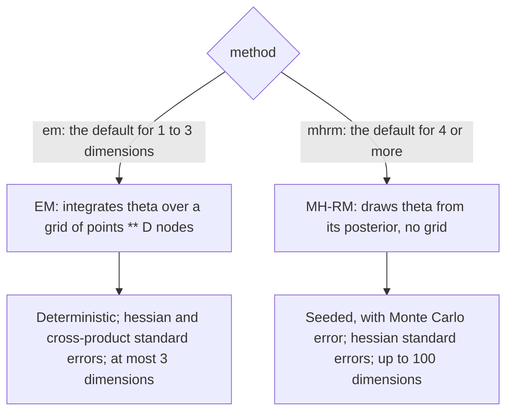
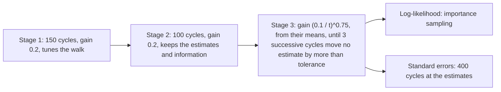
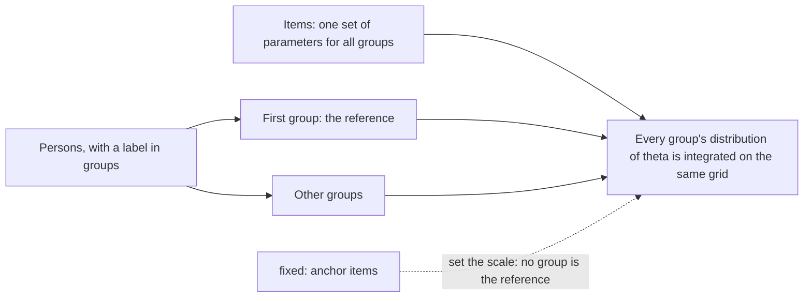
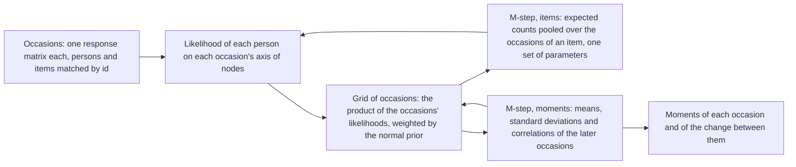
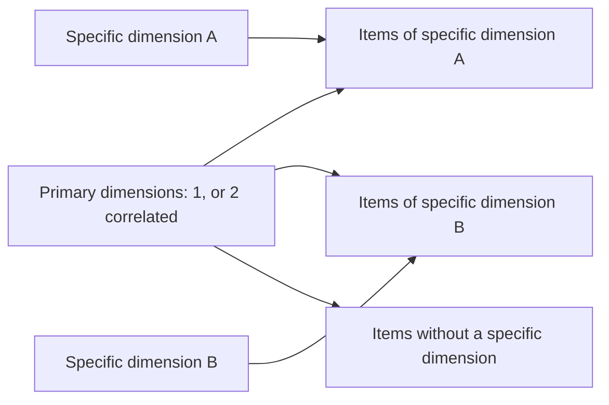
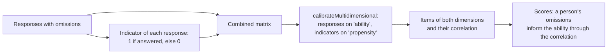

# Multidimensional item response theory

`@measurekit/psychometrics/multidimensional` models a person by a vector of thetas, one per dimension, and an item by a
slope on each dimension: a high theta on one dimension makes up for a low one on another (compensatory models). It
calibrates items and the correlations between dimensions by marginal maximum likelihood, exploratory and confirmatory,
with EM for up to three dimensions and with MH-RM for up to 100, and bifactor and two-tier models by dimension
reduction; computes standard errors; rotates exploratory solutions; calibrates several groups of persons on one scale,
with fixed anchor items; calibrates the same persons over two or three occasions; estimates thetas by EAP and MAP in any
number of dimensions; and computes information matrices. Every estimate is validated against mirt, GPArotation and base
R ([validation](validation.md)). The dimensions have mean 0 and variance 1, in the first group of a calibration of
several groups.

## Quick start

Calibrate a confirmatory 2PL of two correlated dimensions, and estimate a person's thetas:

```ts
import { createRandom } from "@measurekit/psychometrics";
import {
  calibrateMultidimensional,
  multidimensionalPosteriorModeEstimate,
  multidimensionalTwoParameterLogistic,
} from "@measurekit/psychometrics/multidimensional";
import { simulateMultidimensionalResponses } from "@measurekit/psychometrics/sim";

// Eight items, four on each of two correlated dimensions; 1,000 persons.
const random = createRandom(11);
const items = Array.from({ length: 8 }, (_, i) => ({
  model: multidimensionalTwoParameterLogistic,
  parameters: { a: [i < 4 ? 1.2 : 0, i < 4 ? 0 : 1.4], intercept: (i % 4) - 1.5, c: 0, d: 1 },
}));
const thetas = Array.from({ length: 1000 }, () => {
  const [z1, z2] = [random.normal(), random.normal()];
  return [z1, 0.5 * z1 + Math.sqrt(0.75) * z2];
});
const matrix = simulateMultidimensionalResponses(items, thetas, random);

// Confirmatory: the dimensions of each item by id.
const loadings = Object.fromEntries(matrix.itemIds.map((id, i) => [id, [i < 4 ? "verbal" : "quantitative"]]));
const fit = calibrateMultidimensional(matrix, multidimensionalTwoParameterLogistic, {
  loadings,
  standardErrors: "hessian",
});
fit.dimensions; // => ["verbal", "quantitative"]
fit.items[0]?.parameters; // => { a: [1.17, 0], intercept: -1.34, c: 0, d: 1 }
fit.items[0]?.standardErrors; // => { a1: 0.18, intercept: 0.11 }
fit.correlations; // => [[1, 0.46], [0.46, 1]]
fit.converged; // => true

// A person's thetas, with the calibration's correlations as the prior.
const prior = { mean: [0, 0], covariance: fit.correlations };
multidimensionalPosteriorModeEstimate(fit.items, [1, 1, 0, 1, null, 1, 1, 0], { prior }).theta; // => [0.61, 0.32]
```

## Models

Items have K ordered categories scored 0 to K - 1. With the slopes `a` and the thetas θ of a person, z = a · θ. The
parameters follow mirt's slope-intercept form, `coef(model, IRTpars = FALSE)`, with D = 1 ([parameterization](parameterization.md)
converts them); the intercept is mirt's `d`, named in full because `d` is the upper asymptote of the IRT form.

| Model                                    | Parameters                                 | P(X = 1) or P(X ≥ k)                                                 | mirt item type |
| ---------------------------------------- | ------------------------------------------ | -------------------------------------------------------------------- | -------------- |
| `multidimensionalTwoParameterLogistic`   | `{ a, intercept, c, d }` with c = 0, d = 1 | 1 / (1 + exp(-(z + intercept)))                                      | `2PL`          |
| `multidimensionalThreeParameterLogistic` | `{ a, intercept, c, d }` with d = 1        | c + (1 - c) / (1 + exp(-(z + intercept)))                            | `3PL`          |
| `multidimensionalGradedResponse`         | `{ a, intercepts: [d1, ..., d(K-1)] }`     | P(X ≥ k) = 1 / (1 + exp(-(z + d_k))), P(k) = P(X ≥ k) - P(X ≥ k + 1) | `graded`       |

Valid input: the slopes are finite numbers of any sign, one or more; the intercepts are finite; `c` is from 0 to below
1 and `d` is 1; the graded intercepts strictly decrease; thetas are finite. All items of a test have the same number of
dimensions, and the slopes of a dimension an item does not load on are 0.

`multidimensionalDiscrimination(item)` returns an item's multidimensional discrimination, MDISC = √(Σ a_d²), its
largest slope in any direction of the dimensions, and `multidimensionalDifficulty(item)` its multidimensional difficulty
at each boundary between its categories, MDIFF = -intercept / MDISC, the signed distance from the origin to its
steepest point along the direction of its slopes: one value for a dichotomous item, one per intercept for a graded one,
as mirt's `MDISC` and `MDIFF` (Reckase, 2009). MDISC takes an item of any model, MDIFF one of the built-in models.

A model implemented outside the package works as the built-in ones do if it has the members of
`MultidimensionalModel`. The first `dimensions` entries of its parameter vector are the slopes, `parameterDerivatives`
differentiates with respect to the vector, and `information` writes the Fisher information matrix.

## Calibration



|                      | EM                                                   | MH-RM                                                                               |
| -------------------- | ---------------------------------------------------- | ----------------------------------------------------------------------------------- |
| Dimensions           | 1 to 3                                               | Up to 100; the default above 3                                                      |
| Integration of theta | Quadrature on a grid of `points` nodes per dimension | Metropolis-Hastings draws, no grid                                                  |
| Result               | Deterministic, exact to `tolerance`                  | Seeded, within a Monte Carlo error                                                  |
| Standard errors      | `"hessian"` and `"cross-product"`                    | `"hessian"`                                                                         |
| Log-likelihood       | Exact on the grid                                    | Importance sampling                                                                 |
| Time                 | Grows with the responses times `points ** D`         | Grows with the persons, responses and parameters; slower than EM below 4 dimensions |

`calibrateMultidimensional(data, model, options)` takes a response matrix or response records, and a model, one for all
items or one per item in item order. Missing responses are skipped, which suits responses missing at random, and persons
without responses change nothing. [A recipe](#recipe-responses-missing-not-at-random) models omissions that depend on
the ability.

| Option            | Default                                   | Meaning                                                                                                                                           |
| ----------------- | ----------------------------------------- | ------------------------------------------------------------------------------------------------------------------------------------------------- |
| `method`          | `"em"` up to 3 dimensions, `"mhrm"` above | `"em"` or `"mhrm"`                                                                                                                                |
| `dimensions`      | none; one of `dimensions` and `loadings`  | Exploratory: the number of dimensions, a positive integer, 3 at most for EM, 100 for MH-RM; every item loads on each                              |
| `loadings`        | none; one of `dimensions` and `loadings`  | Confirmatory: the names of the dimensions of each item, by item id, of every item                                                                 |
| `correlated`      | `true`                                    | Confirmatory: estimate the correlations, in every group. Ignored when exploratory                                                                 |
| `groups`          | one group                                 | EM only: each person's group label, aligned with the persons; [several groups on one scale](#groups-and-fixed-items)                              |
| `fixed`           | none                                      | EM only: parameters of anchor items by item id, which are not estimated and set the scale                                                         |
| `fixedParameters` | none                                      | Values of single parameters of estimated items by item id, then entry name, held while the rest is estimated: [held parameters](#held-parameters) |
| `priors`          | none                                      | Priors by parameter name: `"a"` for every slope, `"intercept"` and `"c"`; estimates are posterior modes                                           |
| `points`          | `61`, `31`, `15` for 1, 2, 3 dimensions   | EM only: nodes per dimension of the grid, at least 2, from -6 to 6 standard deviations: mirt's `quadpts`                                          |
| `standardErrors`  | `"none"`                                  | `"hessian"`, or `"cross-product"` for EM only                                                                                                     |
| `seed`            | `0`                                       | MH-RM only: a safe integer; the same seed gives the same calibration                                                                              |
| `tolerance`       | `1e-4` for EM, `1e-3` for MH-RM           | Converged when no parameter changes by more than this: in an EM iteration, or in 3 successive MH-RM cycles                                        |
| `maxIterations`   | `500` for EM, `2000` for MH-RM            | The most EM iterations, or the most cycles of MH-RM's last stage, after the 250 of its first two stages                                           |

- **Confirmatory.** Each item loads on the dimensions named for it; the dimensions are named in order of first
  appearance among the items, in item order, and their slopes on the other dimensions are fixed at 0. With
  `correlated` the correlations are estimated, on a unit diagonal.
- **Exploratory.** Every item loads on every dimension and the dimensions are uncorrelated. Rotating the loadings
  leaves the likelihood unchanged, so the first D - 1 items' slopes beyond their own index are fixed at 0 (item j loads
  on the first j dimensions): the solution is then determined up to the signs of the dimensions. The dimensions are
  named `F1` to `FD`. EM starts from the first D eigenvectors of the items' correlations as loadings, each signed so
  that its entries sum to at least 0, converted to slopes by a = 1.702 λ / √(1 - h²). Use `rotateLoadings` for a simpler structure. To explore the number of factors and
  their loadings from the correlations of the items, in milliseconds, use
  [`exploratoryFactorAnalysis`](dimensionality.md#exploratory-factor-analysis); this route estimates the item
  parameters by full information, in seconds.
- **One dimension.** The model equals the one-dimensional model in the slope-intercept form: slope a, intercept
  -a b.
- **EM.** The grid is the product of `points` equally spaced nodes per dimension, weighted by the normal density of the
  correlations and normalized to sum to 1. The E-step accumulates each item's expected counts at every node; the M-step
  takes a Fisher-scoring step for each item, halved until the expected log-likelihood does not fall, and maximizes the
  correlations, which keep a unit diagonal and stay positive definite, with BFGS on the weights of the grid, so that
  it maximizes the reported likelihood. SQUAREM accelerates the iterations: every third one starts from a point
  extrapolated along the last two, shortened toward the plain steps where the log-likelihood falls. It reaches the
  fixed points of plain EM in a fraction of the iterations where EM contracts slowly, as for an exploratory model, and
  `iterations` counts every EM iteration.
- **Memory.** EM keeps each item's probability and expected count of each category at every node of the grid, 16
  bytes each: about 30 KB for a dichotomous item on the default grid of two dimensions and 110 KB on that of three. A
  calibration whose tables would hold more than 2²⁴ values, 256 MiB, throws a `DataError`; at the limit of 10⁶ nodes
  that is 8 dichotomous items. Standard errors add the scores of the items at the nodes of the dimensions they load
  on: an exploratory model of three dimensions at the limit takes 700 MB in all.
- **MH-RM.** Each cycle draws every person's theta from its posterior given the current estimates, by 5 random-walk
  Metropolis-Hastings steps whose variance is tuned to an acceptance of 0.35, and moves the estimates by γ Γ⁻¹ g, with g
  the complete-data score at the draws and Γ the observed complete-data information. The stages, gains and tolerance
  are mirt's defaults (below). The dimensions are not integrated, so their number is not limited, and the cost grows with
  the persons, responses and parameters, not with a grid. The result is stochastic, with a Monte Carlo error that
  [validation](validation.md) measures, and seeded: `seed` fixes the draws. MH-RM does not compute the log-likelihood,
  which is estimated by importance sampling with 5,000 draws per person, from the normal approximation of each person's
  posterior.
- **Priors.** A prior of `"c"` is on the probability scale; mirt's `norm` prior is on logit c, which a custom
  `ParameterPrior` reproduces ([IRT](irt.md#priors)). A prior of `"a"` applies to every estimated slope.



The result:

| Field                         | Content                                                                                                                        |
| ----------------------------- | ------------------------------------------------------------------------------------------------------------------------------ |
| `dimensions`                  | The names of the dimensions, in the order of the slopes                                                                        |
| `items`                       | Each item's `id`, `model`, `parameters` and `standardErrors`                                                                   |
| `correlations`                | The correlations between dimensions, by rows; of the first group when there are several                                        |
| `groups`                      | With `groups` or `fixed`: each group's `group` label, `means` and `covariance`, in order of first appearance                   |
| `correlationStandardErrors`   | By rows with a zero diagonal; `null` if the correlations are not estimated or there are no standard errors                     |
| `loadings`                    | The standardized loadings, items by dimensions                                                                                 |
| `communalities`               | λᵀ Φ λ of each item                                                                                                            |
| `logLikelihood`, `aic`, `bic` | The marginal log-likelihood at the estimates, without priors, by importance sampling for MH-RM; -2 ln L + 2p; -2 ln L + p ln n |
| `converged`, `iterations`     | Whether `tolerance` was reached, and the iterations run: EM's, or the cycles of MH-RM's last stage                             |

The number of parameters p counts the estimated slopes, intercepts and asymptotes, and the correlations and, with
several groups or fixed items, the means and variances; n is the number of persons with a response.

The standardized loadings follow mirt's `summary`: λ = (a / 1.702) / √(1 + (a / 1.702)ᵀ Φ (a / 1.702)), where Φ is the
correlation matrix, and the communality is λᵀ Φ λ. With several groups, Φ is the correlation matrix of the first group
and the slopes are scaled by its standard deviations.

**Orientation.** A dimension turned around, its slopes, loadings and correlations and each group's mean and covariances
with it negated, gives every response the same probability, so the likelihood has two maxima for it, and which one EM or
MH-RM ends at depends on the starting values and the draws. Each dimension is turned so that its slopes sum above 0, as
psych's `fa` and lavaan's exploratory factor analysis orient a factor. A dimension that a fixed item or a held slope
orients keeps the orientation given, as does a dimension whose slopes have a prior or bounds, and every dimension of a
calibration with a model other than the built-in ones, whose likelihood the turn need not keep.

### Held parameters

`fixedParameters` holds single parameters of estimated items at given values while their other parameters are
estimated, as mirt's `est = FALSE` on one parameter, by EM and by MH-RM: an M3PL item that two dimensions share keeps
its lower asymptote at 1/4 of its four options, with no prior on any item's `c`. The names are those of the standard
errors: `a1` to `aD`, `intercept` or `intercept1` upward, and `c`.

```ts
import { createRandom } from "@measurekit/psychometrics";
import {
  calibrateMultidimensional,
  multidimensionalThreeParameterLogistic,
  multidimensionalTwoParameterLogistic,
} from "@measurekit/psychometrics/multidimensional";
import { simulateMultidimensionalResponses } from "@measurekit/psychometrics/sim";

// Seven items, three on each of two dimensions, and "item4", of four options, on both.
const random = createRandom(2026);
const shared = 3;
const items = Array.from({ length: 7 }, (_, i) => ({
  model: i === shared ? multidimensionalThreeParameterLogistic : multidimensionalTwoParameterLogistic,
  parameters: {
    a: [i <= shared ? 1.3 : 0, i >= shared ? 1.1 : 0],
    intercept: (i % 3) - 1,
    c: i === shared ? 0.25 : 0,
    d: 1,
  },
}));
const thetas = Array.from({ length: 1000 }, () => [random.normal(), random.normal()]);
const responses = simulateMultidimensionalResponses(items, thetas, random);
const dimensionsOf = (i: number) =>
  i === shared ? ["verbal", "quantitative"] : [i < shared ? "verbal" : "quantitative"];
const fit = calibrateMultidimensional(
  responses,
  items.map(({ model }) => model),
  {
    loadings: Object.fromEntries(responses.itemIds.map((id, i) => [id, dimensionsOf(i)])),
    fixedParameters: { item4: { c: 0.25 } },
    standardErrors: "hessian",
  },
);
fit.items[shared]?.parameters; // => { a: [1.16, 1.21], intercept: -1.02, c: 0.25, d: 1 }
fit.items[shared]?.standardErrors; // => { a1: 0.28, a2: 0.32, intercept: 0.20 }, none for c
```

A held parameter is kept exactly, has no standard error, prior or place in the covariance, and the AIC and BIC do not
count it, as in [`calibrate`](irt.md#held-parameters). The items must be estimated, not in `fixed`, and keep at least
one parameter free; a slope the pattern of loadings fixes at 0 cannot be held, and every value must leave a valid item.
A held slope is on the scale of the dimensions, which stay N(0, 1) without `fixed`: it does not set the scale. A held
intercept of a graded item moves the starting values of the others to fit it.

### Groups and fixed items



`groups` calibrates persons from several populations on one scale, as `mirt::multipleGroup` with
`invariance = c("slopes", "intercepts", "free_means", "free_var")`: every item has the same parameters in every group,
and each group has its own distribution of theta, normal with a mean vector and a covariance matrix. `fixed` gives the
parameters of anchor items, which are not estimated; the other items are estimated on their scale.

| Entries of a group's distribution | The first group                        | The other groups                       | Every group, with `fixed`              |
| --------------------------------- | -------------------------------------- | -------------------------------------- | -------------------------------------- |
| Means                             | 0                                      | Estimated                              | Estimated                              |
| Variances                         | 1                                      | Estimated                              | Estimated                              |
| Correlations                      | Estimated with `correlated`, 0 without | Estimated with `correlated`, 0 without | Estimated with `correlated`, 0 without |

The means of the other groups are their latent means on the scale of the first group, in the `means` of each group of the
result; the longitudinal calibration below estimates the means of the occasions after the first in the same way. The
first group is the first label in order of first appearance. The groups must share items, directly or through other
groups: a group that shares none with the first throws a `DataError`, as its distribution could not be put on the scale
of the others. With `fixed`, the fixed items set the scale of each set of groups that share items, so every dimension
needs a fixed item with a slope on it that the set answered; otherwise a `DataError`. A fixed item needs parameters of
the calibration's number of dimensions and as many categories as its responses reach. Calibrating persons of one group
onto the scale of fixed items is the case of `fixed` without `groups`: the result then has one group, labeled `"all"`.

```ts
import { createRandom } from "@measurekit/psychometrics";
import {
  calibrateMultidimensional,
  multidimensionalTwoParameterLogistic,
} from "@measurekit/psychometrics/multidimensional";
import { simulateMultidimensionalResponses } from "@measurekit/psychometrics/sim";

// Twenty items, ten on each of two dimensions; 1,000 persons in each of two years, the later one 0.4 higher.
const random = createRandom(5);
const items = Array.from({ length: 20 }, (_, i) => ({
  model: multidimensionalTwoParameterLogistic,
  parameters: { a: [i < 10 ? 1.2 : 0, i < 10 ? 0 : 1.4], intercept: (i % 10) * 0.25 - 1.1, c: 0, d: 1 },
}));
const thetas = Array.from({ length: 2000 }, (_, person) => {
  const shift = person < 1000 ? 0 : 0.4;
  const [z1, z2] = [random.normal(), random.normal()];
  return [shift + z1, shift + 0.5 * z1 + Math.sqrt(0.75) * z2];
});
const matrix = simulateMultidimensionalResponses(items, thetas, random);

const fit = calibrateMultidimensional(matrix, multidimensionalTwoParameterLogistic, {
  loadings: Object.fromEntries(matrix.itemIds.map((id, i) => [id, [i < 10 ? "verbal" : "quantitative"]])),
  groups: thetas.map((_, person) => (person < 1000 ? "2025" : "2026")),
});
fit.groups?.[0]; // => { group: "2025", means: [0, 0], covariance: [[1, 0.5], [0.5, 1]] }
fit.groups?.[1]; // => { group: "2026", means: [0.35, 0.41], covariance: [[0.98, 0.5], [0.5, 1.04]] }
fit.converged; // => true
```

The groups' distributions can serve as priors of the scoring functions: pass `{ mean: group.means, covariance:
group.covariance }` as `prior`.

**Standard errors.** With `standardErrors`, the information covers the items and the entries of every group's
distribution, so an item's standard error accounts for the groups. Fixed items have none, and `correlationStandardErrors`
are those of the first group's correlations.

**Convergence.** A group's estimated distribution that runs to the edge of the grid, a mean outside it or a standard
deviation below the spacing of its nodes or above its range, leaves `converged` `false`: a few persons, or too coarse a
grid, give such a group no maximum. A group whose correlations are estimated needs more persons with a response than
dimensions, or a `DataError` says so: the thetas of fewer span no more than a hyperplane, and the correlations run to
±1, where the likelihood has no maximum. The same holds for the persons of a calibration without groups, by EM or
MH-RM, and for the two primary dimensions of a two-tier model. The default grid of three dimensions has 15 nodes per dimension; set `points: 21`
above 20 items per dimension, where the coarse grid biases the moments of the groups.

### Longitudinal calibration



`calibrateLongitudinal` calibrates the same persons answering the same items on two or three occasions: the trait of each
occasion is one dimension of a normal distribution whose means, standard deviations and correlations are estimated, and
an item has one set of parameters on every occasion it is on. It is `mirt` with one dimension per occasion, the items'
parameters tied by `constrain` and `MEAN` and `COV` freed (Andersen, 1985). The first occasion is N(0, 1) and sets the
scale: the other means and standard deviations are on it.

| Option           | Default                      | Meaning                                                                                           |
| ---------------- | ---------------------------- | ------------------------------------------------------------------------------------------------- |
| `model`          | `twoParameterLogistic`       | `oneParameterLogistic` (one slope for all items), `twoParameterLogistic` or `gradedResponse`      |
| `points`         | 31 for 2 occasions, 21 for 3 | Nodes on each occasion's axis, from -6 to 6, at least 2; the grid has `points ** occasions` nodes |
| `standardErrors` | `"none"`                     | `"hessian"` or `"cross-product"`, of the items and the distribution together; see below           |
| `tolerance`      | `1e-4`                       | EM stops when no estimated parameter changes by more than this                                    |
| `maxIterations`  | `500`                        | The most EM iterations; the result has `converged: false` if they run out                         |

| The data         | Rule                                                                                                                         |
| ---------------- | ---------------------------------------------------------------------------------------------------------------------------- |
| Occasions        | An array of 2 or 3 response matrices; another length is a `DataError`                                                        |
| Persons          | Matched by person id: a person who is in some occasions only is allowed, and counts as having no responses on the others     |
| Items            | Matched by item id, in order of first appearance; an item that only some occasions have is allowed, as in an anchored design |
| Linked occasions | Every occasion must share an item with the first, directly or through the others, or its mean has no scale: a `DataError`    |
| Categories       | Pooled over the occasions: an item needs responses in every category up to its highest, as in `calibrate`                    |

| Result                      | Meaning                                                                                                                                                              |
| --------------------------- | -------------------------------------------------------------------------------------------------------------------------------------------------------------------- |
| `items`                     | Each item's `id`, `model`, `parameters`, `estimated` and `standardErrors`, as `calibrate` gives them; they serve `abilityEstimates` and the other functions of items |
| `occasions`                 | The `mean` and `sd` of each occasion's trait, with their `standardErrors`; the first is 0 and 1                                                                      |
| `correlations`              | The correlations between the occasions, by rows                                                                                                                      |
| `correlationStandardErrors` | Their standard errors, by rows with 0 on the diagonal                                                                                                                |
| `changes`                   | For each pair of consecutive occasions, `from` and `to` (indexes from 0): the `mean` and `sd` of the change and its `correlationWithStart`                           |
| `logLikelihood`             | The marginal log-likelihood at the estimates                                                                                                                         |
| `converged`                 | Whether EM reached `tolerance` within `maxIterations`, with every later occasion's distribution on the grid; `iterations` counts them                                |

`changes` carries the change in the trait that growth models use: the later trait less the earlier, with the mean and
standard deviation of the difference from the covariance matrix, and its correlation with the earlier trait, which is
negative where persons who start low gain more. Embretson's (1991) initial ability and modifiability are the earlier
trait and that change.

```ts
import { createRandom } from "@measurekit/psychometrics";
import { twoParameterLogistic } from "@measurekit/psychometrics/irt";
import { calibrateLongitudinal } from "@measurekit/psychometrics/multidimensional";
import { simulateItems, simulateResponses } from "@measurekit/psychometrics/sim";

// Twelve items; 1,000 persons answer them twice, the second time 0.4 higher on average and more spread out.
const random = createRandom(7);
const items = simulateItems(twoParameterLogistic, 12, random);
const before = Array.from({ length: 1000 }, () => random.normal());
const after = before.map((theta) => 0.4 + 1.2 * (0.8 * theta + 0.6 * random.normal()));
const fit = calibrateLongitudinal([simulateResponses(items, before, random), simulateResponses(items, after, random)], {
  standardErrors: "hessian",
});
fit.occasions[1]; // => { mean: 0.43, sd: 1.22, standardErrors: { mean: 0.042, sd: 0.051 } }
fit.correlations; // => [[1, 0.84], [0.84, 1]]
fit.changes[0]; // => { from: 0, to: 1, mean: 0.43, sd: 0.66, correlationWithStart: 0.03 }
fit.items[0]?.parameters; // => { a: 0.81, b: -0.15, c: 0, d: 1 }
fit.correlationStandardErrors?.[1]?.[0]; // => 0.024
fit.converged; // => true
```

**Convergence.** A later occasion's distribution that runs to the edge of the grid, a mean outside it or a standard
deviation below the spacing of its nodes or above its range, leaves `converged` `false`, as in
[groups](#groups-and-fixed-items).

**Standard errors.** `"hessian"` is the observed information, the Hessian of the marginal log-likelihood by central
differences of its exact gradient, which two E-steps per parameter give; `"cross-product"` is the sum over persons of the
outer products of their scores, one pass. The errors are on the estimates' own scale and named as the estimates are: each
item's by the names of its parameters, a parameter that the items share, the 1PL's slope, at each item; each later
occasion's `mean` and `sd`, the first occasion's being `null`, as it fixes them; and the correlations' by rows. They are
`null` without the option and where the information cannot be inverted or gives a variance that is not positive.

**Time.** CPU time of one calibration at the default `tolerance`, on an Apple M5 with Node.js 26, simulated data:

| Data                                                                     | `"none"` | `"cross-product"` | `"hessian"` |
| ------------------------------------------------------------------------ | -------- | ----------------- | ----------- |
| 2 occasions, 2PL, 10 items, 1,500 persons, 31 points                     | 0.4 s    | 0.4 s             | 1.0 s       |
| 3 occasions, 2PL, 10 items, 1,000 persons, 21 points                     | 2.7 s    | 2.8 s             | 4.1 s       |
| 3 occasions, graded with 5 categories, 6 items, 1,000 persons, 21 points | 2.0 s    | 2.3 s             | 3.8 s       |

The E-step costs the responses times the points of an axis plus a few operations per node of the grid, which has
`points ** occasions` nodes; the BFGS of the moments costs more than the items' M-step, which pools the occasions'
counts. A calibration is synchronous: in a browser, run it in a Web Worker ([IRT](irt.md#in-a-browser)).

**Why 3 occasions.** The grid has `points ** occasions` nodes, so the nodes per occasion fall as occasions are added, and
the moments of correlated occasions are biased by the coarse grid with no sign of it: every fit below reports
`converged`. `mirt` at its defaults, 1,500 persons, 10 items per occasion, autoregressive correlation 0.85, the largest
error over the seeds (3 seeds up to 3 occasions, 1 at 4 and 5) of an estimate from the mean, standard deviation or
correlation of the simulated abilities:

| Occasions | Nodes | Mean error | SD error  | Correlation error |
| --------- | ----- | ---------- | --------- | ----------------- |
| 2         | 31    | 0.035      | 0.065     | 0.015             |
| 3         | 15    | 0.047      | 0.053     | 0.021             |
| 3         | 21    | 0.046      | 0.049     | 0.028             |
| 4         | 9     | **0.305**  | **0.192** | **0.238**         |
| 5         | 7     | **0.307**  | **0.291** | **0.228**         |

At 2 and 3 occasions the error is that of the persons and items, which more of them reduce: at 5,000 persons it is
0.018, 0.014 and 0.013 at 2 occasions and 0.018, 0.022 and 0.013 at 3. At 4 and 5 occasions the grid is the limit by a
wide margin, so `calibrateLongitudinal` takes 2 or 3 occasions and throws a `DataError` for another number.

**Why 21 nodes at 3 occasions.** With 40 items per occasion the posterior narrows, and 15 nodes, `mirt`'s default for
three dimensions, miss by many times what 21 do. 2,000 persons, 40 items per occasion, 3 occasions, correlation 0.85,
two seeds; the distance is the largest difference of a mean, standard deviation or correlation between two grids:

| Seed | 15 against 31 nodes | 21 against 31 nodes | Time at 15, 21 and 31 nodes |
| ---- | ------------------- | ------------------- | --------------------------- |
| 1    | 0.109               | 0.021               | 2.8 s, 4.1 s, 21 s          |
| 2    | 0.104               | 0.008               | 1.7 s, 6.6 s, 22 s          |

So the default is 21 nodes at 3 occasions, and `mirt`'s 31 at 2. `validation/psychometrics/longitudinal-recovery.ts`
recovers the moments of 5,000 simulated persons at 10 and at 40 items per occasion within 1.5 times the worst error of
`mirt` on the same design, rounded up to a multiple of 0.005 ([validation](validation.md#simulation)).

### Standard errors

| `standardErrors`  | Method                                                                                                                                                                                                                                                                       | Cost                                                       |
| ----------------- | ---------------------------------------------------------------------------------------------------------------------------------------------------------------------------------------------------------------------------------------------------------------------------- | ---------------------------------------------------------- |
| `"hessian"`       | The inverse of the observed information of the log-posterior in unbounded coordinates, with the delta method for c, by Louis' formula: the complete-data information minus the covariance of the complete-data score under the posterior. For EM, mirt's `SE.type = "Oakes"` | EM: one pass over the posterior; MH-RM: 400 further cycles |
| `"cross-product"` | The inverse of the sum over persons of the outer products of their score vectors, plus the curvature of the priors; mirt's `"crossprod"`; EM only                                                                                                                            | One pass over the persons                                  |

Oakes' formula differentiates the EM map and needs two E-steps for each estimated parameter. Louis' formula gives the
same matrix from the posterior of one E-step: the complete-data information is the second derivative of the M-step's
objective, and the covariance of the scores is summed over the grid, for an item over the marginal of the posterior on
the dimensions the item loads on. MH-RM has no grid: the covariance is that of each person's score over the draws of 400
cycles at the estimates, summed over persons, and the information is the observed complete-data information at the
draws. The standard errors of MH-RM are therefore stochastic, as mirt's are; the person-wise covariance leaves out the
covariance between persons, which is 0 given the parameters and would add noise.

Standard errors take at most 2,000 estimated parameters, by EM, MH-RM, bifactor and longitudinal calibration alike, as
[irt](irt.md#standard-errors) explains: beyond it calibration throws `DataError` before it estimates anything.

A standard error is listed by the name of the parameter: `a1` to `aD` for the slopes the item loads on, `intercept` or
`intercept1`, `intercept2`, ..., and `c`. Slopes fixed at 0 and held parameters have none. All standard errors of a calibration are `null`
if the information matrix cannot be inverted or gives a variance that is not positive.

### Time

CPU time of one calibration on an Apple M5 with Node.js 26, simulated data, each item loading on one dimension, the
default `tolerance`. EM:

| Data                                                                       | `"none"` | `"cross-product"` | `"hessian"` |
| -------------------------------------------------------------------------- | -------- | ----------------- | ----------- |
| 2 dimensions, M2PL, 20 items, 2,000 persons, 31 points                     | 1.1 s    | 1.4 s             | 3.3 s       |
| 3 dimensions, M2PL, 30 items, 2,000 persons, 15 points                     | 7.3 s    | 7.6 s             | 11.6 s      |
| 3 dimensions, graded with 5 categories, 15 items, 1,000 persons, 15 points | 3.6 s    | 3.3 s             | 5.7 s       |

MH-RM, seeded, with the cycles of its last stage:

| Data                                                            | Cycles | `"none"` | `"hessian"` |
| --------------------------------------------------------------- | ------ | -------- | ----------- |
| 2 dimensions, M2PL, 20 items, 2,000 persons                     | 44     | 16.1 s   | 23.8 s      |
| 3 dimensions, M2PL, 30 items, 2,000 persons                     | 45     | 27.3 s   | 38.1 s      |
| 3 dimensions, graded with 5 categories, 15 items, 1,000 persons | 53     | 21.5 s   | 30.0 s      |
| 5 dimensions, M2PL, 30 items, 2,000 persons                     | 54     | 31.9 s   | 43.8 s      |
| 5 dimensions, graded with 5 categories, 25 items, 1,000 persons | 57     | 38.6 s   | 53.6 s      |

Differences under 10% are noise. The E-step of EM dominates and grows with the responses times the nodes: a grid of
`points` nodes in each of D dimensions has `points ** D` nodes. Fewer `points` is faster and, for a calibration, less
exact. MH-RM has no grid, so its time grows slowly with the dimensions; it runs 250 cycles before the last stage, and
the importance-sampled log-likelihood is part of every time. Correlated dimensions add their correlations, D (D - 1) / 2
parameters whose information grows as the square of their number: two persons on 40 correlated dimensions take 170 MB
and 8 s, on 60 dimensions 300 MB and 45 s. Use EM up to three dimensions, where it is exact and
faster. The exploratory model of a weak second dimension converges slowly with EM; `maxIterations` bounds it.
Calibration runs synchronously: in a browser, run it in a Web Worker ([IRT](irt.md#in-a-browser)).

An exploratory model starts from the leading eigenvectors of the items' correlations, which Householder's reduction and
the implicit QL algorithm find with all the others, in time that grows as the cube of the items: about 30 s at 2,000
items, where base R's `eigen` takes 1.6 s. The correlations take the responses to each pair of items: 20 s for 1,000 persons who answered
all 2,000, and 0.2 s for 20,000 persons who answered 2 of them each. mirt's start, which smooths the correlations by
eigendecompositions until none of their eigenvalues is negative, took more than 20 minutes on the first of these.

## Bifactor and two-tier models

`calibrateBifactor(data, specific, options)` calibrates models in which every item loads on the primary dimensions, one
for a bifactor model and two, correlated, for a two-tier model, and on at most one specific dimension, such as a passage
or a method factor. The specific dimensions are uncorrelated with everything. It is `calibrateMultidimensional` with the
dimensions integrated one group of items at a time, so the cost follows the primary dimensions plus one, however many
specific dimensions there are. `specific` gives each item's specific dimension by item id, every item of the data: a
name, or `null` for an item with none.



```ts
import { createRandom } from "@measurekit/psychometrics";
import {
  calibrateBifactor,
  multidimensionalEstimates,
  multidimensionalPosteriorModeEstimate,
  multidimensionalTwoParameterLogistic,
} from "@measurekit/psychometrics/multidimensional";
import { simulateMultidimensionalResponses } from "@measurekit/psychometrics/sim";

// Twelve items in three passages of four: each loads on a general dimension and on its passage's own; 2,000 persons.
const random = createRandom(5);
const items = Array.from({ length: 12 }, (_, i) => {
  const a = [1.2, 0, 0, 0];
  a[1 + Math.floor(i / 4)] = 0.9;
  return {
    model: multidimensionalTwoParameterLogistic,
    parameters: { a, intercept: ((i % 4) - 1.5) * 0.6, c: 0, d: 1 },
  };
});
const thetas = Array.from({ length: 2000 }, () => [random.normal(), random.normal(), random.normal(), random.normal()]);
const matrix = simulateMultidimensionalResponses(items, thetas, random);

// The specific dimension of each item by id; `null` for an item without one.
const specific = Object.fromEntries(matrix.itemIds.map((id, i) => [id, `passage${1 + Math.floor(i / 4)}`]));
const fit = calibrateBifactor(matrix, specific, { standardErrors: "hessian" });
fit.dimensions; // => ["general", "passage1", "passage2", "passage3"]
fit.items[0]?.parameters; // => { a: [1.19, 1.07, 0, 0], intercept: -0.96, c: 0, d: 1 }
fit.items[0]?.standardErrors; // => { a1: 0.11, a2: 0.17, intercept: 0.08 }
fit.items[5]?.parameters.a; // => [1.08, 0, 0.87, 0]
fit.logLikelihood; // => -14468.29
fit.converged; // => true

// A person's thetas on all dimensions, with the calibration's correlations as the prior.
const prior = { mean: [0, 0, 0, 0], covariance: fit.correlations };
const scores = multidimensionalEstimates(matrix, fit.items, {
  estimator: (calibrated, responses) => multidimensionalPosteriorModeEstimate(calibrated, responses, { prior }),
});
scores[0]?.estimate?.theta; // => [0.63, 0.14, 0.14, 0.22]
```

| Option           | Default                                        | Meaning                                                                                                                                 |
| ---------------- | ---------------------------------------------- | --------------------------------------------------------------------------------------------------------------------------------------- |
| `primary`        | one dimension, `"general"`, for every item     | Each item's primary dimensions by item id: one name for a bifactor model, up to two in all for a two-tier model                         |
| `model`          | `multidimensionalTwoParameterLogistic`         | The model of every item: also the 3PL and the graded model                                                                              |
| `priors`         | none                                           | Priors by parameter name, `"a"`, `"intercept"` and `"c"`: estimates are posterior modes, the usual way to estimate the 3PL's asymptotes |
| `points`         | `31` with one primary dimension, `21` with two | Nodes per integrated dimension, at least 2, from -6 to 6 standard deviations                                                            |
| `standardErrors` | `"none"`                                       | `"hessian"`, or `"cross-product"`, as in `calibrateMultidimensional`                                                                    |
| `tolerance`      | `1e-4`                                         | Converged when no parameter changes by more than this in an EM iteration                                                                |
| `maxIterations`  | `500`                                          | The most EM iterations                                                                                                                  |

The result is that of `calibrateMultidimensional`. Its dimensions are the primary ones, then the specific ones in order
of first appearance among the items, and an item has a slope of 0 on each specific dimension it does not load on. The
correlations are the identity, except between two primary dimensions, which are estimated and have a standard error.
The log-likelihood is exact on the grid, and the number of parameters of `aic` and `bic` counts the estimated slopes,
intercepts and asymptotes, and that correlation. Scoring needs no new function: `multidimensionalEstimates` works on the
result, on the grid of all dimensions. The posterior mean integrates over that grid, so it needs a small `points` with
many specific dimensions; the posterior mode does not. A bifactor or two-tier model takes at most 100 dimensions, the
primary and the specific ones together, as scoring does, so that every calibration can be scored.

Each dimension, primary or specific, is turned so that its slopes sum above 0, with the exceptions of
[Orientation](#calibration). mirt's `bfactor` keeps the orientation that its starting slopes of 1 give, and EM from them
can end with a specific dimension whose slopes sum below 0, such as one of slopes -1.8, 0.5, 0.5 and 0.5.

| Rule                                | Definition                                                                                           |
| ----------------------------------- | ---------------------------------------------------------------------------------------------------- |
| Models                              | The multidimensional 2PL, 3PL and graded models, one for all items                                   |
| Two primary dimensions              | A two-tier model: the correlation of the two is estimated, the specific dimensions stay uncorrelated |
| Missing responses                   | Skipped; a person without responses changes nothing                                                  |
| An item in two specific dimensions  | `DataError`: `calibrateMultidimensional` with `loadings` fits it by MH-RM                            |
| A specific dimension of one item    | `DataError`: one item does not identify a specific dimension                                         |
| More than two primary dimensions    | `DataError`: `calibrateMultidimensional` with `loadings` fits them by MH-RM                          |
| A name that is primary and specific | `DataError`                                                                                          |
| A grid of more than 10⁶ nodes       | `DataError`: use fewer `points`                                                                      |
| Tables of more than 2²⁴ values      | `DataError`: the items' categories at the nodes, with their pairs for `"hessian"`; use fewer points  |

**How it is fast.** Given the primary dimensions, the groups of items of the specific dimensions are independent, so a
person's likelihood is a sum over the primary nodes of the weight times a product, over the groups, of a sum over each
group's own nodes. The sum of a group depends only on the responses to its items. Three things make a calibration take
a fraction of the time of the same model in full:

| Part                                | Effect                                                                                                       |
| ----------------------------------- | ------------------------------------------------------------------------------------------------------------ |
| Distinct response patterns          | Persons with one pattern are one row of the E-step                                                           |
| Distinct sub-patterns of each group | A group's sum over its nodes is computed once for each pattern of the responses to its items, not per person |
| SQUAREM                             | The acceleration of the other EM calibrations of the module                                                  |

A group of items whose persons all have different sub-patterns is the worst case: the cost is then the persons times the
nodes squared times the items of the group, as with any bfactor program.

CPU time of one calibration at the default `tolerance`, on an Apple M5 with Node.js 26, against `mirt::bfactor` with
31 nodes on the same simulated data of 2,000 persons, each item loading on the general dimension and on one specific
dimension:

| Data                            | measurekit | mirt  | Ratio |
| ------------------------------- | ---------- | ----- | ----- |
| 12 items, 3 specific dimensions | 0.08 s     | 1.4 s | 17    |
| 40 items, 4 specific dimensions | 0.51 s     | 4.2 s | 8.3   |

## Rotation

`rotateLoadings(calibration, options)` rotates the standardized loadings of a calibration of uncorrelated dimensions,
such as an exploratory one, by gradient projection from the identity rotation.

| Option                       | Default         | Meaning                                                                                     |
| ---------------------------- | --------------- | ------------------------------------------------------------------------------------------- |
| `method`                     | `"oblimin"`     | `"varimax"`, orthogonal, or `"oblimin"`, oblique                                            |
| `normalize`                  | `false`         | Scale each item's loadings to unit length before rotating and back after (Kaiser)           |
| `gamma`                      | `0`             | The γ of oblimin: 0 is quartimin, 0.5 biquartimin. Ignored by varimax                       |
| `tolerance`, `maxIterations` | `1e-10`, `1000` | The norm of the projected gradient at which the rotation has converged; the most iterations |

For a rotation T, the rotated loadings are Λ (Tᵀ)⁻¹ and the correlations between the rotated dimensions TᵀT. The
rotated slopes are a (Tᵀ)⁻¹ = 1.702 λ / √(1 - h²), the communalities h² unchanged, and the intercepts are those of the
calibration, so the rotated `items` with the rotated `correlations` as the prior score as the original ones do, in the
rotated dimensions. The sign of each rotated dimension is chosen so that its largest loading in absolute value is
positive. The result also holds `rotation` (T), `converged` and `iterations`.

```ts
import { createRandom } from "@measurekit/psychometrics";
import {
  calibrateMultidimensional,
  multidimensionalTwoParameterLogistic,
  rotateLoadings,
} from "@measurekit/psychometrics/multidimensional";
import { simulateMultidimensionalResponses } from "@measurekit/psychometrics/sim";

// The data of the first sample: eight items, four on each of two dimensions correlated 0.5; 1,000 persons.
const random = createRandom(11);
const items = Array.from({ length: 8 }, (_, i) => ({
  model: multidimensionalTwoParameterLogistic,
  parameters: { a: [i < 4 ? 1.2 : 0, i < 4 ? 0 : 1.4], intercept: (i % 4) - 1.5, c: 0, d: 1 },
}));
const thetas = Array.from({ length: 1000 }, () => {
  const [z1, z2] = [random.normal(), random.normal()];
  return [z1, 0.5 * z1 + Math.sqrt(0.75) * z2];
});
const matrix = simulateMultidimensionalResponses(items, thetas, random);

const exploratory = calibrateMultidimensional(matrix, multidimensionalTwoParameterLogistic, { dimensions: 2 });
const rotated = rotateLoadings(exploratory, { method: "oblimin" });
rotated.loadings.slice(0, 2); // => [[0.61, -0.04], [0.51, 0.08]]
rotated.correlations; // => [[1, 0.44], [0.44, 1]]
rotated.converged; // => true
```

A calibration with correlated dimensions is not rotated: `rotateLoadings` throws `DataError` unless its correlations
are the identity and it has at least two dimensions.

## Scoring

| Function                                                                | Estimate                                                                                                       |
| ----------------------------------------------------------------------- | -------------------------------------------------------------------------------------------------------------- |
| `multidimensionalPosteriorMeanEstimate(items, responses, options)`      | EAP: the posterior mean, with the posterior covariance, by quadrature                                          |
| `multidimensionalPosteriorModeEstimate(items, responses, options)`      | MAP: the posterior mode; the covariance is the inverse of the test information plus the precision of the prior |
| `multidimensionalMaximumLikelihoodEstimate(items, responses, options)`  | MLE: the maximum of the likelihood in `range`; the covariance is the inverse of the test information           |
| `multidimensionalWeightedLikelihoodEstimate(items, responses, options)` | WLE (Warm): the root of the score plus ½ tr(I⁻¹ J_r) in `range`; the same covariance                           |
| `multidimensionalEstimates(data, items, options)`                       | The estimate of every person of a data set, `null` without responses                                           |

`items` are `{ model, parameters }` of one number of dimensions, at most 100; `responses` has one response per item,
`null` when missing. An estimate has `theta`, `standardErrors` and `covariance`. The limit of dimensions is one for
calibration, scoring, `multidimensionalInformation` and adaptive tests, so that every calibration can be scored: the
matrices of scoring grow as the square of the dimensions and its time as the cube, so that the posterior mode of one item
of 1,000 dimensions took 11 s.

| Option   | Of       | Default                                                     | Meaning                                                                                              |
| -------- | -------- | ----------------------------------------------------------- | ---------------------------------------------------------------------------------------------------- |
| `prior`  | EAP, MAP | N(0, I)                                                     | `{ mean, covariance }`: pass the calibration's `correlations` as the covariance                      |
| `points` | EAP      | `61`, `31`, `15`, `9`, `7` for 1 to 5 dimensions, `3` above | Nodes per dimension of the rectangular grid placed on the prior: `mean + sd * z` with z from -6 to 6 |
| `range`  | MLE, WLE | `[-6, 6]`                                                   | The lowest and the highest theta in every dimension, as for `maximumLikelihoodEstimate`              |

The covariance of the prior is symmetric and positive definite. EAP weights the grid nodes by the prior density times
the likelihood, and keeps the 8 grids asked for last for reuse, within 64 MiB of nodes. A grid of more than 10⁶ nodes
throws, naming MAP, which works in any number of dimensions: a scan of 5 points per dimension (3 above three dimensions)
from -3 to 3 prior standard deviations, or above five dimensions the prior mean and 3 prior standard deviations either
side of it on each axis, picks the start of Fisher scoring with halved steps, which runs to a gradient below 1e-10.
Without responses the estimate is the prior, also without items, when a `prior` gives the dimensions: an estimate from
no items needs one.

The MLE and the WLE need a response, and answered items whose slopes span the dimensions: along a dimension they leave
out the likelihood is flat, and they throw `DataError`. The MLE starts from the point of the largest likelihood on the
points of MAP's scan spread over the box of `range`, and Fisher scoring with the steps projected onto the box runs to a
score below 1e-10 on the coordinates inside it. The WLE starts from MAP under N(0, I), and takes Fisher scoring's steps,
or Newton's with the Jacobian of the weighted score by central differences where scoring's do not halve its length, to
a weighted score below 1e-9. I is the test information and J_r the sum over the answered items and categories of
∂P/∂θ_r ∇²P / P, as `weightedLikelihoodEstimate` has it on one dimension, where both estimates equal the
one-dimensional ones.

- **Extreme patterns.** Where the likelihood grows toward a face of the box, as for a pattern of lowest or highest
  categories, or of items of one dimension all answered alike, the MLE lies on that face, with its other coordinates at
  their maximum there, as the one-dimensional MLE is at an end of `range`. The WLE of such a pattern is finite where the
  correction balances the score, and on the face where it does not.
- **Several roots.** The weighted score is the gradient of the log of the likelihood times √det I, Jeffreys' prior, for
  the M2PL and the graded model, and of no function for the M3PL, whose likelihood can have several maxima and its
  weighted score several roots: the estimate is the one that the search reaches from the start.
- **Time.** Warm's correction takes the gradients of each item at 2D points, and a Newton step the correction at 2D
  more: on 100 dimensions and 500 items the WLE takes 2 s, and MAP and the MLE 0.06 s.

`multidimensionalEstimates` matches the data's item ids to `items`, estimates each person from the person's answered
items only, and takes `multidimensionalPosteriorModeEstimate` unless given an estimator, a function of items and
responses such as `(items, responses) => multidimensionalPosteriorMeanEstimate(items, responses, { prior })`.

## Information

`multidimensionalInformation(items, theta)` returns the test information matrix at a vector of thetas: the sum over
the items of Σ_k ∇P_k ∇P_kᵀ / P_k. The information of an item in the direction of a unit vector u is uᵀ I u, and the
inverse of the matrix is the covariance of a maximum likelihood estimate of theta there.

## Simulation, parameterization

`simulateMultidimensionalResponses` ([simulation](sim.md#multidimensional-responses)) draws responses from a
vector of thetas per person; `writeMirtMultidimensional` and `readMirtMultidimensional`
([parameterization](parameterization.md#multidimensional-items)) convert items to and from mirt.

## Recipe: responses missing not at random

Persons of low ability often omit items, so whether a response is missing depends on the trait that the test measures,
and skipping the missing responses biases the items and the abilities. Holman and Glas (2005) model the omissions: the
response indicator of each item, 1 if answered, is an item of a second dimension, the propensity to respond, which
correlates with the ability. `calibrateMultidimensional` fits the two dimensions and their correlation, with the
indicators always observed and the responses missing where they were omitted.



```ts
import { createRandom } from "@measurekit/psychometrics";
import { buildResponseMatrix, type ResponseMatrix } from "@measurekit/psychometrics/data";
import {
  calibrateMultidimensional,
  multidimensionalPosteriorModeEstimate,
  multidimensionalTwoParameterLogistic,
} from "@measurekit/psychometrics/multidimensional";

// 800 persons answer 8 items; the persons of lower ability omit more, as the propensity correlates 0.5 with the ability.
const random = createRandom(7);
const logistic = (z: number) => 1 / (1 + Math.exp(-z));
const rows = Array.from({ length: 800 }, () => {
  const ability = random.normal();
  const propensity = 0.5 * ability + Math.sqrt(0.75) * random.normal();
  return Array.from({ length: 8 }, (_, j) => {
    const answered = random.uniform() < logistic(propensity + 0.3 * (j - 3));
    const correct = random.uniform() < logistic(ability - 1.4 + 0.4 * j);
    return answered ? Number(correct) : null;
  });
});
const matrix = buildResponseMatrix(rows);

/** The responses and, beside them, an indicator item of whether each was answered, with the dimension of every item. */
function withIndicators(data: ResponseMatrix) {
  const itemIds = [...data.itemIds, ...data.itemIds.map((id) => `answered:${id}`)];
  const combined = data.responses.map((row) => [...row, ...row.map((response) => (response === null ? 0 : 1))]);
  const loadings = Object.fromEntries(
    itemIds.map((id, i) => [id, [i < data.itemIds.length ? "ability" : "propensity"]]),
  );
  return { matrix: buildResponseMatrix(combined, { itemIds }), loadings };
}

const { matrix: combined, loadings } = withIndicators(matrix);
const fit = calibrateMultidimensional(combined, multidimensionalTwoParameterLogistic, { loadings });
fit.correlations; // => [[1, 0.48], [0.48, 1]]: the truth is 0.5

// The first person answered 4 of 8 items. Scored with the indicators and the correlation as the prior, the omissions count.
const person = combined.responses[0] ?? [];
const prior = { mean: [0, 0], covariance: fit.correlations };
multidimensionalPosteriorModeEstimate(fit.items, person, { prior }).theta; // => [-0.54, -0.45]
```

| Choice     | Value                                                                                                                                          |
| ---------- | ---------------------------------------------------------------------------------------------------------------------------------------------- |
| Model      | The 2PL for the responses, and for the indicators the same model, whose slope on the propensity is the indicator's discrimination              |
| Dimensions | `loadings` puts each response on `"ability"` and each indicator on `"propensity"`; the correlation between them is estimated                   |
| Time       | Two dimensions on a grid of 31 points, as any two-dimensional calibration: 800 persons and 16 items take under a second                        |
| Check      | A correlation near 0 means the omissions say little about the ability, and the items differ little from those of a calibration that skips them |
| Limits     | The model is the one of Holman and Glas: omissions depend on the ability only through the correlation of the two dimensions                    |

## Errors

Invalid input throws `DataError` naming the value found.

| Error                                                                                                                                                                          | What to do                                                                       |
| ------------------------------------------------------------------------------------------------------------------------------------------------------------------------------ | -------------------------------------------------------------------------------- |
| Neither `dimensions` nor `loadings`, or both                                                                                                                                   | Give `dimensions` for an exploratory model, or `loadings` for a confirmatory one |
| Loadings, primary or specific dimensions, or priors for an id that is not an item, or a dimension named twice for an item                                                      | Name the dimensions of the items of the matrix, each once                        |
| An item with invalid parameters: slopes or intercepts not finite, graded intercepts that do not decrease, or c and d out of 0 ≤ c < d ≤ 1                                      | Give the parameters in mirt's slope-intercept form                               |
| More than three dimensions with EM, an exploratory model with too few items, or a grid of more nodes than its limit                                                            | Use `method: "mhrm"`, fewer `points`, or more items                              |
| A bifactor model of more than one primary dimension, or a two-tier model of more than two                                                                                      | Use `calibrateMultidimensional` with `loadings`                                  |
| Groups or occasions that share no item, or fixed items that leave a dimension without a scale                                                                                  | Give them common items, or fix items with slopes on every dimension              |
| A longitudinal calibration of more than three occasions                                                                                                                        | Calibrate two or three occasions at a time                                       |
| A held parameter of an item that is not estimated, one its model lacks, a slope the loadings fix at 0, every parameter an item estimates, or values that leave an invalid item | Hold what the item estimates at valid values; put a whole item in `fixed`        |
| A prior whose covariance is not symmetric positive definite, or scoring without items or a prior                                                                               | Give the prior of the calibration's correlations                                 |
| A rotation of fewer than two dimensions, or of loadings that are not an exploratory calibration's                                                                              | Rotate the items of an exploratory calibration                                   |

## Not included

| Not included                                                                                              | Why                                                                                                                                                                                                                                                       |
| --------------------------------------------------------------------------------------------------------- | --------------------------------------------------------------------------------------------------------------------------------------------------------------------------------------------------------------------------------------------------------- |
| Noncompensatory models                                                                                    | Outside the sources: a variant of the compensatory models; the graded model covers ordered items.                                                                                                                                                         |
| Multidimensional GPCM                                                                                     | Outside the sources: a variant of the graded model, which covers ordered items.                                                                                                                                                                           |
| Multidimensional nominal models                                                                           | Outside the sources: a variant of the graded model, which covers ordered items.                                                                                                                                                                           |
| Held parameters in bifactor and longitudinal calibration                                                  | Outside the sources: a prior serves the asymptotes there, and `calibrateMultidimensional` holds parameters of the same bifactor pattern given as `loadings`.                                                                                              |
| Multidimensional linking of separate calibrations                                                         | Outside the sources: concurrent calibration of groups is the practice here, though Reckase gives linking a chapter; the groups are calibrated together, on one scale.                                                                                     |
| QMC-EM                                                                                                    | Outside the sources: an option of mirt (`method = "QMCEM"`), and MH-RM serves high dimensions.                                                                                                                                                            |
| Standard errors of the means and covariances of the groups                                                | Outside the sources: the items' standard errors account for them.                                                                                                                                                                                         |
| Items whose parameters differ between groups                                                              | Outside the sources: the groups share one set of item parameters.                                                                                                                                                                                         |
| More than three occasions                                                                                 | No fit: the grid has a dimension for each, and the grids that a product can afford are too coarse for the correlations that longitudinal data have; on them mirt itself returns wrong moments that report `converged` ([why](#longitudinal-calibration)). |
| Structured means and covariances of the occasions, such as a growth curve or an autoregressive covariance | No fit: every mean, standard deviation and correlation of the later occasions is free, and a structure on them is a model of growth fitted to the estimated moments.                                                                                      |
| Multidimensional person fit                                                                               | Outside the sources: rare; the groups allow a likelihood-ratio comparison of models.                                                                                                                                                                      |
| Multidimensional DIF                                                                                      | Outside the sources: rare; the groups allow a likelihood-ratio comparison of models.                                                                                                                                                                      |
| Normal-ogive multidimensional models                                                                      | Outside the sources: the logistic form is the practice, and is built.                                                                                                                                                                                     |
| Multicomponent models                                                                                     | Outside the sources: a variant of the noncompensatory models.                                                                                                                                                                                             |
| NOHARM                                                                                                    | Outside the sources: `calibrateMultidimensional` is full information.                                                                                                                                                                                     |

## Differences from the references

- **Exploratory models.** mirt leaves all slopes of an exploratory model free, so that the likelihood is flat along the
  rotations and its EM runs long: SAT12 scored with 31 points did not converge in 5,000 iterations at `TOL = 1e-10`. Here the first
  D - 1 items' later slopes are fixed at 0, as above. With the same constraint given to mirt, its EM stops short of the
  maximum that EM here and a base R optimizer reach: 14.5 log-likelihood units below on a simulated clear structure
  and 0.21 below on SAT12.
- **Where EM stops.** The M-step takes one Fisher-scoring step, not a full optimization, and the correlations
  maximize the likelihood on the grid. The estimates agree with mirt's within the tolerances in
  [validation](validation.md); mirt's EM stops short on flat likelihoods whatever its `TOL`.
- **Bifactor models.** `calibrateBifactor` is mirt's `bfactor` with `model2` for a two-tier model, on the same
  rectangular grid, and its estimates, standard errors and log-likelihood agree within the tolerances in
  [validation](validation.md). Without priors the asymptotes of the 3PL make the likelihood flat: on a simulation of 4,000
  persons and 12 items mirt reached its limit of 5,000 cycles at `TOL = 1e-10` short of the maximum, which EM here reaches
  (0.06 higher in log-likelihood), so the validation puts a prior on logit c.
- **Communalities.** mirt's `summary` sums the squared loadings, which is the communality only for uncorrelated
  dimensions; the communality here is λᵀ Φ λ.
- **MAP standard errors.** They come from the expected information, as `posteriorModeEstimate` does; mirt's come from the
  observed Hessian, which differs for the graded model.
- **ML and WLE.** Where the likelihood grows toward a face of the box, mirt's `fscores` returns -Inf, Inf or NaN, or
  stops at ±20 without converging; here the estimate is on the face of `range`, and its other coordinates maximize the
  likelihood there, so they differ from mirt's: of 10 M2PL items, five right on the first dimension and five wrong on
  the second, mirt's MLE is (7.76, -20) and the MLE here (3.32, -6). mirt's WLE maximizes the likelihood times √det I,
  which is Warm's estimator for the M2PL and the graded model, where the two agree; for the M3PL they differ by up to
  0.87, as on one dimension.
- **Rotation.** GPArotation's default algorithm, Barzilai-Borwein steps with a nonmonotone line search; mirt's
  `summary` and `fscores` rotate to GPArotation's default tolerance, 1e-5.
- **Priors.** A prior of c is on the probability scale; mirt's `norm` on `g` is on its logit.
- **Dimensions.** EM calibrates up to three dimensions, and MH-RM, bifactor models and scoring take up to 100; mirt
  takes any number.
- **Groups.** The options `groups` and `fixed` stand for mirt's `invariance` and the `est` column of `pars`. mirt cannot
  constrain parameters that it does not estimate, so for fixed items it needs the other items named in `invariance`;
  here `fixed` frees the means and covariance of the first group as well. mirt's covariance of a group is free in
  every entry its model frees; here an uncorrelated model has a diagonal covariance in every group, as mirt's.
- **Held parameters.** `fixedParameters` stands for mirt's `pars` with `est = FALSE` on a parameter. mirt keeps a held `g` on
  its logit, 0.2499999999999999 for 1/4; here the value given is kept exactly. mirt refuses a held intercept of a graded
  item that its starting values leave out of order, until the others are set in `pars`; here their starts move to fit it.
- **Wide groups.** For a group whose standard deviations are near 2 on the scale of the first, mirt's `multipleGroup` stops
  below the maximum of its own likelihood, with that group's variances too small: on 800 simulated persons in two groups,
  0.148 log-likelihood units below, at variances of 3.06 and 3.24 where the maximum has 3.31 and 3.69. Its own likelihood
  at the maximum that EM here and a base R optimizer reach is the maximum's ([validation](validation.md)).
- **Groups of few persons.** mirt's `multipleGroup` estimates the correlation of a group of one or two persons on two
  dimensions as 1 and reports convergence, and stops with a singular covariance at five; here a group of no more persons
  than its correlated dimensions is refused.
- **Longitudinal calibration.** mirt needs the occasions as one wide matrix, a dimension for each, and `constrain`
  lists of parameter numbers that tie the items; here the occasions are response matrices whose items and persons are
  matched by id, and a person who missed an occasion has no row in it, where mirt has a row of missing responses. The
  first occasion is N(0, 1) in both. TAM's Rasch model fixes the slopes at 1 and frees the first occasion's variance: the
  same model on the scale of that standard deviation, which the 1PL's slope `a` carries here. On three occasions mirt's
  EM stops before its estimates settle, as for groups, and this library's log-likelihood is never below its own.
- **MH-RM estimates.** The stages, gains and tolerance are mirt's defaults, and the estimates agree within Monte Carlo
  error, not to the digits that EM does: on 800 persons, 25 graded items and 5 dimensions, mirt's ten runs differ from
  their mean by up to 0.19 in a parameter, and a run here from that mean by up to 0.20.
- **Orientation.** mirt keeps the orientation that its starting values give a dimension; here each dimension is turned
  so that its slopes sum above 0 ([Orientation](#calibration)), which MH-RM's draws can otherwise reverse at the same
  likelihood: without it, seed 5 of the ten above ends with the dimension C turned around.
- **MH-RM information.** A cycle's information is the observed complete-data information at the draws, as mirt's
  `Deriv` gives it. The expected information is about 10% larger and makes the estimates of weakly determined directions
  noisier, so it is not used.
- **MH-RM standard errors.** mirt accumulates the score and information over at least 400 cycles in a running average;
  here they are the person-wise Louis estimate above. MH-RM's standard errors vary with the seed, in mirt too: mirt's
  differ from their mean over ten seeds by 44% at the median and 151% at most, and some are missing where its
  information is not positive definite, so one seed's are compared with nothing. Averaged over the same ten seeds, the
  standard errors here are a median 1.12 of mirt's, half of them from 1.04 to 1.17 and all from 0.95 to 1.43. A
  simulation settles which are right: over 50 data sets of 800 persons drawn from the mean of mirt's estimates, the
  standard deviation of each estimate is the error both should give, and the errors here are a median 1.01 of it, from
  0.80 to 1.25, where mirt's are 0.92, from 0.61 to 1.20. mirt's MH-RM standard errors run small, by about 8%.
- **MH-RM log-likelihood.** The importance-sampling estimate here agrees within about 1 with the exact log-likelihood
  of EM on three dimensions. On the five-dimensional data mirt's reported log-likelihood is 22 to 42 below the estimate
  here, at mirt's own parameters as well, so the two are not compared.

## References

- Bock, R. D., & Aitkin, M. (1981). Marginal maximum likelihood estimation of item parameters: Application of an EM
  algorithm. Psychometrika, 46, 443-459. https://doi.org/10.1007/BF02293801
- Reckase, M. D. (2009). Multidimensional item response theory. Springer. https://doi.org/10.1007/978-0-387-89976-3
- Samejima, F. (1969). Estimation of latent ability using a response pattern of graded scores. Psychometrika Monograph
  Supplement, 17. https://doi.org/10.1007/BF03372160
- Chalmers, R. P. (2012). mirt: A multidimensional item response theory package for the R environment. Journal of
  Statistical Software, 48(6). https://doi.org/10.18637/jss.v048.i06
- Andersen, E. B. (1985). Estimating latent correlations between repeated testings. Psychometrika, 50, 3-16.
  https://doi.org/10.1007/BF02294143
- Embretson, S. E. (1991). A multidimensional latent trait model for measuring learning and change. Psychometrika, 56,
  495-515. https://doi.org/10.1007/BF02294487
- Jennrich, R. I. (2001). A simple general procedure for orthogonal rotation. Psychometrika, 66, 289-306.
  https://doi.org/10.1007/BF02294840
- Jennrich, R. I. (2002). A simple general method for oblique rotation. Psychometrika, 67, 7-19.
  https://doi.org/10.1007/BF02294706
- Bernaards, C. A., & Jennrich, R. I. (2005). Gradient projection algorithms and software for arbitrary rotation
  criteria in factor analysis. Educational and Psychological Measurement, 65, 676-696.
  https://doi.org/10.1177/0013164404272507
- Camilli, G. (1994). Origin of the scaling constant d = 1.7 in item response theory. Journal of Educational and
  Behavioral Statistics, 19, 293-295. https://doi.org/10.3102/10769986019003293
- Robbins, H., & Monro, S. (1951). A stochastic approximation method. The Annals of Mathematical Statistics, 22,
  400-407. https://doi.org/10.1214/aoms/1177729586
- Louis, T. A. (1982). Finding the observed information matrix when using the EM algorithm. Journal of the Royal
  Statistical Society: Series B, 44, 226-233. https://doi.org/10.1111/j.2517-6161.1982.tb01203.x
- Cai, L. (2010). High-dimensional exploratory item factor analysis by a Metropolis-Hastings Robbins-Monro algorithm.
  Psychometrika, 75, 33-57. https://doi.org/10.1007/s11336-009-9136-x
- Cai, L. (2010). Metropolis-Hastings Robbins-Monro algorithm for confirmatory item factor analysis. Journal of
  Educational and Behavioral Statistics, 35, 307-335. https://doi.org/10.3102/1076998609353115
