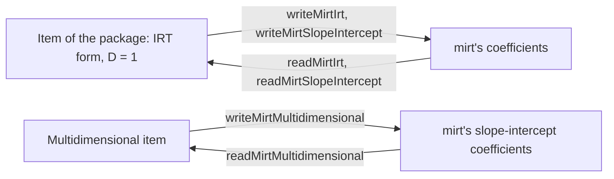

# Parameterization in mirt's coefficients

`@measurekit/psychometrics/parameterization` converts item parameters ([IRT](irt.md) and
[multidimensional IRT](multidimensional.md)) to and from mirt's coefficients.



## Quick start

Write a 3PL item in mirt's slope-intercept form, and read it back:

```ts
import { threeParameterLogistic } from "@measurekit/psychometrics/irt";
import { readMirtSlopeIntercept, writeMirtSlopeIntercept } from "@measurekit/psychometrics/parameterization";

const item = { model: threeParameterLogistic, parameters: { a: 1.2, b: -0.5, c: 0.2, d: 1 } };
const coefficients = writeMirtSlopeIntercept(item); // => { a1: 1.2, d: 0.6, g: 0.2, u: 1 }, d = -a b
readMirtSlopeIntercept(coefficients, threeParameterLogistic).parameters; // => { a: 1.2, b: -0.5, c: 0.2, d: 1 }
```

## mirt

mirt reports an item's coefficients in two forms, both with D = 1: the IRT form, `coef(model, IRTpars = TRUE)`, and
the slope-intercept form, `coef(model, IRTpars = FALSE)`. The items of this library have their parameters in the
IRT form.

| Function                                      | Conversion                                                       |
| --------------------------------------------- | ---------------------------------------------------------------- |
| `writeMirtIrt(item)`                          | An item, such as a calibration's, to its IRT coefficients        |
| `writeMirtSlopeIntercept(item)`               | An item to its slope-intercept coefficients                      |
| `readMirtIrt(coefficients, model)`            | IRT coefficients to an item `{ model, parameters }` of the model |
| `readMirtSlopeIntercept(coefficients, model)` | Slope-intercept coefficients to an item of the model             |

`MirtCoefficients` is one row of `coef(model, simplify = TRUE)$items` with only the item's own columns.

| Model                                       | mirt item type          | IRT form            | Slope-intercept form                               |
| ------------------------------------------- | ----------------------- | ------------------- | -------------------------------------------------- |
| 1PL to 4PL                                  | `Rasch`, `2PL` to `4PL` | a, b, g = c, u = d  | a1 = a, d = -a b, g, u                             |
| `gradedResponse`                            | `graded`                | a, b1 to b(K-1)     | a1 = a, d_k = -a b_k                               |
| `generalizedPartialCredit`, `partialCredit` | `gpcm`, `Rasch`         | a, b1 to b(K-1)     | a1 = a, ak_k = k, d0 = 0, d_k = -a (b1 + ... + bk) |
| `ratingScale`                               | `rsm`                   | a1, b1 to b(K-1), c | the same as the IRT form                           |
| `nominalResponse`                           | `nominal`               | a1 to aK, c1 to cK  | a1, ak0 = 0 to ak(K-1) = K - 1, d0 = 0 to d(K-1)   |

A conversion from mirt throws `DataError` when a name of the form is missing or not finite, when the coefficients have
a name the form does not use, when it would divide by a slope a1 = 0, or when the parameters are invalid for the
model. Only the built-in models other than the GGUM convert.

- **Rating scale.** mirt's thresholds are b_j - c / a1, with b_j shared by its rsm items. `readMirtIrt` takes the
  location b as their mean and the steps around it; `writeMirtIrt` writes the steps as b1 to b(K-1) and c = -a b, which
  give the same thresholds.
- **Nominal.** The IRT form sums the slopes and the intercepts to 0. The slope-intercept form fixes ak0 = 0,
  ak(K-1) = K - 1 and d0 = 0, so an item whose first and last slopes are equal has none.

## Multidimensional items

Items of the [multidimensional models](multidimensional.md) have parameters in mirt's slope-intercept form, so the
conversion renames: the slopes `a` are mirt's `a1` to `aD`, and the intercept is mirt's `d`. There is no IRT form.

| Function                                        | Conversion                                                   |
| ----------------------------------------------- | ------------------------------------------------------------ |
| `writeMirtMultidimensional(item)`               | An item, such as a calibration's, to its coefficients        |
| `readMirtMultidimensional(coefficients, model)` | Coefficients to an item `{ model, parameters }` of the model |

| Model                                    | mirt item type | Coefficients                          |
| ---------------------------------------- | -------------- | ------------------------------------- |
| `multidimensionalTwoParameterLogistic`   | `2PL`          | a1 to aD, d = intercept, g = c, u = d |
| `multidimensionalThreeParameterLogistic` | `3PL`          | a1 to aD, d = intercept, g = c, u = d |
| `multidimensionalGradedResponse`         | `graded`       | a1 to aD, d1 to d(K-1) = intercepts   |

A conversion from mirt throws `DataError` when a name of the form is missing or not finite, when the coefficients have a
name the form does not use, or when the parameters are invalid for the model. Only the built-in models convert. The
number of dimensions is the number of `a` names, `a1` up to the first one not given.

```ts
import { readMirtMultidimensional } from "@measurekit/psychometrics/parameterization";
import { multidimensionalGradedResponse } from "@measurekit/psychometrics/multidimensional";

const item = readMirtMultidimensional({ a1: 1.1, a2: 0.4, d1: 2, d2: 0, d3: -1.5 }, multidimensionalGradedResponse);
item.parameters; // => { a: [1.1, 0.4], intercepts: [2, 0, -1.5] }
```

In R, write the coefficients as one object per item; jsonlite leaves out the columns of other item types:

```r
library(jsonlite)
write_json(as.data.frame(coef(model, IRTpars = TRUE, simplify = TRUE)$items), "items.json", digits = I(17))
```

and read them as items for ability estimation, or take their `parameters` as anchors for calibration:

```ts
import { readMirtIrt } from "@measurekit/psychometrics/parameterization";
import { generalizedPartialCredit, threeParameterLogistic } from "@measurekit/psychometrics/irt";

const items = [
  readMirtIrt({ a: 1.09, b: -1.46, g: 0.2, u: 1 }, threeParameterLogistic),
  readMirtIrt({ a: 0.86, b1: -3.27, b2: -2.89, b3: 1.54 }, generalizedPartialCredit),
];
items[1]; // => { parameters: { a: 0.86, b: [-3.27, -2.89, 1.54] }, ... }
```

## Errors

A conversion from mirt throws `DataError` naming the value found.

| Error                                                                             | What to do                                                                            |
| --------------------------------------------------------------------------------- | ------------------------------------------------------------------------------------- |
| A name of the form missing or not finite, or a name the form does not use         | Give the item's row of `coef(model, simplify = TRUE)$items` with its own columns only |
| A slope a1 = 0 to the IRT form, which divides by it                               | Read the item in the slope-intercept form                                             |
| A partial credit item whose scores ak are not 0, 1, ..., or d0 not 0              | Give the coefficients of a `gpcm` item as mirt writes them                            |
| A nominal item whose first and last slopes are equal, to the slope-intercept form | Read and write it in the IRT form                                                     |
| An item of a model that is not built in, or of the GGUM                           | Convert only the built-in models other than the GGUM                                  |

## Not included

| Not included                    | Why                                                         |
| ------------------------------- | ----------------------------------------------------------- |
| Conversions beyond mirt's forms | No fit: the parameterization of one more program is a line. |

## Differences from the references

None: the conversions are mirt's definitions of its two forms, checked against the coefficients of 25 items and 21
multidimensional items set in mirt ([validation](validation.md#datasets)).
