# Performance of psychometrics

What the hot paths of `@measurekit/psychometrics` cost against their references, how much each entry point adds to a
bundle, and the memory that each reader of untrusted input needs on its worst input.

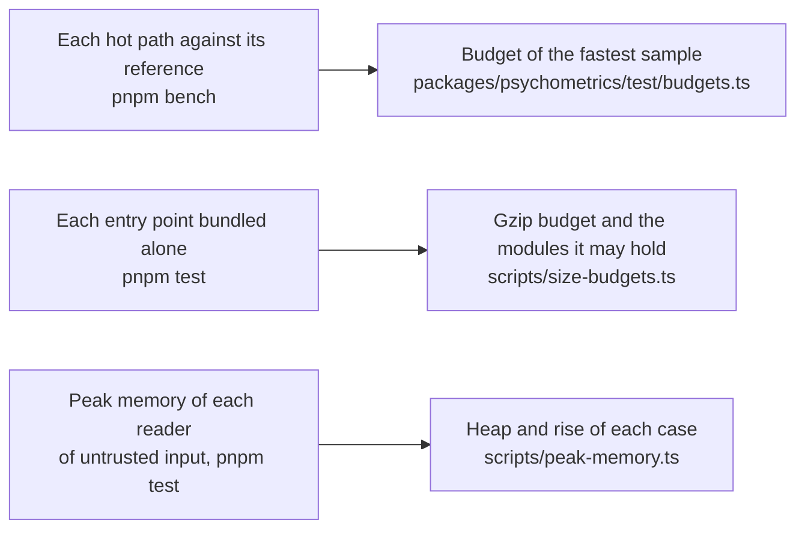

## Speed

Each benchmark times the hot path of each module against its reference in R, or RSMTool for the evaluation of automated
scores, on the same data. How each side is timed, how the ratio is read, how the budgets are set and how to refresh this
page are in the [method](../../validation/README.md#benchmarks).

<!-- charts -->

### Where measurekit is slower

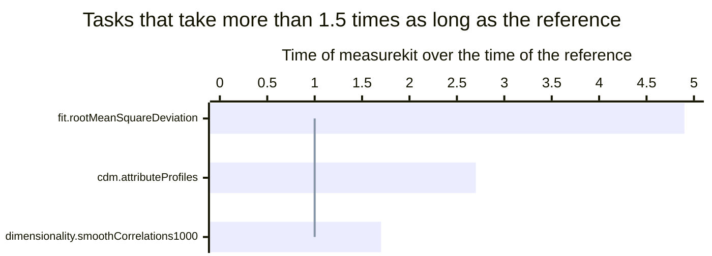

A bar above the line takes longer than the reference, and md stands for multidimensional.

### Every task

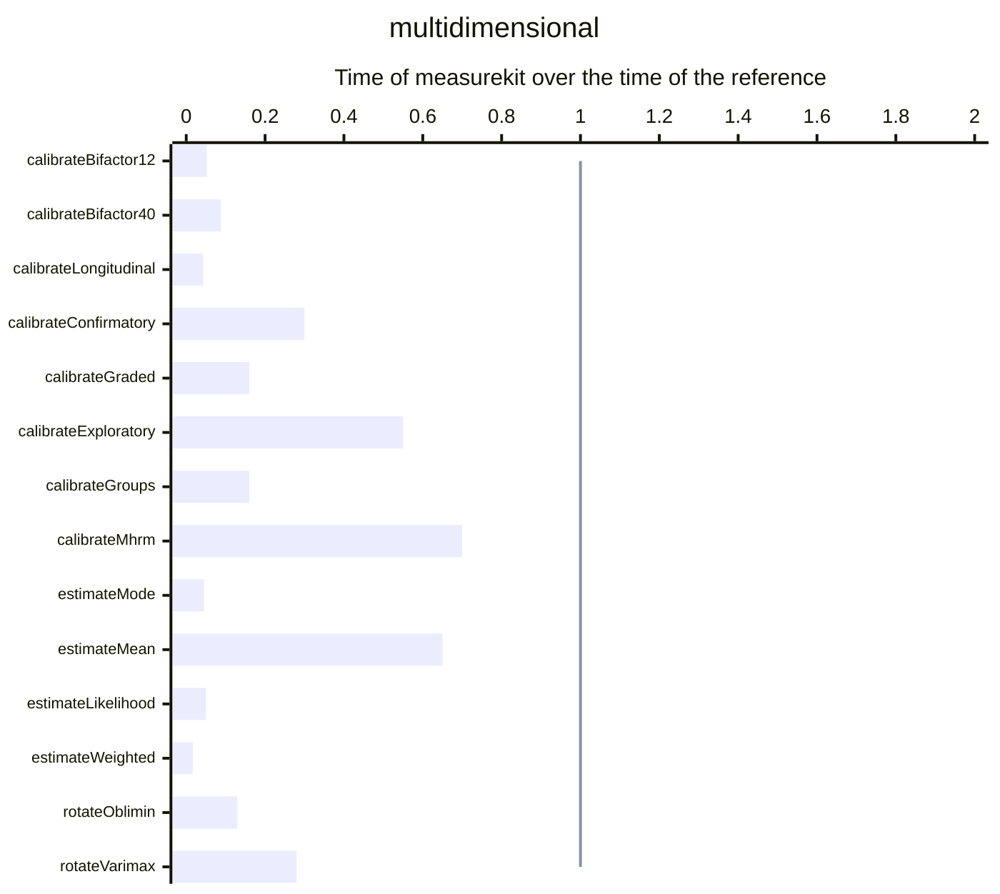

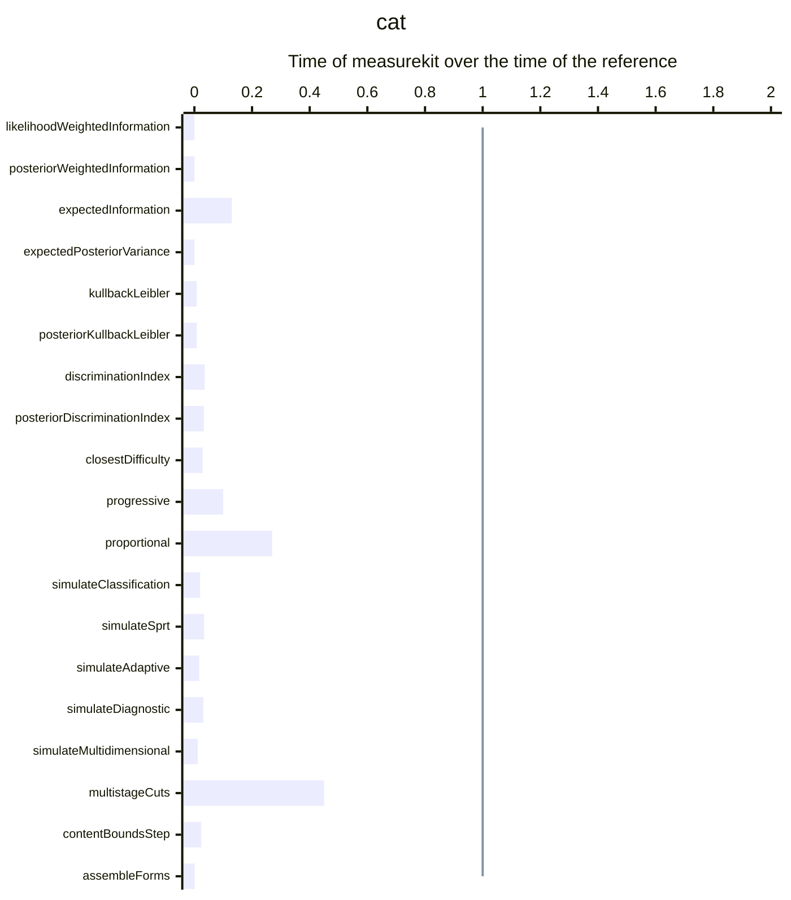

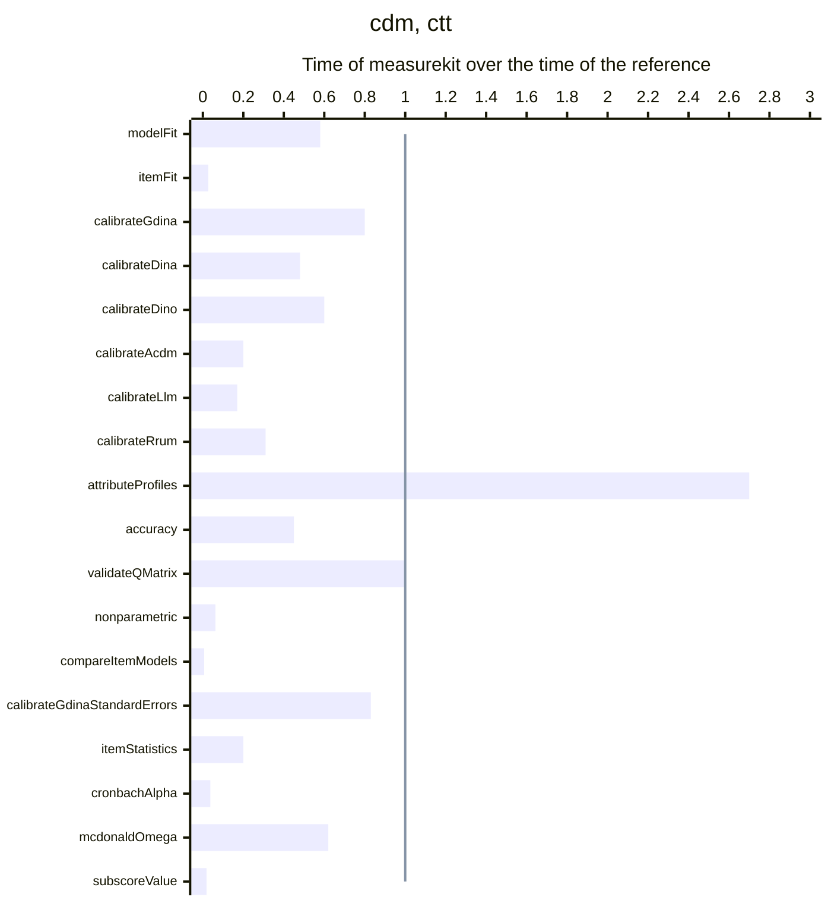

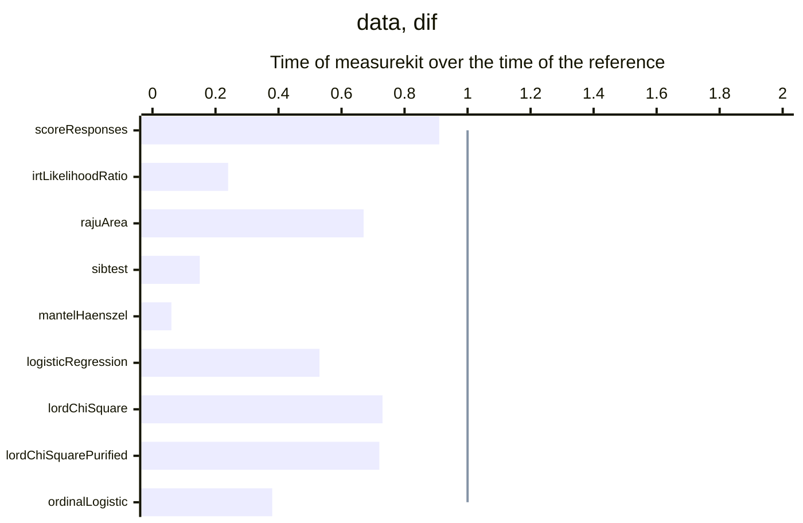

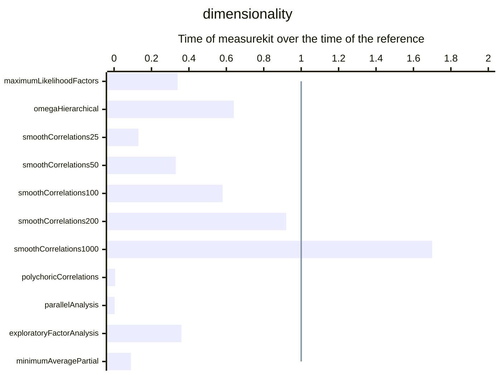

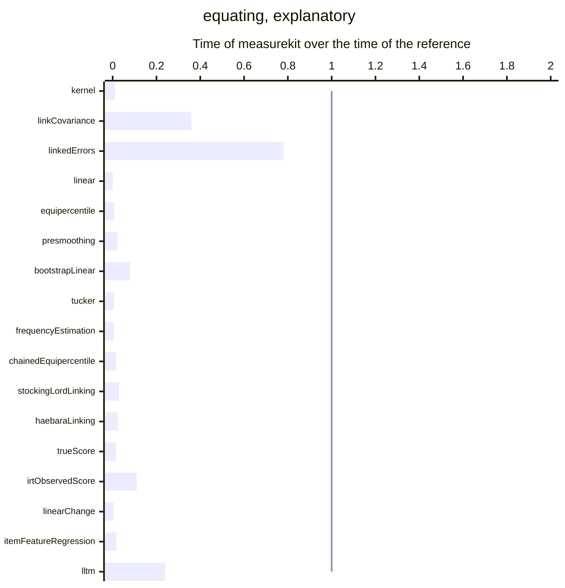

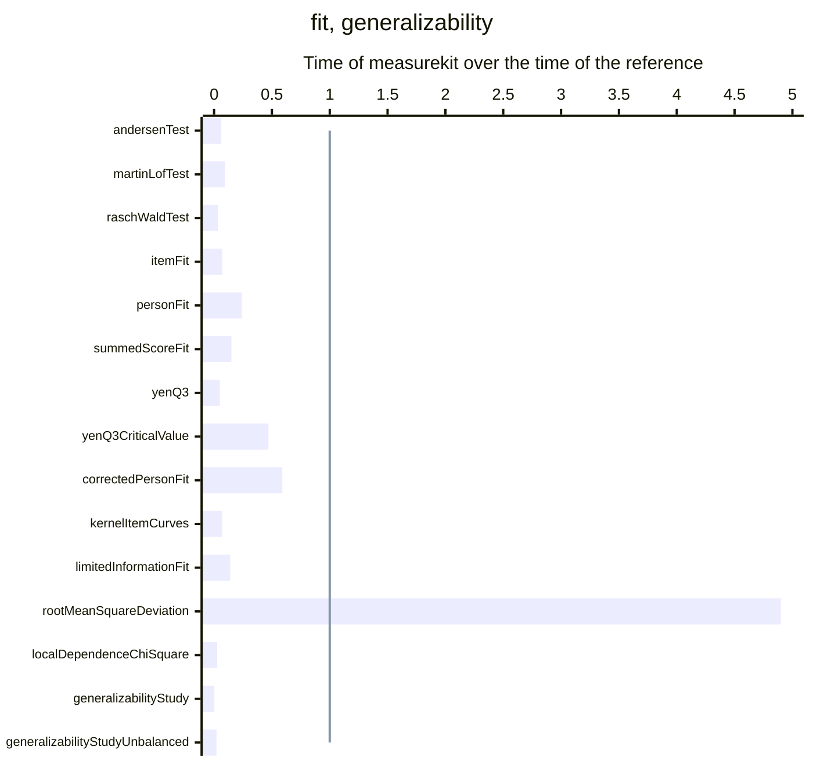

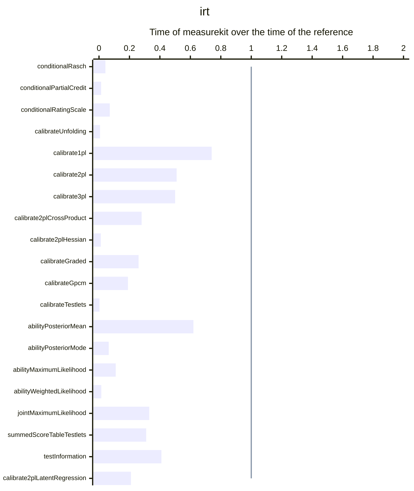

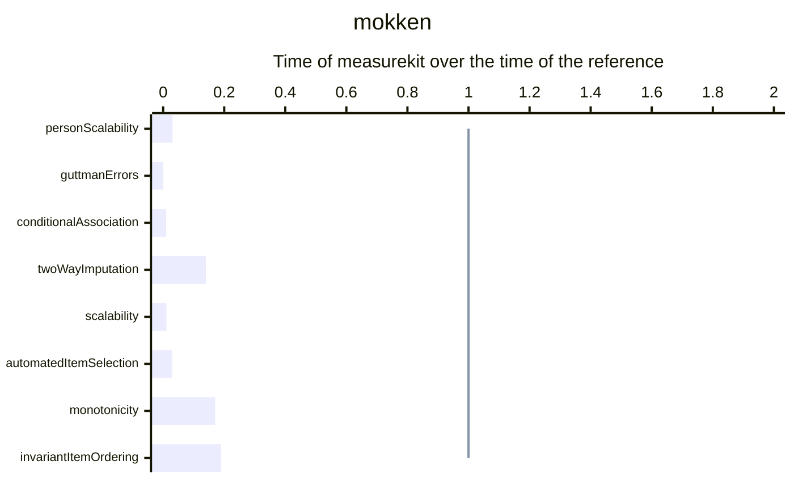

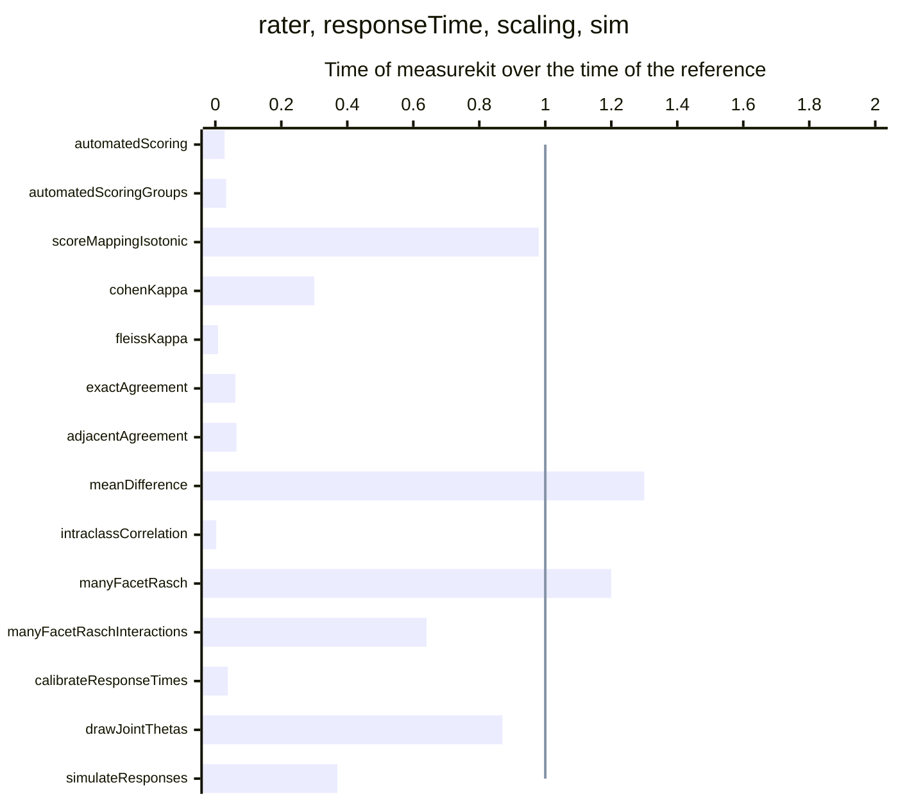

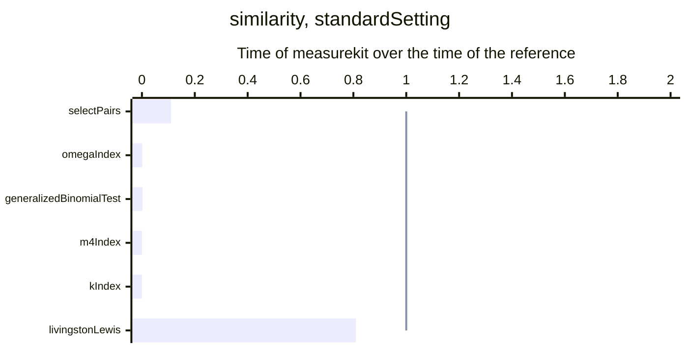

<!-- /charts -->

### Results

<!-- tables -->

Measured on Apple M5 with 10 cores, 16 GB of memory, Node.js 26.8.1 and R version 4.6.1 (2026-06-24).

| Task                                                                                                             | Size                                                                                                         | measurekit (ms) | Reference                                                                                                 | Reference (ms) |     Ratio |
| ---------------------------------------------------------------------------------------------------------------- | ------------------------------------------------------------------------------------------------------------ | --------------: | --------------------------------------------------------------------------------------------------------- | -------------: | --------: |
| Calibration of a bifactor 2PL by EM with dimension reduction                                                     | 2,000 persons, 12 items, 3 specific dimensions                                                               |            60.9 | mirt 1.48 `bfactor(quadpts = 31)`                                                                         |          1,174 |    0.052× |
| Calibration of a bifactor 2PL by EM with dimension reduction                                                     | 2,000 persons, 40 items, 4 specific dimensions                                                               |             354 | mirt 1.48 `bfactor(quadpts = 31)`                                                                         |          4,032 |    0.088× |
| One item selection by likelihood-weighted information                                                            | a pool of 500 3PL items, after 15 of 30 items                                                                |           0.169 | catR 3.17 `nextItem(criterion = "MLWI")`                                                                  |            976 |  0.00017× |
| One item selection by posterior-weighted information                                                             | a pool of 500 3PL items, after 15 of 30 items                                                                |           0.168 | catR 3.17 `nextItem(criterion = "MPWI")`                                                                  |            969 |  0.00017× |
| One item selection by maximum expected information                                                               | a pool of 500 3PL items, after 15 of 30 items                                                                |            15.0 | catR 3.17 `nextItem(criterion = "MEI")`                                                                   |            112 |     0.13× |
| One item selection by minimum expected posterior variance                                                        | a pool of 500 3PL items, after 15 of 30 items                                                                |           0.238 | catR 3.17 `nextItem(criterion = "MEPV")`                                                                  |          1,521 |  0.00016× |
| One item selection by Kullback-Leibler information                                                               | a pool of 500 3PL items, after 15 of 30 items                                                                |           0.377 | catR 3.17 `nextItem(criterion = "KL")`                                                                    |           47.0 |    0.008× |
| One item selection by posterior Kullback-Leibler information                                                     | a pool of 500 3PL items, after 15 of 30 items                                                                |           0.374 | catR 3.17 `nextItem(criterion = "KLP")`                                                                   |           47.0 |    0.008× |
| One item selection by the global discrimination index                                                            | a pool of 500 3PL items, after 15 of 30 items                                                                |           0.199 | catR 3.17 `nextItem(criterion = "GDI")`                                                                   |           5.56 |    0.036× |
| One item selection by the posterior global discrimination index                                                  | a pool of 500 3PL items, after 15 of 30 items                                                                |           0.199 | catR 3.17 `nextItem(criterion = "GDIP")`                                                                  |           6.00 |    0.033× |
| One item selection by the difficulty closest to the estimate                                                     | a pool of 500 3PL items, after 15 of 30 items                                                                |           0.001 | catR 3.17 `nextItem(criterion = "bOpt")`                                                                  |          0.048 |    0.029× |
| One item selection by the progressive method                                                                     | a pool of 500 3PL items, after 15 of 30 items                                                                |           0.007 | catR 3.17 `nextItem(criterion = "progressive")`                                                           |          0.072 |      0.1× |
| One item selection by the proportional method                                                                    | a pool of 500 3PL items, after 15 of 30 items                                                                |           0.022 | catR 3.17 `nextItem(criterion = "proportional")`                                                          |          0.080 |     0.27× |
| Simulation of adaptive tests that stop when the 95% interval of the estimate clears a cut                        | 200 persons, a pool of 500 3PL items, at most 30 items each                                                  |             109 | catR 3.17 `randomCAT(stop = list(rule = "classification"))`                                               |          5,474 |     0.02× |
| Simulation of adaptive tests that stop when the sequential probability ratio test decides at a cut               | 200 persons, a pool of 500 3PL items, at most 30 items each                                                  |            90.0 | mirtCAT 1.14 `mirtCAT(design = list(sprt_lower, sprt_upper))`                                             |          2,615 |    0.034× |
| Simulation of adaptive tests by maximum information and the posterior mean                                       | 200 persons, a pool of 500 3PL items, 30 items each                                                          |             185 | catR 3.17 `randomCAT`                                                                                     |         10,999 |    0.017× |
| Simulation of adaptive tests that select testlets as units, by their mean information                            | 200 persons, a pool of 500 3PL items with 400 in testlets of 4, 30 items each                                |             193 | none                                                                                                      |                |           |
| Simulation of diagnostic adaptive tests by the G-DINA discrimination index                                       | 200 persons, a pool of 20 items over 4 attributes, 10 items each                                             |            11.8 | cdcatR 1.0.7 `cdcat`                                                                                      |            376 |    0.031× |
| Simulation of multidimensional adaptive tests by the determinant of the information                              | 100 persons, a pool of 200 two-dimensional items, 20 items each                                              |            58.2 | mirtCAT 1.14 `mirtCAT(criteria = "Drule")`                                                                |          5,014 |    0.012× |
| Routing cuts of a multistage panel by maximum information                                                        | a panel of 1-3-3-3 modules of 20 items, from a pool of 500 3PL items                                         |            1.81 | stats 4.6.1 `uniroot on the information curves`                                                           |           4.00 |     0.45× |
| One item selection under content bounds, by the information at the estimate                                      | a pool of 1000 3PL items in 12 content areas, a test of 30 items after 12                                    |           0.128 | mirtCAT 1.14 `findNextItem(objective = computeCriteria(criteria = "MI"))` with lpSolve's `lp`             |           5.33 |    0.024× |
| Assembly of parallel forms with enemies, by weighted deviations in rotation                                      | 4 forms of 40 items from a pool of 1000 3PL items in 5 content areas, with 30 pairs of enemies and 3 targets |            10.4 | highs 1.15.1.1 `highs_solve`                                                                              |         10,013 |    0.001× |
| M2 with its RMSEA and SRMSR of a G-DINA calibration                                                              | 1,000 persons, 20 items, 4 attributes                                                                        |            9.44 | GDINA 2.13.2 `modelfit`                                                                                   |           16.4 |     0.58× |
| The fit statistics of each item of a G-DINA calibration                                                          | 1,000 persons, 20 items, 4 attributes                                                                        |            2.19 | GDINA 2.13.2 `itemfit`                                                                                    |           80.0 |    0.027× |
| Calibration of the G-DINA model by EM                                                                            | 1,000 persons, 20 items, 4 attributes                                                                        |            76.8 | GDINA 2.13.2 `GDINA(model = "GDINA")`                                                                     |           96.0 |      0.8× |
| Calibration of the DINA model by EM                                                                              | 1,000 persons, 20 items, 4 attributes                                                                        |            18.5 | GDINA 2.13.2 `GDINA(model = "DINA")`                                                                      |           39.0 |     0.48× |
| Calibration of the DINO model by EM                                                                              | 1,000 persons, 20 items, 4 attributes                                                                        |            80.8 | GDINA 2.13.2 `GDINA(model = "DINO")`                                                                      |            134 |      0.6× |
| Calibration of the A-CDM model by EM                                                                             | 1,000 persons, 20 items, 4 attributes                                                                        |            23.0 | GDINA 2.13.2 `GDINA(model = "ACDM")`                                                                      |            118 |      0.2× |
| Calibration of the LLM model by EM                                                                               | 1,000 persons, 20 items, 4 attributes                                                                        |            29.0 | GDINA 2.13.2 `GDINA(model = "LLM")`                                                                       |            167 |     0.17× |
| Calibration of the R-RUM model by EM                                                                             | 1,000 persons, 20 items, 4 attributes                                                                        |            30.5 | GDINA 2.13.2 `GDINA(model = "RRUM")`                                                                      |           98.0 |     0.31× |
| **Posterior profiles of the persons of a calibration**                                                           | 1,000 persons, 20 items, 4 attributes                                                                        |           0.378 | GDINA 2.13.2 `personparm(what = "EAP")`                                                                   |          0.140 |  **2.7×** |
| Accuracy and consistency of the classification                                                                   | 1,000 persons, 20 items, 4 attributes                                                                        |           0.472 | GDINA 2.13.2 `CA`                                                                                         |           1.04 |     0.45× |
| Validation of the Q-matrix by the proportion of variance accounted for                                           | 1,000 persons, 20 items, 4 attributes                                                                        |            2.70 | GDINA 2.13.2 `Qval(method = "PVAF")`                                                                      |           2.71 |        1× |
| Nonparametric classification by the Hamming distance                                                             | 1,000 persons, 20 items, 4 attributes                                                                        |            1.24 | NPCD 1.0.11 `AlphaNP`                                                                                     |           20.0 |    0.062× |
| Wald tests of the DINA, DINO, A-CDM, LLM and R-RUM against the G-DINA, for each item with two or more attributes | 1,000 persons, 20 items, 4 attributes                                                                        |           0.162 | GDINA 2.13.2 `modelcomp(method = "Wald")`                                                                 |           25.0 |   0.0065× |
| Calibration of the G-DINA model by EM, with the covariance of its success probabilities                          | 1,000 persons, 20 items, 4 attributes                                                                        |            82.4 | GDINA 2.13.2 `GDINA(model = "GDINA"), extract("catprob.cov", SE.type = 2)`                                |           99.0 |     0.83× |
| Item difficulty, discrimination and the statistics of the items                                                  | 3,000 persons, 50 items                                                                                      |            9.64 | psych 2.6.9 `alpha`                                                                                       |           48.0 |      0.2× |
| Cronbach's alpha                                                                                                 | 3,000 persons, 50 items                                                                                      |            1.74 | psych 2.6.9 `alpha`                                                                                       |           47.5 |    0.037× |
| McDonald's omega total of one factor                                                                             | 3,000 persons, 20 items                                                                                      |            4.96 | psych 2.6.9 `omega(nfactors = 1)`                                                                         |           8.00 |     0.62× |
| The value of five subscores of ten items over the total score                                                    | 3,000 persons, 50 items                                                                                      |            2.08 | subscore 3.3 `CTTsub`                                                                                     |            113 |    0.018× |
| Scoring of the choices of persons against a key                                                                  | 2,000 persons, 50 items of 4 options                                                                         |           0.656 | base 4.6.1 `t(t(choices) == key)`                                                                         |          0.718 |     0.91× |
| The likelihood-ratio test of every item, against the model with all items equal                                  | 2,000 persons in two groups, 15 items                                                                        |           1,586 | mirt 1.48 `multipleGroup, DIF(scheme = "drop")`                                                           |          6,592 |     0.24× |
| Raju's signed and unsigned areas of every item, with both groups calibrated by the 2PL                           | 2,000 persons in two groups, 15 items                                                                        |             319 | difR 6.1.0 `difRaju`                                                                                      |            474 |     0.67× |
| SIBTEST of every item, matched on the other items                                                                | 2,000 persons in two groups, 15 items                                                                        |            10.3 | difR 6.1.0 `difSIBTEST`                                                                                   |           69.0 |     0.15× |
| The Mantel-Haenszel test of every item                                                                           | 2,000 persons in two groups, 30 items                                                                        |            5.00 | difR 6.1.0 `difMH`                                                                                        |           83.0 |     0.06× |
| Logistic regression for uniform and nonuniform DIF of every item                                                 | 2,000 persons in two groups, 30 items                                                                        |            43.9 | difR 6.1.0 `difLogistic`                                                                                  |           83.0 |     0.53× |
| Lord's chi-square of every item, with both groups calibrated by the 2PL                                          | 2,000 persons in two groups, 30 items                                                                        |             676 | difR 6.1.0 `difLord`                                                                                      |            922 |     0.73× |
| Lord's chi-square of every item, purified until two rounds flag the same items                                   | 2,000 persons in two groups, 30 items                                                                        |             676 | difR 6.1.0 `difLord, purify = TRUE`                                                                       |            938 |     0.72× |
| Ordinal logistic regression of every item                                                                        | 1,000 persons in two groups, 10 items of 4 categories                                                        |            33.2 | rms 8.2.0 `lrm, three models for an item`                                                                 |           87.0 |     0.38× |
| Five factors by maximum likelihood with oblimin rotation, and their fit                                          | 2,800 persons, 25 items of 6 categories                                                                      |            16.2 | psych 2.6.9 `fa(nfactors = 5, fm = "ml", rotate = "oblimin")`                                             |           48.0 |     0.34× |
| Omega hierarchical and total from five group factors by minimum residuals                                        | 2,800 persons, 25 items of 6 categories                                                                      |            16.3 | psych 2.6.9 `omega(nfactors = 5, fm = "minres")`                                                          |           25.3 |     0.64× |
| Smoothing of a positive definite correlation matrix, which its eigenvalues find so                               | 25 items                                                                                                     |           0.046 | psych 2.6.9 `cor.smooth`                                                                                  |          0.344 |     0.13× |
| Smoothing of a positive definite correlation matrix, which its eigenvalues find so                               | 50 items                                                                                                     |           0.176 | psych 2.6.9 `cor.smooth`                                                                                  |          0.534 |     0.33× |
| Smoothing of a positive definite correlation matrix, which its eigenvalues find so                               | 100 items                                                                                                    |           0.820 | psych 2.6.9 `cor.smooth`                                                                                  |           1.41 |     0.58× |
| Smoothing of a positive definite correlation matrix, which its eigenvalues find so                               | 200 items                                                                                                    |            4.60 | psych 2.6.9 `cor.smooth`                                                                                  |           5.00 |     0.92× |
| **Smoothing of a positive definite correlation matrix, which its eigenvalues find so**                           | 1,000 items                                                                                                  |             411 | psych 2.6.9 `cor.smooth`                                                                                  |            242 |  **1.7×** |
| Polychoric correlations of every pair of items                                                                   | 2,800 persons, 25 items of 6 categories                                                                      |            12.4 | psych 2.6.9 `polychoric`                                                                                  |          2,186 |   0.0057× |
| Parallel analysis of components and factors from polychoric correlations, 20 data sets                           | 2,800 persons, 25 items of 6 categories                                                                      |             153 | psych 2.6.9 `fa.parallel(cor = "poly")`                                                                   |         44,369 |   0.0034× |
| Five factors by minimum residuals with oblimin rotation, from Pearson correlations                               | 2,800 persons, 25 items of 6 categories                                                                      |            16.9 | psych 2.6.9 `fa(nfactors = 5, fm = "minres", rotate = "oblimin")`                                         |           46.5 |     0.36× |
| Velicer's minimum average partial test of 8 components, from Pearson correlations                                | 2,800 persons, 25 items of 6 categories                                                                      |            12.3 | psych 2.6.9 `VSS(n = 8)`                                                                                  |            137 |     0.09× |
| Kernel equating with its standard errors, from log-linear fits of degree 3                                       | 41 scores, two forms                                                                                         |            1.65 | kequate 1.6.4 `kequate("EG")`                                                                             |            148 |    0.011× |
| The link of a chain of three forms by Haebara's method, with its covariance                                      | 3 forms of 20 items                                                                                          |            5.08 | equateIRT 2.5.2 `alldirec, chainec`                                                                       |           14.0 |     0.36× |
| The standard errors of true-score equating through a mean-mean link                                              | 2 forms of 20 items                                                                                          |            8.08 | equateIRT 2.5.2 `score(se = TRUE)`                                                                        |           10.4 |     0.78× |
| Linear equating, random groups                                                                                   | 4,329 and 4,152 persons, 40 items                                                                            |           0.000 | equate 2.0.9 `equate(type = "linear")`                                                                    |          0.778 |  0.00059× |
| Equipercentile equating, random groups                                                                           | 4,329 and 4,152 persons, 40 items                                                                            |           0.003 | equate 2.0.9 `equate(type = "equipercentile")`                                                            |          0.400 |   0.0071× |
| Log-linear presmoothing of a score distribution, degree 3                                                        | 41 scores                                                                                                    |           0.027 | equate 2.0.9 `presmoothing(smoothmethod = "loglinear")`                                                   |           1.24 |    0.022× |
| Standard errors of the linear equating by 100 bootstrap replications                                             | 4,329 and 4,152 persons, 40 items                                                                            |            32.6 | equate 2.0.9 `bootstrap`                                                                                  |            414 |    0.079× |
| Tucker linear equating, nonequivalent groups                                                                     | 1,655 and 1,638 persons, 36 items, an anchor of 12                                                           |           0.012 | equate 2.0.9 `equate(method = "tucker")`                                                                  |           2.06 |   0.0056× |
| Frequency estimation equipercentile equating                                                                     | 1,655 and 1,638 persons, 36 items, an anchor of 12                                                           |           0.016 | equate 2.0.9 `equate(method = "frequency estimation")`                                                    |           3.09 |   0.0053× |
| Chained equipercentile equating                                                                                  | 1,655 and 1,638 persons, 36 items, an anchor of 12                                                           |           0.017 | equate 2.0.9 `equate(method = "chained")`                                                                 |           1.12 |    0.015× |
| Stocking-Lord linking of the common items                                                                        | Two forms of 3PL items that share 10                                                                         |           0.074 | equateIRT 2.5.2 `direc(method = "Stocking-Lord")`                                                         |           2.47 |     0.03× |
| Haebara linking of the common items                                                                              | Two forms of 3PL items that share 10                                                                         |           0.067 | equateIRT 2.5.2 `direc(method = "Haebara")`                                                               |           2.76 |    0.024× |
| IRT true score equating of the linked forms                                                                      | Two forms of 3PL items that share 10                                                                         |           0.059 | equateIRT 2.5.2 `score(method = "TSE")`                                                                   |           3.89 |    0.015× |
| IRT observed score equating of the linked forms                                                                  | Two forms of 3PL items that share 10                                                                         |           0.323 | equateIRT 2.5.2 `score(method = "OSE")`                                                                   |           3.00 |     0.11× |
| The linear logistic model of change: a trend and a group effect on each item                                     | 2,000 persons, 8 items, 2 occasions, 2 groups                                                                |           0.857 | eRm 1.0.10 `LLRA`                                                                                         |            274 |   0.0031× |
| Regression of item difficulties on three features by REML                                                        | 300 items, 3 features                                                                                        |           0.318 | metafor 5.2.1 `rma(method = "REML")`                                                                      |           18.5 |    0.017× |
| The linear logistic test model: the effects of three features on difficulty, by EM                               | 1,000 persons, 20 items, 3 features                                                                          |            67.7 | mirt 1.48 `mirt(itemtype = "Rasch", itemdesign), Oakes standard errors`                                   |            283 |     0.24× |
| Andersen's likelihood-ratio test of the Rasch model, split at the median score                                   | 2,000 persons, 15 items                                                                                      |            14.9 | eRm 1.0.10 `LRtest(RM)`                                                                                   |            242 |    0.061× |
| Martin-Löf's test of the Rasch model, the items split at their median                                            | 2,000 persons, 15 items                                                                                      |            14.8 | eRm 1.0.10 `MLoef(RM)`                                                                                    |            157 |    0.094× |
| The Wald test of each item of the Rasch model, split at the median score                                         | 2,000 persons, 15 items                                                                                      |            7.87 | eRm 1.0.10 `Waldtest(RM)`                                                                                 |            234 |    0.034× |
| Infit and outfit of the items                                                                                    | 2,000 persons, 40 items                                                                                      |            2.23 | mirt 1.48 `itemfit(fit_stats = "infit")`                                                                  |           31.5 |    0.071× |
| Infit, outfit and the standardized log-likelihood of the persons                                                 | 2,000 persons, 40 items                                                                                      |            6.37 | mirt 1.48 `personfit`                                                                                     |           26.0 |     0.24× |
| The summed-score statistic S-X2 of the items                                                                     | 2,000 persons, 40 items                                                                                      |            9.25 | mirt 1.48 `itemfit(fit_stats = "S_X2")`                                                                   |           62.0 |     0.15× |
| Yen's Q3 of every pair of items                                                                                  | 2,000 persons, 40 items                                                                                      |            8.63 | mirt 1.48 `residuals(type = "Q3")`                                                                        |            173 |     0.05× |
| The critical value of Q3 by a parametric bootstrap of 10 replications                                            | 2,000 persons, 40 items                                                                                      |           2,149 | mirt 1.48 `mirt, fscores and residuals(type = "Q3") in each replication`                                  |          4,598 |     0.47× |
| Snijders' lz* of the persons at their posterior modes                                                            | 2,000 persons, 40 items                                                                                      |            3.53 | PerFit 1.4.7 `lzstar(Ability.PModel = "BM")`                                                              |           6.00 |     0.59× |
| Kernel-smoothed curves of the categories of the items at 51 points                                               | 2,000 persons, 40 items                                                                                      |            21.4 | KernSmoothIRT 6.6 `ksIRT(format = 2)`                                                                     |            307 |     0.07× |
| M2* with its RMSEA, SRMSR, TLI and CFI                                                                           | 2,000 persons, 40 items                                                                                      |            91.7 | mirt 1.48 `M2`                                                                                            |            641 |     0.14× |
| **The RMSD and mean deviation of the items, at 61 nodes**                                                        | 2,000 persons, 40 items                                                                                      |            11.6 | TAM 4.3.25 `IRT.RMSD`                                                                                     |           2.35 |  **4.9×** |
| Chen and Thissen's chi-square of every pair of items                                                             | 2,000 persons, 40 items                                                                                      |            11.0 | mirt 1.48 `residuals(type = "LD")`                                                                        |            406 |    0.027× |
| Variance components of a fully crossed design of three facets                                                    | 200 persons, 10 items, 4 raters: 8,000 scores                                                                |            1.97 | lme4 2.1.0 `lmer, six random effects, REML`                                                               |            764 |   0.0026× |
| Variance components of a design of three facets with a quarter of the scores missing, by Henderson's Method 1    | 200 persons, 10 items, 4 raters: 6,058 scores                                                                |            2.54 | base 4.6.1 `method_one, Henderson's Method 1`                                                             |            123 |    0.021× |
| The Rasch model by conditional maximum likelihood                                                                | 2,000 persons, 15 items                                                                                      |            3.81 | eRm 1.0.10 `RM`                                                                                           |           91.0 |    0.042× |
| The partial credit model by conditional maximum likelihood                                                       | 1,500 persons, 8 items of 4 categories                                                                       |            3.19 | eRm 1.0.10 `PCM`                                                                                          |            230 |    0.014× |
| The rating scale model by conditional maximum likelihood                                                         | 1,500 persons, 8 items of 4 categories                                                                       |            3.61 | eRm 1.0.10 `RSM`                                                                                          |           50.5 |    0.071× |
| Calibration of the generalized graded unfolding model                                                            | 2,000 persons, 15 items of 4 categories                                                                      |             274 | mirt 1.48 `mirt(itemtype = "ggum")`                                                                       |         39,232 |    0.007× |
| Calibration of the one-parameter model by EM                                                                     | 2,000 persons, 40 dichotomous items                                                                          |            75.3 | mirt 1.48 `mirt(itemtype = "Rasch")`                                                                      |            102 |     0.74× |
| Calibration of the two-parameter model by EM                                                                     | 2,000 persons, 40 dichotomous items                                                                          |            94.6 | mirt 1.48 `mirt(itemtype = "2PL")`                                                                        |            187 |     0.51× |
| Calibration of the three-parameter model by EM                                                                   | 2,000 persons, 40 dichotomous items                                                                          |             570 | mirt 1.48 `mirt(itemtype = "3PL")`                                                                        |          1,145 |      0.5× |
| The two-parameter model with cross-product standard errors                                                       | 2,000 persons, 40 dichotomous items                                                                          |             113 | mirt 1.48 `mirt(SE.type = "crossprod")`                                                                   |            401 |     0.28× |
| The two-parameter model with standard errors from the Hessian                                                    | 500 persons, 20 items                                                                                        |            85.2 | mirt 1.48 `mirt(SE.type = "Richardson")`                                                                  |          6,825 |    0.012× |
| Calibration of the graded response model by EM                                                                   | 1,500 persons, 20 items of 5 categories                                                                      |            45.7 | mirt 1.48 `mirt(itemtype = "graded")`                                                                     |            173 |     0.26× |
| Calibration of the generalized partial credit model by EM                                                        | 1,500 persons, 20 items of 5 categories                                                                      |            70.9 | mirt 1.48 `mirt(itemtype = "gpcm")`                                                                       |            375 |     0.19× |
| Calibration of the testlet model by EM                                                                           | 1,000 persons, 6 testlets of 5 items                                                                         |            54.9 | mirt 1.48 `bfactor`                                                                                       |         17,934 |   0.0031× |
| Ability by the posterior mean                                                                                    | 2,000 persons, the 40 items of the calibration                                                               |            21.3 | mirt 1.48 `fscores(method = "EAP")`                                                                       |           34.5 |     0.62× |
| Ability by the posterior mode                                                                                    | 2,000 persons, the 40 items of the calibration                                                               |            66.1 | mirt 1.48 `fscores(method = "MAP")`                                                                       |          1,035 |    0.064× |
| Ability by maximum likelihood                                                                                    | 2,000 persons, the 40 items of the calibration                                                               |            66.0 | mirt 1.48 `fscores(method = "ML")`                                                                        |            616 |     0.11× |
| Ability by weighted likelihood                                                                                   | 2,000 persons, the 40 items of the calibration                                                               |             123 | mirt 1.48 `fscores(method = "WLE")`                                                                       |          8,172 |    0.015× |
| Joint maximum likelihood calibration of the Rasch model                                                          | 2,000 persons, 40 items                                                                                      |            8.98 | TAM 4.3.25 `tam.jml`                                                                                      |           27.0 |     0.33× |
| The posterior mean of the ability given each summed score                                                        | 40 items                                                                                                     |           0.178 | none                                                                                                      |                |           |
| The posterior mean of the ability given each summed score, with testlets                                         | 40 items in 8 testlets of 5                                                                                  |            9.81 | mirt 1.48 `fscores(method = "EAPsum_2.0")`                                                                |           32.0 |     0.31× |
| Information of a test at 121 values of theta                                                                     | 40 items                                                                                                     |           0.597 | mirt 1.48 `testinfo`                                                                                      |           1.44 |     0.41× |
| Calibration of the two-parameter model with a latent regression by EM                                            | 2,000 persons, 40 dichotomous items                                                                          |             121 | mirt 1.48 `mirt(itemtype = "2PL", covdata, formula = ~ x)`                                                |            583 |     0.21× |
| The normed Guttman errors, U3 and Ht of every person                                                             | 2,000 persons, 40 dichotomous items                                                                          |            2.69 | PerFit 1.4.7 `Gnormed, U3, Ht`                                                                            |           87.0 |    0.031× |
| The Guttman errors of every person                                                                               | 433 persons, 20 items of 5 categories                                                                        |           0.468 | mokken 3.1.2 `check.errors`                                                                               |            860 |  0.00054× |
| The W1, W2 and W3 indices of conditional association                                                             | 433 persons, 20 items of 5 categories                                                                        |            36.7 | mokken 3.1.2 `check.ca(Windex = TRUE)`                                                                    |          3,495 |     0.01× |
| Two-way imputation of the missing responses                                                                      | 433 persons, 20 items of 5 categories, one in ten missing                                                    |           0.361 | mokken 3.1.2 `twoway`                                                                                     |           2.53 |     0.14× |
| Scalability coefficients with standard errors                                                                    | 433 persons, 20 items of 5 categories                                                                        |            2.13 | mokken 3.1.2 `coefH(se = TRUE)`                                                                           |            192 |    0.011× |
| Automated item selection into Mokken scales                                                                      | 433 persons, 20 items of 5 categories                                                                        |           0.923 | mokken 3.1.2 `aisp`                                                                                       |           31.0 |     0.03× |
| The check of monotonicity of every item                                                                          | 433 persons, 20 items of 5 categories                                                                        |            1.89 | mokken 3.1.2 `check.monotonicity`                                                                         |           10.8 |     0.17× |
| The check of invariant item ordering, with selection of items                                                    | 433 persons, 20 items of 5 categories                                                                        |            12.4 | mokken 3.1.2 `check.iio(method = "MIIO")`                                                                 |           65.0 |     0.19× |
| Calibration of a trait over three occasions by EM                                                                | 1,000 persons, 3 occasions of 10 items                                                                       |           2,011 | mirt 1.48 `mirt(model, constrain, quadpts = 21)`                                                          |         46,897 |    0.043× |
| Calibration of a confirmatory two-dimensional 2PL by EM                                                          | 1,000 persons, 24 items, 2 correlated dimensions                                                             |             222 | mirt 1.48 `mirt(model, quadpts = 31)`                                                                     |            744 |      0.3× |
| Calibration of a confirmatory two-dimensional graded model by EM                                                 | 1,000 persons, 20 items of 4 categories, 2 correlated dimensions                                             |             278 | mirt 1.48 `mirt(itemtype = "graded", quadpts = 31)`                                                       |          1,789 |     0.16× |
| Calibration of an exploratory two-dimensional 2PL by EM                                                          | 1,000 persons, 20 items, 2 dimensions                                                                        |           1,566 | mirt 1.48 `mirt(data, 2, quadpts = 31)`                                                                   |          2,864 |     0.55× |
| Calibration of a confirmatory two-dimensional 2PL in two groups by EM                                            | 1,000 persons in 2 groups, 24 items, 2 correlated dimensions                                                 |             339 | mirt 1.48 `multipleGroup(invariance = c("slopes", "intercepts", "free_means", "free_var"), quadpts = 31)` |          2,168 |     0.16× |
| Calibration of a five-dimensional graded model by Metropolis-Hastings Robbins-Monro                              | 800 persons, 25 items of 6 categories, 5 correlated dimensions                                               |          10,844 | mirt 1.48 `mirt(method = "MHRM")`                                                                         |         15,487 |      0.7× |
| Abilities by the posterior mode, in two dimensions                                                               | 1,000 persons, 24 items                                                                                      |            33.9 | mirt 1.48 `fscores(method = "MAP")`                                                                       |            746 |    0.045× |
| Abilities by the posterior mean, in two dimensions                                                               | 1,000 persons, 24 items                                                                                      |            31.1 | mirt 1.48 `fscores(method = "EAP")`                                                                       |           47.5 |     0.65× |
| Abilities by maximum likelihood, in two dimensions                                                               | 1,000 persons, 24 items                                                                                      |            70.7 | mirt 1.48 `fscores(method = "ML")`                                                                        |          1,404 |     0.05× |
| Abilities by weighted likelihood, in two dimensions                                                              | 1,000 persons, 24 items                                                                                      |             250 | mirt 1.48 `fscores(method = "WLE")`                                                                       |         15,032 |    0.017× |
| Oblimin rotation of the loadings of a calibration                                                                | 20 items, 2 dimensions                                                                                       |           0.029 | GPArotation 2026.8.2 `oblimin`                                                                            |          0.220 |     0.13× |
| Varimax rotation of the loadings of a calibration                                                                | 20 items, 2 dimensions                                                                                       |           0.022 | GPArotation 2026.8.2 `Varimax`                                                                            |          0.077 |     0.28× |
| Machine-human and human-human metrics, their degradation and the disattenuated correlation                       | 8,859 essays, two human raters                                                                               |            2.22 | RSMTool 12.0.0 `compute_degradation_and_disattenuated_correlations`                                       |           79.2 |    0.028× |
| Machine-human metrics of all essays and of each group, the SMD on the population's SDs                           | 1,818 essays in 6 groups                                                                                     |           0.475 | RSMTool 12.0.0 `metrics_helper`                                                                           |           14.5 |    0.033× |
| The coverage and agreement of the machine at each confidence of the scorer                                       | 8,859 essays, 89 confidences                                                                                 |            1.72 | none                                                                                                      |                |           |
| The isotonic mapping from machine to human scores                                                                | 8,859 essays                                                                                                 |           0.726 | stats 4.6.1 `isoreg`                                                                                      |          0.740 |     0.98× |
| Cohen's kappa of two raters                                                                                      | 2,000 subjects, 5 categories                                                                                 |           0.073 | irr 0.85 `kappa2`                                                                                         |          0.240 |      0.3× |
| Fleiss' kappa of five raters                                                                                     | 500 subjects, 5 raters, 5 categories                                                                         |           0.065 | irr 0.85 `kappam.fleiss`                                                                                  |           8.00 |   0.0081× |
| The share of subjects on whom five raters agree exactly                                                          | 500 subjects, 5 raters, 5 categories                                                                         |           0.021 | irr 0.85 `agree(tolerance = 0)`                                                                           |          0.348 |    0.061× |
| The share of subjects whose ratings are within one category                                                      | 500 subjects, 5 raters, 5 categories                                                                         |           0.022 | irr 0.85 `agree(tolerance = 1)`                                                                           |          0.348 |    0.064× |
| The standardized mean difference of two raters                                                                   | 2,000 subjects, 2 raters                                                                                     |           0.203 | effsize 0.8.1 `cohen.d`                                                                                   |          0.152 |      1.3× |
| The six intraclass correlations of four raters                                                                   | 200 subjects, 4 raters                                                                                       |           0.016 | psych 2.6.9 `ICC`                                                                                         |           5.50 |   0.0029× |
| The many-facet Rasch model of items and raters, with standard errors                                             | 200 persons, 10 items, 4 raters: 8,000 scores                                                                |            55.6 | TAM 4.3.25 `tam.mml.mfr(formulaA = ~ item + rater + step)`                                                |           45.0 |      1.2× |
| The many-facet Rasch model of items and raters with their interaction, with standard errors                      | 150 persons, 8 items, 3 raters: 3,600 scores                                                                 |            41.6 | TAM 4.3.25 `tam.mml.mfr(formulaA = ~ item + rater + item:rater + step)`                                   |           65.0 |     0.64× |
| The lognormal model of the response times                                                                        | 1,000 persons, 20 items                                                                                      |            6.04 | nlme 3.1.169 `lme(logtime ~ 0 + item, random = ~ 1 \| person)`                                            |            161 |    0.038× |
| The joint model of speed and accuracy, with the 2PL                                                              | 1,000 persons, 20 items                                                                                      |             476 | none                                                                                                      |                |           |
| Speed of each person given the times of the items                                                                | 1,000 persons, 20 items                                                                                      |           0.961 | none                                                                                                      |                |           |
| Joint draws of theta from separate posteriors by a Gaussian copula                                               | 2,000 draws, 6 posteriors of 241 nodes                                                                       |           0.997 | mvtnorm 1.4.2 `rmvnorm(method = "eigen")`                                                                 |           1.14 |     0.87× |
| Norms of a weighted sample: mean, SD, z and rank of each score, stanines, standard errors                        | 10,000 persons, 30 distinct scores                                                                           |            1.83 | none                                                                                                      |                |           |
| A conversion table of the posterior mean of theta given each summed score                                        | 40 items                                                                                                     |           0.395 | none                                                                                                      |                |           |
| A conversion table of the theta of each summed true score                                                        | 40 items                                                                                                     |           0.657 | none                                                                                                      |                |           |
| The cut score of a bookmark in an ordered item booklet                                                           | 40 items                                                                                                     |           0.029 | none                                                                                                      |                |           |
| Accuracy and consistency of the classification by two cuts                                                       | 2,000 persons                                                                                                |           0.326 | none                                                                                                      |                |           |
| Conversion of 2PL items to mirt's slope-intercept form                                                           | 10,000 items                                                                                                 |            1.16 | none                                                                                                      |                |           |
| Conversion of 2PL items to mirt's IRT form                                                                       | 10,000 items                                                                                                 |            1.21 | none                                                                                                      |                |           |
| Simulation of the abilities of persons and their responses to 2PL items                                          | 2,000 persons, 40 items                                                                                      |            2.21 | mirt 1.48 `simdata(itemtype = "dich")`                                                                    |           6.00 |     0.37× |
| The pairs of the persons who share a room                                                                        | 1,000 persons in rooms of 25, 12,000 pairs                                                                   |           0.325 | base R `expand.grid` of each room, as CopyDetect 1.3's `centers`                                          |           2.85 |     0.11× |
| Wollack's omega of each pair, nominal responses                                                                  | 1,200 ordered pairs of 2 rooms of 25, 40 items of 5 options                                                  |            1.82 | CopyDetect 1.4 `omega2`                                                                                   |          1,396 |   0.0013× |
| The generalized binomial test of each pair, nominal responses                                                    | 1,200 ordered pairs of 2 rooms of 25, 40 items of 5 options                                                  |            2.63 | CopyDetect 1.4 `gbt2`                                                                                     |          1,235 |   0.0021× |
| Maynes' M4 of each pair, nominal responses                                                                       | 1,200 ordered pairs of 2 rooms of 25, 40 items of 5 options                                                  |            17.6 | CopyDetect 1.4 `M4_2`                                                                                     |         58,112 |   0.0003× |
| The K index, K1, K2, S1 and S2 of each pair, nominal responses                                                   | 1,200 ordered pairs of 2 rooms of 25, 40 items of 5 options                                                  |            3.28 | CopyDetect 1.4 `k_2 and ks12`                                                                             |        125,820 | 0.000026× |
| Livingston and Lewis's accuracy and consistency by one cut                                                       | 3,000 scores of 40 items                                                                                     |           0.296 | betafunctions 2.0.0 `LL.CA`                                                                               |          0.364 |     0.81× |

- Simulation of adaptive tests that select testlets as units, by their mean information: catR has no testlets, so no reference does this task.
- Assembly of parallel forms with enemies, by weighted deviations in rotation: highs finds the forms whose largest gap from the target is smallest (minimax), to its limit of 10 seconds..
- The fit statistics of each item of a G-DINA calibration: itemfit's expected values come from a simulation of persons, and measurekit's are exact sums over the profiles.
- Posterior profiles of the persons of a calibration: personparm multiplies the log posterior that the fit stored by the profiles, which is work of the fit; measurekit's calibration holds no posterior, so it computes each person's from the responses, and returns the posterior, the probability of each attribute and the MAP and EAP profiles. The same computation in R, with matrix products, takes NA ms.
- Wald tests of the DINA, DINO, A-CDM, LLM and R-RUM against the G-DINA, for each item with two or more attributes: modelcomp computes the covariance of the success probabilities of the fit again for each item; measurekit's comes with its calibration, which cdm.calibrateGdinaStandardErrors times.
- Raju's signed and unsigned areas of every item, with both groups calibrated by the 2PL: difRaju calibrates by ltm's marginal maximum likelihood, and measurekit by EM.
- Five factors by maximum likelihood with oblimin rotation, and their fit: fa also computes factor scores' statistics and other fit indices, which measurekit leaves out.
- Omega hierarchical and total from five group factors by minimum residuals: omega also computes the fit of the general factor and of the group factors, which measurekit leaves out.
- Smoothing of a positive definite correlation matrix, which its eigenvalues find so: cor.smooth takes the eigenvectors too, by base R's eigen, which runs LAPACK's dsyevr on OpenBLAS, a reduction in blocks and MRRR in native code; measurekit takes the eigenvalues alone, by Householder's reduction and the QL iterations in JavaScript.
- Five factors by minimum residuals with oblimin rotation, from Pearson correlations: fa also computes fit statistics, and this task leaves them out.
- Velicer's minimum average partial test of 8 components, from Pearson correlations: VSS also fits 8 factor solutions with their very simple structure and fit statistics, which this task leaves out.
- The link of a chain of three forms by Haebara's method, with its covariance: alldirec links each pair of forms both ways, twice the links of the chain, as chainec takes no other list; equateIRT differentiates the links analytically, and measurekit, for items of any model, by central differences of one Newton step from each link's minimum.
- Kernel-smoothed curves of the categories of the items at 51 points: ksIRT also computes the expected scores, the correlation of each item with the total and the maximum likelihood theta of each person on the curves.
- The RMSD and mean deviation of the items, at 61 nodes: IRT.RMSD reads the expected counts that the calibration stored, which is work of the calibration; measurekit takes items, so it computes each person's posterior from the responses. The same computation in R, with matrix products, takes 4.6 ms.
- The Rasch model by conditional maximum likelihood: eRm maximizes with nlm, which stops on its own criteria, and measurekit by Newton's method to a change of 1e-6.
- The partial credit model by conditional maximum likelihood: eRm maximizes with nlm, which stops on its own criteria, and measurekit by Newton's method to a change of 1e-6.
- The rating scale model by conditional maximum likelihood: eRm maximizes with nlm, which stops on its own criteria, and measurekit by Newton's method to a change of 1e-6.
- Calibration of the generalized graded unfolding model: measurekit fits in the GGUM package's three stages from its starts, and mirt from its own starts.
- The W1, W2 and W3 indices of conditional association: check.ca removes the item with the most flags and runs again until none is flagged, and measurekit runs its first pass.
- Calibration of a trait over three occasions by EM: the occasions are dimensions, and the items of each occasion are columns tied by constrain.
- Calibration of an exploratory two-dimensional 2PL by EM: mirt stops at its limit of 500 cycles when it has not converged.
- Calibration of a five-dimensional graded model by Metropolis-Hastings Robbins-Monro: both draw the abilities, so the time depends on the seed; mirt runs with one.
- Abilities by maximum likelihood, in two dimensions: both keep the estimates in [-6, 6]: mirt with `max_theta = 6`.
- Abilities by weighted likelihood, in two dimensions: both keep the estimates in [-6, 6]: mirt with `max_theta = 6`; for the M2PL, mirt's mode of the likelihood times √det I is Warm's estimator.
- The isotonic mapping from machine to human scores: the essays are ordered by machine score and, within one, by human score from the highest.
- The many-facet Rasch model of items and raters, with standard errors: TAM takes its standard errors from the diagonal of the second derivatives of its last M-step, with no E-step more, and measurekit from the Hessian of the marginal log-likelihood by central differences of its exact gradient, two E-steps for each parameter, which take about half its time: its estimates alone take about 0.6 times as long as TAM's.
- The lognormal model of the response times: measurekit also estimates the item discriminations.
- Joint draws of theta from separate posteriors by a Gaussian copula: the posteriors' distribution functions are inverted by base R's approx.
- The pairs of the persons who share a room: base R forms each pair both ways, and measurekit once.
- Livingston and Lewis's accuracy and consistency by one cut: LL.CA integrates by integrate's default relative tolerance, about 1.2e-4, and measurekit to 1e-12; at LL.CA's tolerance measurekit takes about a quarter of LL.CA's time.

<!-- /tables -->

### Iterations

The iterations that each EM calibration of the tables needed to reach its tolerance, on the data of the benchmark. A
ratio of times is the product of a ratio of iterations and a ratio of the time of one. The one-parameter to the
generalized partial credit calibrations, the multidimensional ones, the many-facet Rasch model and the linear logistic
test model of measurekit extrapolate EM with SQUAREM, as mirt does with Ramsay's method; the others run plain EM. Every
EM iteration counts, those that follow an extrapolation included. EM stops when an iteration changes no parameter by
more than the tolerance, which leaves the estimates some distance from the maximum, more where EM contracts slowly.
Extrapolated, they stop closer to it than plain EM does, by up to about 1e-3 at the default tolerance (the confirmatory
2PL is 1.3e-4 from the maximum, was 4.8e-4); at a tolerance of 1e-8 both are at it.

| Calibration                         | measurekit | Reference |
| ----------------------------------- | ---------: | --------: |
| One-parameter model                 |         10 |         9 |
| Two-parameter model                 |         13 |        19 |
| Three-parameter model               |         81 |       183 |
| Graded response model               |         12 |        11 |
| Generalized partial credit model    |         19 |        37 |
| Confirmatory two-dimensional 2PL    |         12 |        24 |
| Confirmatory two-dimensional graded |         12 |        43 |
| Exploratory two-dimensional 2PL     |        100 |       135 |
| G-DINA                              |        187 |       184 |
| DINA                                |         44 |        45 |
| DINO                                |        195 |       231 |
| A-CDM                               |         40 |        33 |
| LLM                                 |         52 |        61 |
| R-RUM                               |         53 |        27 |

## Size

Each entry point bundled alone with esbuild ([method](../../validation/README.md#sizes-and-peak-memory)). Every package
declares `sideEffects: false`, so a named import holds only what that name needs: `createAdaptiveTest` from
`@measurekit/psychometrics/cat` bundles to 16.6 KB minified, 5.9 KB after gzip, with `cat`, `checks`, `irt`, `math` and
core, and none of the `cdm`, `data`, `multidimensional` and `sim` that the subpath's other functions take.

| Entry point                                  | Minified (bytes) | Gzip (bytes) | Modules it holds besides its own                          |
| -------------------------------------------- | ---------------: | -----------: | --------------------------------------------------------- |
| `@measurekit/psychometrics`                  |            2,572 |        1,348 | core                                                      |
| `@measurekit/psychometrics/cat`              |           75,174 |       25,109 | core, cdm, checks, data, irt, math, multidimensional, sim |
| `@measurekit/psychometrics/cdm`              |           44,456 |       16,262 | core, checks, data, irt, math                             |
| `@measurekit/psychometrics/change`           |            5,790 |        2,518 | core, checks                                              |
| `@measurekit/psychometrics/ctt`              |           22,896 |        8,748 | core, data, math                                          |
| `@measurekit/psychometrics/data`             |            7,148 |        2,522 | core                                                      |
| `@measurekit/psychometrics/dif`              |           94,478 |       32,480 | core, data, equating, irt, math                           |
| `@measurekit/psychometrics/dimensionality`   |           39,464 |       14,720 | core, data, math                                          |
| `@measurekit/psychometrics/equating`         |           64,412 |       22,006 | core, checks, irt, math                                   |
| `@measurekit/psychometrics/explanatory`      |           51,512 |       17,997 | core, data, irt, math                                     |
| `@measurekit/psychometrics/fit`              |          118,124 |       40,292 | core, checks, data, irt, math, sim                        |
| `@measurekit/psychometrics/generalizability` |           15,272 |        5,656 | core, data, math                                          |
| `@measurekit/psychometrics/irt`              |           90,656 |       30,543 | core, checks, data, math                                  |
| `@measurekit/psychometrics/mokken`           |           33,502 |       12,463 | core, data, math                                          |
| `@measurekit/psychometrics/multidimensional` |          136,972 |       44,536 | core, checks, data, irt, math                             |
| `@measurekit/psychometrics/parameterization` |           18,264 |        5,992 | core, irt, multidimensional                               |
| `@measurekit/psychometrics/rater`            |           67,369 |       23,000 | core, checks, data, fit, irt, math                        |
| `@measurekit/psychometrics/response-time`    |           58,806 |       19,809 | core, checks, data, irt, math                             |
| `@measurekit/psychometrics/scaling`          |           35,667 |       13,221 | core, checks, equating, irt, math                         |
| `@measurekit/psychometrics/sim`              |           21,511 |        7,251 | core, cdm, checks, data, irt, multidimensional            |
| `@measurekit/psychometrics/similarity`       |           23,305 |        8,945 | core, checks, data, irt, math                             |
| `@measurekit/psychometrics/standard-setting` |           34,317 |       12,776 | core, checks, equating, irt, math                         |

## Memory

What each reader of untrusted input adds to the peak resident memory of a Node.js process, on its worst inputs within
the limits of [SECURITY.md](../../SECURITY.md) ([method](../../validation/README.md#sizes-and-peak-memory)). Each reader
grows in proportion to its input, but for the designs of cognitive diagnosis, the analyses of the pairs of items that
hold a matrix of them, whose limits bound them, the statistics of pairs of items of fit and of Mokken scales and the
starts of an unfolding calibration, which their limit of 1,000 items bounds, and the selection of pairs of persons, M4
and the K index of answer similarity, which their limits bound.

| Reader                             | Input                                                         | JSON (MB) | Peak added (MB)              |
| ---------------------------------- | ------------------------------------------------------------- | --------- | ---------------------------- |
| `buildResponseMatrix`              | 1,000 persons, 1,000 items                                    | 1.9       | below the peak of the parse  |
| `buildResponseMatrix`              | 1 person, 1,000,000 items, with the ids it gives them         | 1.9       | 86                           |
| `buildResponseMatrix`              | 1,000,000 persons, 1 item, with the ids it gives them         | 3.8       | 94                           |
| `buildResponseMatrix` with `times` | 1,000 persons, 1,000 items                                    | 4.6       | 49                           |
| `buildResponseMatrixFromColumns`   | 1,000 persons, 1,000 items                                    | 1.9       | 23                           |
| `buildResponseRecords`             | 1,000,000 records of 1,000 persons and 1,000 items            | 43        | 106                          |
| `buildResponseRecords`             | 1,000,000 records, each of its own person and item            | 48        | 421                          |
| `scoreResponses`                   | 1,000 persons, 1,000 items of 4 options                       | 3.8       | 8                            |
| `calibrate` of records             | 200,000 records of 100,000 items, two persons each            | 9.9       | 440                          |
| `qMatrixIdentifiability`           | A Q-matrix of 100,000 items of 20 attributes                  | 12        | 62                           |
| `calibrateCdm`                     | 128 items of 11 of 15 attributes, the most cells and groups   | 0.010     | 160 to 230 by run            |
| `calibrateMultidimensional`        | 8 dichotomous items, 2 persons, 10⁶ nodes                     | 0.0002    | 310                          |
| `calibrateMultidimensional`        | The same, 3 dimensions, exploratory, standard errors          | 0.0002    | 650 to 750 by run            |
| `calibrateBifactor`                | 1,000 persons, two-tier, 40 items, standard errors            | 0.09      | 620 to 670 by run            |
| `generalizabilityStudy`            | 1,000,000 scores of 6 facets of 10 elements                   | 87        | 125                          |
| `generalizabilityStudy`            | The same with one score missing, `unbalanced`                 | 87        | 301                          |
| `exploratoryFactorAnalysis`        | 1,000 items of 40 persons, the most a matrix of items takes   | 0.08      | 152                          |
| `omegaHierarchical`                | 1,000 items of 40 persons                                     | 0.08      | 148                          |
| `mcdonaldOmega`                    | 1,000 items of 40 persons                                     | 0.08      | 118                          |
| `manyFacetRasch`                   | 1,994 persons, 997 raters: 1,000 parameters, one EM iteration | 0.26      | 66 to 77 by run              |
| `personScalability`                | 2 persons, 1,000,000 items, from their response matrix        | 3.8       | 195                          |
| `localDependenceChiSquare`         | 2 persons, 1,000 2PL items, the most: 499,500 pairs           | 0.028     | 102 to 228 by version, OS    |
| `localDependenceChiSquare`         | 2 graded items of 4,096 categories, the most cells            | 0.1       | 132 to 262 by version, OS    |
| `summedScoreFit`                   | 2 persons, 300 2PL items, the highest total score             | 0.008     | 4 to 14 by version, OS       |
| `yenQ3`                            | 2 persons, 1,000 2PL items, the most                          | 0.028     | 14 to 22 by version, OS      |
| `calibrateUnfolding`               | 2 persons, 1,000 items, the most                              | 0.004     | 106 to 130 by version, macOS |
| `scalability`                      | 200 persons of distinct patterns, 1,000 items, the most       | 0.4       | 75 to 117 by version, OS     |
| `conditionalAssociation`           | 8 persons, 1,000 items, the most                              | 0.015     | 141                          |
| `assembleForms`                    | 8,191 forms of the one item of a pool, the most counts        | 0.0001    | 223 to 288 by version, OS    |
| `createDiagnosticAdaptiveTest`     | 128 items of 11 of 15 attributes, the most cells and groups   | 1.0       | 55 to 90 by run              |
| `selectPairs`                      | 10,000 persons in 50 groups of 200, the most: 995,000 pairs   | 0.2       | 136 to 157 by version, OS    |
| `m4Index`                          | 2 persons, 1,000 2PL items, the most                          | 0.028     | 13 to 22 by version, OS      |
| `kIndex`                           | 2,896 persons, 0 to 2,895 incorrect each, the most cells      | 16        | 95 to 165 by version, OS     |

A reader of a matrix or of records takes at most about 50 times the bytes of its JSON, where it names a million items or
persons itself, and 2 to 9 times where the input names them. A design of cognitive diagnosis, of a calibration or of an
adaptive test's pool, takes up to about 300 MB from a few hundred bytes, which its limits stop there, by model and run:
an additive model works on each latent group. A statistic of every pair of items, local dependence, Yen's Q3 or a Mokken
scale analysis, returns items² values, which their limit of 1,000 items stops at about 210 MB from 28 KB; the standard
errors of Mokken's scalability add memory in proportion to the items times the persons' patterns. The many-facet Rasch
model holds matrices of the square of its parameters, which its limit of 1,000 stops at 77 MB from 260 KB of scores; its
time grows with their cube, 3.3 minutes to converge with standard errors there.

A calibration of several dimensions holds tables over its grid, whose limit stops them at 310 MB, and at 700 MB with the
standard errors of an exploratory model. The standard errors of a bifactor model keep, for each pattern of the responses
to a specific dimension's items, the mean scores of its items at each primary node: patterns of long specific dimensions
on the grid of two primary dimensions take about 7 KB per response.
