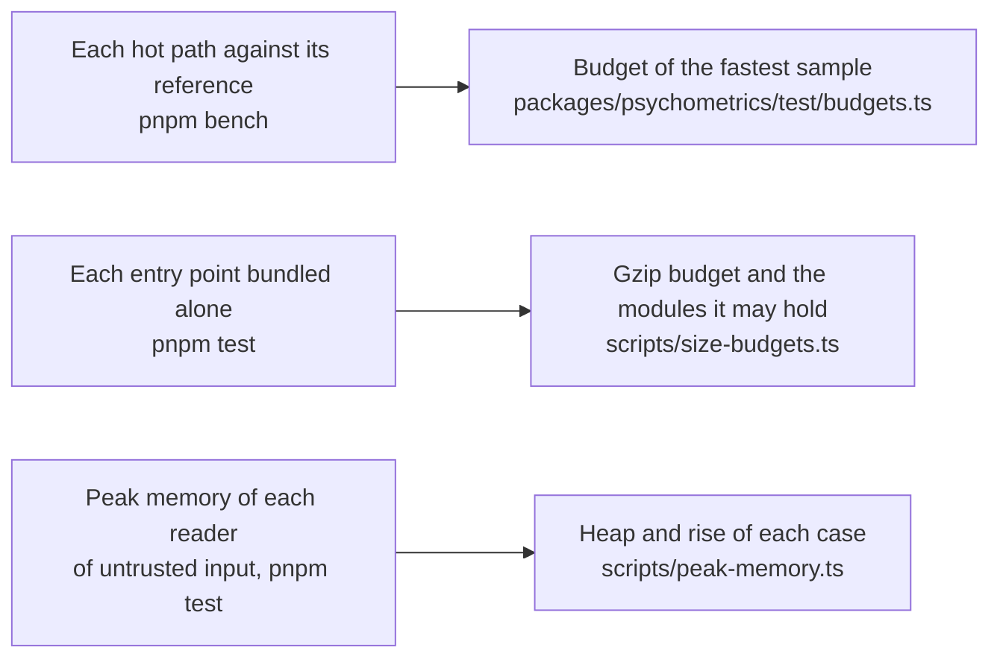

# Performance of psychometrics

How the speed of the hot paths of `@measurekit/psychometrics` is guarded against their references, how much each entry
point adds to a bundle, and the memory that each reader of untrusted input needs on its worst input.

## Speed

Each hot path of each module has a benchmark in `packages/psychometrics/test/*.bench.ts` that times it against its
reference in R, or RSMTool for the evaluation of automated scores, on the same data, and the `bench` job of CI holds each one
to a budget in `packages/psychometrics/test/budgets.ts`. The docs publish no measured time: it differs on every machine and
goes stale with each change. How each side is timed, how the budgets are set and how a user times the references on their
machine are in the [method](../../validation/README.md#benchmarks).

### Iterations

The iterations that each EM calibration of the benchmarks needed to reach its tolerance, on the data of the benchmark. The
time of a calibration is the product of its iterations and the time of one. The one-parameter to the
generalized partial credit calibrations, the multidimensional ones, the many-facet Rasch model and the linear logistic
test model of measurekit extrapolate EM with SQUAREM, as mirt does with Ramsay's method; the others run plain EM. Every
EM iteration counts, those that follow an extrapolation included. EM stops when an iteration changes no parameter by
more than the tolerance, which leaves the estimates some distance from the maximum, more where EM contracts slowly.
Extrapolated, they stop closer to it than plain EM does, by up to about 1e-3 at the default tolerance (the confirmatory
2PL is 1.3e-4 from the maximum, was 4.8e-4); at a tolerance of 1e-8 both are at it.

| Calibration                         | measurekit | Reference |
| ----------------------------------- | ---------: | --------: |
| One-parameter model                 |         10 |         9 |
| Two-parameter model                 |         13 |        19 |
| Three-parameter model               |         81 |       183 |
| Graded response model               |         12 |        11 |
| Generalized partial credit model    |         19 |        37 |
| Confirmatory two-dimensional 2PL    |         12 |        24 |
| Confirmatory two-dimensional graded |         12 |        43 |
| Exploratory two-dimensional 2PL     |        100 |       135 |
| G-DINA                              |        187 |       184 |
| DINA                                |         44 |        45 |
| DINO                                |        195 |       231 |
| A-CDM                               |         40 |        33 |
| LLM                                 |         52 |        61 |
| R-RUM                               |         53 |        27 |

## Size

Each entry point bundled alone with esbuild ([method](../../validation/README.md#sizes-and-peak-memory)). Every package
declares `sideEffects: false`, so a named import holds only what that name needs: `createAdaptiveTest` from
`@measurekit/psychometrics/cat` bundles to 16.6 KB minified, 5.9 KB after gzip, with `cat`, `checks`, `irt`, `math` and
core, and none of the `cdm`, `data`, `multidimensional` and `sim` that the subpath's other functions take.

| Entry point                                  | Minified (bytes) | Gzip (bytes) | Modules it holds besides its own                          |
| -------------------------------------------- | ---------------: | -----------: | --------------------------------------------------------- |
| `@measurekit/psychometrics`                  |            2,572 |        1,348 | core                                                      |
| `@measurekit/psychometrics/cat`              |           75,174 |       25,109 | core, cdm, checks, data, irt, math, multidimensional, sim |
| `@measurekit/psychometrics/cdm`              |           44,456 |       16,262 | core, checks, data, irt, math                             |
| `@measurekit/psychometrics/change`           |            5,790 |        2,518 | core, checks                                              |
| `@measurekit/psychometrics/ctt`              |           22,896 |        8,748 | core, data, math                                          |
| `@measurekit/psychometrics/data`             |            7,148 |        2,522 | core                                                      |
| `@measurekit/psychometrics/dif`              |           94,478 |       32,480 | core, data, equating, irt, math                           |
| `@measurekit/psychometrics/dimensionality`   |           39,464 |       14,720 | core, data, math                                          |
| `@measurekit/psychometrics/equating`         |           64,412 |       22,006 | core, checks, irt, math                                   |
| `@measurekit/psychometrics/explanatory`      |           51,512 |       17,997 | core, data, irt, math                                     |
| `@measurekit/psychometrics/fit`              |          118,124 |       40,292 | core, checks, data, irt, math, sim                        |
| `@measurekit/psychometrics/generalizability` |           15,272 |        5,656 | core, data, math                                          |
| `@measurekit/psychometrics/irt`              |           90,656 |       30,543 | core, checks, data, math                                  |
| `@measurekit/psychometrics/mokken`           |           33,502 |       12,463 | core, data, math                                          |
| `@measurekit/psychometrics/multidimensional` |          136,972 |       44,536 | core, checks, data, irt, math                             |
| `@measurekit/psychometrics/parameterization` |           18,264 |        5,992 | core, irt, multidimensional                               |
| `@measurekit/psychometrics/rater`            |           67,369 |       23,000 | core, checks, data, fit, irt, math                        |
| `@measurekit/psychometrics/response-time`    |           58,806 |       19,809 | core, checks, data, irt, math                             |
| `@measurekit/psychometrics/scaling`          |           35,667 |       13,221 | core, checks, equating, irt, math                         |
| `@measurekit/psychometrics/sim`              |           21,511 |        7,251 | core, cdm, checks, data, irt, multidimensional            |
| `@measurekit/psychometrics/similarity`       |           23,305 |        8,945 | core, checks, data, irt, math                             |
| `@measurekit/psychometrics/standard-setting` |           34,317 |       12,776 | core, checks, equating, irt, math                         |

## Memory

What each reader of untrusted input adds to the peak resident memory of a Node.js process, on its worst inputs within
the limits of [SECURITY.md](../../SECURITY.md) ([method](../../validation/README.md#sizes-and-peak-memory)). Each reader
grows in proportion to its input, but for the designs of cognitive diagnosis, the analyses of the pairs of items that
hold a matrix of them, whose limits bound them, the statistics of pairs of items of fit and of Mokken scales and the
starts of an unfolding calibration, which their limit of 1,000 items bounds, and the selection of pairs of persons, M4
and the K index of answer similarity, which their limits bound.

| Reader                             | Input                                                         | JSON (MB) | Peak added (MB)              |
| ---------------------------------- | ------------------------------------------------------------- | --------- | ---------------------------- |
| `buildResponseMatrix`              | 1,000 persons, 1,000 items                                    | 1.9       | below the peak of the parse  |
| `buildResponseMatrix`              | 1 person, 1,000,000 items, with the ids it gives them         | 1.9       | 86                           |
| `buildResponseMatrix`              | 1,000,000 persons, 1 item, with the ids it gives them         | 3.8       | 94                           |
| `buildResponseMatrix` with `times` | 1,000 persons, 1,000 items                                    | 4.6       | 49                           |
| `buildResponseMatrixFromColumns`   | 1,000 persons, 1,000 items                                    | 1.9       | 23                           |
| `buildResponseRecords`             | 1,000,000 records of 1,000 persons and 1,000 items            | 43        | 106                          |
| `buildResponseRecords`             | 1,000,000 records, each of its own person and item            | 48        | 421                          |
| `scoreResponses`                   | 1,000 persons, 1,000 items of 4 options                       | 3.8       | 8                            |
| `calibrate` of records             | 200,000 records of 100,000 items, two persons each            | 9.9       | 440                          |
| `qMatrixIdentifiability`           | A Q-matrix of 100,000 items of 20 attributes                  | 12        | 62                           |
| `calibrateCdm`                     | 128 items of 11 of 15 attributes, the most cells and groups   | 0.010     | 160 to 230 by run            |
| `calibrateMultidimensional`        | 8 dichotomous items, 2 persons, 10⁶ nodes                     | 0.0002    | 310                          |
| `calibrateMultidimensional`        | The same, 3 dimensions, exploratory, standard errors          | 0.0002    | 650 to 750 by run            |
| `calibrateBifactor`                | 1,000 persons, two-tier, 40 items, standard errors            | 0.09      | 620 to 670 by run            |
| `generalizabilityStudy`            | 1,000,000 scores of 6 facets of 10 elements                   | 87        | 125                          |
| `generalizabilityStudy`            | The same with one score missing, `unbalanced`                 | 87        | 301                          |
| `exploratoryFactorAnalysis`        | 1,000 items of 40 persons, the most a matrix of items takes   | 0.08      | 152                          |
| `omegaHierarchical`                | 1,000 items of 40 persons                                     | 0.08      | 148                          |
| `mcdonaldOmega`                    | 1,000 items of 40 persons                                     | 0.08      | 118                          |
| `manyFacetRasch`                   | 1,994 persons, 997 raters: 1,000 parameters, one EM iteration | 0.26      | 66 to 77 by run              |
| `personScalability`                | 2 persons, 1,000,000 items, from their response matrix        | 3.8       | 195                          |
| `localDependenceChiSquare`         | 2 persons, 1,000 2PL items, the most: 499,500 pairs           | 0.028     | 102 to 228 by version, OS    |
| `localDependenceChiSquare`         | 2 graded items of 4,096 categories, the most cells            | 0.1       | 132 to 262 by version, OS    |
| `summedScoreFit`                   | 2 persons, 300 2PL items, the highest total score             | 0.008     | 4 to 14 by version, OS       |
| `yenQ3`                            | 2 persons, 1,000 2PL items, the most                          | 0.028     | 14 to 22 by version, OS      |
| `calibrateUnfolding`               | 2 persons, 1,000 items, the most                              | 0.004     | 106 to 130 by version, macOS |
| `scalability`                      | 200 persons of distinct patterns, 1,000 items, the most       | 0.4       | 75 to 117 by version, OS     |
| `conditionalAssociation`           | 8 persons, 1,000 items, the most                              | 0.015     | 141                          |
| `assembleForms`                    | 8,191 forms of the one item of a pool, the most counts        | 0.0001    | 223 to 288 by version, OS    |
| `createDiagnosticAdaptiveTest`     | 128 items of 11 of 15 attributes, the most cells and groups   | 1.0       | 55 to 90 by run              |
| `selectPairs`                      | 10,000 persons in 50 groups of 200, the most: 995,000 pairs   | 0.2       | 136 to 157 by version, OS    |
| `m4Index`                          | 2 persons, 1,000 2PL items, the most                          | 0.028     | 13 to 22 by version, OS      |
| `kIndex`                           | 2,896 persons, 0 to 2,895 incorrect each, the most cells      | 16        | 95 to 165 by version, OS     |

A reader of a matrix or of records takes at most about 50 times the bytes of its JSON, where it names a million items or
persons itself, and 2 to 9 times where the input names them. A design of cognitive diagnosis, of a calibration or of an
adaptive test's pool, takes up to about 300 MB from a few hundred bytes, which its limits stop there, by model and run:
an additive model works on each latent group. A statistic of every pair of items, local dependence, Yen's Q3 or a Mokken
scale analysis, returns items² values, which their limit of 1,000 items stops at about 210 MB from 28 KB; the standard
errors of Mokken's scalability add memory in proportion to the items times the persons' patterns. The many-facet Rasch
model holds matrices of the square of its parameters, which its limit of 1,000 stops at 77 MB from 260 KB of scores; its
time grows with their cube.

A calibration of several dimensions holds tables over its grid, whose limit stops them at 310 MB, and at 700 MB with the
standard errors of an exploratory model. The standard errors of a bifactor model keep, for each pattern of the responses
to a specific dimension's items, the mean scores of its items at each primary node: patterns of long specific dimensions
on the grid of two primary dimensions take about 7 KB per response.
