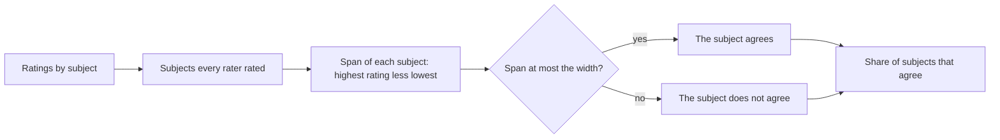
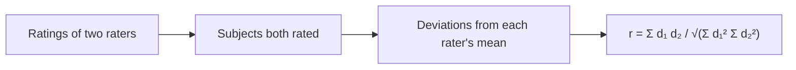
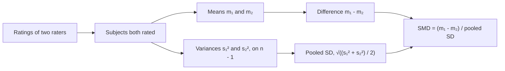
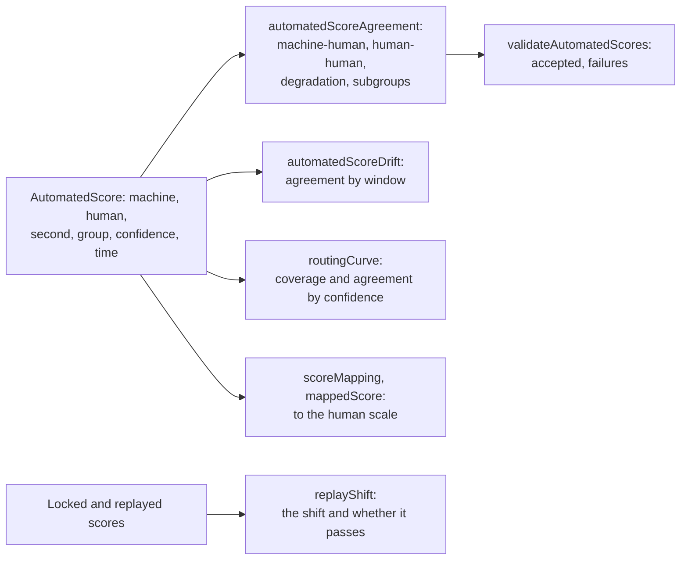
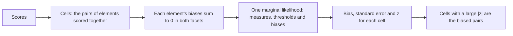

# Rater agreement and effects

`@measurekit/psychometrics/rater` measures how far raters agree: exact and adjacent agreement, Cohen's kappa for two
raters, unweighted, linear or quadratic weighted, Fleiss' kappa for two or more, and intraclass correlations of
scores; how far two raters order the subjects alike, by the correlation of their ratings; and how far one rater is more
lenient than another, by the standardized mean difference, of a whole sample or of a subgroup. It evaluates automated
scores against human ones, as RSMTool does, judges them against thresholds of acceptance, and watches them by window,
by confidence and by replay ([evaluating automated scores](#evaluating-automated-scores)). It also estimates what
raters do to scores: the many-facet Rasch model puts persons, items and raters on one scale, so that a rater's severity
is a number of logits and a person's score can be adjusted for the raters who gave it, and a bias analysis finds the
raters who are harsher or milder than usual on one item. The agreement statistics are validated against irr, psych,
effsize and RSMTool, the routing curve, the mappings and the replay against base R, the model against base R and TAM
([validation](validation.md)).

## Ratings

Every function takes ratings by subject: one row per rated subject, such as an essay, with one rating per rater,
`null` when a rater did not rate the subject. Agreement and kappa take categories, integers from 0, as item responses; the
correlation, the standardized mean difference and the intraclass correlations take any finite numbers. Each statistic uses the subjects every rater rated.

```ts
import { cohenKappa, fleissKappa, intraclassCorrelation } from "@measurekit/psychometrics/rater";

// Four essays scored 0 to 4 by three raters; rater 3 did not score essay 4.
const ratings = [
  [3, 3, 2],
  [1, 2, 1],
  [4, 4, 4],
  [2, 1, null],
];
cohenKappa(
  ratings.map((row) => row.slice(0, 2)),
  { weights: "quadratic" },
); // => 0.80, the QWK of raters 1 and 2
fleissKappa(ratings); // => 0.40, over essays 1 to 3
intraclassCorrelation(ratings); // => { oneWay: 0.88, agreement: 0.89, consistency: 0.91, oneWayAverage: 0.96, ... }
```

## Kappa

| Function                       | Value                                                      | irr             |
| ------------------------------ | ---------------------------------------------------------- | --------------- |
| `cohenKappa(ratings, options)` | (p_o - p_e) / (1 - p_e) of two raters (Cohen, 1960, 1968)  | `kappa2`        |
| `fleissKappa(ratings)`         | (P̄ - P_e) / (1 - P_e) of two or more raters (Fleiss, 1971) | `kappam.fleiss` |

For Cohen's kappa, p_o = Σ w_ij O_ij / n is the weighted observed agreement and p_e = Σ w_ij r_i c_j / n² the agreement
expected from the raters' margins r and c, with agreement weights w_ij by `weights`:

| `weights`          | w_ij                    | irr's `weight` |
| ------------------ | ----------------------- | -------------- |
| `"none"` (default) | 1 when i = j, else 0    | `"unweighted"` |
| `"linear"`         | 1 - \|i - j\| / (K - 1) | `"equal"`      |
| `"quadratic"`      | 1 - (i - j)² / (K - 1)² | `"squared"`    |

K - 1 is the range of the categories used. Quadratic weights give the quadratic weighted kappa (QWK) used to compare
automated with human scoring. The weights use the categories' values; irr numbers the categories used in order, which
gives the same weights when no category between the lowest and highest is unused.

For Fleiss' kappa, P̄ is the mean over subjects of the share of agreeing pairs of raters, Σ_k n_k (n_k - 1) / (m (m
- 1)) for m raters of whom n_k chose category k, and P_e = Σ_k p_k² from each category's share p_k of all ratings.

Kappa is 1 for perfect agreement and 0 for agreement at chance level. When every rating is in one category the chance
agreement is 1 and kappa is undefined: both functions throw `DataError`.

## Exact and adjacent agreement

`exactAgreement(ratings)` and `adjacentAgreement(ratings, options)` return the share of subjects on which the raters
agree: exactly, or within a number of categories. They are the simplest checks of how well automated scores or two
human raters match; kappa corrects them for chance.



| Function                              | Agreement of a subject                                                                       | irr                        |
| ------------------------------------- | -------------------------------------------------------------------------------------------- | -------------------------- |
| `exactAgreement(ratings)`             | Every rater gave the same rating: a span of 0                                                | `agree(tolerance = 0)`     |
| `adjacentAgreement(ratings, options)` | The highest rating less the lowest is at most `width`: with two raters, a difference of that | `agree(tolerance = width)` |

| Option  | Default | Meaning                                                                                             |
| ------- | ------- | --------------------------------------------------------------------------------------------------- |
| `width` | `1`     | Of `adjacentAgreement`: the widest span, in categories, that counts as agreement; an integer from 0 |

Both return a proportion from 0 to 1, where irr reports a percentage. Ratings are categories, integers from 0, from two
raters or more; with more than two, every rating of a subject must lie within the width. They use the subjects every
rater rated. [Kappa](#kappa) is the agreement corrected for chance.

```ts
import { adjacentAgreement, exactAgreement } from "@measurekit/psychometrics/rater";

// Four essays scored 0 to 4 by three raters; rater 3 did not score essay 4.
const ratings = [
  [3, 3, 2],
  [1, 2, 1],
  [4, 4, 4],
  [2, 1, null],
];
exactAgreement(ratings); // => 0.33: the three raters agree on essay 3 alone
adjacentAgreement(ratings); // => 1: on essays 1 to 3 no two raters differ by more than 1
adjacentAgreement(
  ratings.map((row) => row.slice(0, 2)),
  { width: 0 },
); // => 0.5: raters 1 and 2 agree exactly on two of four essays
```

## Intraclass correlation

`intraclassCorrelation(ratings)` returns the six coefficients of Shrout and Fleiss (1979) and McGraw and Wong (1996),
from the mean squares of an analysis of variance of n subjects by k raters: subjects MS_R, raters MS_C, residual MS_E
and within subjects MS_W.

| Field                | Form               | Value                                                       |
| -------------------- | ------------------ | ----------------------------------------------------------- |
| `oneWay`             | ICC(1)             | (MS_R - MS_W) / (MS_R + (k - 1) MS_W)                       |
| `agreement`          | ICC(A,1), ICC(2,1) | (MS_R - MS_E) / (MS_R + (k - 1) MS_E + k (MS_C - MS_E) / n) |
| `consistency`        | ICC(C,1), ICC(3,1) | (MS_R - MS_E) / (MS_R + (k - 1) MS_E)                       |
| `oneWayAverage`      | ICC(k)             | (MS_R - MS_W) / MS_R                                        |
| `agreementAverage`   | ICC(A,k), ICC(2,k) | (MS_R - MS_E) / (MS_R + (MS_C - MS_E) / n)                  |
| `consistencyAverage` | ICC(C,k), ICC(3,k) | (MS_R - MS_E) / MS_R                                        |

Use the single-rater forms when one rater scores each subject in practice, the average forms when the reported score
is the raters' mean; absolute agreement when raters' leniency matters, consistency when only their ordering does. A
coefficient whose denominator is 0, as when every rating is equal, is `null`.

## Correlation between two raters

`ratingCorrelation(ratings)` is the Pearson correlation between two raters' ratings: how far they order the subjects
alike, whatever their leniency. It is the companion of the [standardized mean difference](#standardized-mean-difference)
in the evaluation of automated scoring: a machine can correlate perfectly with a human rater and still rate everyone
higher, and each statistic shows what the other does not.



It uses the subjects both raters rated, needs at least two, takes finite numbers, and is `null` when either rater's
ratings are constant, as R's `cor` gives `NA`. The value lies from -1 to 1, does not change with the order of the raters,
and is unchanged by a shift or a positive rescaling of either rater's ratings.

```ts
import { ratingCorrelation, standardizedMeanDifference } from "@measurekit/psychometrics/rater";

// Raters 1 and 3 of the four essays above; rater 3 did not score essay 4.
ratingCorrelation([
  [3, 2],
  [1, 1],
  [4, 4],
]); // => 0.93

// A rater who scores everything 3 higher correlates perfectly and is 2.3 standard deviations harsher.
const shifted = [
  [2, 5],
  [3, 6],
  [1, 4],
  [4, 7],
];
ratingCorrelation(shifted); // => 1
standardizedMeanDifference(shifted); // => -2.32
```

## Standardized mean difference

`standardizedMeanDifference(ratings)` measures how much more lenient the first of two raters is than the second, in
standard deviations: the difference of their mean ratings over their pooled standard deviation. It is the measure used
to compare automated with human scores, where a magnitude above 0.15 is commonly taken to flag a difference worth
acting on.



The result is positive when the first rater rates higher on average, and 0 when the means are equal; it does not depend
on the origin or the scale of the ratings. With the same subjects rated by both raters, the pooled standard deviation
is that of Cohen's d, so the value equals effsize's `cohen.d` of the two raters' ratings as independent samples.
Ratings are finite numbers, not only categories: automated scores are often continuous. It uses the subjects both
raters rated, needs at least two, and is `null` when both raters' ratings are constant.

```ts
import { standardizedMeanDifference } from "@measurekit/psychometrics/rater";

// Raters 1 and 3 of the four essays above; rater 3 did not score essay 4.
standardizedMeanDifference([
  [3, 2],
  [1, 1],
  [4, 4],
]); // => 0.22: rater 1 is 0.22 standard deviations more lenient
```

A subgroup's SMD, as of the essays of one group of writers, is read against the whole population's: `population` gives
each rater's standard deviation over every subject, and the subgroup's difference of means is divided by
√((first² + second²) / 2), as Williamson, Xi and Breyer (2012) recommend and RSMTool's `method = "williamson"` computes.
Then the subgroups' SMDs share one scale, and a group whose ratings vary less is not made to look more different.

| Option       | Default                                             | Meaning                                                                                                        |
| ------------ | --------------------------------------------------- | -------------------------------------------------------------------------------------------------------------- |
| `population` | the pooled standard deviation of the subjects given | `{ first, second }`: each rater's standard deviation over the population, non-negative; `null` when both are 0 |

Where effsize treats the two sets of ratings as independent samples, so does this
function, though the same subjects were rated; it does not use the standard deviation of the differences, as a paired
effect size would.

## Evaluating automated scores

A scoring engine's scores are evaluated against human scores on the same responses before it scores alone: agreement,
association and the difference of means, overall and by subgroup, and against the agreement of two people, as
Williamson, Xi and Breyer (2012) set out and RSMTool, ETS's evaluation tool, computes. Once it scores, its agreement is
watched by window of time, the responses it is least sure of go to people, and responses scored again show whether the
engine changed.



| Function                                      | Returns                                                                                                        |
| --------------------------------------------- | -------------------------------------------------------------------------------------------------------------- |
| `automatedScoreAgreement(scores, options)`    | `machineHuman`, `humanHuman`, `degradation`, `disattenuatedCorrelation` and `groups`                           |
| `validateAutomatedScores(agreement, options)` | `{ accepted, failures }`: each rule of acceptance broken, with its value and threshold                         |
| `automatedScoreDrift(scores, options)`        | The machine-human agreement of each window of time with a subject                                              |
| `routingCurve(scores, options)`               | For each confidence, the share of subjects at or above it and their agreement                                  |
| `scoreMapping(scores, options)`               | A line or an isotonic function from machine to human scores; `mappedScore(mapping, score)` applies it          |
| `replayShift(ratings, options)`               | The shift of replayed scores from locked ones in SDs, its standard error and whether it is within `maxShiftSd` |

Each subject is an `AutomatedScore`: `machine`, the engine's score, any finite number; `human`, a person's score, a
category, an integer from 0; and where it has them, `second`, a second person's score, `group`, the writer's subgroup,
`confidence`, the engine's confidence, any finite number where higher is surer, and `time`, any finite number such as
epoch milliseconds. Fields of other names are ignored, so a host passes its own records.

### Agreement

`automatedScoreAgreement` gives each statistic as a `ScoreAgreement` of a first scoring against a second: the machine's
against the human's in `machineHuman`, the second person's against the first's in `humanHuman`.

| Field                                            | Value                                                                   | RSMTool                            |
| ------------------------------------------------ | ----------------------------------------------------------------------- | ---------------------------------- |
| `exactAgreement`, `adjacentAgreement`            | The share of subjects with equal scores, and with scores within 1       | `exact_agr`, `adj_agr`, in percent |
| `kappa`, `quadraticKappa`                        | Cohen's kappa, unweighted and with quadratic weights (QWK)              | `kappa`, `wtkappa`                 |
| `correlation`                                    | Pearson's r                                                             | `corr`                             |
| `smd`                                            | The first mean less the second over √((s₁² + s₂²) / 2)                  | `SMD` with `smd_method = "pooled"` |
| `rmse`, `rSquared`                               | √(mean (first - second)²); 1 - Σ (second - first)² / Σ (second - mean)² | `RMSE`, `R2`                       |
| `firstMean`, `firstSd`, `secondMean`, `secondSd` | Means, and SDs on n - 1                                                 | `sys_sd`, `h_sd`                   |

The machine-human statistics use every subject, and the human-human ones the subjects with a `second` score, as RSMTool
does by default. `degradation` is the machine-human value less the human-human one of the correlation, both kappas and
both agreements, negative where the machine agrees less than a second person; `disattenuatedCorrelation` is
r_mh / √r_hh. Each of `groups` is the machine-human agreement within a subgroup, in order of the group's first subject,
its SMD over the population's SDs, those of the machine and human scores of every subject: Williamson et al.'s subgroup
SMD and RSMTool's `"williamson"`, so that the subgroups share one scale and a group whose scores vary less does not look
more different. Subjects without a group are in no subgroup.

| Option  | Default                       | Meaning                                                                                                |
| ------- | ----------------------------- | ------------------------------------------------------------------------------------------------------ |
| `scale` | none: machine scores as given | `{ lowest, highest }`: machine scores are trimmed to it and rounded, a half up, before every statistic |

Kappa needs categories: machine scores are rounded to the scale first, as RSMTool's trimmed and rounded scores; without
`scale` they must already be integers from 0. A statistic the scores leave undefined, such as kappa when every score is
one category or a correlation of constant scores, is `null`.

```ts
import { automatedScoreAgreement, validateAutomatedScores } from "@measurekit/psychometrics/rater";

// Ten essays on a scale of 1 to 6: an engine's unrounded scores, a person's, a second person's and the writers' groups,
// with the engine's confidence and the day it scored each.
const machine = [3.4, 3.6, 2.6, 4.4, 3.3, 4.6, 1.8, 3.7, 5.3, 4.2];
const human = [3, 4, 2, 5, 3, 4, 1, 3, 6, 4];
const second = [3, 4, 3, 5, 2, 4, 2, 3, 5, 4];
const confidence = [0.9, 0.6, 0.8, 0.7, 0.95, 0.5, 0.85, 0.4, 0.75, 0.9];
const day = 86_400_000;
const scores = machine.map((score, i) => ({
  machine: score,
  human: human[i] ?? 0,
  second: second[i] ?? null,
  group: i < 5 ? "a" : "b",
  confidence: confidence[i] ?? null,
  time: Date.UTC(2026, 9, 5) + i * 2 * day,
}));
const scale = { lowest: 1, highest: 6 };

const agreement = automatedScoreAgreement(scores, { scale });
agreement.machineHuman;
// => { exactAgreement: 0.4, adjacentAgreement: 1, kappa: 0.21, quadraticKappa: 0.78, correlation: 0.86, smd: 0.16, ... }
agreement.humanHuman;
// => { exactAgreement: 0.6, adjacentAgreement: 1, kappa: 0.49, quadraticKappa: 0.86, correlation: 0.90, smd: 0.00, ... }
agreement.degradation?.quadraticKappa; // => -0.084
agreement.disattenuatedCorrelation; // => 0.91
agreement.groups.map(({ group, smd }) => [group, smd]); // => [["a", 0], ["b", 0.33]], where b's own SDs give 0.26
```

### Acceptance

`validateAutomatedScores(agreement, options)` judges an agreement against thresholds and returns `{ accepted, failures }`:
each rule broken as `{ rule, value, threshold, group }`, in the order below. A rule's statistic that the data leave
undefined, as a degradation without second scores, breaks it with `value` `null`; turn such a rule off with `null`.

| Rule (`thresholds`)                                           | Passes when                                               | Default | Source                                                                                 |
| ------------------------------------------------------------- | --------------------------------------------------------- | ------- | -------------------------------------------------------------------------------------- |
| `"quadratic-kappa"` (`quadraticKappa`)                        | Machine-human QWK at least the threshold                  | 0.70    | Williamson, Xi and Breyer (2012), in ACT's technical brief R2100 (2021), Table 2       |
| `"correlation"` (`correlation`)                               | Machine-human r at least the threshold                    | 0.70    | Williamson et al. (2012), in ETS's RM-23-01 (2023), p. 7                               |
| `"quadratic-kappa-degradation"` (`quadraticKappaDegradation`) | Human-human QWK less machine-human at most it             | 0.10    | Williamson et al. (2012), in ACT's Table 2                                             |
| `"smd"` (`smd`)                                               | \|SMD\| at most the threshold                             | 0.15    | Williamson et al. (2012), in ACT's Table 2                                             |
| `"group-smd"` (`groupSmd`)                                    | Each subgroup's \|SMD\| at most the threshold             | 0.10    | Williamson et al. (2012)                                                               |
| `"sd-ratio"` (`sdRatio`)                                      | Human SD over machine SD within `[lowest, highest]`       | off     | Wang and von Davier (2014), from 2/3 to 1.5, in ACT's Table 2                          |
| `"exact-agreement-degradation"` (`exactAgreementDegradation`) | Human-human exact agreement less machine-human at most it | off     | McGraw-Hill Education CTB (2014) and Pearson and ETS (2014), 0.05125, in ACT's Table 2 |

`ACCEPTANCE_THRESHOLDS` holds the defaults; `thresholds` replaces some of them. The thresholds are a program's policy:
the defaults are Williamson et al.'s, which ETS applies, and the two that are off are other programs'.

```ts continues
validateAutomatedScores(agreement);
// => { accepted: false, failures: [{ rule: "smd", value: 0.16, ... }, { rule: "group-smd", value: 0.33, group: "b", ... }] }
validateAutomatedScores(agreement, { thresholds: { smd: 0.2, groupSmd: null } }).accepted; // => true
```

### Drift, routing and mapping

`automatedScoreDrift(scores, { width, start, scale })` puts each subject in the window of `width` that holds its `time`,
from `start`, by default the earliest time, and gives each window with a subject its machine-human `ScoreAgreement`.
Compare the windows with the acceptance, or judge each with `validateAutomatedScores`; a window of few subjects gives
wide statistics, so choose a width that holds as many subjects as the acceptance did.

`routingCurve(scores, { scale })` gives a point for each distinct `confidence`, from the highest: the subjects at or
above it, whose machine scores would stand alone while the others go to a person, their share `coverage`, and their
exact and adjacent agreement, QWK, correlation, SMD and RMSE. It is the curve of coverage against agreement of selective
prediction (El-Yaniv and Wiener, 2010), from which a host picks the least confidence that keeps the agreement it needs.
Pick it on other data than those that judge it: the best point of one sample agrees less on the next.

`scoreMapping(scores, { method })` fits a map from machine scores, unrounded, to the human scale:

| `method`             | Map                                                                                                                                                                                          | Reference              |
| -------------------- | -------------------------------------------------------------------------------------------------------------------------------------------------------------------------------------------- | ---------------------- |
| `"linear"` (default) | slope × machine + intercept, with the human scores' mean and SD: RSMTool's scaled scores                                                                                                     | Base R `mean` and `sd` |
| `"isotonic"`         | The non-decreasing function nearest the human scores in least squares, by pooling adjacent violators; a knot per distinct machine score, the mean of its human scores where several share it | R's `isoreg`           |

`mappedScore(mapping, score)` applies a map: the line, or the knots joined by straight lines and flat beyond the ends,
as R's `approx` with `rule = 2`. Round the result to the scale, as `automatedScoreAgreement`'s `scale` does.

```ts continues
import { automatedScoreDrift, mappedScore, routingCurve, scoreMapping } from "@measurekit/psychometrics/rater";

automatedScoreDrift(scores, { width: 7 * day, scale }).map(({ agreement }) => agreement.quadraticKappa);
// => [0.67, 0.81, 0.625]: weeks of 4, 3 and 3 essays
routingCurve(scores, { scale }).map(({ minConfidence, coverage }) => [minConfidence, coverage]);
// => [[0.95, 0.1], [0.9, 0.3], [0.85, 0.4], ...]: the QWK of the 30% at or above 0.9 is 1
const linear = scoreMapping(scores);
mappedScore(linear, 3.5); // => 3.23
mappedScore(scoreMapping(scores, { method: "isotonic" }), 3.5); // => 3.25, between the knots of 3.4 and 3.6
```

### Replay

Responses whose scores are locked, the engine's at its acceptance or people's, are scored again after a change of model,
prompt or pipeline, or on a schedule. `replayShift(ratings, { maxShiftSd })` takes rows `[locked, replayed]` and returns
the mean shift, `meanShift`, the SD of the locked scores, `lockedSd`, the shift in those SDs, `standardizedShift`, its
standard error, that of a paired mean, the exact agreement and the correlation of the two, and `passed`, whether the
absolute standardized shift is at most `maxShiftSd`. The standard error is √(2 (1 - r) / n) for n responses whose two
scores have the same SD and correlate at r: 0.035 for 200 responses at r = 0.88. People's scores of new responses cannot
tell a changed engine from changed responses; the replay holds the responses still.

| Option       | Default  | Meaning                                                                                                         |
| ------------ | -------- | --------------------------------------------------------------------------------------------------------------- |
| `maxShiftSd` | required | The largest absolute shift, in SDs of the locked scores, that passes: a program's policy, as no source sets one |

```ts continues
import { replayShift } from "@measurekit/psychometrics/rater";

const locked = [2, 3, 3, 4, 1, 2, 4, 3];
const replayed = [2, 3, 4, 4, 1, 3, 4, 3];
replayShift(
  locked.map((score, i) => [score, replayed[i] ?? null]),
  { maxShiftSd: 0.05 },
); // => { standardizedShift: 0.24, standardError: 0.16, passed: false, ... }
```

### Differences from RSMTool

On PERSUADE 2.0's essays on one prompt and ELLIPSE's double-scored essays, with machine scores from essay length, every
statistic of `automatedScoreAgreement` equals RSMTool 12.0.0's within 1.3e-13 ([validation](validation.md)).

| Topic                      | measurekit                                         | RSMTool                                                               |
| -------------------------- | -------------------------------------------------- | --------------------------------------------------------------------- |
| Agreement                  | A proportion                                       | A percentage                                                          |
| The SMD of a whole sample  | Pooled over the two raters, Williamson et al.'s    | `"unpooled"`, the human SD alone, by default in the analyzer          |
| The SMD of a subgroup      | On the population's pooled SD, Williamson et al.'s | The difference of standardized means (DSM) by default in the analyzer |
| The degradation of the SMD | Not given                                          | The machine-human SMD unpooled less the human-human SMD pooled        |
| Kappa of unrounded scores  | Round first: a category is an integer              | `quadratic_weighted_kappa` takes continuous scores                    |
| Thresholds                 | Judged by `validateAutomatedScores`                | Not judged: the report shows the values                               |

## Many-facet Rasch model

`manyFacetRasch(scores, options)` estimates the many-facet Rasch model (Linacre, 1989) by marginal maximum likelihood.
Each score names the element of every facet it was given at: the person, the item or task, the rater, and any further
facet such as the occasion. The model says how much each element adds to the score, in logits.

```ts
import { expectedRating, manyFacetEstimates, manyFacetFit, manyFacetRasch } from "@measurekit/psychometrics/rater";

// Twelve essays scored 0 to 3 on content and style by two of three raters: essay, rater, content, style.
const rows = [
  ["e1", "r1", 1, 1],
  ["e1", "r2", 1, 2],
  ["e2", "r2", 2, 2],
  ["e2", "r3", 3, 2],
  ["e3", "r1", 3, 2],
  ["e3", "r3", 2, 3],
  ["e4", "r1", 1, 1],
  ["e4", "r2", 2, 1],
  ["e5", "r2", 3, 2],
  ["e5", "r3", 3, 1],
  ["e6", "r1", 2, 0],
  ["e6", "r3", 3, 3],
  ["e7", "r1", 0, 0],
  ["e7", "r2", 3, 2],
  ["e8", "r2", 2, 0],
  ["e8", "r3", 3, 0],
  ["e9", "r1", 1, 0],
  ["e9", "r3", 1, 1],
  ["e10", "r1", 2, 2],
  ["e10", "r2", 2, 2],
  ["e11", "r2", 1, 2],
  ["e11", "r3", 1, 2],
  ["e12", "r1", 2, 1],
  ["e12", "r3", 1, 2],
] as const;
const scores = rows.flatMap(([person, rater, content, style]) => [
  { levels: { person, item: "content", rater }, score: content },
  { levels: { person, item: "style", rater }, score: style },
]);

const model = manyFacetRasch(scores, { facets: ["item", "rater"] });
model.facets[1]?.elements.map(({ id, measure }) => [id, measure]); // => [["r1", 0.77], ["r2", -0.31], ["r3", -0.46]]
model.facets[1]?.elements.map(({ fairAverage }) => fairAverage); // => [1.15, 1.87, 1.96]: r1 is the severe rater
model.facets[1]?.reliability; // => 0.68
expectedRating(model, 0.5, { levels: { rater: "r1" } }); // => 1.35: the score of a person of theta 0.5 from the severest rater
expectedRating(model, 0.5, { levels: { rater: "r3" } }); // => 2.12
const persons = manyFacetEstimates(scores, model); // => [{ id: "e1", theta: 0.03, standardError: 0.42 }, ...]: EAP
manyFacetFit(scores, model, persons).find(({ id }) => id === "r3")?.infitMeanSquare; // => 1.22

// A bias for each rater on each item, [item, rater, bias]: no pair stands out in these few scores.
const biased = manyFacetRasch(scores, { facets: ["item", "rater"], interactions: [["item", "rater"]] });
biased.interactions?.map(({ levels, bias }) => [...levels, Math.round(bias * 100) / 100]);
// => [["content", "r1", -0.13], ["style", "r1", 0.13], ["content", "r2", 0.07], ["style", "r2", -0.07], ["content", "r3", 0.05], ["style", "r3", -0.05]]
```

### Scores

`scores` is an array of `FacetedScore`s, `{ levels, score }`, one for each score in long format ([data](data.md)):
`levels` holds the element of each facet by facet name, as strings, and `score` an integer from 0 to 2³¹ - 1.

| Rule                                 | Meaning                                                                                                                     |
| ------------------------------------ | --------------------------------------------------------------------------------------------------------------------------- |
| One element of each facet            | The person facet and the facets in `facets`; other keys of `levels` are ignored                                             |
| Connected                            | Each score links its person to its elements; all persons and elements must form one set, or the measures are not comparable |
| Categories 0 to the highest, no gaps | In each rating scale, at least two categories, and every category up to the highest used                                    |
| Two persons                          | At least two persons                                                                                                        |

A person may have several scores for one combination of elements, such as two ratings by one rater of the same item;
they count as independent observations. A design in which raters have no person or item in common is not connected,
and `manyFacetRasch` throws a `DataError` that names the subsets.

### Model

For a score in category k of a person with ability θ, with the measure δ of its element in each facet f, and the
thresholds τ of the rating scale s, the log odds of k against k - 1 are

θ - Σ_f δ_(f, element) - τ_(s, k),

and θ is normal with a mean μ and a standard deviation σ that are estimated. Each distinct combination of the elements
of the facets other than the person is a virtual item, so a person's scores are independent given θ. To identify the
scale, the measures of each facet sum to 0 and the thresholds of each set sum to 0; positive measures are harder items
and more severe raters, and μ carries the overall level.

The model is estimated by the EM algorithm of `calibrate`, over partial credit items with a = 1, with Newton's method
for all measures, thresholds, μ and σ together, and the extrapolation SQUAREM on the iterations. Standard errors come from the Hessian of the marginal log-likelihood,
and, for the element each facet's constraint leaves out and for the last threshold, from the delta method.

| Option           | Default                 | Meaning                                                                                                 |
| ---------------- | ----------------------- | ------------------------------------------------------------------------------------------------------- |
| `person`         | `"person"`              | The facet that names the persons                                                                        |
| `facets`         | required                | The other facets, such as `["item", "rater"]`: at least one, none repeated; facets beyond two add terms |
| `thresholdFacet` | one scale shared by all | A facet whose elements each get their own thresholds, as the partial credit model: one of `facets`      |
| `interactions`   | none                    | Pairs of `facets` with a bias for each cell, such as `[["item", "rater"]]`; none repeated               |
| `quadrature`     | 61 rectangular points   | The rule over theta, as `calibrate`                                                                     |
| `standardErrors` | `"hessian"`             | `"none"` leaves out the standard errors, and with them the separation, reliability and homogeneity test |
| `tolerance`      | `1e-4`                  | EM stops when no parameter changes by more than this                                                    |
| `maxIterations`  | `500`                   | The most EM iterations                                                                                  |

| Limit                                                           | Value | Why                                                                                                                                              |
| --------------------------------------------------------------- | ----- | ------------------------------------------------------------------------------------------------------------------------------------------------ |
| Parameters: measures, biases, free thresholds, the mean and SD  | 1,000 | Newton's method inverts a matrix of every pair of them, in time that grows as their cube: 997 raters of 1,994 persons take 3.3 minutes and 80 MB |
| Categories of a rating scale                                    | 255   | FACETS's limit                                                                                                                                   |
| Expected counts: virtual items × quadrature points × categories | 2^24  | EM holds them in two tables of 128 MB, and the time of an iteration grows with them times the categories                                         |

A few hundred kilobytes of scores reach these limits; the estimation's time grows faster than the scores, so run it on
scores from users in a worker with a deadline.

### Result

| Field                         | Meaning                                                                                                        |
| ----------------------------- | -------------------------------------------------------------------------------------------------------------- |
| `facets`                      | A `FacetSummary` for each facet in `facets`                                                                    |
| `thresholds`                  | The thresholds and their standard errors for the shared scale, or for each element of `thresholdFacet`         |
| `interactions`                | The bias of every cell of every interaction; absent without `interactions`                                     |
| `population`                  | The mean and the standard deviation of θ                                                                       |
| `logLikelihood`, `aic`, `bic` | The marginal log-likelihood; -2 ln L + 2p; -2 ln L + p ln n, p the parameters, μ and σ included, n the persons |
| `converged`, `iterations`     | Whether EM reached `tolerance`, and the iterations run                                                         |

A `FacetSummary` holds the facet's `elements`, in order of first appearance, and the statistics of the facet:

| Field                        | Meaning                                                                                                                  |
| ---------------------------- | ------------------------------------------------------------------------------------------------------------------------ |
| `elements[].measure`         | The element's measure in logits                                                                                          |
| `elements[].standardError`   | Its standard error: 0 for the one element of a facet, `null` without standard errors                                     |
| `elements[].count`           | Its number of scores                                                                                                     |
| `elements[].observedAverage` | The mean of its scores                                                                                                   |
| `elements[].fairAverage`     | Its expected score at θ = μ with the other facets at their means: the average the element would give to a typical person |
| `separation`                 | The standard deviation of the measures net of error over the root mean square error                                      |
| `reliability`                | The share of the variance of the measures that is not error                                                              |
| `homogeneity`                | The chi-square that all elements have the same measure, with its degrees of freedom and significance                     |

With V the variance of the measures (dividing by the number of elements) and M the mean of the squared standard errors,
the true variance is max(V - M, 0), the separation is its square root over √M, and the reliability is the true variance
over V (Wright and Masters, 1982). The homogeneity chi-square is Σ w d² - (Σ w d)² / Σ w with d the measures and
w = 1 / SE², on as many degrees of freedom as elements less 1, as FACETS' "fixed (all same)" test. All three are `null`
for a facet of one element and without standard errors.

A threshold set has K - 1 thresholds for categories 0 to K - 1. A threshold the constraint fixes, as the one threshold of
a two-category scale, has the standard error 0.

### Persons, fair scores and fit

| Function                                     | Returns                                                                        |
| -------------------------------------------- | ------------------------------------------------------------------------------ |
| `manyFacetEstimates(scores, model, options)` | A `PersonEstimate` for each person in the scores, in order of first appearance |
| `expectedRating(model, theta, options)`      | The expected rating of a person at θ on the elements of the option `levels`    |
| `manyFacetFit(scores, model, persons)`       | A `FacetFit` for each element of each facet                                    |

`manyFacetEstimates` turns each of a person's scores into a response to a partial credit item with a = 1, whose steps are
the sum of the measures of the score's elements plus the thresholds of its set, and passes them to an
[ability estimator](irt.md), the option `estimator`: the default is the posterior mean under the normal population of
the model; any other, such as `maximumLikelihoodEstimate`, works. The estimates account for the raters' and items' measures, so a person
rated by severe raters is not penalized. Scores need elements the model has, in categories its thresholds give.

`expectedRating` is the fair score, the severity-adjusted score that a platform reports for an essay: the rating a
person of ability θ would get from raters and items at the given elements. A facet not in `levels` is at its mean, a
measure of 0; with a `thresholdFacet` not in `levels`, the expected ratings under each of its elements' thresholds are
averaged.

`manyFacetFit` gives each element the infit and outfit mean squares and their standardized forms of the
[residual fit](fit.md#infit-and-outfit), computed over the scores of the element at the persons' estimates. Mean squares near 1
fit; above 1.5, a rater who departs from the others unpredictably; below 0.5, one whose scores are too predictable
(Linacre, 2002). Scores of persons without an estimate are skipped.

### Bias analysis

A rater can be harsher on one item than the rater's measure and the item's measure predict. `interactions` adds the
pair of facets to the model, and each cell, a rater scoring an item, gets a bias: the logits that the pair adds to the
sum of the two measures. Positive is harsher, or harder, than the measures predict. The example under Many-facet Rasch model
ends with one.



| Field of a cell | Meaning                                                                                          |
| --------------- | ------------------------------------------------------------------------------------------------ |
| `facets`        | The two facets, in the order of the option                                                       |
| `levels`        | The ids of the cell's elements in them                                                           |
| `bias`          | The bias in logits                                                                               |
| `standardError` | From the same Hessian as the measures, by the delta method; `null` with `standardErrors: "none"` |
| `z`             | The bias over its standard error; `null` where the standard error is `null` or 0                 |

The biases of the cells of an element sum to 0 in either facet, so that the measures keep their meaning; the cells of one
interaction have (n - 1) (m - 1) free biases for n by m elements. Cells that no score fills have no bias, and a table
with empty cells has as many free biases as its cells have cycles; an interaction whose cells leave none, such as raters
who each score a different item, throws a `DataError`. A pair may not repeat, in either order.

The package flags no cell: compare `z` with a cut-off of your choice. With many cells, some exceed 2 by chance, 5% of them
when no bias exists. The biases enter the same likelihood as the measures and the thresholds, so `aic` and `bic` count
them, and a model with the interaction can be compared with one without.

The biases enter `manyFacetEstimates` and `manyFacetFit`, which score each rating at its cell's location. They do not
enter `expectedRating` or the fair averages of a facet, which are at a facet's mean: a facet that is not in `levels` has
no cell.

### Differences from FACETS

| Topic          | This package                                                         | FACETS                                                                  |
| -------------- | -------------------------------------------------------------------- | ----------------------------------------------------------------------- |
| Estimation     | Marginal maximum likelihood, theta normal with estimated mean and SD | Joint maximum likelihood, persons as parameters: biased for short tests |
| Identification | The measures of each facet and the thresholds of each set sum to 0   | Facets centered or anchored as specified; persons free                  |
| Separation     | The variance of the measures divided by the number of elements       | Reports it for the population (N) and for the sample (N - 1)            |
| Bias analysis  | The biases enter the likelihood with the measures                    | A second step with the other measures fixed: the biases differ          |

### Differences from TAM

| Topic                 | This package                                                                                         | TAM's `tam.mml.mfr`                                                                     |
| --------------------- | ---------------------------------------------------------------------------------------------------- | --------------------------------------------------------------------------------------- |
| Quadrature            | Nodes μ + σ z on the 61 points of -6 to 6 standard deviations                                        | Fixed nodes in theta units, weighted by the normal density at the estimated mean and SD |
| Convergence           | EM with Newton's method for all parameters and SQUAREM: 27 to 51 iterations to 1e-11 on the fixtures | EM that stops short of the maximum within 3000 iterations on the fixtures               |
| Constraints           | Each facet and each set of thresholds sums to 0                                                      | The same, with `constraint = "items"`                                                   |
| Thresholds by a facet | Any facet                                                                                            | `rater:step` fails with more than three raters in TAM 4.3-25                            |
| Interaction           | `interactions`: biases within 4e-4 of TAM's on the fixture; standard errors from the Hessian         | `item:rater`: standard errors of its own parameters, 0.6 to 2.4 times the Hessian's     |

## Not included

- **Joint maximum likelihood (FACETS).** Outside the sources: its measures are biased for short tests, and marginal
  maximum likelihood is consistent. Measures differ from FACETS' by its bias.
- **Rater drift as a term of the many-facet model.** No reference: it needs its own terms in the model, and no package
  that runs it was found; `automatedScoreDrift` gives the agreement by window.
- **The hierarchical rater model.** No reference: it needs its own terms in the model, and no package that runs it was
  found.
- **A person facet other than one.** No reference: the persons are the only random facet.
- **PRMSE of automated scores on true scores (Loukina et al., 2020).** Outside the sources: no program report found uses
  it, and ETS's RM-23-01 (2023) was still exploring thresholds for its operational use; RSMTool has it.
- **Quadratic weighted kappa of continuous scores (Haberman, 2019).** Outside the sources: no program report found uses
  it; programs round machine scores, and on integers `cohenKappa` with quadratic weights is the same statistic.
- **The degradation of the SMD.** Outside the sources: RSMTool's mixes an unpooled and a pooled SMD.
- **The difference of standardized means by subgroup (DSM).** Outside the sources: RSMTool's option; Williamson et al.'s
  subgroup SMD is `standardizedMeanDifference` with `population`.
- **The SMD on the human SD alone, or on the population's human SD.** Outside the sources: RSMTool's `"unpooled"` and
  `"johnson"`; Williamson et al. pool the two SDs.
- **Fairness models OSA, OSD and CSD (Loukina, Madnani and Zechner, 2019).** Outside the sources: a research proposal; no
  program report found uses them.
- **Building, explaining and cross-validating a scoring model.** No fit: machine learning, another domain; RSMTool, SHAP
  and SKLL do it.
- **Confusion matrices, score distributions and descriptive statistics.** No fit: counts and general statistics.
- **A least-squares line from machine to human scores.** Outside the sources: it shrinks the scores toward their mean,
  which the SD ratio flags; RSMTool scales to the human mean and SD, as `scoreMapping`'s `"linear"` does.
- **A confidence of the scorer.** No fit: the scorer's own, which `routingCurve` takes.
- **Evaluation reports, as RSMTool's HTML, `rsmcompare` and `rsmsummarize`.** No fit: input and output.
- **Spearman's rank correlation.** Outside the sources: it ranks the ratings first, which makes it a different statistic
  from the correlation of the ratings.
- **The correlations among more than two raters.** No fit: pairs of raters give them.
- **The small-sample correction of Hedges' g.** Outside the sources: an option of effsize's `cohen.d`.
- **Confidence intervals of the standardized mean difference.** Outside the sources: effsize reports them.
- **The standardized mean differences among more than two raters.** No fit: pairs of raters give them.
- **Light's kappa.** Outside the sources: a function of irr, beside `cohenKappa` and `fleissKappa`.
- **Kendall's W.** Outside the sources: a function of irr.
- **Finn's coefficient.** Outside the sources: a function of irr.
- **Robinson's A.** Outside the sources: a function of irr.
- **Iota.** Outside the sources: a function of irr.
- **Maxwell's RE.** Outside the sources: a function of irr.
- **The Bhapkar test.** Outside the sources: a function of irr.
- **The Stuart-Maxwell test.** Outside the sources: a function of irr.
- **Sample size for kappa.** Outside the sources: a planning tool of irr.
- **The latent class model for two raters.** Outside the sources: a function of sirt.
- **Krippendorff's alpha.** Outside the sources: the method of Hayes and Krippendorff (2007), which no testing program's
  technical report found uses; programs report agreement and kappa, which are built.

## References

- Cohen, J. (1960). A coefficient of agreement for nominal scales. Educational and Psychological Measurement, 20,
  37-46.
- Cohen, J. (1968). Weighted kappa. Psychological Bulletin, 70, 213-220.
- Eckes, T. (2023). Introduction to many-facet Rasch measurement: Analyzing and evaluating rater-mediated assessments
  (3rd ed.). Peter Lang.
- El-Yaniv, R., & Wiener, Y. (2010). On the foundations of noise-free selective classification. Journal of Machine
  Learning Research, 11, 1605-1641.
- Fleiss, J. L. (1971). Measuring nominal scale agreement among many raters. Psychological Bulletin, 76, 378-382.
- Linacre, J. M. (1989). Many-facet Rasch measurement. MESA Press.
- Linacre, J. M. (2002). What do infit and outfit, mean-square and standardized mean? Rasch Measurement Transactions,
  16(2), 878.
- McGraw, K. O., & Wong, S. P. (1996). Forming inferences about some intraclass correlation coefficients.
  Psychological Methods, 1, 30-46.
- Myford, C. M., & Wolfe, E. W. (2003). Detecting and measuring rater effects using many-facet Rasch measurement: Part I.
  Journal of Applied Measurement, 4, 386-422.
- Myford, C. M., & Wolfe, E. W. (2004). Detecting and measuring rater effects using many-facet Rasch measurement: Part II.
  Journal of Applied Measurement, 5, 189-227.
- Shrout, P. E., & Fleiss, J. L. (1979). Intraclass correlations: Uses in assessing rater reliability. Psychological
  Bulletin, 86, 420-428.
- Williamson, D. M., Xi, X., & Breyer, F. J. (2012). A framework for evaluation and use of automated scoring.
  Educational Measurement: Issues and Practice, 31(1), 2-13.
- Wright, B. D., & Masters, G. N. (1982). Rating scale analysis. MESA Press.
