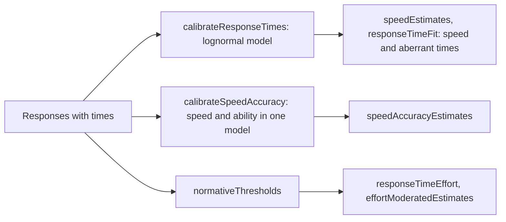

# Response times

`@measurekit/psychometrics/response-time` models how long persons take on items: the lognormal model with
its calibration, person speed, aberrant times, the hierarchical model of speed and accuracy, which puts responses and
times in one model, and rapid guessing by normative thresholds, response time effort and effort-moderated scoring.
Each is validated against nlme, LNIRT, mirt or base R ([validation](validation.md)).



## Quick start

Simulate the times of 300 persons on three items, calibrate the lognormal model, and estimate each person's speed:

```ts
import { createRandom } from "@measurekit/psychometrics";
import { buildResponseMatrix } from "@measurekit/psychometrics/data";
import { calibrateResponseTimes, responseTimeFit, speedEstimates } from "@measurekit/psychometrics/response-time";
import { normalDistribution, simulateThetas } from "@measurekit/psychometrics/sim";

// 300 persons answer 3 items; ln T = β - τ + ε / α with β = 4, 3.5 and 3, α = 2 and speeds τ ~ N(0, 0.3²).
const random = createRandom(2026);
const intensities = [4, 3.5, 3];
const speeds = simulateThetas(300, random, { distribution: normalDistribution(0, 0.3) });
const times = speeds.map((speed) => intensities.map((intensity) => Math.exp(intensity - speed + random.normal() / 2)));
const data = buildResponseMatrix(
  times.map((row) => row.map(() => 1)),
  { times },
);

const calibration = calibrateResponseTimes(data);
calibration.items.map(({ intensity, discrimination }) => [intensity, discrimination]);
// => [[3.943, 2.241], [3.455, 2.004], [3.018, 1.913]]: the intensities and the discriminations
calibration.speedSd; // => 0.32
const options = { sd: calibration.speedSd };
speedEstimates(data, calibration.items, options)[0]; // => { id: "person1", speed: -0.09, standardError: 0.21 }
responseTimeFit(data, calibration.items, options)[0];
// => { id: "person1", residuals: [0.48, -0.01, -0.12], statistic: 0.24, ... }
```

## Times

Times are in seconds, positive, aligned with the responses: `times` of a [response matrix](data.md), by person, then
item, `null` when missing; or `time` of a [response record](data.md#response-records). A time needs a response.

```ts
import { buildResponseMatrix } from "@measurekit/psychometrics/data";

const matrix = buildResponseMatrix(
  [
    [1, 0, 1],
    [0, 1, null],
  ],
  {
    times: [
      [41.2, 63.5, 22.8],
      [3.1, 70.4, null],
    ],
  },
);
```

## Lognormal model

The lognormal model (van der Linden, 2006) takes the log time of person j on item i as normal:

ln T_ij ~ N(β_i - τ_j, 1 / α_i²),

with β_i the item's time intensity, α_i its time discrimination, and τ_j the person's speed, τ ~ N(0, σ_τ²) in the
population: a faster person has a higher τ.

`calibrateResponseTimes(data, options)` estimates β, α and σ_τ by marginal maximum likelihood. τ integrates out in
closed form, so EM's E-step gives each person's normal posterior of τ and the M-step updates every parameter in
closed form; the log-likelihood is exact. The model is the linear mixed model of nlme's
`lme(log(t) ~ 0 + item, random = ~ 1 | person, weights = varIdent(form = ~ 1 | item), method = "ML")`. Each item needs
at least two times that differ: with equal times its variance would be 0 and the likelihood unbounded.

| Option          | Default | Meaning                                                              |
| --------------- | ------- | -------------------------------------------------------------------- |
| `tolerance`     | `1e-6`  | EM stops when no parameter changes by more than this in an iteration |
| `maxIterations` | `1000`  | The most EM iterations                                               |

| Result          | Meaning                                                                                                                                                           |
| --------------- | ----------------------------------------------------------------------------------------------------------------------------------------------------------------- |
| `items`         | Per item: `id`, `intensity` β, `discrimination` α and the `standardError` of the intensity, `null` above 2,000 items, as its information holds every pair of them |
| `speedSd`       | σ_τ                                                                                                                                                               |
| `logLikelihood` | The marginal log-likelihood of the log times                                                                                                                      |
| `aic`, `bic`    | With 2 parameters per item and σ_τ; n the persons with times                                                                                                      |
| `converged`     | Whether EM reached `tolerance`                                                                                                                                    |
| `iterations`    | EM iterations run                                                                                                                                                 |

The intensities' standard errors are the square roots of the diagonal of (Σ_j X_jᵀ V_j⁻¹ X_j)⁻¹, as lme's `vcov`. Each
item needs two times or more; responses without times are skipped.

## Speed

`speedEstimates(data, items, { sd })` estimates each person's τ from the person's log times y over items of known
parameters, matched by id. With `sd`, σ_τ of the prior N(0, σ_τ²), such as a calibration's `speedSd`, it returns the
posterior mean Σ α_i² (β_i - y_i) / (1 / σ_τ² + Σ α_i²) and the posterior SD, lme's BLUP; without `sd`, the maximum
likelihood estimate Σ α_i² (β_i - y_i) / Σ α_i² and 1 / √Σ α_i². A person without times has `null` estimates.

## Aberrant times

`responseTimeFit(data, items, { sd })` returns, for each person, the speed as above and:

| Field              | Meaning                                                                                          |
| ------------------ | ------------------------------------------------------------------------------------------------ |
| `residuals`        | z_i = α_i (ln t_i - (β_i - τ̂)) per item, `null` without a time: a time far from the expected one |
| `statistic`        | Σ z_i², the person-level statistic of van der Linden and Guo (2008), as LNIRT's `personfitLN`    |
| `degreesOfFreedom` | The number of the person's times                                                                 |
| `significance`     | The probability of a chi-square at least as large with those degrees of freedom                  |

Under the model, each z_i is about N(0, 1) and the statistic about chi-square; with τ estimated from the same times
both are approximate. Large negative residuals flag times much shorter than the person's speed predicts, as from
preknowledge or rapid guessing; a large statistic flags a person's whole pattern. The residuals hold a value for each
person and item, so response records of many persons and items take their product; `speedEstimates` takes time and
memory that grow with the times alone.

## Speed and accuracy

`calibrateSpeedAccuracy(data, model, options)` estimates the hierarchical model of speed and accuracy (van der Linden,
2007) by marginal maximum likelihood: an [IRT model](irt.md) for the responses, the lognormal model for the times, and
ability and speed correlated in the population. `model` is an [IRT model](irt.md#models) for every item, or one for each
item in the data's item order.

```ts
import { createRandom } from "@measurekit/psychometrics";
import { buildResponseMatrix } from "@measurekit/psychometrics/data";
import { twoParameterLogistic } from "@measurekit/psychometrics/irt";
import { calibrateSpeedAccuracy, speedAccuracyEstimates } from "@measurekit/psychometrics/response-time";
import { simulateItems, simulateResponses, simulateThetas } from "@measurekit/psychometrics/sim";

// 500 persons answer 8 items; speed τ = 0.4 (0.6 θ + 0.8 z) with z ~ N(0, 1), and ln T = β - τ + ε / 1.5, β from 3 up.
const random = createRandom(2026);
const items = simulateItems(twoParameterLogistic, 8, random);
const thetas = simulateThetas(500, random);
const speeds = thetas.map((theta) => 0.4 * (0.6 * theta + 0.8 * random.normal()));
const times = speeds.map((speed) => items.map((_, i) => Math.exp(3 + i / 8 - speed + random.normal() / 1.5)));
const data = buildResponseMatrix(simulateResponses(items, thetas, random).responses, { times });

const calibration = calibrateSpeedAccuracy(data, twoParameterLogistic, { standardErrors: "hessian" });
calibration.correlation; // => 0.63, standard error 0.05: the true value is 0.6
calibration.speedSd; // => 0.41
calibration.items[0];
// => { id: "item1", parameters: { a: 0.74, b: -0.33, c: 0, d: 1 }, intensity: 3.00, discrimination: 1.51, ... }
speedAccuracyEstimates(data, calibration)[0]; // => { id: "person1", theta: -0.11, thetaStandardError: 0.57, speed: 0.14, ... }
```

The model has two levels for each person. Responses follow the IRT model of each item, and the log times

ln T_ij ~ N(β_i - τ_j, 1 / α_i²),

with β_i and α_i as in the lognormal model. Persons have the abilities θ ~ N(0, 1) and the speeds τ ~ N(0, σ_τ²) of a
bivariate normal distribution with correlation ρ. Given θ, the speed is normal with mean ρ σ_τ θ and variance σ_τ² (1 -
ρ²), so the log times of a person are multivariate normal given θ, with mean β - ρ σ_τ θ and covariance diag(1 / α²) +
σ_τ² (1 - ρ²) 11ᵀ. Their density has a closed form, and the likelihood needs the quadrature over θ alone: the estimates
are those of maximum likelihood, with the item parameters as fixed effects (Molenaar, Tuerlinckx and van der Maas, 2015).

The E-step is that of `calibrate` with each person's density of the times at each node added to the responses'; the
items' M-step is `calibrate`'s, and β, α, σ_τ and ρ follow in closed form from the expected moments of τ. The scale of
θ is N(0, 1), as in `calibrate` with one group; the scale of τ has mean 0.

| Option           | Default               | Meaning                                                                                                                                                         |
| ---------------- | --------------------- | --------------------------------------------------------------------------------------------------------------------------------------------------------------- |
| `priors`         | none                  | Priors of the items' parameters by name, as [calibrate](irt.md#calibration)                                                                                     |
| `quadrature`     | 61 rectangular points | The rule over θ, as `calibrate`                                                                                                                                 |
| `standardErrors` | `"none"`              | `"hessian"` computes them from the Hessian of the marginal log-likelihood, by central differences of its exact gradient, for at most 2,000 estimated parameters |
| `tolerance`      | `1e-6`                | EM stops when no parameter changes by more than this in an iteration                                                                                            |
| `maxIterations`  | `1000`                | The most EM iterations                                                                                                                                          |

| Result                    | Meaning                                                                                                                                   |
| ------------------------- | ----------------------------------------------------------------------------------------------------------------------------------------- |
| `items`                   | Per item: the calibrated `parameters` and their `standardErrors`, the time `intensity` β and `discrimination` α, and `timeStandardErrors` |
| `speedSd`                 | σ_τ                                                                                                                                       |
| `correlation`             | ρ, the correlation between θ and τ, and its `correlationStandardError`                                                                    |
| `logLikelihood`           | The marginal log-likelihood of the responses and the times                                                                                |
| `aic`, `bic`              | With the items' parameters, 2 time parameters per item, σ_τ and ρ; n the persons with responses                                           |
| `converged`, `iterations` | Whether EM reached `tolerance`, and the iterations run                                                                                    |

The standard errors are `null` without the option, and when the information matrix cannot be inverted. A person's
responses and times need not be complete: a response without a time counts for the responses only, and a time needs its
response. Each item needs at least two times that differ and the responses `calibrate` needs, in every category up to
the highest.

Because the times carry information on θ through ρ, the item parameters differ from those of `calibrate` on the
responses alone, by little where ρ is small. With ρ = 0, the model is the IRT model and the lognormal model estimated
together.

### Estimates

`speedAccuracyEstimates(data, calibration)` returns, for each person in the data, the posterior of θ and τ at the
calibration's parameters, with items matched by id:

| Field                         | Meaning                                                                                          |
| ----------------------------- | ------------------------------------------------------------------------------------------------ |
| `theta`, `thetaStandardError` | The posterior mean and SD of θ over 61 rectangular points; `null` for a person without responses |
| `speed`, `speedStandardError` | The posterior mean and SD of τ; `null` for a person without times                                |

The density of the times, which depends on θ through ρ, is in the posterior of θ: the times sharpen the estimate of
θ, the collateral information of van der Linden, Klein Entink and Fox (2010), the more so the larger |ρ|. The speed is
then normal given θ, so its posterior mean and variance follow from those of θ. A person with responses and no times
has the estimate of θ from the responses alone and no speed. The calibration's items need a model with `probabilities`
and, for each response, a category of its item.

## Rapid guessing

A rapid guess is a response faster than its item's threshold: too fast to have read and solved the item.

| Function                                                     | Result                                                                                                                   |
| ------------------------------------------------------------ | ------------------------------------------------------------------------------------------------------------------------ |
| `normativeThresholds(data, { percentage, cap })`             | Each item's threshold: `percentage` of its mean time, at most `cap` seconds (Wise and Ma, 2012)                          |
| `responseTimeEffort(data, thresholds)`                       | Per person: `effort`, the share of timed responses at or above their threshold (Wise and Kong, 2005), and `rapidGuesses` |
| `effortModeratedEstimates(data, items, thresholds, options)` | Per person: theta with rapid guesses treated as missing (Wise and DeMars, 2006)                                          |

| Option       | Default | Meaning                                 |
| ------------ | ------- | --------------------------------------- |
| `percentage` | `10`    | The share of the item's mean time, NT10 |
| `cap`        | `10`    | The largest threshold in seconds        |

`thresholds` maps item ids to seconds, such as the result of `normativeThresholds`; items without one count every
response. `effortModeratedEstimates` estimates theta as `abilityEstimates` ([IRT](irt.md#ability-estimation)) does,
with the option `estimator`, `posteriorMeanEstimate` by default, from the person's responses that are not rapid guesses. Persons with low
effort, such as below 0.9, are often reported or left out of calibration.

```ts
import { buildResponseMatrix } from "@measurekit/psychometrics/data";
import { twoParameterLogistic } from "@measurekit/psychometrics/irt";
import {
  effortModeratedEstimates,
  normativeThresholds,
  responseTimeEffort,
} from "@measurekit/psychometrics/response-time";

const data = buildResponseMatrix(
  [
    [1, 0, 1],
    [0, 0, 1],
  ],
  {
    times: [
      [41, 63, 22],
      [2, 3, 35],
    ],
  },
);
const thresholds = normativeThresholds(data); // => { item1: 2.15, item2: 3.3, item3: 2.85 }
responseTimeEffort(data, thresholds);
// => [{ id: "person1", effort: 1, rapidGuesses: 0 }, { id: "person2", effort: 0.33, rapidGuesses: 2 }]: person2
//    guessed items 1 and 2
const items = [
  { id: "item1", model: twoParameterLogistic, parameters: { a: 1.2, b: -0.5, c: 0, d: 1 } },
  { id: "item2", model: twoParameterLogistic, parameters: { a: 0.8, b: 0.3, c: 0, d: 1 } },
  { id: "item3", model: twoParameterLogistic, parameters: { a: 1.5, b: 1.1, c: 0, d: 1 } },
];
effortModeratedEstimates(data, items, thresholds);
// => [{ id: "person1", theta: 0.72, standardError: 0.75 }, { id: "person2", theta: 0.85, standardError: 0.84 }]: person2
//    from item 3 alone
```

## Errors

Invalid input throws `DataError` naming the value found.

| Error                                                               | What to do                                                               |
| ------------------------------------------------------------------- | ------------------------------------------------------------------------ |
| The data have no times                                              | Give `times` to the matrix, or `time` to each record                     |
| An item has fewer than two times, or times that do not differ       | Leave the item out: its variance is 0 and the likelihood is unbounded    |
| An item of the data has no item with its id among the parameters    | Give the parameters of every item of the data                            |
| A threshold is not a positive finite number                         | Give each item a threshold in seconds                                    |
| A response is not a category of its item, in the hierarchical model | Calibrate the item on these data, or give it the categories the data use |

## Not included

| Not included                                                           | Why                                                                                                                                  |
| ---------------------------------------------------------------------- | ------------------------------------------------------------------------------------------------------------------------------------ |
| The item population level of the hierarchical model                    | Outside the sources: it is a multivariate normal distribution of the item parameters, which only Bayesian estimation (`LNIRT`) uses. |
| Response times as collateral information in adaptive tests             | No reference: no package that uses them was found, and `AbilityEstimator` sees no times.                                             |
| Speed that changes within a test                                       | No reference: no package that fits it was found.                                                                                     |
| Mixture models of the joint distribution of times and responses        | No reference: no package that fits them was found.                                                                                   |
| Rapid-guessing models of the joint distribution of times and responses | No reference: no package that fits them was found.                                                                                   |
| Poisson and gamma models of reading speed                              | Outside the sources: one chapter; the lognormal model is the practice.                                                               |
| Diffusion-based models                                                 | Outside the sources: one chapter, a cognitive model of each response.                                                                |
| Reaction-time and span task summaries                                  | No fit: scoring of a behavioral task, not a model of response times.                                                                 |

## Differences from the references

| Topic             | This package                                                               | LNIRT                                                                                                                                                                          |
| ----------------- | -------------------------------------------------------------------------- | ------------------------------------------------------------------------------------------------------------------------------------------------------------------------------ |
| Estimation        | Maximum likelihood with the item parameters as fixed effects               | Gibbs sampling with a prior on the item parameters and the person distribution                                                                                                 |
| Response model    | The logistic IRT models of `irt/`, any number of categories                | The normal ogive; with `guess` the three-parameter model                                                                                                                       |
| Person parameters | θ ~ N(0, 1) and τ with mean 0 and an estimated SD                          | θ and τ with estimated means and variances, as `ident` sets them                                                                                                               |
| Time parameters   | β, α and σ_τ agree: the times do not involve the response model            | The same                                                                                                                                                                       |
| Correlation       | The correlation of θ and τ under the logistic model, by maximum likelihood | Posterior mean of the covariance over the product of the SDs, under a prior on the items: close where the items are well determined, lower where most persons answer correctly |
| Missing data      | A response or a time may be missing, each by itself                        | Needs every time                                                                                                                                                               |

## References

- van der Linden, W. J. (2006). A lognormal model for response times on test items. Journal of Educational and
  Behavioral Statistics, 31, 181-204.
- Molenaar, D., Tuerlinckx, F., & van der Maas, H. L. J. (2015). A bivariate generalized linear item response theory
  modeling framework to the analysis of responses and response times. Multivariate Behavioral Research, 50, 56-74.
- van der Linden, W. J. (2007). A hierarchical framework for modeling speed and accuracy on test items. Psychometrika,
  72, 287-308.
- van der Linden, W. J., Klein Entink, R. H., & Fox, J.-P. (2010). IRT parameter estimation with response times as
  collateral information. Applied Psychological Measurement, 34, 327-347.
- van der Linden, W. J., & Guo, F. (2008). Bayesian procedures for identifying aberrant response-time patterns in
  adaptive testing. Psychometrika, 73, 365-384.
- Wise, S. L. (2017). Rapid-guessing behavior: Its identification, interpretation, and implications. Educational
  Measurement: Issues and Practice, 36(4), 52-61.
- Wise, S. L., & DeMars, C. E. (2006). An application of item response time: The effort-moderated IRT model. Journal of
  Educational Measurement, 43, 19-38.
- Wise, S. L., & Kong, X. (2005). Response time effort: A new measure of examinee motivation in computer-based tests.
  Applied Measurement in Education, 18, 163-183.
- Wise, S. L., & Ma, L. (2012). Setting response time thresholds for a CAT item pool: The normative threshold method.
  Annual meeting of the National Council on Measurement in Education, Vancouver.
