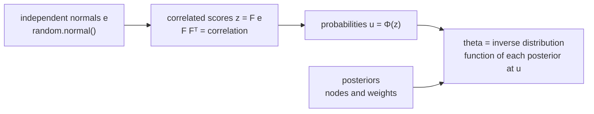

# Score reporting and prediction

`@measurekit/psychometrics/scaling` turns theta and total scores into the scores a test reports, and predicts the
score a person will be reported on an official form. It covers a linear scale with rounding and bounds, conversion
tables from total scores to scale scores, the conditional standard error of measurement of scale scores, the scale
scores of equated scores, percentile ranks in a norm sample, predictions from a posterior of theta, and joint draws of
theta from separate posteriors. Every function is validated against R ([validation](validation.md)). The growth between the groups of a vertical scale, `scaleGrowth`,
has [its own guide](vertical-scaling.md).

## Scales

A scale reports slope θ + intercept, rounded to the nearest multiple of `step`, halves up, and bounded to `lowest` and
`highest`. `scaleScore(theta, scale)` applies it.

```ts
import { scaleScore } from "@measurekit/psychometrics/scaling";

const scale = { slope: 100, intercept: 500, lowest: 200, highest: 800, step: 10 };
scaleScore(0.234, scale); // 520
scaleScore(-4.2, scale); // 200
```

| Option      | Default     | Valid range              | Meaning                                           |
| ----------- | ----------- | ------------------------ | ------------------------------------------------- |
| `slope`     | required    | positive and finite      | Scale points per unit of theta                    |
| `intercept` | required    | finite                   | The scale score of theta 0                        |
| `lowest`    | `-Infinity` | a number below `highest` | Lower scores are reported as this one             |
| `highest`   | `Infinity`  | a number above `lowest`  | Higher scores are reported as this one            |
| `step`      | `1`         | finite, at least 0       | The rounding increment; 0 leaves scores unrounded |

The same options, without `slope` and `intercept`, are the `ScoreRounding` of `scaleConversion`. Scale scores do not
decrease with theta, and a score that rounds to -0 is reported as 0.

## Conversion tables

`conversionTable(items, scale, options)` converts each total score of a form to theta and to a scale score.

```ts
import { conversionTable } from "@measurekit/psychometrics/scaling";
import { twoParameterLogistic } from "@measurekit/psychometrics/irt";

const items = [
  { model: twoParameterLogistic, parameters: { a: 1.2, b: -0.8, c: 0, d: 1 } },
  { model: twoParameterLogistic, parameters: { a: 0.9, b: 0, c: 0, d: 1 } },
  { model: twoParameterLogistic, parameters: { a: 1.5, b: 0.9, c: 0, d: 1 } },
];
const scale = { slope: 100, intercept: 500, lowest: 200, highest: 800, step: 10 };
conversionTable(items, scale);
// [{ score: 0, theta: -0.969, standardError: 0.787, scaleScore: 400, scaleStandardError: 47.5 },
//  { score: 1, theta: -0.297, standardError: 0.761, scaleScore: 470, scaleStandardError: 51.0 },
//  { score: 2, theta: 0.331, standardError: 0.756, scaleScore: 530, scaleStandardError: 53.2 },
//  { score: 3, theta: 1.081, standardError: 0.761, scaleScore: 610, scaleStandardError: 52.5 }]
```

The items are those of a calibration, `calibrate(...).items`, or any [items](irt.md#models) of any models.

| Option       | Default               | Meaning                                                                                           |
| ------------ | --------------------- | ------------------------------------------------------------------------------------------------- |
| `method`     | `"eap-sum"`           | `"eap-sum"` or `"true-score"`: how the theta of a total score is found                            |
| `prior`      | `{ mean: 0, sd: 1 }`  | The prior of `"eap-sum"`: a finite mean and a positive sd                                         |
| `quadrature` | 61 rectangular points | The rule of `"eap-sum"`, placed on the prior, as [`summedScoreTable`](irt.md#summed-score-tables) |
| `range`      | `[-6, 6]`             | The thetas of the total scores that have none: a lower bound below an upper bound                 |

| Method         | Theta of a total score x                                                    | Standard error                                |
| -------------- | --------------------------------------------------------------------------- | --------------------------------------------- |
| `"eap-sum"`    | The posterior mean of theta given x (Thissen et al., 1995): mirt's `EAPsum` | The posterior standard deviation              |
| `"true-score"` | The root of the test characteristic curve τ(θ) = x (Lord, 1980)             | 1 / √I(θ), the test information at that theta |

- **Scores with no theta.** A score takes an end of `range`, with a `null` standard error: the lower end for a score
  below those that have a theta, the upper end otherwise. With `"eap-sum"` these are scores whose probability underflows
  to 0. With `"true-score"` they are scores at or below the sum of the lower asymptotes, which the curve approaches as
  theta falls, or at or above the sum of the upper asymptotes: for a 2PL form, the scores 0 and the highest.
- **True-score forms.** The curve must increase with theta: the built-in models other than the NRM, with positive
  slopes. Other forms throw `DataError` for `"true-score"`; `"eap-sum"` takes items of any model.
- **Scale scores.** `scaleScore` is `scaleScore(theta, scale)` of the row's theta. A table whose scores will be
  interpolated by `scaleConversion` is made with `step: 0`.
- **`scaleStandardError`.** The [conditional standard error](#conditional-standard-errors) at the row's theta of the
  table's own scale scores, rounded and bounded as reported.

## Conditional standard errors

`conditionalScaleError(items, conversion, theta)` returns the standard deviation of the scale score of a person at
theta (Kolen, Zeng and Hanson, 1996). With P(x | θ) the probability of the total score x, from the recursion of Lord
and Wingersky (1984), and c(x) its scale score, it is √(Σ c(x)² P(x | θ) - (Σ c(x) P(x | θ))²).

```ts continues
import { conditionalScaleError } from "@measurekit/psychometrics/scaling";

// `items` is the form of the previous example and 400, 470, 530, 610 its table's scale scores.
conditionalScaleError(items, [400, 470, 530, 610], 0); // 52.1
```

`conversion` holds one finite scale score for each total score from 0 to the form's highest, the sum of its items'
highest categories; any other length throws `DataError`. For the unrounded scale score of a theta estimate, the error
is the slope times `conditionalStandardError` of the [irt](irt.md#information) module. The recursion takes
O(items × scores) per theta, and a table does all its rows in one pass.

## Scale scores of equated scores

Equating gives each score of form X an equivalent on form Y, usually not a whole number. `scaleConversion(equivalents,
conversion, options)` reports it on Y's scale by linear interpolation between the neighboring scores of Y's table
(Kolen and Brennan, 2014), holding the end values for equivalents below 0 and above Y's highest score, and then rounds
and bounds as `options` say, which are those of [a scale](#scales).

```ts continues
import { linearEquating } from "@measurekit/psychometrics/equating";
import { conversionTable, scaleConversion } from "@measurekit/psychometrics/scaling";

// The number of persons at each total score of forms X and Y, 0 to 3, taken by random groups.
const equated = linearEquating([2, 8, 20, 10], [4, 11, 22, 8]); // [-0.295, 0.757, 1.808, 2.860]
// Y's unrounded scale scores; `items` and `scale` are those of the first example, for form Y.
const unrounded = conversionTable(items, { ...scale, step: 0 }).map((row) => row.scaleScore);
scaleConversion(equated, unrounded, scale); // [400, 450, 520, 600]
```

Interpolate unrounded scores: rounding Y's table first rounds twice. Any equating that returns equivalents on Y's raw
scale, including [NEAT equating](equating.md#equating-through-common-items), takes this route.

## Norms

`percentileRanks(sample, scores)` gives the percentile rank in a norm sample of each score: the percentage of the
sample below it plus half the percentage at it, 100 (#{s < x} + #{s = x} / 2) / n. At integer scores it is Kolen and
Brennan's percentile rank, and the `px` of the equate package times 100.

```ts
import { percentileRanks } from "@measurekit/psychometrics/scaling";

const sample = [420, 480, 480, 510, 540, 600, 600, 600, 650, 720];
percentileRanks(sample, [480, 500, 600, 800]); // [20, 30, 65, 100]
```

The sample is sorted once and each rank found by binary search, so n scores and m ranks take O((n + m) log n). It needs
at least one finite score, and the ranks are on the sample's own scale: norms of scale scores take a sample of scale
scores and, as `scores`, a table's.

## Predicting an official score

A learner practices on a bank of items and then takes the official test. The practice responses give a posterior
distribution of theta, a `ThetaDistribution` of `nodes` and `weights` that sum to 1. The prediction is the distribution
of the score the official test will report, treating theta as constant.

| Function                                        | Official test                            | Prediction by                                                       |
| ----------------------------------------------- | ---------------------------------------- | ------------------------------------------------------------------- |
| `predictFormScore(posterior, form, conversion)` | A fixed form scored by total score       | P(x) = Σ_q w_q P(x \| θ_q), converted by the form's table           |
| `predictThetaScore(posterior, scale, options)`  | A test that reports theta, such as a CAT | The estimate θ + e, e ~ N(0, se²), rounded and bounded by the scale |

```ts
import { thetaPosterior, twoParameterLogistic } from "@measurekit/psychometrics/irt";
import { conversionTable, predictFormScore, predictThetaScore } from "@measurekit/psychometrics/scaling";

const item = (a: number, b: number) => ({ model: twoParameterLogistic, parameters: { a, b, c: 0, d: 1 } });
const practice = [item(1, -1), item(1.2, -0.2), item(0.9, 0.5), item(1.4, 1.1)];
const official = [item(1.1, -0.5), item(1.3, 0.4), item(0.8, 1)];
const scale = { slope: 100, intercept: 500, lowest: 200, highest: 800, step: 10 };

const posterior = thetaPosterior(practice, [1, 1, 0, 0]);
const conversion = conversionTable(official, scale).map((row) => row.scaleScore); // [410, 480, 540, 600]
predictFormScore(posterior, official, conversion);
// { mean: 501.5, lower: 410, upper: 600,
//   distribution: [{ score: 410, probability: 0.180 }, { score: 480, probability: 0.373 },
//                  { score: 540, probability: 0.325 }, { score: 600, probability: 0.122 }] }
predictThetaScore(posterior, scale, { standardError: 0.3, level: 0.9 }); // mean 508.5, lower 380, upper 640
```

| Option          | Of                  | Default | Valid range        | Meaning                                           |
| --------------- | ------------------- | ------- | ------------------ | ------------------------------------------------- |
| `level`         | both                | `0.8`   | above 0, below 1   | The probability of the central interval           |
| `standardError` | `predictThetaScore` | `0`     | finite, at least 0 | The standard error of the official theta estimate |

| Result         | Meaning                                                                                       |
| -------------- | --------------------------------------------------------------------------------------------- |
| `mean`         | The expected reported score                                                                   |
| `lower`        | The lowest score with at least (1 - `level`) / 2 of the probability at or below it            |
| `upper`        | The lowest score with at least (1 + `level`) / 2 of the probability at or below it            |
| `distribution` | `{ score, probability }` for each reportable score, in ascending order of score, summing to 1 |

- **Form scores.** `conversion` has one finite scale score for each total score of `form`. Total scores with equal scale
  scores pool their probabilities, so `distribution` lists the distinct scale scores.
- **Theta scores.** The reportable scores are `lowest`, `highest` and the multiples of `step` between them; the estimates
  that round and bound to a score s form an interval of theta, so that P(s) = Σ_q w_q [Φ((t_hi - θ_q) / se) - Φ((t_lo
  - θ_q) / se)]. With `standardError` 0 each node's weight goes to the score of its own theta. The scale needs finite
  `lowest` and `highest` and a `step` above 0, and `distribution` has (`highest` - `lowest`) / `step` + 2 entries at most:
  scales of a few thousand scores or fewer.
- **Posteriors.** Any distribution with finite `nodes` and non-negative `weights` that sum to 1 within 1e-6 serves. Its
  probabilities are scaled to sum to 1.

Where the posterior comes from:

| Source                      | Call                                                                                                  |
| --------------------------- | ----------------------------------------------------------------------------------------------------- |
| Practice responses          | `thetaPosterior(practiceItems, responses, { prior })` of [irt](irt.md#posterior-distribution)         |
| A knowledge tracing learner | `model.posterior(state)` of [`@measurekit/knowledge-tracing/irt`](../knowledge-tracing/irt.md#online) |
| No practice                 | A calibration's `groups[0]`, a `GroupDistribution`: the score of a person drawn from the population   |

```ts continues
import { irt } from "@measurekit/knowledge-tracing/irt";
import { predictFormScore } from "@measurekit/psychometrics/scaling";

// `official` and `conversion` are those of the previous example; q1 to q4 are the practice items.
const model = irt({
  parameters: {
    items: { q1: { a: 1, b: -1 }, q2: { a: 1.2, b: -0.2 }, q3: { a: 0.9, b: 0.5 }, q4: { a: 1.4, b: 1.1 } },
  },
});
const answers: [string, number][] = [
  ["q1", 1],
  ["q2", 1],
  ["q3", 0],
  ["q4", 0],
];
let ana = model.initialState("ana");
answers.forEach(([item, outcome], time) => {
  ana = model.update(ana, { learner: "ana", item, skills: [], time, outcome });
});
predictFormScore(model.posterior(ana), official, conversion).mean; // 501.5, as thetaPosterior gives
```

The libraries meet in data, not imports: both return `{ nodes, weights }`. The prediction is valid only if the practice
items and the official form are on one theta scale. Calibrate the practice items with official items as anchors, or
link their scale first ([linking](equating.md#linking)); the prediction treats theta as constant between practice and
the test, so pass recent responses where learning is likely.

## Joint draws of theta

A host holds one posterior per section or person, computed apart, and needs the distribution of something that combines
them: a composite score, a pass on every section, the reliability of a composite. `drawJointThetas(posteriors,
correlation, draws, random)` draws thetas from all the posteriors at once, coupled by a Gaussian copula: each posterior
keeps its own distribution, and `correlation` says how the thetas move together.



```ts
import { createRandom } from "@measurekit/psychometrics";
import { thetaPosterior, twoParameterLogistic } from "@measurekit/psychometrics/irt";
import { drawJointThetas } from "@measurekit/psychometrics/scaling";

const item = (a: number, b: number) => ({ model: twoParameterLogistic, parameters: { a, b, c: 0, d: 1 } });
const quadrature = { points: 241 };
const reading = thetaPosterior([item(1, -1), item(1.2, -0.2), item(0.9, 0.5), item(1.4, 1.1)], [1, 1, 0, 0], {
  quadrature,
});
const writing = thetaPosterior([item(1.1, -0.6), item(0.8, 0.3), item(1.3, 0.9)], [1, 0, 0], { quadrature });

// The sum of the two thetas at the correlations 0 and 1, which bound it for any correlation.
for (const r of [0, 1]) {
  const draws = drawJointThetas(
    [reading, writing],
    [
      [1, r],
      [r, 1],
    ],
    10_000,
    createRandom(1),
  );
  const sums = draws.map(([x, y]) => (x ?? 0) + (y ?? 0));
  const mean = sums.reduce((total, sum) => total + sum, 0) / sums.length;
  const sd = Math.sqrt(sums.reduce((total, sum) => total + (sum - mean) ** 2, 0) / (sums.length - 1));
  console.log(r, mean.toFixed(3), sd.toFixed(3)); // 0 -0.123 1.054, then 1 -0.139 1.474
}
```

| Argument      | Valid range                                                                                                       | Meaning                                             |
| ------------- | ----------------------------------------------------------------------------------------------------------------- | --------------------------------------------------- |
| `posteriors`  | at least one `ThetaDistribution`: finite, strictly ascending `nodes`, non-negative `weights`                      | The distribution of theta of each person or section |
| `correlation` | a symmetric matrix by rows, one row per posterior, 1 on the diagonal, entries from -1 to 1, positive semidefinite | The correlation of the normal scores z              |
| `draws`       | a positive integer                                                                                                | The number of draws                                 |
| `random`      | a `Random`, as `createRandom` returns it                                                                          | The source of the normals                           |

The result holds one array for each draw, with a theta for each posterior in the order given. All four arguments are
required. A draw takes as many normals from `random` as there are posteriors, whatever the correlation, so a seed gives the
same draws for the same posteriors.

| Correlation | Draws                                                                                   |
| ----------- | --------------------------------------------------------------------------------------- |
| 1           | One quantile in every posterior: the largest variance that a sum of the thetas can have |
| 0           | Independent draws                                                                       |
| -1          | Opposite quantiles: u in one posterior and 1 - u in the other (two posteriors)          |
| between     | Rank correlation (6 / π) asin(r / 2) for any posteriors                                 |

- **Reading a posterior.** The distribution function is linear within the cell of each node. A cell runs from the midpoint
  with the node below to the midpoint with the node above, and the outer cells are mirrored about their nodes; a node with
  no weight is never drawn, and one node gives that node. A cell of width h adds h² / 12 to the variance: 0.0033 on the 61
  points of spacing 0.2 that `thetaPosterior` returns, 3.7% of a variance of 0.09, and 0.0002 on 241 points. Pass 241 or
  more points for a posterior with a standard deviation under 0.5.
- **The correlation of the thetas.** `correlation` is that of the normal scores, which is the correlation of the thetas when
  the posteriors are near normal. A correlation of 1 is exact: the matrix is factored by its eigenvalues, and one below
  1e-10 in absolute value is taken as 0, so that rounding does not part the draws. A matrix with an eigenvalue below
  -1e-10 throws `DataError` naming it, and [`smoothCorrelations`](dimensionality.md) gives the nearest valid one.
- **What separate posteriors leave out.** A posterior of one section says nothing of another, so the copula carries only the
  correlation you give. Until one is estimated, report a forecast at the correlations 0 and 1. A joint model of the
  dimensions gives their joint posterior and covariance through the [multidimensional estimates](multidimensional.md#scoring);
  this function serves posteriors that were computed apart.

| Failure                                                                                                      | Result                                         |
| ------------------------------------------------------------------------------------------------------------ | ---------------------------------------------- |
| No posteriors; weights that are negative or do not sum to 1 within 1e-6; nodes that do not strictly ascend   | `DataError` naming the posterior               |
| A correlation that is not square of the posteriors' number, symmetric, 1 on the diagonal and within -1 and 1 | `DataError` naming the entry                   |
| An eigenvalue of the correlation below -1e-10                                                                | `DataError` naming it and `smoothCorrelations` |
| `draws` not a positive integer; `random` not a generator                                                     | `DataError`                                    |

The matrix is checked as symmetric and 1 on the diagonal to within 1e-8. A draw costs the square of the posteriors' number
plus a binary search in each, and 2,000 draws from 6 posteriors of 241 nodes take under a millisecond.

## Not included

- **Smoothed or continuous norming.** Outside the sources: a clinical practice with competing models (`cNORM`); it needs
  a norming model, not a rank.
- **Weighted norm samples.** Outside the sources: a clinical practice with competing models; they need a norming model,
  not a rank.
- **Growth during practice.** No fit: learning models live in `@measurekit/knowledge-tracing`.
- **Model-based percentiles Φ((θ - μ) / σ).** No fit: one line with a `GroupDistribution`'s `mean` and `sd`.
- **Scale anchoring.** No reference: descriptive work on a calibrated bank with no statistic of its own.
- **Item mapping.** No reference: descriptive work on a calibrated bank with no statistic of its own.
- **A copula other than the Gaussian.** Outside the sources: the correlation bounds of comonotonicity and independence
  hold for any copula, but the Gaussian one is the usual choice for separate posteriors and needs one matrix.

## Differences from the references

| Topic                    | This package                                                    | Reference                                                                 |
| ------------------------ | --------------------------------------------------------------- | ------------------------------------------------------------------------- |
| Rounding of halves       | Up: 525 to 530 with a step of 10                                | R's `round` rounds halves to even; testing programs differ                |
| EAP of the summed score  | 61 rectangular points on the prior, any prior                   | mirt's `fscores(method = "EAPsum")`: the model's own latent distribution  |
| True-score theta         | The root of the curve; the range's end where there is none      | A procedure of each program for scores below the guessing level           |
| Percentile ranks         | Of the sample's scores as given; a step function between scores | Kolen and Brennan interpolate linearly within each integer score          |
| Error of reported scores | Of the rounded and bounded scores of the table                  | Kolen, Zeng and Hanson give the error before rounding too: slope × SEM(θ) |
| Joint draws              | A Gaussian copula over separate posteriors                      | mirt's `fscores(plausible.draws =)`: one model's joint posterior          |

## References

- Kolen, M. J., & Brennan, R. L. (2014). Test equating, scaling, and linking: Methods and practices (3rd ed.). Springer.
- Kolen, M. J., Zeng, L., & Hanson, B. A. (1996). Conditional standard errors of measurement for scale scores using IRT.
  Journal of Educational Measurement, 33(2), 129-140.
- Cario, M. C., & Nelson, B. L. (1997). Modeling and generating random vectors with arbitrary marginal distributions and
  correlation matrix (technical report). Northwestern University.
- Dhaene, J., Denuit, M., Goovaerts, M. J., Kaas, R., & Vyncke, D. (2002). The concept of comonotonicity in actuarial science
  and finance: Theory. Insurance: Mathematics and Economics, 31(1), 3-33.
- Lord, F. M. (1980). Applications of item response theory to practical testing problems. Lawrence Erlbaum.
- Lord, F. M., & Wingersky, M. S. (1984). Comparison of IRT true-score and equipercentile observed-score "equatings".
  Applied Psychological Measurement, 8(4), 453-461.
- Nelsen, R. B. (2006). An introduction to copulas (2nd ed.). Springer.
- Petersen, N. S., Kolen, M. J., & Hoover, H. D. (1989). Scaling, norming, and equating. In R. L. Linn (Ed.),
  Educational measurement (3rd ed., pp. 221-262). American Council on Education.
- Thissen, D., Pommerich, M., Billeaud, K., & Williams, V. S. L. (1995). Item response theory for scores on tests
  including polytomous items with ordered responses. Applied Psychological Measurement, 19(1), 39-49.
