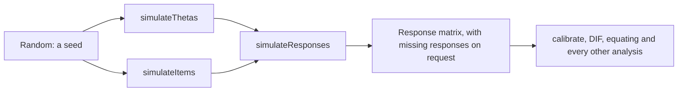

# Simulation

`@measurekit/psychometrics/sim` simulates thetas, item parameters of every built-in [IRT model](irt.md) and
response matrices, also of [multidimensional models](multidimensional.md), for test design and research: recovery studies, the design of forms and pools, and data for any
other analysis. Every draw comes from the `Random` passed in, so a seed reproduces a simulation.



```ts
import { createRandom } from "@measurekit/psychometrics";
import { calibrate, twoParameterLogistic } from "@measurekit/psychometrics/irt";
import { simulateItems, simulateResponses, simulateThetas } from "@measurekit/psychometrics/sim";

const random = createRandom(20261029);
const items = simulateItems(twoParameterLogistic, 20, random);
const thetas = simulateThetas(2000, random);
const matrix = simulateResponses(items, thetas, random, { missingProbability: 0.05 });
calibrate(matrix, { model: twoParameterLogistic }).items; // estimates near items[j].parameters
```

| Function                                                            | Result                                                                                         |
| ------------------------------------------------------------------- | ---------------------------------------------------------------------------------------------- |
| `simulateThetas(count, random, distribution)`                       | `count` thetas from `distribution`, by default N(0, 1)                                         |
| `simulateItems(model, count, random, options)`                      | `count` items `{ model, parameters }` of a built-in model                                      |
| `simulateResponses(items, thetas, random, options)`                 | A response matrix: a row per theta, a column per item, the default ids                         |
| `simulateMultidimensionalResponses(items, thetas, random, options)` | The same for [multidimensional](multidimensional.md) items, with an array of thetas per person |

Thetas need not come from `simulateThetas`: any finite values work, such as a grid or the estimates of a real
sample. A seed gives the same simulation for the same calls in the same order.

## Distributions

A `Distribution` is a function `(random) => number` that draws only from `random`.

| Function                                | Distribution                                          |
| --------------------------------------- | ----------------------------------------------------- |
| `normalDistribution(mean, sd)`          | N(mean, sd²)                                          |
| `logNormalDistribution(meanLog, sdLog)` | ln x ~ N(meanLog, sdLog²), as R's `rlnorm`            |
| `uniformDistribution(lower, upper)`     | Uniform from `lower` to `upper`                       |
| `(random) => ...`                       | A custom distribution, such as the constant `() => 1` |

Normal draws invert the normal distribution function at a uniform draw, as R's default `rnorm` does; R's generator
differs from `createRandom`, so a seed gives other values than in R.

## Item parameters

`simulateItems(model, count, random, options)` draws `count` items `{ model, parameters }` of a built-in model.

| Option          | Default                                | Meaning                                                                       |
| --------------- | -------------------------------------- | ----------------------------------------------------------------------------- |
| `categoryCount` | 2 for the 1PL to 4PL, 3 for the others | K, the number of categories of every item; catR's `nrCat`                     |
| `distributions` | catR's, below                          | Distributions by parameter name, such as `{ a: uniformDistribution(0.5, 2) }` |

Each parameter comes from its distribution in `distributions` or from its default, which is catR's in
`genDichoMatrix` and `genPolyMatrix`:

| Model                      | Parameters drawn                                                      | Defaults                          |
| -------------------------- | --------------------------------------------------------------------- | --------------------------------- |
| `oneParameterLogistic`     | `a`, once for all items; `b`                                          | a = 1, b ~ N(0, 1)                |
| `twoParameterLogistic`     | `a`, `b`                                                              | a ~ N(1, 0.2²), b ~ N(0, 1)       |
| `threeParameterLogistic`   | `a`, `b`, `c`                                                         | as the 2PL, c ~ U(0, 0.25)        |
| `fourParameterLogistic`    | `a`, `b`, `c`, `d`                                                    | as the 3PL, d ~ U(0.75, 1)        |
| `gradedResponse`           | `a`; K - 1 thresholds `b`, in increasing order                        | a ~ logN(0, 0.1225²), b ~ N(0, 1) |
| `generalizedPartialCredit` | `a`; K - 1 thresholds `b`                                             | a ~ logN(0, 0.1225²), b ~ N(0, 1) |
| `partialCredit`            | `a`, once for all items; K - 1 thresholds `b`                         | a = 1, b ~ N(0, 1)                |
| `ratingScale`              | `a` and K - 1 `steps`, once for all items; `b`                        | a = 1, steps and b ~ N(0, 1)      |
| `nominalResponse`          | Slopes `a` and intercepts `c` of the categories from 1; category 0: 0 | a ~ logN(0, 0.1225²), c ~ N(0, 1) |

catR draws the number of categories of each polytomous item from a Poisson distribution unless `same.nrCat = TRUE`;
`simulateItems` gives every item `categoryCount`.

- **Shared parameters.** The parameters the model's items share are drawn once, as calibration estimates one value of
  each.
- **Form.** Items come in the form calibration reports. The GRM's thresholds increase when a > 0 and decrease when
  a < 0. The RSM's steps sum to 0: their mean moves into each b, which keeps the thresholds b + τ_k as drawn. The NRM's
  slopes and intercepts are centered to sum to 0.
- **Validity.** Draws that give an invalid item, such as c ≥ d, throw `DataError` naming the item. A distribution for
  a parameter the model does not draw, such as `c` for the 2PL, throws too.
- **Mixed formats.** Concatenate the items of several calls. A custom `IrtModel` is not supported; build its items
  directly.

## Responses

`simulateResponses(items, thetas, random, { missingProbability })` draws each response from its item's category
probabilities at the person's theta, by inverting their distribution function at one uniform draw: category k with
probability P(k | θ). Items of any model work, a custom one included. Persons are drawn in order, each person's items
in order.

`missingProbability` (default `0`) makes each response missing with that probability, independently of everything
else: missing completely at random. The missing responses are drawn after all responses, so a seed gives the same
responses with and without missingness, less the missing ones.

### Multidimensional responses

`simulateMultidimensionalResponses(items, thetas, random, { missingProbability })` draws responses of items of the
[multidimensional models](multidimensional.md) in the same way, from each person's vector of thetas: `thetas` has one
array per person, as many numbers as the items have dimensions. Every item has the same number of dimensions. The
thetas come from any source, such as correlated normal draws:

```ts
import { createRandom } from "@measurekit/psychometrics";
import { multidimensionalTwoParameterLogistic } from "@measurekit/psychometrics/multidimensional";
import { simulateMultidimensionalResponses } from "@measurekit/psychometrics/sim";

const random = createRandom(5);
const items = [
  { model: multidimensionalTwoParameterLogistic, parameters: { a: [1.2, 0], intercept: 0.3, c: 0, d: 1 } },
  { model: multidimensionalTwoParameterLogistic, parameters: { a: [0.4, 1.1], intercept: -0.5, c: 0, d: 1 } },
];
const thetas = Array.from({ length: 4 }, () => [random.normal(), random.normal()]);
simulateMultidimensionalResponses(items, thetas, random).responses; // [[1, 1], [0, 1], [1, 1], [0, 0]]
```

`simulateCdmResponses(model, profiles, random)` simulates responses from a [cognitive diagnosis](cdm.md) model, its
`attributes` and `items` with their success probabilities per latent group, such as a calibration's: one person per
profile, each response correct with the probability of the profile's latent group for the item, by one uniform draw,
persons in order, each person's items in order.

Adaptive and multistage tests are simulated by `simulateAdaptiveTest` and `simulateMultistageTest`
([adaptive testing](cat.md#simulation)), which draw responses in the same way.

## Validation

R's generator differs from `createRandom`, so no R reference reproduces a simulation. Seeded tests check
the distributions instead ([validation](validation.md#simulation)): moments, category frequencies, the share of
missing responses, exact reproduction, and the recovery of simulated 2PL items by calibration.
