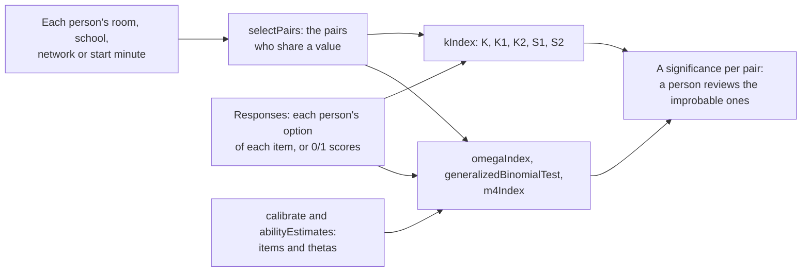

# Answer similarity

`@measurekit/psychometrics/similarity` tests whether two persons gave the same responses more often than two persons
who answer alone do: the statistical evidence of answer copying and collusion on a multiple-choice test. It selects the
pairs worth comparing, the persons who shared a room, a school, a network or a start time, and computes the indices
that CopyDetect gives: Wollack's ω, the generalized binomial test, Maynes' M4, and the K index with its variants K1,
K2, S1 and S2. Every index is validated against CopyDetect 1.4 on a simulation with planted copying
([validation](validation.md)).



| Function                                                | Answers                                                                                        | Takes item parameters |
| ------------------------------------------------------- | ---------------------------------------------------------------------------------------------- | --------------------- |
| `selectPairs(personIds, contexts, options)`             | Which persons could have seen or told each other's answers?                                    | No                    |
| `omegaIndex(matrix, items, thetas, pairs)`              | Did the first person give the second's responses more often than the first's ability explains? | Yes                   |
| `generalizedBinomialTest(matrix, items, thetas, pairs)` | Did the two give the same responses more often than two persons answering alone?               | Yes                   |
| `m4Index(matrix, items, thetas, pairs, options)`        | Did they give identical correct and identical incorrect responses together too often?          | Yes                   |
| `kIndex(matrix, pairs, options)`                        | Did the first share more of the second's incorrect responses than persons as able do?          | No                    |

A small significance marks a pattern that is improbable without copying, and honest persons make it too, at its rate:
an index is evidence for a person's review, never proof of copying. CopyDetect's manual says the same.

## Quick start

Simulate a test of 400 persons in rooms of 20 on which one person copies another, calibrate the nominal response
model, and screen the pairs of each room both ways with ω:

```ts
import { createRandom } from "@measurekit/psychometrics";
import { buildResponseMatrix } from "@measurekit/psychometrics/data";
import { abilityEstimates, calibrate, nominalResponse } from "@measurekit/psychometrics/irt";
import { simulateItems, simulateResponses, simulateThetas } from "@measurekit/psychometrics/sim";
import { omegaIndex, selectPairs } from "@measurekit/psychometrics/similarity";

const random = createRandom(20261104);
const truth = simulateItems(nominalResponse, 30, random, { categoryCount: 4 });
const simulated = simulateResponses(truth, simulateThetas(400, random), random);
// The fourth person copies the third person's choices on 20 of the 30 items.
const responses = simulated.responses.map((row, person) =>
  person === 3 ? [...(simulated.responses[2] ?? []).slice(0, 20), ...row.slice(20)] : row,
);
const matrix = buildResponseMatrix(responses);
const { items } = calibrate(matrix, { model: nominalResponse });
const thetas = abilityEstimates(matrix, items).map(({ theta }) => theta ?? 0);

const rooms = matrix.personIds.map((_, person) => `room${Math.floor(person / 20) + 1}`);
const { pairs } = selectPairs(matrix.personIds, { room: rooms });
const bothWays = [...pairs, ...pairs.map(([a, b]) => [b, a] as const)];
const level = 0.01 / bothWays.length;
omegaIndex(matrix, items, thetas, bothWays)
  .filter(({ significance }) => significance !== null && significance < level)
  .map(({ persons, omega }) => [persons, omega]);
// => [[["person3", "person4"], 5.41], [["person4", "person3"], 4.88]]
```

The screen compares 3,800 pairs both ways, so it divides its level by 7,600, Bonferroni's bound on the chance that
any honest pair is flagged: every flag costs a person's review.

## Responses and items

The indices compare responses as categories of a response matrix, numbered from 0 for each item.

| Data                                         | Responses                                             | Items                                          | Key                                         |
| -------------------------------------------- | ----------------------------------------------------- | ---------------------------------------------- | ------------------------------------------- |
| The option each person chose, the best input | The option's place among the item's options           | `nominalResponse`, calibrated on the same data | Option `key`: the keyed option of each item |
| Scores 0 and 1                               | The scores; every incorrect response is then the same | 1PL to 4PL                                     | Category 1, the default                     |

Two persons match on an item when they give it the same category. With choices, two persons who chose the same wrong
option match, and two who chose different wrong options do not; with scores, any two incorrect responses match, which
loses that evidence. ω, the generalized binomial test and M4 take the probability of each category at each person's
theta, so their items are the matrix's calibrated items and their thetas are estimates from the same items, such as
`abilityEstimates`; CopyDetect 1.3 estimated the posterior mode under a N(0, 5) prior for scores and N(0, 10) for choices.
The K index needs no item parameters; its rates come from the other persons of the matrix, so the matrix holds every
person who took the test, not only those of the pairs.

```ts
import { buildResponseMatrix, scoreResponses } from "@measurekit/psychometrics/data";

const optionLabels = ["A", "B", "C", "D"];
const choices = [
  ["B", "C", null, "A"],
  ["B", "C", "D", "A"],
  ["A", "C", "D", "B"],
];
const key = ["B", "C", "A", "A"];
scoreResponses(choices, key, { optionLabels }).responses; // => [[1, 1, null, 1], [1, 1, 0, 1], [0, 1, 0, 0]]
// The options as categories of the nominal response model, and the key as categories.
const matrix = buildResponseMatrix(
  choices.map((row) => row.map((choice) => (choice === null ? null : optionLabels.indexOf(choice)))),
);
const keyed = key.map((label) => optionLabels.indexOf(label)); // => [1, 2, 0, 0]
```

A missing response, `null`, leaves its item out of each pair it is in: the indices compare the items both persons
answered, and the K index counts it as neither correct nor incorrect. An omission that a test counts as a response, as
CopyDetect counts two missing responses as identical incorrect ones, is a category of its own: give it a label, as
[scoring](data.md#scoring-against-a-key) shows, and calibrate the nominal model with it.

## Pairs

`selectPairs` forms the pairs of the persons who share a value of a context, never every pair: 64,160 persons make
2.06 × 10⁹ pairs. Pass one list of values per context, one value per person, `null` for a person without one.

```ts
import { selectPairs } from "@measurekit/psychometrics/similarity";

const personIds = ["ana", "ben", "cy", "dee", "eve"];
const selection = selectPairs(
  personIds,
  {
    room: ["r1", "r1", "r2", "r2", "r2"],
    network: ["campus", "campus", "campus", null, "home"],
  },
  { maxGroup: 2 },
);
selection.pairs; // => [["ana", "ben"]]
selection.skipped;
// => [{ context: "room", value: "r2", persons: 3 }, { context: "network", value: "campus", persons: 3 }]
```

| Option     | Default     | Meaning                                                                                                       |
| ---------- | ----------- | ------------------------------------------------------------------------------------------------------------- |
| `maxGroup` | `200`       | The most persons that share a value and still form pairs, an integer from 2; a hall of 200 forms 19,900 pairs |
| `maxPairs` | `1_000_000` | The most pairs, an integer from 1: a selection of more throws; 2,000 rooms of 30 form 870,000                 |

A value shared by more than `maxGroup` persons, such as a school's network, says little of contact: it forms no pairs,
and `skipped` names it, so the caller can report what was not compared. A pair that two contexts form is kept once, its
persons in the order of the ids, and the pairs come in that order. The same selection serves any comparison of pairs,
such as of the programs that two persons wrote.

ω and the K index are directional: the first person of a pair is the suspected copier and the second the source. When no
one knows who could have copied whom, pass each pair both ways; the generalized binomial test and M4 are symmetric and
need each pair once.

## Omega

Wollack's ω asks whether the suspected copier gave the source's responses more often than the copier's ability
explains. Over the items both answered, the expected matches are the sum of the probabilities that the copier gives
the source's response, at the copier's theta, and ω is the observed matches less the expected ones over their standard
deviation, about N(0, 1) without copying; the significance is its upper tail.

| Field             | Meaning                                                                  |
| ----------------- | ------------------------------------------------------------------------ |
| `compared`        | The items both answered                                                  |
| `matches`         | The compared items on which the copier gave the source's response        |
| `expectedMatches` | The matches expected of the copier at the copier's theta                 |
| `omega`           | ω; `null` when the matches have no variance, as when no item is compared |
| `significance`    | The upper tail of the standard normal distribution at ω; `null` with ω   |

## K index and its variants

The K index needs no item parameters: it compares the incorrect responses the suspected copier shares with the source
with those that persons with as many incorrect responses as the copier share with the source. The persons are grouped
by their number of incorrect responses; the source is in no group. A group's matching rate is the mean number of the
source's incorrect responses its members give, over the source's incorrect responses w. Each index is a probability of
at least the observed identical incorrect responses.

| Index | Distribution of the identical incorrect responses                                                                                                  | Source                       |
| ----- | -------------------------------------------------------------------------------------------------------------------------------------------------- | ---------------------------- |
| `k`   | Binomial of w trials at the matching rate of the copier's group                                                                                    | Holland (1996)               |
| `k1`  | Binomial at the rate of a linear regression of the groups' rates on their proportion of incorrect responses                                        | Sotaridona and Meijer (2002) |
| `k2`  | Binomial at the rate of a quadratic regression                                                                                                     | Sotaridona and Meijer (2002) |
| `s1`  | Poisson, up to w, at the mean of a log-linear model of the groups' mean identical incorrect responses on their number of incorrect responses       | Sotaridona and Meijer (2003) |
| `s2`  | As S1, with each identical correct response added, weighted by how rarely the copier's group answers its item correctly, up to the number of items | Sotaridona and Meijer (2003) |

```ts
import { buildResponseMatrix } from "@measurekit/psychometrics/data";
import { kIndex } from "@measurekit/psychometrics/similarity";

// The options chosen by 8 persons on 6 items, keyed 0: the first person shares the second's 4 incorrect responses.
const matrix = buildResponseMatrix([
  [1, 2, 0, 3, 1, 0],
  [1, 2, 0, 3, 1, 0],
  [2, 0, 1, 0, 3, 2],
  [0, 3, 2, 1, 0, 0],
  [3, 1, 0, 2, 2, 0],
  [0, 0, 3, 0, 1, 1],
  [2, 0, 1, 3, 0, 0],
  [0, 1, 0, 0, 2, 3],
]);
kIndex(matrix, [["person1", "person2"]], { key: [0, 0, 0, 0, 0, 0], guessing: 0.25 })[0];
// => { sourceIncorrect: 4, identicalIncorrect: 4, k: 0.0123, k1: 0.0123, k2: 0.0123, s1: 0.0347, s2: 0.0776, ... }
```

| Option     | Default                                     | Meaning                                                                             |
| ---------- | ------------------------------------------- | ----------------------------------------------------------------------------------- |
| `key`      | Category 1 of every item, for 0/1 responses | The keyed category of each item; needed when a response is above 1                  |
| `guessing` | `0.2`                                       | g of S2's weights, the probability of a correct guess: 1 over the number of options |

A rate of K1 or K2 that a regression puts at 1 or above is 0.999, and at 0 or below 0.001, as in CopyDetect. S2's weight
of an item that a proportion p of the copier's group answers correctly is ((1 + g) e / (1 - g))^(-(1 + g) p / g): 1 for
an item nobody answers correctly, near 0 for one everybody does. A source without an incorrect response gives every
index `null`: there is nothing to share.

## Generalized binomial test

The test of van der Linden and Sotaridona asks whether two persons gave the same responses more often than two
persons who answer alone at their abilities. Two such persons match on an item with the probability that they give the
same category, Σ_k P_k(θ₁) P_k(θ₂), and the number of matches over the compared items follows the generalized
binomial distribution of these probabilities, which the recursion of Lord and Wingersky gives exactly. The
significance is its upper tail at the observed matches. The test is symmetric in the two persons, and its fields are
`compared`, `matches`, `expectedMatches` and `significance`, as for ω.

```ts
import { buildResponseMatrix } from "@measurekit/psychometrics/data";
import { twoParameterLogistic } from "@measurekit/psychometrics/irt";
import { generalizedBinomialTest } from "@measurekit/psychometrics/similarity";

const items = [-1, -0.5, 0, 0.5, 1, 1.5].map((b) => ({
  model: twoParameterLogistic,
  parameters: { a: 1.2, b, c: 0, d: 1 },
}));
const matrix = buildResponseMatrix([
  [1, 1, 0, 1, 0, 1],
  [1, 1, 0, 1, 0, 1],
]);
generalizedBinomialTest(matrix, items, [0, 0], [["person1", "person2"]])[0]?.significance; // => 0.0462
```

## M4

Maynes' M4 asks whether two persons gave identical correct and identical incorrect responses together more often than
two persons who answer alone. On each compared item, they give the keyed response both with probability
P = P_key(θ₁) P_key(θ₂), the same other response with Q = Σ_(k≠key) P_k(θ₁) P_k(θ₂), and different responses otherwise;
the counts of identical correct and identical incorrect responses follow the generalized trinomial distribution of
these probabilities, which M4 computes exactly. A pair of counts (x, y) is as extreme as the observed (m, n) when its
joint upper tail P(X ≥ x, Y ≥ y) is at most that of (m, n), and the significance is the probability of all such
counts, as CopyDetect computes it. Identical incorrect responses, being rarer, carry more of the evidence than as many
identical correct ones, which two able persons give without copying.

```ts
import { buildResponseMatrix } from "@measurekit/psychometrics/data";
import { nominalResponse } from "@measurekit/psychometrics/irt";
import { m4Index } from "@measurekit/psychometrics/similarity";

const item = { model: nominalResponse, parameters: { a: [-1, 0, 1, 0.5], c: [0, 0.5, 0, 0.2] } };
const matrix = buildResponseMatrix([
  [2, 0, 1, 3, 2, 0, 1, 2],
  [2, 0, 1, 3, 2, 1, 0, 2],
]);
const [pair] = m4Index(matrix, Array(8).fill(item), [0.4, -0.2], [["person1", "person2"]], {
  key: [2, 2, 2, 2, 2, 2, 2, 2],
});
pair; // => { compared: 8, identicalCorrect: 3, identicalIncorrect: 3, significance: 0.001, ... }
```

| Option | Default                                         | Meaning                                                                  |
| ------ | ----------------------------------------------- | ------------------------------------------------------------------------ |
| `key`  | Category 1 of every item, for dichotomous items | The keyed category of each item; needed when an item has more categories |

## Limits

| Input                                                   | Limit                 | Cost at the limit                                                                    |
| ------------------------------------------------------- | --------------------- | ------------------------------------------------------------------------------------ |
| Pairs of `selectPairs`                                  | `maxPairs`, 1,000,000 | About 150 MB and 0.1 s for 995,000 pairs                                             |
| Persons sharing a value in `selectPairs`                | `maxGroup`, 200       | 19,900 pairs of the value                                                            |
| Items a pair compares, generalized binomial test and M4 | 1,000                 | M4: 16 MB for its table of counts and about 0.2 s a pair; the test under 1 ms a pair |
| Counts of the K index: groups × categories of all items | 2²⁴                   | Counts, and a weight per group and item: up to 165 MB for 2,895 items                |

Time grows with the pairs. On 40 items of 5 options a pair takes about 1.5 µs for ω, 2 µs for the generalized binomial
test, 15 µs for M4 and 3 µs for the K index ([performance](../performance.md)); M4 grows with the cube of the compared
items, the test with their square, and the others linearly. The K index also counts every response once.

## Errors

Invalid input throws `DataError` with the value found.

| Cause                                                                           | What to do                                                                      |
| ------------------------------------------------------------------------------- | ------------------------------------------------------------------------------- |
| A pair names a person the matrix lacks, or one person twice                     | Pass ids of the matrix's persons, two distinct ones a pair                      |
| A response that is not a category of its item                                   | Calibrate the items on the same categories as the responses                     |
| No key for items or responses of more than two categories                       | Pass `key`, the keyed category of each item                                     |
| A context without one string or `null` per person                               | Pass a list per context in the order of the ids, with strings                   |
| More pairs than `maxPairs`                                                      | Use narrower contexts, a lower `maxGroup`, or a higher `maxPairs` with its cost |
| A pair compares more than 1,000 items in `generalizedBinomialTest` or `m4Index` | Compare the items of one form                                                   |
| The K index's counts above 2²⁴ cells                                            | Merge rare categories, or analyze fewer items                                   |

## Not included

| Not included                                       | Why                                                                                                                                                                                                                                             |
| -------------------------------------------------- | ----------------------------------------------------------------------------------------------------------------------------------------------------------------------------------------------------------------------------------------------- |
| The older indices g2, ESA and Bm                   | Outside the sources: Wollack (1997), as Sotaridona (2003) reports, found the Type I errors of g2 grossly inflated and ESA and Bm less powerful than g2; CopyDetect keeps the indices that the simulation studies of its sources show effective. |
| Estimating the items and thetas inside the indices | No fit: `calibrate` and `abilityEstimates` give them for any model, as the module's composition, where CopyDetect fits its models again on every call.                                                                                          |

## Differences from the references

| Reference                    | Difference                                                                                                                                                                                                                                                                                                                                                                                                |
| ---------------------------- | --------------------------------------------------------------------------------------------------------------------------------------------------------------------------------------------------------------------------------------------------------------------------------------------------------------------------------------------------------------------------------------------------------- |
| CopyDetect 1.4               | It fits the 1PL, 2PL, 3PL or nominal model with mirt and estimates posterior modes itself; this library takes the items and thetas, of any model and estimator, from the caller                                                                                                                                                                                                                           |
| CopyDetect 1.4               | It counts two missing responses as identical incorrect ones but leaves missing responses out of the source's incorrect responses in K, gives a source's missing nominal response the copier's likeliest distractor in ω, and keeps the items either person missed in the distributions of the generalized binomial test and M4; this library leaves an item out of a pair when either response is missing |
| CopyDetect 1.4               | Its K variants are `1 - pbinom` and `1 - ppois`, which round a significance below about 1e-16 to 0; this library sums the tail, so that a tail of 1e-30 keeps its digits                                                                                                                                                                                                                                  |
| CopyDetect 1.4               | It fits S1's and S2's log-linear models with `glm`, which stops when the deviance changes by less than 1e-8 of itself; this library maximizes the likelihood by Newton's method to convergence, and S1 and S2 differ by up to 5e-10 of their value                                                                                                                                                        |
| CopyDetect 1.4               | Its S2 takes a guessing probability of 0.2 for scores and 1 over the number of options for choices; this library takes `guessing`, 0.2 by default                                                                                                                                                                                                                                                         |
| Sotaridona and Meijer (2003) | S2 rounds the weighted count to the nearest integer; CopyDetect, and this library, round it up, and add the rounded-up mean weight of a group to its mean identical incorrect responses                                                                                                                                                                                                                   |
| CopyDetect 1.3               | Its `centers` forms every ordered pair of a center, of any size; `selectPairs` forms each pair once, over several contexts, with `maxGroup` and `maxPairs`                                                                                                                                                                                                                                                |

## References

- Cizek, G. J., & Wollack, J. A. (Eds.). (2017). _Handbook of quantitative methods for detecting cheating on tests_.
  Routledge. https://doi.org/10.4324/9781315743097
- Holland, P. W. (1996). _Assessing unusual agreement between the incorrect answers of two examinees using the K-index_
  (ETS Research Report 96-4). https://doi.org/10.1002/j.2333-8504.1996.tb01685.x
- Maynes, D. (2014). Detection of non-independent test taking by similarity analysis. In N. M. Kingston & A. K. Clark
  (Eds.), _Test fraud_ (pp. 53–82). Routledge. https://doi.org/10.4324/9781315884677
- Sotaridona, L. S., & Meijer, R. R. (2002). Statistical properties of the K-index for detecting answer copying.
  _Journal of Educational Measurement, 39_, 115–132. https://doi.org/10.1111/j.1745-3984.2002.tb01138.x
- Sotaridona, L. S., & Meijer, R. R. (2003). Two new indices to detect answer copying. _Journal of Educational
  Measurement, 40_, 53–69. https://doi.org/10.1111/j.1745-3984.2003.tb01096.x
- van der Linden, W. J., & Sotaridona, L. S. (2006). Detecting answer copying when the regular response process follows
  a known response model. _Journal of Educational and Behavioral Statistics, 31_, 283–304.
  https://doi.org/10.3102/10769986031003283
- Sotaridona, L. S. (2003). _Statistical methods for the detection of answer copying on achievement tests_ [Doctoral
  dissertation, University of Twente]. https://ris.utwente.nl/ws/files/6072637/thesis_Sotaridona.pdf
- Wollack, J. A. (1997). A nominal response model approach for detecting answer copying. _Applied Psychological
  Measurement, 21_, 307–320. https://doi.org/10.1177/01466216970214002
- Zopluoglu, C. CopyDetect: Computing response similarity indices for multiple-choice tests (version 1.4).
  https://cran.r-project.org/package=CopyDetect
