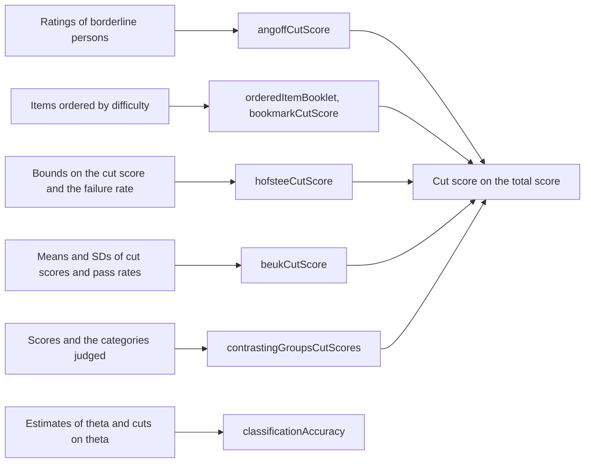

# Standard setting

`@measurekit/psychometrics/standard-setting` turns a panel's judgments into cut scores by the modified Angoff,
Bookmark, Hofstee and Beuk methods, and the judgments of persons or of their work into cut scores by contrasting groups
and Body of Work, and reports how accurately and consistently cuts on theta classify persons. No R package among the
references implements them; each is validated against its definition written out in base R, with mirt's probabilities
and expected test scores for the Bookmark method and R's `glm` for contrasting groups ([validation](validation.md)).



Cut scores on the total score scale are not rounded: a person meets the standard with a total score at or above it.

## Modified Angoff

Each panelist rates each item with the expected score of a borderline person, the person just at the standard: for a
dichotomous item, the probability of a correct response (Angoff, 1971). `angoffCutScore(ratings)` takes the ratings
by panelist, then item.

```ts
import { angoffCutScore } from "@measurekit/psychometrics/standard-setting";

angoffCutScore([
  [0.6, 0.8, 2],
  [0.7, 0.9, 1.9],
  [0.5, 0.7, 2.1],
]); // { cutScore: 3.4, panelistCutScores: [3.4, 3.5, 3.3], sd: 0.1, standardError: 0.058 }
```

| Field               | Meaning                                                                |
| ------------------- | ---------------------------------------------------------------------- |
| `cutScore`          | The mean of the panelists' cut scores                                  |
| `panelistCutScores` | Each panelist's cut score: the sum of the panelist's ratings           |
| `sd`                | The standard deviation of the panelists' cut scores, denominator n - 1 |
| `standardError`     | sd / √n for n panelists, the standard error of the cut score           |

`sd` and `standardError` are `null` with one panelist. Each round of a standard-setting meeting is one call.

## Bookmark

The Bookmark method (Mitzel, Lewis, Patz and Green, 2001) orders the score points of a test's items by difficulty in
an ordered item booklet. Each panelist places a bookmark after the last page a borderline person masters, that is,
answers with a probability of at least the response probability (RP).

```ts
import { bookmarkCutScore, orderedItemBooklet } from "@measurekit/psychometrics/standard-setting";
import { gradedResponse, threeParameterLogistic } from "@measurekit/psychometrics/irt";

const items = [
  { id: "q1", model: threeParameterLogistic, parameters: { a: 1.2, b: -0.8, c: 0.2, d: 1 } },
  { id: "q2", model: threeParameterLogistic, parameters: { a: 0.9, b: 0.3, c: 0.25, d: 1 } },
  { id: "essay", model: gradedResponse, parameters: { a: 1.1, b: [-1.2, 0.4, 1.5] } },
];
orderedItemBooklet(items); // [{ id: "essay", category: 1, location }, { id: "q1", category: 1, location }, ...]
bookmarkCutScore(items, 3); // { theta, cutScore }: the location of page 3 and the expected total score there
```

- **Pages.** An item with K categories has a page for each score point k from 1 to K - 1, located at the theta where
  P(X ≥ k | θ) = RP: b + ln((RP - c) / (d - RP)) / a for a logistic item. Pages are in ascending order of location,
  ties in item order.
- **Cut scores.** `bookmarkCutScore(items, page)` takes the number of the last page mastered. The theta cut is that
  page's location; the raw cut score is the expected total score there, Σ E(X_i | θ) over the items, the test
  characteristic curve. A panel that places the bookmark on the first page not mastered gives that page's number
  less 1. Each panelist's bookmark is one call; the panel's cut is often the median of theirs.
- **Response probability.** `responseProbability` defaults to 0.67. For a Rasch item, RP 2/3 is where the information
  of a correct response, P(θ) I(θ), peaks; for a 3PL item that point is RP (2 + c) / 3 (Huynh, 1998, 2006).
- **Items.** Items of the built-in models whose expected score increases with theta: not the NRM, and a > 0. A
  logistic item needs c < RP < d, or its probability never equals RP.

## Hofstee

The Hofstee (1983) method asks the panel for the lowest and highest acceptable cut scores, k_min and k_max, and the
lowest and highest acceptable failure rates, f_min and f_max, usually the means of the panelists' answers. The cut
score is where the line from (k_min, f_max) to (k_max, f_min) crosses the observed failure rate F(c), the share of
persons with a total score below c.

```ts
import { hofsteeCutScore } from "@measurekit/psychometrics/standard-setting";

// The number of persons at each total score from 0 to 10.
const distribution = [1, 2, 4, 7, 10, 12, 11, 8, 5, 3, 1];
hofsteeCutScore(distribution, {
  minimumCutScore: 4,
  maximumCutScore: 7,
  minimumFailureRate: 0.1,
  maximumFailureRate: 0.4,
}); // { cutScore, failureRate }
```

F is taken at each score from 0 to the highest and is linear between them, so the cut score need not be a score. The
distribution is the number of persons at each total score, as in [observed-score equating](equating.md). When the line
does not cross F between k_min and k_max, the panel's bounds do not fit the data, and the function throws `DataError`.

## Beuk

The Beuk (1984) method asks each panelist for the lowest passing score and the share of persons expected to pass. The
means k̄ and p̄ give a point, and the standard deviations s_k and s_p a slope: the line through (k̄, p̄) of slope s_p / s_k
in pass rates crosses the observed pass rate, so the answer the panel agrees on more moves less. In failure rates, the
share of persons below c, the line falls and the observed failure rate rises, and they cross once.

```ts
import { beukCutScore } from "@measurekit/psychometrics/standard-setting";

// The number of persons at each total score from 0 to 10.
const distribution = [1, 2, 4, 7, 10, 12, 11, 8, 5, 3, 1];
beukCutScore(distribution, { cutScore: 6, passRate: 0.4, cutScoreSd: 1, passRateSd: 0.1 });
// { cutScore: 6.138, failureRate: 0.586 }, after rounding
```

| Judgment     | Meaning                                                                       |
| ------------ | ----------------------------------------------------------------------------- |
| `cutScore`   | The mean of the panelists' lowest passing scores, from 0 to the highest score |
| `passRate`   | The mean of the panelists' expected pass rates, from 0 to 1                   |
| `cutScoreSd` | The standard deviation of the lowest passing scores, positive                 |
| `passRateSd` | The standard deviation of the expected pass rates, positive                   |

The observed failure rate is taken at each score and is linear between them, as in the Hofstee method, with which it
shares its crossing. When the line does not cross it between the scores 0 and the highest, the function throws
`DataError`.

## Contrasting groups and Body of Work

`contrastingGroupsCutScores(scores, categories, options)` takes each person's score and the category a panel placed the
person in, and returns a cut score for each boundary between adjacent categories: the score where a logistic regression
of "at or above the boundary" on the score reaches `probability`, (logit(probability) - β₀) / β₁, as R's `glm(family =
binomial)`. Two categories, masters and non-masters, give the contrasting-groups method (Livingston and Zieky, 1982):

```ts
import { contrastingGroupsCutScores } from "@measurekit/psychometrics/standard-setting";

const scores = [12, 15, 17, 18, 20, 21, 21, 23, 24, 26, 27, 29, 31, 33];
const masters = [0, 0, 0, 1, 0, 0, 1, 0, 1, 1, 1, 1, 1, 1]; // the panel's judgment of each person
contrastingGroupsCutScores(scores, masters); // { cutScores: [21.154], converged: true }, after rounding
contrastingGroupsCutScores(scores, masters, { probability: 0.67 }); // { cutScores: [22.816], ... }
```

More categories give the Body of Work method (Kingston, Kahl, Sweeney and Bay, 2001): a panel sorts collections of work
into the performance levels, each collection with its score, and each boundary gets its cut:

```ts
import { contrastingGroupsCutScores } from "@measurekit/psychometrics/standard-setting";

const work = [8, 12, 15, 19, 22, 24, 27, 29, 31, 34, 36, 38, 41, 43, 46, 49, 52, 55];
const levels = [0, 0, 0, 1, 0, 1, 1, 1, 2, 1, 2, 2, 2, 3, 2, 3, 3, 3]; // below basic to advanced
contrastingGroupsCutScores(work, levels).cutScores; // [20.031, 32.5, 44.76], after rounding
```

| Option        | Default | Meaning                                                          |
| ------------- | ------- | ---------------------------------------------------------------- |
| `probability` | `0.5`   | The probability of the higher category at a cut, between 0 and 1 |

Categories are integers from 0, and every boundary up to the highest category needs persons on both sides. Where the
scores of the two sides of a boundary do not overlap, the likelihood has no maximum: that cut is `null` and
`converged` is `false`. A cut need not be a score.

## Classification accuracy

`classificationAccuracy(estimates, cuts)` takes ability estimates, `{ theta, standardError }` each, and cuts on theta in
increasing order, and returns Rudner's (2001, 2005) indices, as cacIRT's `class.Rud`. Each person's theta is taken as
normal around the estimate with its standard error: P_k = Φ((c_(k+1) - θ̂) / SE) - Φ((c_k - θ̂) / SE) for each
category k between cuts.

| Field         | Meaning                                                                                              |
| ------------- | ---------------------------------------------------------------------------------------------------- |
| `persons`     | Per person: `category`, the number of cuts at or below θ̂, and `probabilities`, P_k for each category |
| `accuracy`    | The mean of the probability of each person's estimated category                                      |
| `consistency` | The mean of Σ_k P_k²: the probability that two independent measurements agree                        |

With one cut, `probabilities` are a person's chances of failing and passing; with several, the indices are cacIRT's
simultaneous ones. The normal approximation suits ML, WLE and EAP estimates with their standard errors.

```ts
import { classificationAccuracy } from "@measurekit/psychometrics/standard-setting";

const result = classificationAccuracy(
  [
    { theta: -0.4, standardError: 0.35 },
    { theta: 0.6, standardError: 0.3 },
    { theta: 1.4, standardError: 0.4 },
  ],
  [0.5],
);
result.persons[1]; // { category: 1, probabilities: [0.37, 0.63] }: 0.63 = Φ((0.6 - 0.5) / 0.3)
```

## Recipes

Three methods are one line over the functions above.

**Nedelsky.** Each panelist strikes the options of each multiple-choice item that a borderline person would rule out;
the item's rating is 1 over the options left, and the cut is the Angoff cut score of those ratings (Nedelsky, 1954):

```ts
import { angoffCutScore } from "@measurekit/psychometrics/standard-setting";

// The options left on each of four items, by two panelists.
const optionsLeft = [
  [2, 3, 1, 2],
  [2, 2, 1, 3],
];
angoffCutScore(optionsLeft.map((row) => row.map((options) => 1 / options))).cutScore; // 2.333
```

**Ebel.** The panel sorts the items into cells of relevance by difficulty and judges the share of each cell's items a
borderline person answers; the cut is the sum of the items times the share over the cells, the Angoff cut score of a
panel of one that rates each item with its cell's share (Ebel, 1972):

```ts
import { angoffCutScore } from "@measurekit/psychometrics/standard-setting";

const cells = [
  { items: 6, proportion: 0.9 },
  { items: 9, proportion: 0.75 },
  { items: 4, proportion: 0.55 },
];
const ratings = cells.flatMap(({ items, proportion }) => new Array<number>(items).fill(proportion));
angoffCutScore([ratings]).cutScore; // 14.35
```

**The borderline group.** The cut is the median of the scores of the persons the panel judges borderline.

## Not included

- **Nedelsky.** No fit: `angoffCutScore` of the reciprocals of the options left, a recipe.
- **Ebel.** No fit: a sum of items times proportions over the cells, a recipe.
- **The borderline group.** No fit: the median of the group's scores, a recipe.
- **A standard error of the borderline group's cut.** Outside the sources: not confirmed in the chapter; a bootstrap
  over the group gives one.
- **Direct consensus.** No fit: `angoffCutScore` takes the sums of clusters.
- **Item-descriptor matching.** No fit: a panel procedure with no statistic beyond the Bookmark's.
- **The analytic judgment and other holistic methods.** Outside the sources: variants of Body of Work.
- **Vertically moderated standards.** No fit: a policy across grades, not a statistic.
- **Standards for alternate assessments.** No fit: a policy, not a statistic.

## References

- Angoff, W. H. (1971). Scales, norms, and equivalent scores. In R. L. Thorndike (Ed.), Educational measurement (2nd
  ed., pp. 508-600). American Council on Education.
- Beuk, C. H. (1984). A method for reaching a compromise between absolute and relative standards in examinations.
  Journal of Educational Measurement, 21(2), 147-152.
- Ebel, R. L. (1972). Essentials of educational measurement. Prentice-Hall.
- Hofstee, W. K. B. (1983). The case for compromise in educational selection and grading. In S. B. Anderson & J. S.
  Helmick (Eds.), On educational testing (pp. 109-127). Jossey-Bass.
- Huynh, H. (1998). On score locations of binary and partial credit items and their applications to item mapping and
  criterion-referenced interpretation. Journal of Educational and Behavioral Statistics, 23, 35-56.
- Huynh, H. (2006). A clarification on the response probability criterion RP67 for standard settings based on
  bookmark and item mapping. Educational Measurement: Issues and Practice, 25(2), 19-20.
- Kingston, N. M., Kahl, S. R., Sweeney, K. P., & Bay, L. (2001). Setting performance standards using the body of work
  method. In G. J. Cizek (Ed.), Setting performance standards (pp. 219-248). Lawrence Erlbaum.
- Livingston, S. A., & Zieky, M. J. (1982). Passing scores. Educational Testing Service.
- Mitzel, H. C., Lewis, D. M., Patz, R. J., & Green, D. R. (2001). The Bookmark procedure: Psychological perspectives.
  In G. J. Cizek (Ed.), Setting performance standards (pp. 249-281). Lawrence Erlbaum.
- Nedelsky, L. (1954). Absolute grading standards for objective tests. Educational and Psychological Measurement, 14(1),
  3-19.
- Rudner, L. M. (2005). Expected classification accuracy. Practical Assessment, Research & Evaluation, 10(13).
