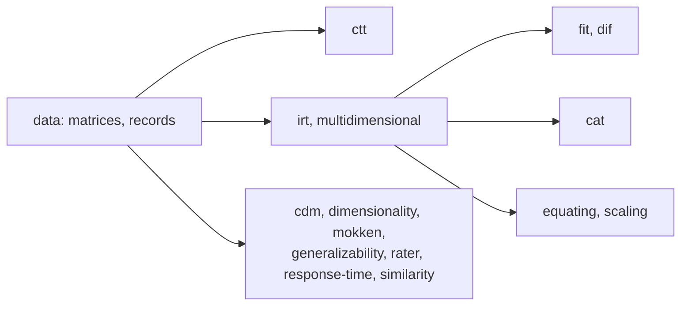

# What psychometrics supports

What each module of `@measurekit/psychometrics` builds, the references its tests compare it with, and where it lists what it
leaves out. What is built follows the [sources](architecture.md#sources) of each module; each guide's Not included table
gives the reason for each method it leaves out.

| Module                                  | Builds                                                                                                                                                                                                                                                                                                      | References                                            | Leaves out                                       |
| --------------------------------------- | ----------------------------------------------------------------------------------------------------------------------------------------------------------------------------------------------------------------------------------------------------------------------------------------------------------- | ----------------------------------------------------- | ------------------------------------------------ |
| [data](data.md)                         | Response matrices from rows or columns, response records for sparse data, scoring of choices against a key                                                                                                                                                                                                  | mirt's `key2binary`                                   | [Not included](data.md#not-included)             |
| [ctt](ctt.md)                           | Item statistics, distractor analysis, alpha, KR-20, KR-21, split half, omega, the SEM, the value of subscores and augmented subscores                                                                                                                                                                       | psych, subscore, base R                               | [Not included](ctt.md#not-included)              |
| [irt](irt.md)                           | The 1PL to 4PL, GRM, GPCM, PCM, RSM, NRM and GGUM; marginal, joint and conditional maximum likelihood; groups, latent regression, testlets, priors, person weights, held parameters; ability estimates, summed-score tables, information, reliability                                                       | mirt, TAM, eRm, ltm, GGUM, base R                     | [Not included](irt.md#not-included)              |
| [multidimensional](multidimensional.md) | The M2PL, M3PL and multidimensional graded models by EM and MH-RM, held parameters, bifactor and two-tier models, longitudinal models, rotation, scoring, information                                                                                                                                       | mirt, TAM, GPArotation                                | [Not included](multidimensional.md#not-included) |
| [cdm](cdm.md)                           | G-DINA, DINA, DINO, A-CDM, LLM, R-RUM; item-level model comparison, profiles, classification accuracy, Q-matrix validation, model and item fit, identifiability, nonparametric classification                                                                                                               | GDINA, CDM, NPCD                                      | [Not included](cdm.md#not-included)              |
| [cat](cat.md)                           | Adaptive tests with information, Bayesian, Kullback-Leibler, progressive, proportional and stratified selection, content balancing and bounds, enemy sets, testlets, exposure control, classification stopping; diagnostic and multidimensional adaptive tests; multistage tests; form assembly; simulation | catR, mirtCAT, cdcatR, base R replays                 | [Not included](cat.md#not-included)              |
| [fit](fit.md)                           | Infit, outfit, lz, lz*, S-X², RMSD, Q3 and its critical value, the local-dependence chi-square, M2 and its indices, the Andersen, Martin-Löf and Wald tests, kernel item curves                                                                                                                             | mirt, eRm, TAM, PerFit, KernSmoothIRT                 | [Not included](fit.md#not-included)              |
| [dif](dif.md)                           | Mantel-Haenszel with the ETS categories, logistic regression, the Mantel test, ordinal logistic regression, the logistic discriminant function, Lord's chi-square, Raju's areas, IRT likelihood ratios, SIBTEST, DFIT                                                                                       | difR, lordif, rms, mirt, sirt, DFIT, base R           | [Not included](dif.md#not-included)              |
| [dimensionality](dimensionality.md)     | Polychoric and tetrachoric correlations, parallel analysis, exploratory factors by minres or maximum likelihood, Schmid-Leiman, omega hierarchical, the MAP test                                                                                                                                            | psych, polycor, GPArotation                           | [Not included](dimensionality.md#not-included)   |
| [equating](equating.md)                 | Linking from common items, observed-score equating with presmoothing, equating through common items, kernel equating, IRT equating, standard errors                                                                                                                                                         | equate, equateIRT, kequate                            | [Not included](equating.md#not-included)         |
| [explanatory](explanatory.md)           | The LLTM of dichotomous and polytomous items, the linear logistic model of change, the regression of item parameters on features                                                                                                                                                                            | eRm, TAM, mirt, metafor                               | [Not included](explanatory.md#not-included)      |
| [generalizability](generalizability.md) | G studies of crossed and nested designs, with empty cells, and D studies                                                                                                                                                                                                                                    | base R, lme4; GeneralizIT as a check                  | [Not included](generalizability.md#not-included) |
| [mokken](mokken.md)                     | Scalability coefficients, automated item selection, monotonicity, invariant item ordering, conditional association, Guttman errors and person scalability, reliability                                                                                                                                      | mokken, PerFit                                        | [Not included](mokken.md#not-included)           |
| [scaling](scaling.md)                   | Scale scores, conversion tables, conditional errors, percentile ranks and norms with person weights, predicted scores, joint draws of theta                                                                                                                                                                 | mirt, equate, mvtnorm, Hmisc, survey                  | [Not included](scaling.md#not-included)          |
| [standard-setting](standard-setting.md) | Angoff, Bookmark, Hofstee, Beuk, contrasting groups and Body of Work, borderline regression and group, Rudner's and Livingston and Lewis's classification                                                                                                                                                   | mirt, cacIRT, betafunctions, base R                   | [Not included](standard-setting.md#not-included) |
| [rater](rater.md)                       | Agreement, kappa, intraclass correlations, the evaluation of automated scores, the many-facet Rasch model and its bias analysis                                                                                                                                                                             | irr, psych, effsize, TAM, Iso; RSMTool                | [Not included](rater.md#not-included)            |
| [response-time](response-time.md)       | The lognormal model, speed, aberrant times, the joint model of speed and accuracy, rapid guessing and effort                                                                                                                                                                                                | nlme, LNIRT, mirt                                     | [Not included](response-time.md#not-included)    |
| [similarity](similarity.md)             | Pairs that share a context, Wollack's ω, the generalized binomial test, M4 and the K indices                                                                                                                                                                                                                | CopyDetect                                            | [Not included](similarity.md#not-included)       |
| [change](change.md)                     | Simple, residual and normalized gains, the reliability of a difference, reliable change                                                                                                                                                                                                                     | clinicalsignificance, base R                          | [Not included](change.md#not-included)           |
| [sim](sim.md)                           | Thetas, item parameters of every model, responses with missingness, CDM and multidimensional responses                                                                                                                                                                                                      | Seeded properties and recovery; R's generator differs | [Not included](sim.md#not-included)              |
| [parameterization](parameterization.md) | mirt's IRT and slope-intercept coefficients of every model, multidimensional ones included                                                                                                                                                                                                                  | mirt                                                  | [Not included](parameterization.md#not-included) |

Every function runs on Node.js, browsers, Deno, Bun and workerd, with no platform API; `compat/` runs a calibration on each
and compares its results with Node.js's. The limits on the size of each input are in
[SECURITY.md](https://github.com/measurekit/measurekit/blob/main/SECURITY.md).
