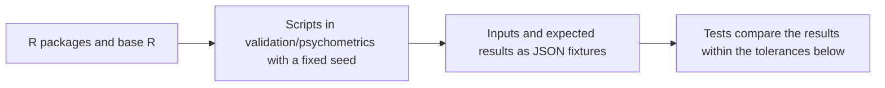

# Validation

Every statistic of `@measurekit/psychometrics` is compared with an R reference; [simulation](#simulation) is checked
by its properties instead. R scripts in [`validation/`](../../validation/README.md) load public datasets or
simulate data with a fixed seed, run the reference, and write the inputs and expected results as JSON fixtures
to `packages/psychometrics/test/fixtures/`. The tests compare the results with the fixtures. CI runs only the
TypeScript tests; R runs when fixtures change.

## References

Fixtures were generated with R 4.6.1, psych 2.6.9, mirt 1.48, ltm 1.2-0, catR 3.17, TAM 4.3-25, eRm 1.0.10, difR 6.1.0,
lordif 0.4-2, MASS 7.3-65, rms 8.2.0, subscore 3.3, equate 2.0.9, equateIRT 2.5.2, irr 0.85, effsize 0.8.1, cacIRT 1.4, sirt 4.2-133, DFIT 1.1, nlme 3.1-169,
LNIRT 0.5.1, numDeriv 2016.8-1.1, lme4 2.1.0, metafor 5.2.1, mokken 3.1.2, GDINA 2.13.2, alabama 2025.1.0, NPCD 1.0.11,
CDM 8.3.14, cdcatR 1.0.7, mirtCAT 1.14, GPArotation 2026.8.2, polycor 0.8.2, mvtnorm 1.4.2, clinicalsignificance 3.0.0, GGUM 0.5
(with rJava 1.0.18 and xlsx 0.6.5 on OpenJDK 17, which its import of xlsx needs) and jsonlite 2.0.0. The cross-check of unbalanced generalizability runs in Python 3.12 with GeneralizIT 0.1.2 (`validation/psychometrics/requirements.txt`).

| Statistic                                                                                                             | Reference                                                                                                                                             |
| --------------------------------------------------------------------------------------------------------------------- | ----------------------------------------------------------------------------------------------------------------------------------------------------- |
| Alpha, `itemTotal` (`raw.r`), `itemRest` (`r.drop`), alpha if deleted                                                 | `psych::alpha` on the complete cases                                                                                                                  |
| Guttman split-half coefficient                                                                                        | `psych::splitHalf(raw = TRUE, brute = TRUE, covar = TRUE)`, the split's entry                                                                         |
| Item count, mean and SD; biserial; D; KR-20; KR-21; split-half correlation and Spearman-Brown; SEM; option statistics | Base R, written out in `validation/psychometrics/ctt.R`                                                                                               |
| McDonald's omega and the minres loadings                                                                              | Base R: Σ_(i<j) (r_ij - λ_i λ_j)² minimized by BFGS, then Newton; `psych::omega(nfactors = 1)`'s `omega.tot` agrees within 1e-4                       |
| Subscore PRMSEs and added value                                                                                       | The `subscore` package's `CTTsub(method = "Haberman")` on the persons who answered every item of the sections; base R written out agrees within 1e-12 |
| Augmented subscores, reliabilities, means, SDs and weights                                                            | The `subscore` package's `subscore.Wainer` on the persons who answered every item of the sections; base R written out agrees within 1e-9              |
| Augmented against observed subscores as predictors of known true subscores                                            | Base R: correlations with the expected section scores of a seeded simulation                                                                          |
| Scoring against a key                                                                                                 | `mirt::key2binary`                                                                                                                                    |
| Normal quantile, density and distribution function, logistic function, chi-square upper tail                          | `qnorm`, `dnorm`, `pnorm`, `plogis`, `pchisq(lower.tail = FALSE)`                                                                                     |
| Gauss-Hermite nodes and weights                                                                                       | Golub-Welsch: `eigen` of the Jacobi matrix, a different algorithm                                                                                     |
| Eigenvalues and eigenvectors of a symmetric matrix                                                                    | Base R `eigen(symmetric = TRUE)` (LAPACK), a different algorithm from the package's Jacobi method                                                     |

| IRT quantity                                                                                   | Reference                                                                                                                                                                                                                                                                                      |
| ---------------------------------------------------------------------------------------------- | ---------------------------------------------------------------------------------------------------------------------------------------------------------------------------------------------------------------------------------------------------------------------------------------------- |
| 1PL, 2PL and anchored 2PL estimates, SEs, log-likelihood, AIC, BIC                             | `mirt(SE.type = "Richardson")`, `TOL = 1e-10`, 61 rectangular points; the 1PL as a 2PL with equal slopes                                                                                                                                                                                       |
| 4PL estimates with priors, SEs, log-likelihood, AIC, BIC                                       | `mirt(SE.type = "Oakes")` with `norm` priors on logit g and logit u                                                                                                                                                                                                                            |
| 2PL with Gauss-Hermite quadrature                                                              | `ltm(GHk = 21)`, `summary()` for the SEs                                                                                                                                                                                                                                                       |
| 3PL with a beta prior on c                                                                     | Base R: direct maximization of the log-posterior (BFGS, then Newton) and `optimHess` for the SEs                                                                                                                                                                                               |
| GRM, GPCM and NRM estimates, log-likelihood, AIC, BIC                                          | `mirt(itemtype = "graded", "gpcm", "nominal", SE.type = "Richardson")`, `TOL = 1e-10`, 61 points                                                                                                                                                                                               |
| PCM                                                                                            | mirt's `gpcm` with equal slopes                                                                                                                                                                                                                                                                |
| RSM                                                                                            | mirt's `rsm` with the slopes freed and equal and the latent variance fixed at 1                                                                                                                                                                                                                |
| Polytomous parameters and SEs                                                                  | Base R: mirt's estimates in this library's parameters; the delta method on `vcov()`, Jacobian by central differences                                                                                                                                                                           |
| Mixed-format 3PL and GPCM with anchors and a prior                                             | `mirt(SE.type = "Oakes")` with a `norm` prior on logit g                                                                                                                                                                                                                                       |
| EAP and MAP theta, ML theta                                                                    | `fscores(method = "EAP", "MAP", "ML")`, 61 points                                                                                                                                                                                                                                              |
| ML, WLE and MAP standard errors                                                                | Base R from `iteminfo`: 1 / √I(θ) and 1 / √(I(θ) + 1)                                                                                                                                                                                                                                          |
| WLE theta                                                                                      | Base R: the root of Warm's equation by `uniroot`, the largest weighted likelihood by `integrate`                                                                                                                                                                                               |
| Item and test information                                                                      | `iteminfo`, `testinfo`                                                                                                                                                                                                                                                                         |
| JML thresholds, thetas and log-likelihood                                                      | `TAM::tam.jml`, iterated by base R from its estimates to a change below 1e-12                                                                                                                                                                                                                  |
| JML standard errors                                                                            | Base R: the inverse threshold information matrix of each item, 1 / √I(θ) for persons                                                                                                                                                                                                           |
| CML thresholds, locations, steps, standard errors, conditional log-likelihood: Rasch, PCM, RSM | eRm's `RM`, `PCM` and `RSM` with `sum0 = TRUE`, moved to thresholds that sum to 0 with the covariance W H⁻¹ Wᵀ projected along the shift; with missing responses of polytomous items, base R's conditional likelihood by every pattern, maximized by `optim` and differentiated by `optimHess` |
| mirt's IRT and slope-intercept coefficients                                                    | `coef(IRTpars = TRUE)`, `coef(IRTpars = FALSE)` and `probtrace` of the same items, every item type                                                                                                                                                                                             |
| Normal distributions of theta: anchored, in groups, online calibration                         | Base R: Newton's method on the marginal likelihood, its gradient by Fisher's identity, the Hessian by central differences of it, which gives the SEs; mirt with `optimizer = "NR"` and `multipleGroup` cross-check                                                                             |
| Latent regression: items, coefficients, residual variance, SEs                                 | `mirt(covdata, formula)` for the 2PL, the anchored 2PL and the GPCM; `mirt` and `TAM::tam.mml(Y)` for the Rasch model; base R: the Hessian of the marginal log-likelihood for the SEs                                                                                                          |
| Empirical histogram on fixed items                                                             | Base R: EM with the same update and stopping rule                                                                                                                                                                                                                                              |
| Testlet model: estimates, SEs, log-likelihood                                                  | Base R: the bifactor likelihood by dimension reduction, maximized by BFGS and Newton on central-difference gradients; `optimHess` for the SEs; mirt's `bfactor` with equal slopes and free testlet variances cross-checks                                                                      |
| Testlet model in groups: estimates, SEs, log-likelihood                                        | Base R: the same likelihood with each normal group's mean and ln SD and one SD for each testlet in all groups; mirt's `bfactor` with the groups, equal slopes and shared testlet variances reaches the maximum within 2e-6                                                                     |
| Histogram of theta with testlets                                                               | Base R: EM with the same updates and stopping rule; each testlet's SD from the second moment of its expected counts                                                                                                                                                                            |
| EAP with testlet effects integrated out                                                        | Base R: the double sum over the nodes written out                                                                                                                                                                                                                                              |
| Cross-product standard errors                                                                  | `mirt(SE.type = "crossprod")`                                                                                                                                                                                                                                                                  |
| Bifactor and two-tier models: estimates, SEs, correlation, log-likelihood, AIC, BIC            | `mirt::bfactor(quadpts = 31)`, `TOL = 1e-10`, Oakes' and cross-product standard errors; the two-tier model with `model2` and `COV` at 21 points; 3PL with a normal prior on logit c; graded; items without a specific dimension; missing responses                                             |
| Bifactor and two-tier models against the full grid                                             | `calibrateMultidimensional` with `loadings` and `correlated: false` after the same number of EM iterations                                                                                                                                                                                     |
| Covariance of the item parameters                                                              | The delta method on mirt's `vcov()`, Jacobian by central differences; with priors by item, base R: `optimHess` inverted                                                                                                                                                                        |
| Priors by item                                                                                 | Base R: direct maximization of the log-posterior, the log-likelihood plus the log priors (BFGS, then Newton)                                                                                                                                                                                   |
| Posterior of theta on 61 points                                                                | Base R: the prior's rectangular weights times the likelihood from mirt's `probtrace`; its mean is mirt's EAP                                                                                                                                                                                   |
| EAP summed-score tables                                                                        | `fscores(method = "EAPsum")`; base R's Lord-Wingersky recursion on `probtrace` for another prior                                                                                                                                                                                               |
| Marginal and empirical reliability                                                             | `marginal_rxx`, `empirical_rxx`; base R's `integrate` for another prior                                                                                                                                                                                                                        |
| GGUM estimates, persons kept, log-likelihood                                                   | The GGUM package's `GGUM(C, tol = 1e-6)` on data of its `GenData.GGUM`; the log-likelihood written out in base R at 61 nodes from -6 to 6, which reproduces GGUM's at its own 30 nodes within 1e-6                                                                                             |
| GGUM cross-product standard errors                                                             | Base R: the information of the persons' scores, by central differences, inverted whole; inverted item by item it reproduces the GGUM package's within 1e-6 relative                                                                                                                            |
| GGUM starts                                                                                    | The GGUM package's `GUM.initprm`                                                                                                                                                                                                                                                               |

The GGUM rows read `validation/psychometrics/irt-unfolding.R`: 10 seeds of 2,000 persons and 15 items of four
categories, and one of 1,000 persons and 12 items of two to six. GGUM's default `tol = 0.001` stops a slow item short of
the maximum, on seed 1 a location by 0.16, so the fixtures take `tol = 1e-6`, within 1.4e-4 of `tol = 1e-7` on seed 1.
Its standard errors leave out the covariance between items ([irt](irt.md#differences-from-the-references)), so the tests
check this package's by coverage, with thresholds set before the first run: over the 150 items of the seeds, the 95%
intervals of the cross-product errors cover the true a of 141 and the true b of 142, inside 0.92 to 0.98, where GGUM's
cover the true b of 125. Every location is within 0.75 of the truth after the reflection, and their RMSE at most 0.2 in
each case (0.441 and 0.135 at worst).

| Multidimensional quantity                                          | Reference                                                                                                                                             |
| ------------------------------------------------------------------ | ----------------------------------------------------------------------------------------------------------------------------------------------------- |
| 2PL: estimates, SEs, correlations, log-likelihood, AIC, BIC        | `mirt(model = "F1 = 1-6 / F2 = 7-12 / COV = F1*F2", SE.type = "Oakes")`, `TOL = 1e-10`, 31 points; also with 8% of the responses missing              |
| 3PL with normal priors on logit c                                  | The same, 21 points, `PRIOR = (1-12, g, norm, ...)`                                                                                                   |
| Graded: `bfi` A and C on two dimensions, A, C and E on three       | `mirt(itemtype = "graded")` with `COV`; 31 points and 15 points                                                                                       |
| Cross-product standard errors                                      | `mirt(SE.type = "crossprod")`                                                                                                                         |
| Several groups: estimates, SEs, moments, log-likelihood            | `multipleGroup(invariance = c("slopes", "intercepts", "free_means", "free_var"))`, `TOL = 1e-10`, 31 and 15 points                                    |
| Fixed items that set the scale                                     | `multipleGroup` with `pars` and `est = FALSE` for the fixed items, and the other items named in `invariance`                                          |
| Longitudinal: items, moments, changes, log-likelihood              | `mirt`: a dimension per occasion, items tied by `constrain`, `MEAN` and `COV` for later occasions, `TOL = 1e-9`; changes in base R                    |
| Longitudinal: Rasch model                                          | `tam.mml` with `Q` and `A`, on the scale of the first occasion; `mirt` with equal slopes                                                              |
| Longitudinal: standard errors                                      | `mirt`'s `SE.type = "Oakes"` and `"crossprod"`, with the delta method for difficulty, correlation, SD                                                 |
| MH-RM: estimates, correlations, standard errors                    | The EM references above for two and three dimensions; `mirt(method = "MHRM", SE = TRUE)` with `technical = list(set.seed = 1 to 4)` for five          |
| MH-RM complete-data score and information of an item               | `mirt:::Deriv` at given thetas                                                                                                                        |
| Exploratory 2D 2PL: estimates, log-likelihood                      | Base R: BFGS then Newton steps on the exact gradient of the marginal likelihood from mirt's estimates, the first item's second slope fixed at 0       |
| Rotation: varimax, oblimin, Kaiser normalization, gamma            | `GPArotation::Varimax`, `GPArotation::oblimin` to a gradient of 1e-10, mirt's sign convention; checked against mirt's `Rotate`                        |
| Rotated slopes and scores in the rotated dimensions                | mirt's `rotateLambdas`; `fscores(rotate = "oblimin", method = "EAP")`                                                                                 |
| EAP theta and standard error                                       | `fscores(method = "EAP", QMC = FALSE)`, rectangular nodes from -6 to 6 on the prior                                                                   |
| MAP theta; standard error                                          | `fscores(method = "MAP")`; the standard error from base R: the inverse of the information matrices plus the precision of the prior                    |
| Information matrices                                               | Base R: the sum over categories of the outer products of the derivatives of the probabilities written out, checked against `probtrace` and `iteminfo` |
| mirt's slope-intercept coefficients of items on 2 and 3 dimensions | `coef(simplify = TRUE)` and `probtrace` of the same items                                                                                             |

| Dimensionality quantity                                                                                   | Reference                                                                                                                                                                                                                                |
| --------------------------------------------------------------------------------------------------------- | ---------------------------------------------------------------------------------------------------------------------------------------------------------------------------------------------------------------------------------------- |
| Bivariate normal distribution function                                                                    | `mvtnorm::pmvnorm(algorithm = Miwa(), abseps = 1e-16)`                                                                                                                                                                                   |
| Polychoric and tetrachoric correlations, thresholds                                                       | Base R: the log-likelihood of the table from `pmvnorm` cells, maximized by `optimize(tol = 1e-12)` and polished at the root of its score; `psych::polychoric` and `tetrachoric` (`smooth = FALSE`); `polycor::polychor` on complete data |
| Eigenvalues of the correlations and of the one-factor reduced matrix                                      | Base R `eigen`; the minres loadings by L-BFGS-B, then Newton on the loadings not at a bound; `psych::fa(nfactors = 1, fm = "minres")`'s `values`                                                                                         |
| Eigenvalues of random data, suggested numbers                                                             | `psych::fa.parallel(n.iter, fa = "both")`; for Pearson correlations of `psych::bfi`, 2,000 permuted data sets in base R                                                                                                                  |
| Minres factors, rotations, communalities                                                                  | Base R: L-BFGS-B on the communalities, then Newton; `GPArotation::oblimin`, `Varimax`; `psych::fa(fm = "minres")`                                                                                                                        |
| Maximum likelihood factors, communalities, rotations                                                      | Base R: L-BFGS-B on the uniquenesses, then Newton; `psych::fa(fm = "ml")`                                                                                                                                                                |
| Fit of the factors: chi-square, degrees of freedom, significance, RMSEA and its interval, TLI, BIC, SRMSR | psych's `fa.stats` of the base R solutions, with `n.obs` and `np.obs`; `psych::fa`'s `STATISTIC`, `dof`, `PVAL`, `RMSEA`, `TLI`, `BIC`, `rms`                                                                                            |
| Minres as unweighted least squares and principal axes                                                     | `psych::fa(fm = "uls")` and `fa(fm = "pa", min.err = 1e-12)`                                                                                                                                                                             |
| Schmid-Leiman loadings, omega hierarchical and omega total                                                | Base R: the one-factor minres solution of the base R oblimin factors' correlations, and the loadings and omegas written out; psych's `schmid` and `omega(fm = "minres", flip = FALSE)`                                                   |
| Minimum average partial test                                                                              | Base R: the formula written out; `psych::VSS(rotate = "none")$map` of the raw data                                                                                                                                                       |
| Smoothed correlations                                                                                     | `psych::cor.smooth`                                                                                                                                                                                                                      |

| CAT quantity                                                 | Reference                                                                                               |
| ------------------------------------------------------------ | ------------------------------------------------------------------------------------------------------- |
| Next item by maximum information, Kullback-Leibler and thOpt | `nextItem(criterion = "MFI", "KL", "thOpt")` at catR's estimate, after each response of a run           |
| Information and KL scores of every eligible item             | `Ii`; `KL()` divided by the largest likelihood on its grid, computed from `Pi`                          |
| The theta of an item's largest information                   | catR's closed form for the 4PL, written out from `nextItem`'s `thOpt`                                   |
| a-stratification of 2PL items                                | `aStratified` strata, and `nextItem(criterion = "bOpt")` with the other strata excluded                 |
| Theta and standard error after each response                 | `thetaEst`, `semTheta`: `BM`, `ML` and `WL` with `range = c(-6, 6)`; `EAP` with `parInt = c(-6, 6, 61)` |
| Content balancing                                            | `nextItem` with `cbControl`                                                                             |
| Stopping decisions                                           | `checkStopRule` with `length`, `precision` and `minInfo` on the remaining items, alone and together     |
| Randomesque, Sympson-Hetter, multistage routing, simulation  | Properties over seeded simulations and hand-derived routes (below)                                      |
| Routing cuts by information and by shares                    | Base R over mirt's `iteminfo` and `expected.item` (below)                                               |
| Enemy sets, exposure calibration                             | Properties (below); catR has no enemy sets                                                              |
| Testlet selection, administration, withholding and stopping  | Base R replay of the documented rules, with catR's `Ii`; mirtCAT's `ordered` groups (below)             |
| Content bounds: items, estimates, withholding and stopping   | Base R replay of the documented rules, with catR's `Ii` (below)                                         |
| Content bounds: tests outside the bounds, precision          | mirtCAT's shadow test, `findNextItem` with `lp` (below)                                                 |
| Form assembly: forms with enemies, testlets and overlap      | Base R replay of the documented rules, with catR's `Ii` (below)                                         |
| Form assembly: bounds and information of 340 forms           | highs: the blueprints are feasible, and the minimax forms' gap from the target (below)                  |

| Diagnostic CAT quantity                                    | Reference                                                                                                    |
| ---------------------------------------------------------- | ------------------------------------------------------------------------------------------------------------ |
| Posterior, mastery and MAP profile after each response     | Base R: the prior times the probability of each response at every profile, normalized                        |
| KL, PWKL, MPWKL, GDI and SHE scores of every eligible item | Base R, written out over the profiles from the definition of each rule; PWKL also against `cdcatR:::PWKL.M`  |
| Item sequences                                             | The replay in base R, selecting the highest score, the first on ties; `cdcat()` for GDI, MPWKL and JSD (SHE) |
| Fixed-precision test length                                | `cdcat(FIXED.LENGTH = FALSE, precision.cut = 0.8)` for GDI                                                   |
| Posterior and mastery thresholds                           | Base R: the largest posterior at least p; every mastery at least p or at most 1 - p                          |

| Multidimensional CAT quantity                                    | Reference                                                                                                                                                                                     |
| ---------------------------------------------------------------- | --------------------------------------------------------------------------------------------------------------------------------------------------------------------------------------------- |
| Estimate after each response: theta, standard errors, covariance | Base R: BFGS then Fisher scoring on the exact gradient of the log posterior, to a gradient below 1e-12; the covariance is the inverse of the prior precision plus the information at the mode |
| D-rule score of every eligible item                              | Base R: `det()` of the prior precision plus the written-out information matrices of the administered items and the item, at the estimate                                                      |
| Item sequences                                                   | The replay in base R, selecting the highest score, the first on ties; mirtCAT's `DPrule` with MAP estimates from the item it starts with                                                      |
| Standard error stopping decisions                                | Base R: every standard error at most the threshold                                                                                                                                            |

| Fit statistic                                                    | Reference                                                                                                                                 |
| ---------------------------------------------------------------- | ----------------------------------------------------------------------------------------------------------------------------------------- |
| Item infit and outfit mean squares and standardized values       | eRm's `itemfit` on its `RM` and `PCM` items and `person.parameter` thetas                                                                 |
| Person infit and outfit                                          | eRm's `personfit`, the same inputs                                                                                                        |
| lz                                                               | mirt's `personfit(Theta = )` `Zh`, at mirt's EAP thetas                                                                                   |
| Q3                                                               | mirt's `residuals(type = "Q3", Theta = )`, the same thetas                                                                                |
| Local-dependence chi-square, df, significance, signed Cramér's V | mirt's `residuals(type = "LD", df.p = TRUE)` at 61 nodes, and at 21 for a population, at mirt's coefficients                              |
| RMSD                                                             | TAM's `IRT.RMSD` at TAM's 21 nodes, calibrations to 1e-10, with the normal density of TAM's mean and variance as the population           |
| Mean deviation                                                   | Written out in base R from TAM's posterior counts; CDM's `IRT.RMSD` where every item has the same categories                              |
| S-X², degrees of freedom, significance                           | mirt's `itemfit(fit_stats = "S_X2")`                                                                                                      |
| M2, M2*, C2, df, RMSEA and its interval, SRMSR, TLI, CFI         | mirt's `M2(quadpts = 61)` at `TOL = 1e-8`; written out in base R below                                                                    |
| Andersen's statistic, df, significance, items left out, persons  | eRm's `LRtest`; base R's conditional likelihood by every pattern on missing responses of polytomous items                                 |
| Martin-Löf statistic, df, significance                           | eRm's `MLoef` on the persons who answered every item; base R's df for the rating scale model                                              |
| Wald z and significance of each item                             | eRm's `Waldtest`, each item's first item-category parameter; base R's locations of eRm's `PCM` in each group for the partial credit model |

M2 reads mirt's `M2` on the 2PL, the 1PL with a common slope, anchors, the GRM and the RSM. On 60 sets of 400 persons
from a true 2PL, both reject 4 at 0.05, and M2 agrees within 2e-4. `validation/psychometrics/fit-global.R` writes the
statistic out in base R, which reproduces mirt on the 2PL within 1e-5, for the three cases where mirt's value is not the
statistic:

| Case                                            | What mirt does                                                                                     | Measured on the fixtures                                  | Reference                                                  |
| ----------------------------------------------- | -------------------------------------------------------------------------------------------------- | --------------------------------------------------------- | ---------------------------------------------------------- |
| The Rasch model with a free variance            | Δ leaves out the variance, while the df counts it. It is one model with the 1PL, whose M2 mirt has | mirt 242.156; with the column 242.051; the 1PL 242.052    | Base R with the column, against this package's 1PL         |
| An estimated normal distribution                | Δ leaves out the mean and the variance, while the df counts them                                   | mirt 72.176; with the columns 72.079                      | Base R with the columns                                    |
| The GPCM and the PCM                            | `dP` of a `gpcm` slope is wrong: -0.62 against central differences' 0.79 at θ = 1                  | PCM C2: mirt 224.87, written out 228.77                   | Base R with the derivative, checked by central differences |
| M2* of the independence model, polytomous items | Δ has rank J below its columns, and `qr.Q` takes an arbitrary part of the complement               | 238.6, and 257.6 with the items reversed; the whole 2,738 | N Σ r², which the whole complement equals within 1e-6      |

For dichotomous items and C2, TLI and CFI are mirt's: its independence model equals N Σ r² within 1e-3 relative, the
distance of its EM from the margins.

| DIF statistic                                                                         | Reference                                                                                                                                                                                                                          |
| ------------------------------------------------------------------------------------- | ---------------------------------------------------------------------------------------------------------------------------------------------------------------------------------------------------------------------------------- |
| Mantel-Haenszel chi-square, with and without the correction                           | Base R's `mantelhaen.test`; difMH's `MH` where they agree                                                                                                                                                                          |
| Common odds ratio, MH D-DIF and its standard error                                    | difR's `difMH`: `alphaMH`, `varLambda`                                                                                                                                                                                             |
| ETS categories                                                                        | Base R: ETS's rule written out from the values above                                                                                                                                                                               |
| Logistic regression chi-squares and R² changes                                        | difR's `difLogistic(type = "udif", "nudif", "both")`                                                                                                                                                                               |
| Lord's chi-square and the mean-sigma transformation                                   | difR's `difLord(irtParam = )` on ltm calibrations run to convergence, checked against `LordChi2` and `itemRescale`                                                                                                                 |
| Purified Lord's chi-square                                                            | `difLord(irtParam = , purify = TRUE)` on the same calibrations; the final link against `LordChi2` and `itemRescale`                                                                                                                |
| Purification, complete data                                                           | Base R's statistics on difR's anchors; `difMH(purify = TRUE)` and `difLogistic(purify = TRUE)` agree in odds ratios, chi-squares, rounds and convergence                                                                           |
| Sparse data, purified and not                                                         | Base R: the matching score written out, `mantelhaen.test` and `glm` on each item's persons                                                                                                                                         |
| Mantel chi-square, standardized mean difference, effect size, ETS categories          | Base R written out from the rows of each score group; the chi-square also against `mantelhaen.test(correct = FALSE)` on dichotomized items                                                                                         |
| Generalized Mantel-Haenszel chi-square and degrees of freedom                         | Base R's `mantelhaen.test` on the 2 × K × S table of the categories used                                                                                                                                                           |
| Ordinal logistic regression deviances, R² changes, slope change                       | `rms::lrm`, lordif's engine, run to `eps = 1e-14`; `MASS::polr` agrees within 1e-8 in the deviance; lordif's `rundif` on the same matching scores                                                                                  |
| Polytomous sparse data and purification                                               | Base R: the matching score written out, `mantelhaen.test` and `lrm` on each item's persons; `rundif` agrees with the final criterion of each item                                                                                  |
| SIBTEST of items and bundles, every option                                            | mirt's `SIBTEST` with `match_set`, `suspect_set`, `guess_correction`, `Jmin`, `correction`, on each analysis's persons; `difSIBTEST(type = "udif")` agrees                                                                         |
| SIBTEST's purification                                                                | Base R's rounds on `SIBTEST`, with and without the correction; `difSIBTEST(purify = TRUE)` agrees where the floor does not stop them                                                                                               |
| Recipes: STD P-DIF, DIF variance                                                      | `difStd(stdWeight = "focal")`; sirt's `dif.variance` on the centered MH D-DIF, as its `eb.dif` shrinks towards the mean only then                                                                                                  |
| Raju's signed and unsigned areas and z, purified and not                              | difR's `difRaju(irtParam = , same.scale = FALSE)` on ltm calibrations run to convergence, checked against `RajuZ` and `itemRescale`; the unsigned area against `integrate`                                                         |
| IRT likelihood-ratio DIF: 2PL, graded, generalized partial credit, sparse, purified   | mirt's `multipleGroup` with the anchors in `invariance`, `free_means` and `free_var`, `quadpts = 61`, `TOL = 1e-7`; `DIF(scheme = "drop")` agrees within 1e-2                                                                      |
| NCDIF, CDIF, DTF: 2PL and graded                                                      | DFIT's `Ncdif`, `Cdif` and `Dtf` with `focalAbilities`, `logistic = TRUE`                                                                                                                                                          |
| Liu-Agresti odds ratio, its standard error, z and significance, purified and not      | difR's `liu_agresti_ccor` with the matching scores as `strata` for ψ̂, and `difMH`'s `alphaMH` on 0/1 items; base R's equation 3 of Liu and Agresti for the standard error, checked against the spread of ln ψ̂ on 1,000 seeded sets |
| Logistic discriminant function: tests, R² changes, purified, sparse, matched on theta | Base R's `glm(group ~ score * response, binomial)` with the response numeric, `epsilon = 1e-14`, on each item's persons                                                                                                            |

| Linking and equating quantity                                                                         | Reference                                                                                                                                                    |
| ----------------------------------------------------------------------------------------------------- | ------------------------------------------------------------------------------------------------------------------------------------------------------------ |
| Mean-mean, mean-sigma, Haebara, Stocking-Lord: 2PL and 3PL                                            | equateIRT's `direc(nq = 30)`                                                                                                                                 |
| Chain of links, forms 1 to 2 to 3                                                                     | equateIRT's `chainec(r = 3)` over the links of `alldirec(nq = 30)`                                                                                           |
| The same, mixed-format items                                                                          | Base R: the moments and the criteria written out, minimized by `nlminb`                                                                                      |
| True-score equating                                                                                   | Base R: `uniroot` and Kolen and Brennan's line; equateIRT's `score(method = "TSE")` agrees                                                                   |
| Linear equating                                                                                       | equate's `equate(type = "linear")`                                                                                                                           |
| Equipercentile equating                                                                               | Base R: Kolen and Brennan's definition; equate's `equate(type = "equipercentile")` within 1e-6                                                               |
| Log-linear presmoothing                                                                               | Base R's Poisson `glm` to a deviance change of 1e-15; equate's `presmoothing` within 1e-6                                                                    |
| Tucker, Levine, chained linear equating                                                               | equate's `equate(type = "linear", method = "tucker", "levine", "chained")`                                                                                   |
| Chained equipercentile, frequency estimation                                                          | Base R: the definitions written out; equate's `equate(method = "chained", "frequency estimation")` within 1e-6                                               |
| Bivariate log-linear presmoothing                                                                     | Base R's Poisson `glm` to a deviance change of 1e-15; equate's `presmoothing` within 1e-6                                                                    |
| Bootstrap standard errors                                                                             | equate's `bootstrap(reps = 2000)`, within the Monte Carlo error of both                                                                                      |
| Robust z of common items                                                                              | Base R: `median` and `IQR`                                                                                                                                   |
| IRT observed-score equating                                                                           | Base R: Lord and Wingersky's recursion; equateIRT's `score(method = "OSE")` within 1e-8                                                                      |
| Delta-method standard errors of IRT equating                                                          | Base R: numDeriv's Jacobian times the covariance of a mirt `multipleGroup` calibration                                                                       |
| Kernel equating in five designs: equated scores, standard errors, bandwidths, percent relative errors | kequate 1.6.4's `kequate`, `getEq`, `getSee`, `getH`, `getPre`, on `glm` fits of the scaled powers of the scores                                             |
| Kernel equating, counterbalanced at a weight other than 1/2                                           | Base R: the delta method through the log-linear parameters, numDeriv's Jacobian; it reproduces kequate at 1/2                                                |
| Standard error of the difference of two kernel equatings                                              | kequate's `genseed`, and its equipercentile result's `SEEDYx` against linear equating                                                                        |
| Standard errors of links between separate calibrations, two forms and a chain of three                | equateIRT's `direc` and `chainec` with 30 Gauss-Hermite points; for mean-sigma, numDeriv's Jacobian of `direc`'s links, as `direc`'s derivative divides by n |
| Standard errors of IRT true-score equating through a link                                             | equateIRT's `score(se = TRUE)` for mean-mean; numDeriv's Jacobian of `direc`'s link and base R's true-score equating for the other methods                   |
| Standard errors of IRT observed-score equating through a link                                         | equateIRT's `score(method = "OSE", se = TRUE)`, mean-mean                                                                                                    |

| Scaling quantity                                                                               | Reference                                                                                                                                        |
| ---------------------------------------------------------------------------------------------- | ------------------------------------------------------------------------------------------------------------------------------------------------ |
| EAP of the summed score: theta and standard error                                              | mirt's `fscores(method = "EAPsum", full.scores = FALSE)` under N(0, 1); base R's recursion on `probtrace` for another prior                      |
| True-score theta and standard error                                                            | Base R: `uniroot` on mirt's `expected.test`; 1 / √`testinfo`                                                                                     |
| Conditional standard error of scale scores, predicted form scores                              | Base R: Lord and Wingersky's recursion on mirt's `probtrace`, written out                                                                        |
| Predicted theta scores                                                                         | Base R: `pnorm` of the estimates that round to each multiple of the step, summed over the scores that report the same score                      |
| Scale scores of equated scores                                                                 | Base R: `approx` on the unrounded table, then rounding written out                                                                               |
| Percentile ranks                                                                               | Base R: the counts below and at a score; equate's `px` on `ACTmath`                                                                              |
| Norms: mean, SD, z scores, percentile ranks, stanine boundaries, standard errors and intervals | mokken's `check.norms`, its intervals at the normal quantile of the level; the z scores' standard errors from the delta method in base R (below) |
| Growth between grades                                                                          | Base R: the mean change, ratio of standard deviations and effect size; mirt's `multipleGroup` for the moments                                    |
| Joint draws: inverse distribution function, transform                                          | Base R: `approx` and a search of the cells; `mvtnorm::rmvnorm(method = "eigen")` scores through `pnorm`                                          |
| Joint draws: joint distribution function, rank correlation                                     | `mvtnorm::pmvnorm` at the corners; (6 / π) asin(r / 2) with the standard error of replicated `rmvnorm` samples                                   |

| Explanatory quantity                                                                | Reference                                                                                                                                                                                                                                                              |
| ----------------------------------------------------------------------------------- | ---------------------------------------------------------------------------------------------------------------------------------------------------------------------------------------------------------------------------------------------------------------------- |
| Effects, standard errors, covariance, residual variance, restricted log-likelihood  | Base R: the restricted likelihood maximized by `optimize` and the root of its score by `uniroot`, then generalized least squares; metafor's `rma(method = "REML")` at the same τ² and, where it converges, at its own                                                  |
| Predictions of new items                                                            | Base R: xᵀη̂ and √(τ² + xᵀ Cov x)                                                                                                                                                                                                                                       |
| LLTM effects, standard errors, σ, log-likelihood, AIC, BIC                          | Base R: the marginal likelihood on the package's rule maximized by BFGS and Newton steps on its exact gradient; standard errors from the Hessian by `numDeriv::jacobian` of the gradient; mirt's Rasch model with `itemdesign` (Oakes standard errors) cross-checks it |
| Likelihood-ratio test against the Rasch model                                       | Base R: the same maximization with a difficulty for each item; `pchisq`; mirt's `Rasch` cross-checks the statistic                                                                                                                                                     |
| Linear change: effects, standard errors, conditional log-likelihood                 | `glm` on the persons who changed, for two occasions and sets of items; the conditional likelihood written out in base R over the patterns of each sum, for three occasions and missing responses; eRm's `LLRA` cross-checks it                                         |
| Polytomous LLTM: effects, standard errors, σ, steps, log-likelihood, AIC, BIC, test | Base R: the marginal likelihood of the partial credit and the rating scale model on the package's rule, maximized as for the LLTM; TAM's `tam.mml` with a design array `A` cross-checks it                                                                             |

| Standard-setting quantity                              | Reference                                                                             |
| ------------------------------------------------------ | ------------------------------------------------------------------------------------- |
| Angoff cut score, the panelists' cut scores, SD and SE | Base R: `rowSums`, `mean`, `sd`                                                       |
| Bookmark page locations                                | Base R: `uniroot` on the cumulative category probabilities of mirt's `probtrace`      |
| Bookmark raw cut scores                                | mirt's `expected.test` at the page locations                                          |
| Hofstee cut score and failure rate                     | Base R: `uniroot` on the failure rates interpolated by `approxfun`, less the line     |
| Beuk cut score and failure rate                        | Base R: `uniroot` on the failure rates interpolated by `approxfun`, less the line     |
| Contrasting-groups and Body of Work cut scores         | Base R: `glm(family = binomial)` per boundary to a deviance change of 1e-14           |
| Recipes: Nedelsky, Ebel, the borderline group          | Base R: the sums of 1 over the options left, of items times proportions, and `median` |
| Classification accuracy and consistency                | cacIRT's `class.Rud`; each category's probability by base R's `pnorm`                 |

| Change quantity                                                 | Reference                                                                                 |
| --------------------------------------------------------------- | ----------------------------------------------------------------------------------------- |
| Simple gains                                                    | Base R: `post - pre`                                                                      |
| Residual gains                                                  | Base R: `residuals(lm(post ~ pre))`                                                       |
| Normalized gains of persons and of the group                    | Base R: Hake's definitions, written out                                                   |
| Reliability of a difference                                     | Base R: Lord's formula, written out                                                       |
| Reliable change index and classification from test scores       | clinicalsignificance's `cs_distribution(rci_method = "JT", better_is = "higher")`; base R |
| Reliable change index and classification from ability estimates | Base R: (θ₂ - θ₁) / √(SE₁² + SE₂²) and `qnorm`                                            |

| Rater statistic                                                             | Reference                                                                                                                                                                                                                                                                                       |
| --------------------------------------------------------------------------- | ----------------------------------------------------------------------------------------------------------------------------------------------------------------------------------------------------------------------------------------------------------------------------------------------- |
| Cohen's kappa, unweighted, linear, quadratic                                | irr's `kappa2(weight = "unweighted", "equal", "squared")`; psych's `cohen.kappa`                                                                                                                                                                                                                |
| Fleiss' kappa                                                               | irr's `kappam.fleiss`                                                                                                                                                                                                                                                                           |
| The six intraclass correlations                                             | irr's `icc`; psych's `ICC(lmer = FALSE)` agrees within 1e-12                                                                                                                                                                                                                                    |
| Exact and adjacent agreement                                                | irr's `agree(tolerance = 0, 1, 2, 3)`, as proportions                                                                                                                                                                                                                                           |
| Correlation of two raters                                                   | Base R's `cor` on the complete cases; `NA` for a constant rater                                                                                                                                                                                                                                 |
| Standardized mean difference of two raters                                  | Base R written out; effsize's `cohen.d` agrees within 1e-12                                                                                                                                                                                                                                     |
| Many-facet Rasch measures, thresholds, mean and SD of theta, log-likelihood | Base R: the marginal likelihood written out on the package's 61 rectangular points, maximized by BFGS on its exact gradient and polished by Newton's method; TAM's `tam.mml.mfr(constraint = "items")` approaches it                                                                            |
| Many-facet standard errors                                                  | Base R: `numDeriv::hessian` of the likelihood, and the delta method for the last element of each constraint                                                                                                                                                                                     |
| Rater biases, their standard errors and z                                   | Base R: the same likelihood with the interaction's columns in the design; the standard errors are the delta method on the inverse of the Jacobian of the exact gradient. TAM's `tam.mml.mfr(formulaA = ~ item + rater + item:rater + step)` agrees on the biases and the log-likelihood (below) |
| Separation, reliability, homogeneity                                        | Base R written out from the measures and standard errors                                                                                                                                                                                                                                        |
| Person EAP estimates, fair averages, expected ratings                       | Base R, from the same parameters                                                                                                                                                                                                                                                                |
| Element infit, outfit and standardized forms                                | Base R written out, at the same person estimates                                                                                                                                                                                                                                                |

| Mokken quantity                                                                     | Reference                                                                                                                                                  |
| ----------------------------------------------------------------------------------- | ---------------------------------------------------------------------------------------------------------------------------------------------------------- |
| G+ of each person, its upper fence and the outliers                                 | Base R: the mean of G+ over the orders of tied item steps; mokken's `check.errors`, equal where no steps tie and within 1/2 where they do (below)          |
| H_ij, H_i, H and their standard errors                                              | mokken's `coefH(se = TRUE)`                                                                                                                                |
| W1, W2, W3 and their flags                                                          | mokken's `check.ca(Windex = TRUE)`, its first pass; on three items, which `check.ca` stops at, its own `compute.W1`, `compute.W2`, `compute.W3` and `flag` |
| Scales of the automated item selection                                              | mokken's `aisp(lowerbound, alpha)`, search `normal`                                                                                                        |
| Counts, violation sizes and sums, z statistics, criterion of the monotonicity check | mokken's `check.monotonicity`, aggregated as `summary` does; significant violations recounted at the exact quantile from its groups                        |
| The same for the invariant item ordering, the items removed, H^T                    | mokken's `check.iio(method = "MIIO")` and `summary`, the criterion from the unrounded H_i                                                                  |
| Molenaar-Sijtsma reliability MS                                                     | mokken's `check.reliability(MS = TRUE)`, run on exact proportions of the item steps (below); `alpha` beside it                                             |
| Two-way imputation                                                                  | mokken's `twoway` with its error term set to 0; its error checked against the two-way values and the residual variance (below)                             |

| Generalizability quantity                         | Reference                                                                                                                                  |
| ------------------------------------------------- | ------------------------------------------------------------------------------------------------------------------------------------------ |
| Degrees of freedom, sums of squares, mean squares | Base R: `aov` on the balanced design                                                                                                       |
| Variance components                               | Base R: the expected mean squares of each design written out and solved with `solve`; lme4's REML estimates where no component is negative |
| Unbalanced variance components                    | Base R: Henderson's Method 1 written out, from T and the coefficients k; GeneralizIT 0.1.2 agrees within its rounding to 4 decimals        |
| Universe score and error variances, coefficients  | Base R: the textbook formulas of each design (Brennan, 2001), components below 0 taken as 0                                                |

The generalizability fixtures are simulations: the references run on any data, and the worked examples published with
their components, Brennan's synthetic data sets, are printed in the book and in no package used here. The components are exact functions of the sums of squares, so data of any origin
take the same path; the simulations choose what real data would meet by chance, such as a negative component, labels
repeated within their parents and empty cells.

| Response time quantity                                                                                   | Reference                                                                                                                                                                                                                           |
| -------------------------------------------------------------------------------------------------------- | ----------------------------------------------------------------------------------------------------------------------------------------------------------------------------------------------------------------------------------- |
| Lognormal model: intensities, discriminations, σ_τ, log-likelihood                                       | nlme's `lme(log(t) ~ 0 + item, random = ~ 1 \| person, weights = varIdent(form = ~ 1 \| item), method = "ML")`, taken to the maximum of the written-out likelihood by Newton steps with numDeriv; LNIRT's `LNRT` by MCMC within 0.1 |
| Intensity standard errors, posterior speeds                                                              | Base R: (Σ X' V⁻¹ X)⁻¹ and the normal posterior written out; lme's `vcov` and BLUPs at its own estimates                                                                                                                            |
| Residuals and the person statistic                                                                       | Base R; LNIRT's `personfitLN`                                                                                                                                                                                                       |
| Normative thresholds, response time effort                                                               | Base R                                                                                                                                                                                                                              |
| Effort-moderated estimates                                                                               | mirt's `fscores(method = "EAP")` with rapid guesses as `NA`                                                                                                                                                                         |
| Joint model of speed and accuracy: item parameters, intensities, discriminations, σ_τ, ρ, log-likelihood | Base R: the marginal likelihood written out (61 rectangular nodes, speed integrated analytically), maximized by L-BFGS-B on its exact gradient and polished by Newton's method; the gradient checked against numDeriv               |
| Joint model standard errors                                                                              | Base R: numDeriv's Richardson Jacobian of the exact gradient, symmetrized                                                                                                                                                           |
| Joint EAP of theta, posterior mean and SD of speed                                                       | Base R, from the same parameters; numerical integration over theta and speed checks the closed forms                                                                                                                                |
| ρ and the time parameters                                                                                | LNIRT's `LNIRT` (Gibbs): the time parameters and σ_τ on both datasets; ρ where the items are well determined                                                                                                                        |

| Cognitive diagnosis quantity                                                           | Reference                                                                                                                                                              |
| -------------------------------------------------------------------------------------- | ---------------------------------------------------------------------------------------------------------------------------------------------------------------------- |
| G-DINA, DINA and DINO probabilities, proportions, log-likelihood, AIC, BIC             | GDINA's `GDINA` with `conv.crit = 1e-9`; for the DINA on 8 attributes, the proportions summed over profiles with equal ideal responses                                 |
| Mastery, posteriors, MAP and EAP profiles                                              | GDINA's `personparm`; the MAP where GDINA's has a single mode                                                                                                          |
| Classification accuracy and consistency                                                | GDINA's `CA` by MAP; by EAP, `CA`'s computation in base R                                                                                                              |
| Q-matrix validation                                                                    | GDINA's `Qval(method = "PVAF")`                                                                                                                                        |
| Nonparametric classification                                                           | NPCD's `AlphaNP(method = "Hamming")`: distances and ties; the profile where NPCD has no tie                                                                            |
| Additive-model probabilities, coefficients, log-likelihood, AIC, BIC                   | GDINA's `GDINA(model = "ACDM", "LLM", "RRUM")` at `conv.crit = 1e-8`, also with a model per item                                                                       |
| Standard errors of the success probabilities of the G-DINA                             | GDINA's `extract(catprob.cov, SE.type = 2)`: the covariance from the outer product of the gradient over persons                                                        |
| Item-level Wald statistics, degrees of freedom, p-values, selected models              | GDINA's `modelcomp(method = "Wald", Wald.args = list(SE.type = 2))` on G-DINA fits at `conv.crit = 1e-9`                                                               |
| M2, degrees of freedom, RMSEA and its interval, SRMSR                                  | GDINA's `modelfit` at `conv.crit = 1e-9`, 1e-8 for additive models; where Δ's rank is below its columns, the statistic on the whole complement from GDINA's Δ, Ξ and e |
| Item fit: shares correct, z of the correlations and log odds ratios, adjusted p-values | Base R with GDINA's estimates and exact expected values; GDINA's `itemfit(N.resampling = 1e6)`; CDM's `modelfit.cor.din` for the DINA                                  |
| The identifiability of the DINA                                                        | CDM's `din_identifiability`                                                                                                                                            |
| One additive M-step on fixed expected counts                                           | Base R: Newton's method on the bounds the maximum meets, certified by the KKT conditions                                                                               |
| Simulation of cognitive diagnosis responses                                            | Properties: frequencies, reproduction, recovery by calibration                                                                                                         |

The scripts also check the references against each other: KR-20 equals alpha for 0/1 items, the base R item-total
correlations equal psych's, and the base R Guttman coefficient equals psych's for every split psych enumerates.
psych enumerates splits only up to 15,000 of them, so for SAT12's 32 items the Guttman coefficient is base R only.

`validation/psychometrics/irt.R` checks its IRT references the same way:

- The base R marginal likelihood and gradient reproduce mirt's 2PL, and mirt's Oakes and Richardson SEs agree.
- The 1PL and mirt's Rasch model, and the PCM and RSM and mirt's `Rasch` and `rsm` with a free latent variance, have
  the same likelihood up to quadrature.
- mirt's GRM, GPCM, PCM and NRM estimates in this library's parameters equal `coef(IRTpars = TRUE)` within 1e-12.
- mirt's WLE equals the base R WLE for the 1PL, 2PL, PCM, GPCM, RSM and NRM, and catR's `thetaEst(method = "WL")`
  agrees wherever Warm's equation has a single root.
- The diagonal of the covariance matrix of the item parameters reproduces the standard errors above within 1e-6
  relative, the written-out 2PL likelihood reproduces mirt's log-likelihood at mirt's estimates within 1e-6, and the
  posterior mean under N(0, 1) is mirt's EAP within 1e-8.
- TAM's JML estimates are within 4e-9 of the base R solution of its steps, and its log-likelihood within 1e-6. For
  dichotomous items, the base R standard error equals TAM's `errorP` within 1e-6.

`validation/psychometrics/irt.R` simulates adaptive tests of 15 items by maximum information at the EAP estimate,
each with 2 of 6 pretest items, for the online calibration. The tests add a recovery check: pretest items seeded
into adaptive tests simulated by `simulateAdaptiveTest`, calibrated with the operational items fixed and a
normal distribution or a histogram, are within four standard errors of their true values, and the distribution's
mean and SD within 0.1.

`validation/psychometrics/latent-regression.R` fits θ ~ N(xᵀβ, σ²) in mirt with `covdata` and `formula`, on centered
covariates because the regression has no intercept. With free slopes mirt fixes σ at 1, as `calibrate` does; the Rasch
model fixes its slope instead, so mirt and TAM estimate σ, and their σ, β and b are the 1PL's `a`, `a β` and `a b`.
mirt's EM with fixed items creeps near a tolerance of 1e-6 and stops at its cycle limit, so that fit runs at 1e-5.
mirt's standard error of a coefficient is below the Hessian of its own marginal log-likelihood: for the binary covariate
of the fixture, Oakes gives 0.0714, Louis 0.0707 and SEM 0.0700, against 0.0885 from base R's numerical Hessian over the
items and the coefficient, which `calibrate` equals. The fixture holds the Hessian.

`validation/psychometrics/explanatory.R` checks the LLTM against mirt's Rasch model with an item design: effects within
1e-4, standard errors within 1e-3 relative, σ within 1e-4, log-likelihoods within 5e-4 and the chi-square within 1e-3.
mirt keeps its nodes on [-6, 6] when it frees the variance, so its estimates differ from the package's by up to 2e-5
and its log-likelihoods by up to 1.2e-4; the base R maximum on the package's rule is the reference. The shift of eRm's
conditional maximum likelihood LLTM on `lltmdat1` is within 5e-6 of the marginal estimate, with the opposite sign as
eRm's parameters are easiness. The tests add a simulation: 2,000 persons recover the effects within four standard errors
and σ within 0.1, and the items of an LLTM are anchors of a calibration whose mean of theta is 0 and standard deviation
σ.

`validation/psychometrics/linear-change.R` takes the change of two occasions from `glm` on the persons who changed, with a
column for each effect: the effects of the items, groups and sets of items agree with the conditional likelihood written
out in base R within 1e-6, and with eRm's `LLRA` within 1e-4 where `LLRA` applies. eRm takes no sets of items, since its
`itmgrps` is documented as not functional, and no missing responses. The tests add identities: recoding 0 as 1 negates every effect, moving the baseline group moves the trend by its effect,
and a person who did not change on an item adds nothing, as a person with a missing response does not.

`validation/psychometrics/lltm-polytomous.R` maximizes the marginal likelihood of the partial credit and rating scale
LLTM in base R on the package's rule, and TAM's `tam.mml` with a design array `A` cross-checks it: effects within 5e-4
without an intercept, where TAM's EM crawls along a flat likelihood and stops 2e-4 away, and within 1e-7 with one; σ
within 5e-3; log-likelihoods within 0.02, the quadrature of TAM being fixed on [-6, 6] where the package's follows σ.
`tam.se` reports each standard error as if the other parameters were known, 1 / √(diagonal of the information), which is
below the covariance of all of them: the script checks it equals that to 2e-3, and the package's errors are the
covariance's, as mirt's Oakes errors are. mirt's `itemdesign` takes dichotomous items only. The tests add a simulation:
2,000 persons recover the effects within four standard errors and σ within 0.1.

`validation/psychometrics/explanatory.R` also checks the regression against its references: the analytic score of τ² equals the
central-difference derivative of the restricted likelihood within 1e-6, and metafor's `rma` with τ² given reproduces the
base R likelihood, coefficients and covariance within 1e-8. Its own search for τ² agrees with the base R maximum within
1e-6 for every design with an intercept; for the design without one it stops at τ² = 1.03, 2.3 below the maximum in
log-likelihood, so base R is the reference there. The tests add a simulation: 200 banks of 40 items, with sampling
errors of 0.08 to 0.18 and τ = 0.3, whose 90% intervals for 100 held-out items each cover between 85% and 95% of their
true difficulties (88.5% found), and a calibration of 3,000 simulated persons that recovers the effects within four
standard errors and τ within 0.1. Properties cover the order of the items, shifts of the parameter, and the symmetry
of the covariance.

`validation/psychometrics/dimensionality.R` writes the likelihood of a pair of items in base R from `pmvnorm` cells,
which is independent of the package's Genz quadrature. Its maximum is found twice, by `optimize` and by the root of the
score, which are within 1e-6 of each other. The correlations are compared on the first 10 items of `bfi`, all 5 items of
LSAT7 and all 32 items of SAT12; psych's matrices, which it computes for every pair, are compared in full. The pairs of
SAT12 items 6 and 20 have an empty cell, so the correction of 0.5 enters; LSAT7 is also run with `correction = 0`.
polycor takes each pair's own complete cases for its thresholds, so it is compared on the 2,436 persons of `bfi` who
answered every item, where the thresholds agree. psych and polycor maximize with `optimize`, whose default tolerance
leaves the correlation within 2e-5 of the maximum; the base R reference and the package agree within 1e-13.

The observed eigenvalues of the package equal base R's `eigen` of the base R correlations, and the factor eigenvalues
those of the matrix with the squared one-factor minres loadings on its diagonal, within 1e-8; psych's `fa` gives the
same factor eigenvalues within 1e-6 on these data, as its optimizer stops short of the minimum. psych bounds each
uniqueness below by 0.005, and so does the package, so that a loading is at most √0.995: matrices of random data, which
one factor does not fit, otherwise have loadings that grow without limit. 2 of 60 correlation matrices of permuted `bfi`
data have a loading at its bound. The fixture holds the first 11 of them and these two, with the eigenvalues of base R's
bounded solution, which the package reproduces within 3e-9. psych's solution has smaller residuals for one of the two, a
different local minimum, and is within 2e-4 of the package's for the others, where the residuals are flat.

The eigenvalues of random data cannot be compared exactly, as R's generator differs from the package's. The tests
compare the mean of each eigenvalue over the package's replications with the mean of the reference's, within 4 standard
errors of their difference, from the standard deviation of the reference's replications: 1,000 replications of the
package against psych's 2,000 for `bfi` with Pearson correlations, and 200 against 100 to 300 for the polychoric and
tetrachoric cases. The 0.95 quantile, which `suggested` uses, has a larger error that is not normal for the first factor
eigenvalue, which is large in the data sets whose loading is at its bound; the tests allow 6 standard errors of a normal
variable's quantile. The numbers of components and factors that `suggested` reports equal psych's on every case.

psych's `fa.parallel` draws its random data in two ways, and the package has both. Its resampled data, `simr`, draw each
item's responses with replacement; the package permutes each item's responses among the persons, which keeps the item's
distribution and missing responses exactly. The two give means that differ by less than the Monte Carlo error of the
comparison, about 1e-3 for `bfi`. Its simulated data, `sim`, are normal data, which the package's `comparison: "normal"`
draws; psych's own suggested numbers of components and factors come from them, even for polychoric correlations, so the
tests compare those with the normal comparison for Pearson correlations only, and the resampled ones elsewhere.

`validation/psychometrics/exploratory-factors.R` solves the minimum residual problem in base R, independently of the
package: L-BFGS-B on the communalities with an exact gradient, then Newton steps with a Hessian by central differences of
the gradient, to a projected gradient below 1e-10; the oblimin and Varimax rotations are GPArotation's to a gradient of
1e-10, and each solution has psych's signs and order. The cases are 12 seeded tetrachoric items on 2 factors, `bfi` with
Pearson and polychoric correlations, SAT12's tetrachoric correlations, which are not positive definite, the 24 tests of
Harman's data, and a matrix of one factor with a loading of 0.99999, whose communality is beyond its bound. The package
solves each matrix as base R does within 1e-8, for the minimum residuals, the rotations and the correlations of the
factors, in 5 to 18 iterations. psych's `fa` stops at about 1e-5 of the minimum, and the loadings agree with it within
that, also on the matrix beyond its bound, where psych's communality is the package's. psych's varimax is `stats::varimax`,
which stops at 1e-5 of its criterion: its loadings are within 1e-2 of the package's, and within 2e-5 of a run of
`stats::varimax` to 1e-14. The correlations the package computes from the responses are its own: its polychoric
correlations differ from psych's by 2e-5, so the factors and the partial correlations that come from them agree with psych
within 3e-4 and 5e-5. The formula of the minimum average partial test is written out in base R, as psych's `VSS` does,
and `VSS`'s `map` of the raw data is compared; the package finds the 2 factors of the simulation and 5 of `bfi`, as psych's
minimum does. The smoothed matrix of SAT12 and of a matrix of three items equal `cor.smooth`'s within 1e-9.

`validation/psychometrics/efa-fit.R` solves the maximum likelihood problem the same way: L-BFGS-B on the uniquenesses
with the exact gradient of factanal and psych, then Newton steps to a projected gradient below 1e-10. psych's `fa.stats`
of those solutions, at the persons of the data and with the persons of each pair, is the reference of the fit; the
cases are `bfi`'s first 10 items and all 25 with their missing responses, by both extractions, 12 seeded items of 5
categories on 2 factors, varimax and unrotated, 3 items with 0 degrees of freedom, and 6 seeded items of one factor whose
first uniqueness stays at its bound of 0.005. The package solves each as base R does within 2e-11, in 5 to 19
iterations, and its fit agrees with `fa.stats` within 4e-13 relative but for the RMSEA's interval, within 1.1e-8, as
`uniroot` stops at its default tolerance. psych's own `fa` stops short of the optimum: its loadings agree within 2e-5,
and its chi-square within 3e-4.

`validation/psychometrics/scaling.R` checks its references against each other: the base R EAP of the summed score equals
mirt's EAPsum within 1e-10, and the base R percentile ranks equal equate's `px` of `ACTmath` within 1e-10. The tests add
a simulation: scores drawn from a posterior and an estimate's normal error, with a scale whose bounds are not multiples
of its step, fall at each reportable score within four binomial standard errors of the predicted probability over
100,000 seeded draws. Properties cover the rest: probabilities sum to 1, a posterior at one theta predicts the form's own
distribution there, and the error of a table equals the one by enumerating the response patterns.

The joint draws are checked in three ways. The inverse distribution function of a posterior, read as linear within the cell
of each node, and the thetas of `rmvnorm`'s normal scores through it equal base R within 1e-12. The joint distribution
function at corners of three cases (two and three posteriors, positive and negative correlations) equals `pmvnorm`'s within
four binomial standard errors over 200,000 seeded draws, and the rank correlation of 20,000 draws equals (6 / π) asin(r / 2)
within four standard errors of replicated `rmvnorm` samples of that size. Properties cover the rest: a correlation of 1 gives
one quantile in every posterior, -1 mirrors a symmetric posterior, 0 passes a chi-square test of independence, a node
without weight is never drawn, and the draws follow the mean and variance of the cells.

`validation/psychometrics/cat.R` runs each adaptive test in catR step by step: before each item, catR's estimate
from the responses so far, by one method until the responses are mixed and another after, and catR's next item at
that estimate; then a response drawn once from a true theta with a fixed seed. The tests replay the responses
through `adaptiveTest`, which must select catR's item at every step. Where catR picks a content area at random, the
test accepts any area catR could pick, and checks that the item is the most informative of its area. Properties
cover the stochastic parts: randomesque selects only among the top items and reaches each of them; an item every
test selects first is administered at the rate of its exposure parameter, within four binomial standard errors
over 4,000 seeded persons; the last eligible item is never withheld; seeded simulations reproduce exactly.
Multistage routing is checked against routes derived by hand, at and beside the cut points.
`validation/psychometrics/multistage-cuts.R` derives routing cuts in base R, as no reference package does: mstR is not
among the references. Panels of 2PL, 3PL, graded and generalized partial credit items are set in mirt, whose `iteminfo`
gives the information curves and `expected.item` the test characteristic curves. A cut by maximum information is the root
of the difference of two modules' information between their peaks, by `uniroot` at a tolerance of 1e-13, and the script
checks that the difference changes sign once there; a pair of modules whose curves also cross in a tail checks that the
cut is not that crossing. A cut by shares is `qnorm` at the cumulative share, or the root of the piecewise linear
distribution function of a population of nodes through the edges of its cells; a population of 501 nodes is also
compared with the quantiles of the mixture density it discretizes, which differ by 6e-6. A cut on the scale
number-correct is the ceiling of the expected score, less 1e-9, through the route that routing by theta takes, and the
script checks that no score lies within 1e-7 of a whole one. Theta cuts agree within 1e-6, and the whole scores
exactly; the largest difference over the fixture is 2e-14. Properties cover the rest: modules that translate each other
cross at the midpoints of their centers, and cuts by shares ascend and are whole scores on the scale number-correct. Enemy sets: over random
sets and responses, no test administers two items of a set. Exposure calibration: every rate of the last simulation
is within its tolerance of r, the result reproduces with its seed, and a test too long for r does not converge.
Form assembly: a target above any form's information selects the most informative items, the counts and information a
form reports equal those of its items, and whatever the pool, the enemies, the testlets, the number of forms and the overlap,
no form has more items than its length, two items of an enemy set, part of a testlet or more shared items with another form
than the overlap.

`validation/psychometrics/cat.R` also replays diagnostic adaptive tests on the items of GDINA calibrations: `sim30GDINA`
with the G-DINA model (30 items, 5 attributes), and ECPE (`CDM::data.ecpe`, 28 items, 3 attributes) with the G-DINA
model, the DINA model and the G-DINA model under a linear hierarchy of the attributes, which gives three of the eight
profiles prior 0. The first four persons of each dataset take a test of 10 items with each rule, and the prior is the
calibration's profile proportions in multiples of 1/4096, so that its sum is exactly 1 as cdcatR checks. The base R
replay stores, before each item, the posterior, the mastery, the MAP profile and every item's score; the test replays
the persons' responses through `diagnosticAdaptiveTest` and compares each estimate, then scores the items from the
stored posterior, so a difference in a score is the rule's alone. cdcatR's `cdcat()` runs the same tests for GDI, MPWKL
and JSD, the mutual information of the response and the profile in bits: the Shannon entropy rule's score plus the
entropy of the posterior, the same for every item, so the rules rank items alike; the script stops if its item sequence
differs from the replay's. It starts with the item of the highest score (`startRule = "max"`) and takes the prior as
`att.prior` and `initial.distr`. The sequences of the fixed-precision test (`precision.cut = 0.8`) end where the tests
ended, 1 to 10 items. The stopping rules are compared on every state along the GDI replays, at 0.7 and 0.9. Properties:
posteriors sum to 1 and a profile of prior 0 keeps posterior 0; the posterior does not depend on the order of the
responses; no test administers an item twice or two enemies; seeds reproduce simulations.

cdcatR 1.0.7 is installed from CRAN source without its import cdmTools, which only its nonparametric rules use and whose
dependency clarabel needs a Rust compiler; `cat.R` describes the installation. cdcatR's PWKL takes its point estimate by
`sample(which(posterior == max(posterior)), 1)`, which for a single mode m draws a number from 1:m instead of returning
m, so its PWKL item sequences are not reproducible and are not a reference. The PWKL scores are compared with its
`PWKL.M` at the MAP profile instead.

`validation/psychometrics/cat.R` also replays multidimensional adaptive tests on pools of 30 to 36 compensatory logistic
items set in mirt: an M2PL and an M3PL pool on 2 dimensions, the M2PL pool with correlated dimensions, and an M2PL pool
on 3 dimensions, with between-dimension items and items on every dimension. The first four persons of each case take a
test of 10 items. The base R replay stores, before each item, the posterior mode, its standard errors and covariance,
and the determinant of every item not administered; the test replays the persons' responses through
`multidimensionalAdaptiveTest` and compares each estimate, then scores the items from the stored estimate with
`maximumDeterminant`, so a difference in a score is the rule's alone. mirtCAT's `DPrule` runs the same tests with MAP
estimates and must give the same item sequence: the script stops if it does not. `DPrule` adds the prior precision to
the information of the administered items, as the package does; its `Drule` does not, and scores every item 0 at first
on two dimensions or more, where one item's information has rank 1. The stopping rule is compared on every state of
every replay at standard errors of 0.45 and 0.6. The tests add a simulation with thresholds fixed before its first run:
300 simulated persons on a pool of 80 items and 2 dimensions, who take 20 items, are estimated with an error below 0.5
and a bias below 0.1 on each dimension, and the D-rule gives smaller standard errors than items in random order.
Properties: no test administers an item twice or two enemies, and every covariance is a symmetric matrix of the standard
errors' squares.

`validation/psychometrics/cat.R` also replays adaptive tests with testlets on a bank of 30 3PL items from catR's
`genDichoMatrix`, 16 of them in five testlets of 3, 4, 2, 3 and 4 items scattered through the pool and 14 alone. The
first four persons answer every item once, at their true thetas, so that each replay takes a fixed set of responses.
The base R replay writes out the documented rules: the EAP estimate on the 61 points before each item, written out and
checked against catR's `thetaEst` in the script; items administered, withheld or enemies of an administered item left
out; the testlet in progress continued without the stopping rule or exposure control; otherwise each testlet scored by
the mean of its eligible items' information, from catR's `Ii`, at its first item to be administered, the highest unit
taken, and a testlet withheld whole when its first item's exposure parameter, 0 or 1, withholds it. Five cases run it:
testlets in order, testlets adaptively, a precision stop at a standard error of 0.45, which falls between testlets, a
pool with testlets withheld by exposure parameters of 0, and enemy sets inside and across testlets. The test replays the
persons' responses through `adaptiveTest` and compares the items, the withheld items and every estimate. catR has no
testlets. mirtCAT's `ordered` constraint administers a group in order once the group's most informative item is
selected, and does not end the test inside it, as the package does where each testlet's items are equally informative;
a sixth case gives each testlet the parameters of its first item and runs mirtCAT with `criteria = "MI"` and the EAP
estimate on the same persons: the script stops if its item sequence differs from the replay's. Its stop is by precision,
as at a `max_items` that falls inside a group mirtCAT stops with the error "Ran out of items to administer". The tests
add properties: whatever the testlets, responses and order, each testlet is one block of the items, in pool order when
the test administers them in order, and the test passes its length by less than the largest testlet.

`validation/psychometrics/cat-bounds.R` replays adaptive tests under content bounds on a bank of 60 3PL items from catR's
`genDichoMatrix`, in 12 cells of 4 domains and 3 item types. Five persons answer every item once, at their true thetas. The base R
replay writes out the documented rules: the EAP estimate on the 61 points, checked against catR's `thetaEst` in the script;
catR's `Ii` for the information; the priority index `weight x f1 x f2` of each area; for each unit, an item or a testlet that has
not begun, the fit, the maximums and the minimums, by the count of items still needed or else by a greedy cover over the eligible
items grouped by their sets of areas; and the units that fill the most needs where none is safe. Fifteen cases run it: one facet,
two facets with exact bounds and with margins, each with and without the index, the index alone, three areas with and without
the index, two exact areas with and without the index, maximums that end the test, testlets taken in order and adaptively with
enemies and exposure parameters of 0, enemies that leave a minimum out of reach, and a precision stop once the minimums are met.
The script stops unless the filter alone and with the index give the same tests on two exact areas, differ on three areas, and
every branch of the minimums runs. The test replays the persons' responses through `adaptiveTest` and compares the items
and every estimate (1e-12).

The same script runs the shadow test of mirtCAT on two blueprints, of two and three facets, for banks of 300 items, 2,000
persons each. Each blueprint is built from a hidden feasible form of 30 items, with each area's bounds the form's count
less or plus a margin of 0 or 1; `lp` confirms it feasible. `findNextItem` maximizes the information at the current estimate subject to the
length, the bounds of every area and the items given, and the script estimates every final theta by its own EAP. The test
simulates the same thetas with `contentBounds(maximumPriorityIndex(maximumInformation))` and expects no test outside the
bounds and a root mean square error at most 1.05 times the shadow test's. The shadow test has none outside, with errors of 0.335
and 0.330; the rules have none outside, with errors 2% and 3% above them. The tests add properties: whatever the blueprint, no test
gives more items than its length or more of an area than its maximum, and on blueprints built from a hidden feasible form in
the cases of a fixed seed, every bound is met.

`validation/psychometrics/form-assembly.R` replays the assembly of forms in base R on a bank of 60 3PL items from catR's
`genDichoMatrix`, with catR's `Ii` for the information. The replay writes out the documented rules: the units, items alone and
testlets taken whole; the rotation of the forms, in order and then in reverse; the availability of a unit to a form by the
places left, the items on the form, the enemies on the form and the overlap; and the choice of the unit with the smallest
weighted sum of the deviations of its projected properties, the first on ties. The sums run item by item in pool order,
as the code adds them, and deviations that differ by less than a share of 1e-12 are ties. Eleven cases run it: one form,
three forms with no item in common, with enemies, four forms that share two items, two forms that share one item with
enemies, testlets taken whole, testlets with enemies and shared items, a testlet whose items are enemies, forms short of
items, content only and information only. The test compares the items of every form in order, the counts, and the information (1e-10).

The same script builds 85 blueprints on two banks of 300 items, of two and three facets, each from a hidden feasible form of
30 items whose area counts, less or plus a margin of 0 or 1, are the bounds and whose information at three thetas is the
target. highs confirms that four forms with no item in common meet the bounds, and for six blueprints finds the four forms whose
largest relative gap from the target is smallest, within 30 seconds: 0.2% to 0.3%. The test assembles four forms for each
blueprint: every bound of all 340 forms is met; the largest gap from the target is 7.3% and 3 forms are beyond 5%, the median 1.4%.
The estimates of the rotation are those of a heuristic with default weights; the solver's are minimax. The limit of 30
seconds is the one thing that a regeneration does not reproduce: on a loaded machine highs stops at other forms, and six
of these gaps moved by up to 0.0016. No test reads the gaps; they are the comparison above.

`validation/psychometrics/fit.R`, `dif.R` and `equating.R` store the inputs each reference used: the items, the
thetas, the calibrations. The tests compute the statistics from those inputs, so a difference is the statistic's alone.

Several results of the reference packages are not references:

- **mirt's M-step for a normal distribution of theta.** mirt maximizes Σ n_q ln φ(θ_q) over the mean and the variance,
  without normalizing the weights over the nodes, so its fixed point is not the maximum of the log-likelihood it
  reports; with fixed items the missing information amplifies the gap. On the anchored fixture, N(0.63, 1.34²), its
  estimates are within 4.6e-3 of the maximum, whose log-likelihood is 7.6e-4 higher; where the distribution lies well
  inside the nodes, within 1.4e-9. The M-step of `calibrate` matches the weights' mean and variance to the
  counts', which maximizes the reported likelihood. mirt's default BFGS M-step also stops short;
  `optimizer = "NR"` converges.
- **mirt's Richardson standard errors with a free variance.** `SE.type = "Richardson"` leaves `COV_11` shifted by
  -0.0025 in the fitted object; `"Oakes"` gives the same standard errors and keeps the estimate.
- **mirt's `bfactor` with free testlet variances.** On the simulated testlets, mirt with `optimizer = "NR"` stops
  short, 1.5e-3 from the maximum and 1.5e-4 below its log-likelihood. On sirt's `data.read` it reaches a degenerate
  solution, testlet variances near 58 and a negative slope, 47.7 below the maximum's log-likelihood. The base R
  maximum is the reference; the log-likelihoods of `calibrate` and base R agree within 4e-10.
  With the groups of a concurrent calibration, equal slopes and one variance for each testlet across them, mirt's
  `bfactor` reaches the maximum within 2e-6 in log-likelihood, and `calibrate` is never below it.
- **lme's ML fit.** nlme's optimizer stops 9e-8 below the maximum of the log-likelihood, 2e-5 from it in the
  discriminations; Newton steps on the written-out likelihood reach it. LNIRT's MCMC posterior means are within its
  Monte Carlo error, 0.08 on the simulation and 0.03 on CredentialForm1.
- **GDINA on the fraction subtraction data.** Under the DINA, profiles with equal ideal responses share any split of
  their proportion; GDINA's split depends on its starts, so the fixture sums proportions over such profiles, and
  persons' posteriors among them are not compared. Under the G-DINA with 8 attributes, GDINA's estimates have a
  log-likelihood 110.8 below those of `calibrateCdm`: the likelihood has several maxima, and the case is left
  out. `coef` rounds to 4 digits unless given `digits`; GDINA breaks MAP ties at random. GDINA's
  `CA(what = "EAP")` classifies every person in the first profile, as its row matching `whichrow_AinB` returns 1
  for every row; the EAP reference is `CA`'s computation in base R with the profiles matched by their patterns.
- **GDINA's standard errors and Wald tests.** `SE.type = 2` is the inverse, by `MASS::ginv`, of the sum over persons of
  the outer products of the scores of the success probabilities of every item, not of the proportions: type 1 inverts
  each item's block alone and type 3 includes the proportions. On `sim10GDINA` the Wald statistics move by 33 between types 1
  and 2 and by 26 between types 2 and 3, so the fixture names type 2. GDINA's decision rule breaks a tie of the largest p-value at random; the script asserts
  that no item of the fixture has one. On the 20 simulated sets the true model of an item is rejected at 0.05 in 14.3%
  of 140 items and selected in 60.7%, by GDINA and by `compareItemModels` alike: the selections of all 147 items are
  identical, and the statistics agree to 3.3e-6 relative, which is the difference between GDINA's `conv.crit = 1e-9` and
  `calibrateCdm` at `tolerance: 1e-10`.
- **GDINA's M2 where Δ's rank is below its columns.** `modelfit` takes nrow - ncol columns of `qr.Q`'s complement of Δ,
  which then depend on the order of Δ's columns. On `sim10GDINA`, Δ of the G-DINA has rank 44 of 45 and that of the
  A-CDM 31 of 35: GDINA gives 6.87 on 10 df and 36.36 on 20, and with the columns reversed 5.43 and 35.56. The fixture's
  statistic is the whole complement from GDINA's own Δ, Ξ and e, 7.68 on 11 df and 51.59 on 24; for the other models the
  same code reproduces GDINA within 1e-6. Its 60 rejection sets of a true G-DINA use the whole complement too, 11 df.
- **GDINA's item fit.** `itemfit` simulates the expected values from `N.resampling` persons, so its z carry a Monte Carlo
  error of about 0.03 at 1e6 persons; the largest difference from the exact z is 0.091. The exact z written out in base
  R equal those of CDM's `modelfit.cor.din`, which computes its expected correlations exactly, within 1.8e-9 on the DINA.
  An empty cell of an observed table counts as 0.5, as in GDINA's `fitstats`.
- **GDINA's additive models.** GDINA maximizes their M-steps with `constrOptim`'s barrier method, which stops near
  1e-6, so its EM never reaches a change below about 5e-9 and misses `conv.crit = 1e-10`; the fixtures use `1e-8`.
  `calibrateCdm` maximizes each M-step exactly and runs to `tolerance: 1e-10` for the comparison, where its
  log-likelihood is at least GDINA's. A MAP between posteriors within 1e-4 of the best counts as a tie in these
  fixtures, as GDINA's precision moves it. Persons and accuracy are compared at GDINA's own estimates, to which a
  posterior is sensitive. The G-DINA, DINA and DINO coefficients are compared in the per-item mix.
- **The additive M-step on fixed counts.** No solver reaches 1e-8 on boundary solutions: `constrOptim` fails on them,
  and the candidates of `slsqp` and the augmented Lagrangian stop short. The reference is Newton's method on the
  face of the bounds that a candidate meets, kept only when the KKT conditions hold: the objective is convex, so a
  point that meets them is the maximum. Counts for which they fail are not in the fixture.
- **Histograms.** The EM weights of an empirical histogram creep toward a spiky maximum without reaching it, in mirt
  as in `calibrate`, so a histogram is where EM stops; mirt stops by its items' change alone. The fixture checks the
  histogram on fixed items against base R's EM with the stopping rule of `calibrate`.
- **mirt's `expbeta` prior.** mirt 1.48 differentiates the prior with respect to g instead of logit g, so its EM stops
  short of the posterior mode it reports: on LSAT7 with Beta(5, 17) on g, its log-posterior is -2651.687, the base R
  mode's -2651.614. The 3PL is therefore validated against base R, and the 4PL and the mixed format against mirt with
  `norm` priors on logit g and logit u, which the test implements as a custom `ParameterPrior`.
- **mirt's WLE for the 3PL, 4PL and GRM.** mirt maximizes ln L + ½ ln I, which equals Warm's estimator only for
  exponential-family models: the 1PL, 2PL, PCM, GPCM, RSM and NRM. `weightedLikelihoodEstimate` solves Warm's
  equation, as catR does.
- **mirt's polytomous IRT standard errors.** mirt 1.48's `coef(IRTpars = TRUE, printSE = TRUE)` gives Science's
  Comfort item a GPCM b1 standard error of 1.111; the delta method on mirt's own covariance matrix gives 0.651, as
  `calibrate` does. Polytomous standard errors therefore come from the delta method.
- **TAM's JML standard errors.** TAM's `errorP` for a polytomous item uses only the diagonal of its threshold
  information matrix, and TAM does not apply the bias correction to it.
- **eRm's CML.** eRm estimates the Rasch model and the PCM by conditional maximum likelihood, which
  `conditionalMaximumLikelihood` builds: a different estimator from JML. On the complete cases of the JML data, its
  thresholds and TAM's corrected JML thresholds, both centered, differ by up to 0.10. With missing responses of
  polytomous items, `PCM` does not maximize the conditional likelihood of each person's answered items: on a seeded test
  of 5 items with 5% missing, the base R write-up of that likelihood, by every response pattern, is -777.07 at its
  maximum and -780.48 at eRm's estimates, and eRm reports -812.09. On complete responses, and on missing responses of
  dichotomous items, the write-up and eRm agree within 1e-6, so that case's fixture is the write-up. eRm's `nlm` stops up
  to 1e-4 short in the thresholds, which the tolerance covers.
- **eRm's Rasch tests.** `LRtest` fits eRm's `PCM`, so on missing responses of polytomous items it gives 60.46 on the
  fixtures' small sparse test, where base R's conditional likelihood gives 11.65: that case's reference is base R.
  `MLoef` counts the parameters of the partial credit model in its df for the rating scale model too, 80 against 82 on
  the fixtures' test, so that case's df is base R's count of eRm's fits; its statistic is eRm's. `Waldtest` compares
  item-category parameters; the fixtures take the first of each item, its location, for the Rasch and rating scale
  models, and base R's mean of the thresholds of eRm's `PCM`, moved to thresholds that sum to 0, for the partial credit
  model. `datcheck.LRtest` checks each group once, so on the tests' hand case it leaves out item1 alone.
- **CDM's mean deviation.** `IRT.RMSD`, which TAM's models use, divides a matrix of nodes by items by the vector of the
  items' categories less 1, which R recycles down the nodes: with items of unequal categories each node takes another
  item's divisor, up to 0.0034 off on the fixtures. The script reproduces CDM's value that way, and checks that the mean
  deviation written out from TAM's posterior counts equals CDM's within 1e-10 where the items have equal categories;
  the written-out values are the reference. CDM adds 1e-10 to a node's posterior count before it divides, which moves
  a value by about 1.4e-12.
- **difR's continuity correction.** `difMH` subtracts 0.5 from \|Σ (A - E(A))\| even when it is below 0.5, so
  identical groups get a positive chi-square. `mantelHaenszel` and `mantelhaen.test` subtract it only from 0.5 up;
  on the fixtures the two differ for one simulated item.
- **difR's ETS codes.** `print` on a `difMH` result codes items by \|MH D-DIF\| alone. ETS's rule also requires
  significance: on verbal, 14 of the 24 items differ. On the simulation, both flag the three DIF items C.
- **lordif's rounding and missing responses.** `rundif` rounds its p-values, R² changes and slope change to 4 decimals
  and counts a missing response in n for Nagelkerke's R², so the comparison with it is within 5e-5 and on complete data
  only. It matches on the scores it is given: the fixtures pass it the rule's total scores, and theta from a graded
  response calibration (mirt's EAP), which are the `matching` option's.
- **polr's BFGS.** `MASS::polr` stops where BFGS does: against `rms::lrm` run to `eps = 1e-14` its deviances differ by
  up to 4e-9 and its coefficients by up to 1.1e-6, which moves the slope change by up to 1e-7. The references are
  lrm's, which `ordinalLogisticRegressionDif` agrees with within 3e-14 in the slope change.
- **LNIRT's correlation.** LNIRT estimates the items with a population distribution, and its person parameters have
  their own scale. Its time parameters and σ_τ agree with maximum likelihood on both datasets, within 0.05 (the
  persons it can use, those with every time, differ from the persons the package uses), and its ρ agrees on `simLNIRT`
  within 0.013. On `CredentialForm1`, ten items that most persons answer correctly, LNIRT's ρ is 0.61 where maximum
  likelihood gives 0.78 (SE 0.05). The link is not the cause: maximum likelihood under the normal ogive gives 0.78
  too. On data simulated from the normal ogive estimates with ρ = 0.78, maximum likelihood gives 0.81 and LNIRT 0.63,
  so LNIRT's estimate is the one that is pulled toward lower values where the items say little about ability.
- **mirt's SIBTEST.** `SIBTEST` refuses missing responses, so the script passes it each analysis's persons. A score group
  needs more than `Jmin` persons of each group; a neighbor without persons of a group has the mean 0, which verbal's
  items reach in 1 of 80 score groups; and the score groups below `guess_correction` times the number of columns are left
  out, the studied and the flagged items counted: `sibtest` does all three. Its `1 - pchisq` reaches 0 below about
  1e-16, which the tolerance covers. `difSIBTEST` calls `SIBTEST`.
- **sirt's `eb.dif`.** `dif.variance` returns λ (d - d̄) + (1 - λ) d̄ with d̄ the mean of the MH D-DIF, where shrinkage towards
  the mean is λ d + (1 - λ) d̄. They agree when d̄ is 0, so the fixture passes centered values and adds d̄ back. The
  standard deviation does not depend on the centering.
- **difR's Raju areas.** `RajuZ` returns 2 (a_F - a_R) ln(1 + e^Y) / (a_F a_R) - Δb as the unsigned area, which is
  negative where a_F < a_R: the script compares its absolute value with `integrate` of |P_F - P_R| at `rel.tol = 1e-12`,
  which agrees within 3e-7, and takes the absolute values of the area and z. `difRaju`'s p-value is 2 (1 - Φ(z)), above
  1 for a negative z, so the fixture's significance is 2Φ(-|z|); its flags use |z|, as the package does.
- **difR's Liu-Agresti standard error.** `liu_agresti_ccor(se = "liu_agresti")` takes a delta method on the
  multinomial counts with ψ̂² left out of its denominator and the sign of one term of the gradient reversed, so its
  value depends on which group comes first. On 1,000 seeded sets of 10 score groups the spread of ln ψ̂ is 0.120;
  equation 3 of Liu and Agresti gives 0.125 on average, the same with the groups swapped, and difR 0.202 with the focal
  group first and 0.044 with the reference group first. The fixture takes ψ̂ from difR and its standard error from
  equation 3, written out in base R.
- **mirt's likelihood-ratio DIF.** Each test is two `multipleGroup` fits, the anchors in `invariance`, run to
  `TOL = 1e-7`; their log-likelihoods give the chi-square. `DIF(scheme = "drop")` on the constrained model refits from
  its estimates and agrees within 1e-2 at mirt's tolerance. The focal group's mean and standard deviation stop within
  3e-5 of the package's, where the log-likelihoods agree within 3.1e-7.
- **difLord's ltm calibrations.** With ltm's default control, 40 EM cycles and then BFGS at `optim`'s relative
  tolerance, the estimates stop up to 1.5e-3 from the maximum on the fixtures' groups, which moves Lord's chi-square by
  up to 2%. The fixture passes difLord calibrations run to convergence.
  The standard errors are ltm's `vcov`, the observed information, which `standardErrors: "hessian"` computes; difLord's
  purification repeats the linking only, not the calibrations.
- **TAM's EM and nodes.** `tam.mml.mfr` with `conv = 1e-10` runs its 3000 iterations without converging. On data.ratings1
  it stops 0.21 and 0.29 log-likelihood below the maximum, with the SD of theta 0.02 short, because TAM's fixed nodes
  from -6 to 6 cut the distribution at 3 SD there (SD 1.97) where the package places its nodes on the mean ± 6 SD. On
  data.sim.mfr and the simulation, where the SD is about 1, it stops within 3e-5 of the log-likelihood, 1e-4 in the
  measures and 5e-5 in the thresholds. The base R maximum is therefore the reference. TAM 4.3-25 cannot build the
  design for thresholds by a facet other than the items when that facet has more than three levels, which is
  `rater:step` in the simulation.
- **TAM's standard errors of an interaction.** `tam.mml.mfr` reports `se.xsi` for the parameters of its own coding of
  `item:rater`, and they are 0.6 to 2.4 times the standard error of the corresponding bias from the inverse information
  matrix, which agrees with base R's to 1.2e-9 relative. The reference is the Jacobian of the exact gradient of the
  base R likelihood, since numDeriv's Hessian of the likelihood differs from it by 3e-5 relative at 28 parameters. TAM's
  biases agree to 4e-4 and are a check of the estimates. TAM's Newton steps for the interaction oscillate by about 1e-4
  once the deviance has stopped changing, so the script runs it with `conv = 1e-4`.
- **equate's percentile ranks** are rounded to 10 decimals, which moves equipercentile equivalents by up to 1e-7, and
  equate returns an X score above Y's scale with a percentile rank of 1 unchanged. The unrounded base R computation is
  the reference.
- **equateIRT's Rasch linking** fixes A = 1 for every method, and its `direc` takes dichotomous items only.
- **equate's frequency estimation** multiplies the groups' numbers of persons into its weights, so that its default
  `ws` weights `from` by n₁² / (n₁² + n₂²), and gives the persons at an anchor score that only one group has their own
  group's weight alone, so that the synthetic distributions lose mass. The definition's weight w₁ is equate's `ws = w₁
  n₂ / (w₁ n₂ + (1 - w₁) n₁)`, which the script passes; the fixtures have anchor scores in both groups.
- **equate's bootstrap** draws with R's generator, whose streams differ from `createRandom`'s, so the standard errors
  agree within their Monte Carlo error: about 1.6% of each standard error for 2000 replications and 3.2% for 500, as
  the standard deviation of B values has a relative standard error of 1 / √(2 (B - 1)). The test compares standard
  errors above 0.05 within 10%, about three standard deviations of the difference. Frequency estimation resamples are
  smoothed, which takes seconds, so the test runs 500 replications of it.
- **mirt's covariance of a concurrent calibration** is of the slopes and intercepts (a1, d); the script converts it to
  that of a and b = -d / a1 with the Jacobian of the transformation, and takes the means and variances of the groups
  from the same calibration as known populations. The standard errors of equating then come from numDeriv's
  Richardson Jacobian, which agrees with the central differences of the package within 1e-8.
- **lme4's REML estimates** equal the analysis of variance estimates of a balanced design when no component is negative,
  but lme4's optimizer stops where the REML criterion is flat to its tolerance. The script restarts bobyqa from its own
  estimate three times, after which the estimates agree within 3.3e-7; the test allows 1e-5. gtheory, which wraps lme4
  for G and D studies, is off CRAN since March 2025, so lme4 is the reference. REML keeps estimates at 0 or
  above, so the case with a negative component has the base R computation alone.
- **Unbalanced designs have no REML reference.** gtheory is off CRAN, and lme4's REML and `VCA::anovaVCA` are other
  estimators than Henderson's Method 1, so they differ from it when the data are not balanced. The reference is Method 1
  written out in base R, which GeneralizIT 0.1.2 reproduces: it rounds its T values, coefficients and components to 4
  decimals, so `generalizability-unbalanced.py` allows 1e-4 and the largest difference is 5e-5. urGENOVA and mGENOVA are
  Windows programs and were not run.
- **mokken's summaries and rounded constants.** mokken's summaries round their results, so the script takes the statistics
  of both checks from the raw `results` and aggregates them as the summary methods do, and asserts that the criteria it
  computes from mokken's own values equal the summaries'. Two rounded values change a result; the fixture holds the
  exact value and, under `mokkenRounded`, mokken's. `check.monotonicity` counts a violation as significant when z exceeds the
  constant 1.6449, the 0.95 quantile rounded to four decimals, whatever the level. The script recounts from the groups
  that the check returns, with the formulas of its source, at that constant, which must reproduce mokken's counts, and
  at `qnorm(0.95)`, which this package uses. One item differs: `Item17` of `cavalini`, at a minimum violation of 0.05
  and a minimum group size of 60, has a z between 1.64485 and 1.6449, so that it has 6 significant violations and a
  criterion of 134 where mokken reports 5 and 131. The summary of the invariant item ordering rounds H_i to three
  decimals before it computes the criterion, which this package does not: `withdrawn*` of `acl four scales` has a
  criterion of 79 and mokken's summary reports 78. mokken's selection of the items to remove breaks ties between items
  by adding random noise to H, and no fixture has such a tie, so that the removed items do not depend on its seed. `aisp`
  stops where the lower bound is above every H_ij and `coefH` at an item without variance, so the references have
  neither.
- **mokken's two-way imputation and norms.** `twoway` draws its error with `rnorm(N J, 0, v)`, v the variance of the
  residuals, which `rnorm` takes as the standard deviation; the script asserts that a seeded `twoway` equals that draw.
  The reference of `twoWayImputation` is `twoway` with its error set to 0, exact on four cases, one with a two-way value
  of exactly 2.5 that both round to 2; the test then sets every normal draw to 1 and finds each value one standard
  deviation, √v, above its two-way value. `check.norms` subtracts (Σ n_k g_k)² / N twice in the variance of a z score,
  and once in the others: the script asserts both, and the z scores' standard errors in the fixture come from the delta
  method written out, 3e-6 of their size above mokken's at most. Its intervals use 1.96; the fixture's use the normal
  quantile of the level, 0.95 and 0.9.
- **mokken's G+ of tied item steps.** `check.errors` orders steps that as many persons pass at random, by noise of
  ±0.001 added to their counts, and rounds the mean of G+ over 1,000 such orders, from `set.seed(1)`, to an integer. The
  mean over every order of the tied steps is exact, and a multiple of 1/2: the base R reference computes it, and the
  test holds `check.errors` within 1/2 of it where steps tie and equal to it where none do. Six of the nine cases
  have tied steps.
- **mokken's proportions of item steps.** `check.reliability` takes the proportion of persons who pass a step with
  `mean()` of zeros and ones, which rounds the deviations from the average in the order of the persons, so that two steps
  passed by the same number of persons can differ in the last bit. MS treats steps with equal proportions as tied, and
  which steps tie then depends on the order of the persons. On `acl four scales` it splits 35 of 47 tied pairs, and its MS is
  0.6819 where exact ties give 0.6810; on the case of 8 items with tied steps 0.7099 where exact ties give 0.7312. The
  script runs mokken's own function with `mean()` replaced by the sum over the count, which gives the same proportion for
  the same count, and asserts that it equals `check.reliability` to 1e-12 wherever no tie is split. The fixture holds both
  values, and the test keeps them within 0.03.
- **mirt's exploratory models.** mirt estimates every slope of an exploratory model, so that the likelihood is flat along
  the rotations: on SAT12 scored with 31 points its EM does not converge in 5,000 iterations at `TOL = 1e-10`. The
  reference gives mirt the constraint of `calibrateMultidimensional`, the first D - 1 items' later slopes at 0, and
  maximizes the likelihood in base R from mirt's estimates, BFGS and then Newton steps on the exact gradient to a
  gradient below 1e-8. mirt's own EM stops 14.5 log-likelihood units below that maximum on the simulated case and 0.21
  below it on SAT12, with 11 points.
- **MH-RM's Monte Carlo error.** MH-RM estimates are random, so they are compared with EM's within their Monte Carlo
  error, not to the digits. On the two-dimensional M2PL case, seeds 1 to 6 at the default settings differ from mirt's EM
  by 0.034 to 0.057 in a parameter, 0.28 to 0.41 of the largest standard error, by at most 0.025 in the correlation, 7%
  in the standard errors and -2.3 to 1.4 in the log-likelihood; 400 cycles of the last stage lower the parameters'
  difference only to about 0.03. The tolerances are about twice the largest of these. The five-dimensional case has no
  exact reference. mirt's MH-RM with four seeds differs from its mean over the seeds by up to 0.08 in a parameter
  (median 0.012), and its standard errors by 20% at the median and 79% at most, with some missing where its information
  is not positive definite. The estimates and standard errors here are compared with that mean, with tolerances of
  about twice what the seeds 1 to 4 found here, 0.17 at most.
- **mirt's MH-RM log-likelihood.** On the five-dimensional case mirt's reported log-likelihood is 24 to 29 below the
  importance-sampling estimate here, which at mirt's own parameters gives -29548.6 against mirt's -29572 to -29577. On
  three dimensions the estimate agrees within about 1 with the exact log-likelihood of EM, so mirt's is not compared.
- **mirt's `summary` loadings and communalities.** mirt's standardized loadings divide by √(1 + Σ (a / 1.702)²), and its
  communality is the sum of the squared loadings, whatever the correlations of the dimensions. The variance of a · θ is
  aᵀ Φ a, so `calibrateMultidimensional` uses it, and the two agree for items that load on one dimension, the fixtures'
  items. The test of an item that loads on two dimensions checks the formula written out.
- **mirt's MAP standard errors.** `fscores(method = "MAP")` takes them from the observed information, which for the
  graded model differs from the expected information that `multidimensionalPosteriorModeEstimate` uses, by up to 0.15 on
  the `bfi` fixture. The M2PL's two agree, so its standard errors are compared with mirt's, and the graded model's with
  base R: the inverse of the information matrices written out plus the precision of the prior, at mirt's MAP.
- **mirt's rotation in `fscores`.** `fscores(rotate = "oblimin")` rotates to GPArotation's default tolerance, 1e-5, so
  its thetas in the rotated dimensions differ from those of a rotation run to 1e-10 by up to 2.4e-5.

No package among the references implements the modified Angoff, Bookmark, Hofstee, Beuk, contrasting-groups or Body of
Work method, so their references are base R written out from each method's definition. The tests add values derived by hand: the Bookmark locations
b + ln((RP - c) / (d - RP)) / a of logistic items, b + ln 2 at RP 2/3 for a Rasch item (Huynh, 2006), and the peak of
P(θ) I(θ) of a 3PL item at RP (2 + c) / 3 (Huynh, 1998).

## Simulation

R's generator differs from `createRandom`, so no R function reproduces a simulation. The tests of `sim` use fixed
seeds and bounds of four standard errors, which a correct simulation exceeds with a probability below 1e-4 per check:

- **Moments.** The mean and standard deviation of 100,000 draws of each distribution and of `simulateThetas`, and of
  20,000 items with each model's default distributions.
- **Categories.** The frequency of each category of 20,000 responses at one theta, for 3PL, GRM, GPCM, RSM and NRM
  items, against P(k | θ).
- **Missingness.** The share of missing responses, with the other responses those of the same seed without them.
- **Reproduction.** Equal seeds give equal simulations, for every model.
- **Recovery.** 20 simulated 2PL items, calibrated from 2,000 simulated persons: every estimate within four standard
  errors of the true value, and root mean square errors below 0.15 for a and 0.2 for b (0.10 and 0.16 found).
- **Multidimensional recovery.** 24 simulated M2PL items, 8 on each of 3 dimensions correlated 0.3, 0.5 and 0.4, from
  1,500 simulated persons: every slope, intercept and correlation within four standard errors of the true value, and a
  root mean square error of the slopes below 0.2 (3.0 standard errors at most, 0.10 found).
- **Multidimensional recovery by MH-RM.** 30 simulated M2PL items, 6 on each of 5 dimensions correlated 0.4 to the power
  of their distance, from 2,000 simulated persons: every slope, intercept and correlation within four standard errors of
  the true value, and a root mean square error of the slopes below 0.2 (2.3 standard errors at most, 0.11 found).
- **Bifactor recovery.** Simulated bifactor 2PLs of 2,000 persons, 12 items in 3 specific dimensions and 40 in 4: the root
  mean square errors of the general and the specific slopes are at most those of `mirt::bfactor` plus 0.005 (0.143 and 0.219,
  0.099 and 0.107 found; mirt's the same within 0.001).
- **Two-tier recovery.** A simulated two-tier 2PL of 3,000 persons and 80 items, 40 on each of two primary dimensions
  correlated 0.5, in 16 specific dimensions of 5 items, on 21 nodes: root mean square errors of the primary slopes below
  0.10 and of the specific slopes below 0.14, and a correlation within 0.04 of 0.5 (0.083, 0.117 and 0.018 found).
- **Multidimensional recovery in several groups.** 120 simulated M2PL items, 40 on each of 3 dimensions, from 1,900
  simulated persons in three groups with their own means and covariances: at 21 nodes per dimension every mean within
  0.18 and every covariance within 0.25 of the true value (0.13 and 0.18 found); at the default 15 nodes the errors are
  0.24 and 0.61, which is why the guide advises 21 above 20 items per dimension.
- **Factor recovery.** 12 simulated dichotomous items, 6 on each of 2 factors correlated 0.3, from 1,500 simulated
  persons, with loadings 0.7 and 0.6: the tetrachoric factors give mean loadings within 0.05 of the truth and a
  correlation within 0.07 (0.010, 0.006 and 0.016 found), and the minimum average partial test finds 2 factors.
- **Two-way imputation.** acl's first 10 adjectives with 10% of the responses missing at random: over 20 imputations
  from `createRandom(20261102)`, the items' variances average within 0.02 of the complete data's (0.011 below found;
  0.041 below without the error).
- **Omega hierarchical recovery.** 12 items of a general factor of loading 0.6 and three group factors of loading 0.4,
  four items each, scored in hundredths, from 2,000 persons (`set.seed(20261036)`): omega hierarchical within 0.03 of the
  population's 0.794 (0.787 found).
- **Maximum likelihood recovery.** 12 items of 2 factors correlated 0.3, 6 on each with loadings 0.7 and 0.6, scored in
  hundredths, from 1,000 persons simulated by `createRandom`: the mean loadings within 0.03 of the truth, and the fit's
  significance above 0.01.
- **Longitudinal recovery.** 10 and 40 simulated 2PL items per occasion answered by 5,000 simulated persons on 2 occasions
  (31 nodes) and 3 (21 nodes), three seeds each, abilities with means 0, 0.3 and 0.6, standard deviations 1, 1.15 and
  1.3 and correlation 0.85 between neighbors: the means and standard deviations of the later occasions and the
  correlations within 1.5 times the worst error of `mirt` on 10 items and the same design, rounded up to a multiple of
  0.005 (0.03, 0.025 and 0.02 at 2 occasions, 0.03, 0.035 and 0.02 at 3). The errors are distances from the moments of the
  simulated abilities, not of their distribution. At 40 items and 3 occasions, 15 nodes miss these thresholds, and 21
  nodes are within 0.03 of 31 where 15 are 0.10 away.
- **Kernel equating.** The population of 40 Rasch items with difficulties from -1.5 to 1.5 and theta N(0, 1), form X
  easier and form Y harder by 0.2; the truth is the kernel equating of the population presmoothed at degree 12. On 200
  sets of 1,000 persons per form presmoothed at degree 6, over the scores 5 to 35: the bias within three of its Monte Carlo
  standard errors (the mean error of one set spreads by about 0.33), the root mean square error at most 1.2 times the root
  mean square of the standard errors, and the mean standard error at the scores 10 to 30 within 0.9 to 1.2 of the spread
  of the equated scores.
- **Link errors.** Three simulated forms of 20 2PL items, 10 common between neighbors, calibrated apart on 1,000 persons
  each, from groups N(0, 1), N(0.5, 1.1²) and N(1, 1.2²) of the first form's scale; 300 draws of each form's estimates
  from its covariance, linked by Stocking-Lord into the chain of the third form to the first: the standard errors of A
  and B within 0.9 to 1.1 of the spread of the draws (0.99 and 1.04 found), and A and B within three standard errors of
  1.2 and 1.
- **Contrasting groups.** 6,000 simulated persons of a 40-item test, mastery drawn with P = logistic(x - 22): the cut
  within 0.2 of 22, 3.3 times its standard error of 0.061 by the expected information.
- **Multidimensional categories.** The frequency of each category of 20,000 responses at one vector of thetas, for
  M2PL, M3PL and graded items on two and three dimensions.

## Datasets

| Fixture                                  | Data                                                                                                                                                                                                                                                                                                                                        | Covers                                                                                                                                                                |
| ---------------------------------------- | ------------------------------------------------------------------------------------------------------------------------------------------------------------------------------------------------------------------------------------------------------------------------------------------------------------------------------------------- | --------------------------------------------------------------------------------------------------------------------------------------------------------------------- |
| `ctt-lsat7.json`                         | `mirt::LSAT7`, expanded: 1000 persons, 5 dichotomous items                                                                                                                                                                                                                                                                                  | Complete data, an odd number of items                                                                                                                                 |
| `ctt-simulated-2pl.json`                 | 2PL simulation, `set.seed(20261029)`: 300 persons, 16 dichotomous items                                                                                                                                                                                                                                                                     | An even number of items                                                                                                                                               |
| `ctt-bfi-neuroticism.json`               | `psych::bfi` items N1-N5, scored 0-5: 2800 persons, 106 incomplete                                                                                                                                                                                                                                                                          | Polytomous items, missing responses                                                                                                                                   |
| `ctt-sat12.json`                         | `mirt::SAT12` with its key, 8 as missing: 600 persons, 32 items, 28 incomplete                                                                                                                                                                                                                                                              | Scoring, distractor analysis, omitted responses                                                                                                                       |
| `ctt-subscores.json`                     | The `subscore` package's `scored.data` (50 items in 3 sections) and `TIMSS11G8M.data` (30 items in 4 sections, 2 items in none); `psych::bfi` by domain, 2436 complete cases of 2800; a simulation, `set.seed(20261029)`: three abilities correlated at 0.45, 8, 10 and 12 items, 1% missing                                                | Sections with and without added value; items in no section; polytomous items; missing responses                                                                       |
| `ctt-augmented-subscores.json`           | The `subscore` package's `scored.data` and `TIMSS11G8M.data` as above; a simulation, `set.seed(20261029)`: 2000 persons, 3 sections of 6 items, abilities correlated 0.8, 2PL with slope 1.1, 1% missing, with the true subscores                                                                                                           |                                                                                                                                                                       |
| `math-functions.json`                    | 18 probabilities from 1e-300 to 1 - 1e-10, 13 points from -30 to 30; chi-squares from 0 to 400, 1 to 100 df, and near the center with up to 10⁷ df                                                                                                                                                                                          | Tails of the normal quantile and of the chi-square                                                                                                                    |
| `math-gauss-hermite.json`                | Rules of 1, 2, 5, 21 and 61 points                                                                                                                                                                                                                                                                                                          | Small and large rules                                                                                                                                                 |
| `math-eigen.json`                        | Base R `eigen`: a random symmetric 5 × 5 matrix, a repeated eigenvalue, LSAT7's and `psych::bfi`'s (25 items) correlations, small matrices                                                                                                                                                                                                  | Negative and repeated eigenvalues, 25 rows                                                                                                                            |
| `math-noncentral-chi-square.json`        | Base R `pchisq(x, df, ncp)`: 540 points, x from 0.5 to 120,000, 1 to 1,000 df, noncentrality 0 to 100,000                                                                                                                                                                                                                                   | Both sides of the Poisson mode, large noncentrality                                                                                                                   |
| `irt-lsat7.json`                         | `mirt::LSAT7`, expanded: 2PL, 2PL with two anchors, 3PL with a prior                                                                                                                                                                                                                                                                        | All 32 patterns and 4 with missing responses                                                                                                                          |
| `irt-simulated-1pl.json`                 | 1PL simulation, `set.seed(20261029)`: 800 persons, 12 items, a = 1.3, 10% missing                                                                                                                                                                                                                                                           | Missing responses, a shared parameter                                                                                                                                 |
| `irt-simulated-4pl.json`                 | 4PL simulation, `set.seed(20261029)`: 2000 persons, 12 items                                                                                                                                                                                                                                                                                | Four parameters, priors on both asymptotes                                                                                                                            |
| `irt-science.json`                       | `mirt::Science`, recoded 0-3: 392 persons, 4 items with 4 categories                                                                                                                                                                                                                                                                        | GRM, GPCM, PCM, RSM, NRM; all 256 patterns and 4 with missing responses                                                                                               |
| `irt-simulated-mixed.json`               | Mixed-format simulation, `set.seed(20261029)`: 3000 persons, 9 3PL items, 3 GPCM items with 3 or 4 categories                                                                                                                                                                                                                               | Mixed models, an anchor of each, a prior on c                                                                                                                         |
| `irt-simulated-pcm.json`                 | Rasch and PCM simulation, `set.seed(20261029)`: 500 persons, 10 dichotomous and 4 polytomous items, 5% missing                                                                                                                                                                                                                              | JML; 15 extreme total scores, missing responses                                                                                                                       |
| `irt-conditional.json`                   | eRm's `raschdat1`, complete and with 2% missing (`set.seed(20261102)`), `pcmdat2`, `pcmdat` and `rsmdat`; a simulation of 400 persons, 5 items of 2 to 4 categories, 5% missing                                                                                                                                                             | CML of the Rasch, partial credit and rating scale models; extreme scores; missing responses                                                                           |
| `cat-3pl.json`                           | catR's `genDichoMatrix(items = 100, model = "3PL", seed = 20261029)`: 4 runs of 15 items                                                                                                                                                                                                                                                    | MFI, KL, thOpt; MAP, EAP then ML, EAP then WLE; 15 stopping decisions                                                                                                 |
| `cat-2pl.json`                           | `genDichoMatrix(items = 100, model = "2PL")`: 4 strata of 25, 3 items from each                                                                                                                                                                                                                                                             | a-stratification                                                                                                                                                      |
| `cat-gpcm.json`                          | `genPolyMatrix(items = 40, nrCat = 4, model = "GPCM")`: 2 to 4 categories, 2 runs of 15 items                                                                                                                                                                                                                                               | Polytomous MFI and KL; MAP, EAP then ML                                                                                                                               |
| `cat-content.json`                       | `genDichoMatrix(items = 60, model = "3PL", cbControl)`: areas with targets 0.5, 0.3 and 0.2                                                                                                                                                                                                                                                 | Content balancing                                                                                                                                                     |
| `cat-cdm.json`                           | GDINA's `sim30GDINA` and `CDM::data.ecpe` calibrated by GDINA: G-DINA; ECPE also DINA and G-DINA under a linear hierarchy; 4 persons, 10 items, 5 rules each                                                                                                                                                                                | The five diagnostic selection rules, posterior thresholds, a prior with zeros, DINA items, fixed precision                                                            |
| `cat-testlets.json`                      | catR's `genDichoMatrix(items = 30, model = "3PL", seed = 20261630)` with 16 items in five testlets; the first 4 persons answer all items at thetas of -1.4, -0.2, 0.7 and 1.6; the pool with equal items within each testlet                                                                                                                | In order, adaptively, precision stop, exposure parameters of 0, enemy sets; mirtCAT's ordered groups                                                                  |
| `cat-bounds.json`                        | catR's `genDichoMatrix(items = 60, model = "3PL", seed = 20261730)` in 12 cells of 4 domains and 3 types, and two banks of 300 items; 15 replays of 5 persons, and the shadow test of 2,000 persons on each bank                                                                                                                            | content bounds: item sequences and estimates; tests outside the bounds and the error of the shadow test                                                               |
| `form-assembly.json`                     | catR's `genDichoMatrix(items = 60, model = "3PL", seed = 20261730)` for 11 replays; two banks of 300 items with 85 blueprints, whose four disjoint forms highs confirms feasible                                                                                                                                                            | assembly of forms: items, counts and information of the replays; bounds and information of 340 forms on the blueprints                                                |
| `cat-mirt.json`                          | Seeded pools of 30 to 36 M2PL and M3PL items set in mirt (`generate.mirt_object`): 2 dimensions, 2 dimensions with correlation 0.5, 3 dimensions; 4 persons, 10 items                                                                                                                                                                       | The D-rule on between- and within-dimension items, guessing, a correlated prior, the standard error stopping rule                                                     |
| `parameterization-mirt.json`             | 25 items set in mirt: 2PL, 3PL, 4PL, `graded` (one negative slope), `gpcm`, `Rasch`, `rsm`, `nominal`                                                                                                                                                                                                                                       | Both coefficient forms, probabilities                                                                                                                                 |
| `parameterization-multidimensional.json` | 6 M2PL, 6 M3PL, 4 graded items on 2 dimensions and 5 graded items on 3 dimensions, set in mirt                                                                                                                                                                                                                                              | Both models' coefficients, probabilities at vectors of theta                                                                                                          |
| `multidimensional-m2pl.json`             | `mirt::simdata` with `set.seed(20261029)`: 1500 persons, 12 dichotomous items, 6 on each of 2 dimensions correlated 0.4                                                                                                                                                                                                                     | Correlated dimensions, Oakes and cross-product standard errors, EAP and MAP of 24 patterns, some with missing responses                                               |
| `multidimensional-missing.json`          | The same data with 8% of the responses missing completely at random                                                                                                                                                                                                                                                                         | Missing responses                                                                                                                                                     |
| `multidimensional-m3pl.json`             | `simdata`, `set.seed(20261029)`: 1000 persons, 12 3PL items with g = 0.15, 6 on each of 2 dimensions                                                                                                                                                                                                                                        | Normal priors on logit c                                                                                                                                              |
| `multidimensional-graded.json`           | `psych::bfi` A1-A5 and C1-C5, 2632 complete cases, coded 0-5                                                                                                                                                                                                                                                                                | Six categories, two dimensions, EAP and MAP of 24 patterns                                                                                                            |
| `multidimensional-graded3.json`          | `psych::bfi` A1-A5, C1-C5 and E1-E5, the first 500 complete cases                                                                                                                                                                                                                                                                           | Three dimensions, 15 points                                                                                                                                           |
| `multidimensional-mhrm.json`             | `psych::bfi`, the 25 items, the first 800 complete cases, coded 0-5; mirt's MH-RM with seeds 1 to 4; the score and Hessian of two items at given thetas                                                                                                                                                                                     | Five dimensions, the Monte Carlo error of mirt's runs, mirt's complete-data derivatives                                                                               |
| `multidimensional-groups.json`           | `mirt::simdata` with `set.seed(20261029)`: five cases of two or three groups on 2 or 3 dimensions, with items missing by design, graded items, and 4 fixed items                                                                                                                                                                            |                                                                                                                                                                       |
| `longitudinal.json`                      | `set.seed(20261101)`: five cases of 2 or 3 occasions, with persons absent, items on one occasion only, graded items, and the Rasch model with TAM's estimates                                                                                                                                                                               |                                                                                                                                                                       |
| `longitudinal-recovery.json`             | mirt's errors in recovering the moments of simulated abilities, `set.seed(20261101 + seed)`, over 2 to 5 occasions                                                                                                                                                                                                                          |                                                                                                                                                                       |
| `multidimensional-exploratory.json`      | The first 600 persons of the M2PL simulation; `mirt::SAT12` scored, omissions wrong: 600 persons, 32 items                                                                                                                                                                                                                                  | Exploratory 2D models, the base R maximum, a flat likelihood                                                                                                          |
| `multidimensional-rotation.json`         | The standardized loadings of the base R maximum of the first exploratory case                                                                                                                                                                                                                                                               | Varimax, oblimin, Kaiser normalization, gamma 0.5; EAP in the rotated dimensions                                                                                      |
| `multidimensional-information.json`      | 6 M2PL, 6 M3PL, 4 graded items on 2 dimensions and 3 graded items on 3 dimensions, set in mirt; 3 vectors of theta each                                                                                                                                                                                                                     | Information matrices                                                                                                                                                  |
| `bifactor-m2pl.json`                     | `mirt::bfactor`, `set.seed(20261101 + 1)` and `+ 2`: bifactor 2PLs of 2,000 persons, 12 items in 3 specific dimensions, with Oakes' and cross-product standard errors, and 40 items in 4                                                                                                                                                    |                                                                                                                                                                       |
| `bifactor-long.json`                     | `set.seed(20261101 + 3)`: 1,500 persons, 40 items in 2 specific dimensions of 20 items                                                                                                                                                                                                                                                      |                                                                                                                                                                       |
| `bifactor-two-tier.json`                 | `set.seed(20261101 + 4)`: a two-tier 2PL of 1,000 persons and 16 items, primary dimensions of 8 items correlated 0.5, 4 specific dimensions of 4 items, 21 points                                                                                                                                                                           |                                                                                                                                                                       |
| `bifactor-m3pl.json`                     | `set.seed(20261101 + 5)`: a bifactor 3PL of 4,000 persons and 12 items in 3 specific dimensions, c from 0.05 to 0.2, with a normal prior on logit c                                                                                                                                                                                         |                                                                                                                                                                       |
| `bifactor-graded.json`                   | `set.seed(20261101 + 6)`: a bifactor graded model of 2,000 persons and 12 items of 4 categories in 3 specific dimensions                                                                                                                                                                                                                    |                                                                                                                                                                       |
| `bifactor-incomplete.json`               | `set.seed(20261101 + 7)`: 1,500 persons and 14 items, 3 specific dimensions of 4 items and two items without one; the same with a tenth of the responses missing and a fifth of the persons skipping one dimension                                                                                                                          |                                                                                                                                                                       |
| `bifactor-recovery.json`                 | `set.seed(20261101 + 8)`: the responses and the truth of a two-tier 2PL of 3,000 persons and 80 items; no reference fit                                                                                                                                                                                                                     |                                                                                                                                                                       |
| `fit-rasch.json`                         | difR's `verbal`, 24 items under `RM`; `mirt::Science` recoded 0-3 under `PCM`                                                                                                                                                                                                                                                               | Extreme scores, polytomous mean squares                                                                                                                               |
| `fit-summed-score.json`                  | `mirt::LSAT7` and `SAT12` scored (omissions wrong) under the 2PL; Science under the GPCM and GRM                                                                                                                                                                                                                                            | Dichotomous and polytomous collapsing                                                                                                                                 |
| `fit-residuals.json`                     | SAT12 scored with omissions missing under the 2PL; Science under the GPCM                                                                                                                                                                                                                                                                   | Missing responses, polytomous lz and Q3                                                                                                                               |
| `fit-rasch-tests.json`                   | eRm's `raschdat1`, complete and with 2% missing (`set.seed(20261103)`), and `pcmdat2`; simulations of 500 persons and 6 rating scale items of 4 categories, of 300 persons and 8 Rasch items with one no upper person misses, and of 600 persons and 5 items of 2 to 4 categories with 5% missing                                           | Splits at the median and the mean, by labels and by sets of items; items left out; missing responses; the three models                                                |
| `fit-rmsd.json`                          | `set.seed(20261104)`: 1,000 persons, 10 2PL items with 3% missing, under the Rasch model and the 2PL; 800 persons, 5 PCM items and 5 GPCM items of 2 to 4 categories                                                                                                                                                                        | Missing responses, items of unequal categories                                                                                                                        |
| `fit-local-dependence.json`              | The same 2PL responses at 61 and at 21 nodes; `mirt::Science` recoded 0-3 under the GRM; 1,000 persons, 6 GPCM items of 2 to 4 categories                                                                                                                                                                                                   | Missing responses, a population, pairs of unequal categories                                                                                                          |
| `fit-limited-information.json`           | mirt's `simdata`, `set.seed(20261102)`: 2,000 persons, 12 2PL items; `set.seed(20261103)`: 1,500 persons, 10 graded items of 4 categories; 60 sets of 400 persons from the first items                                                                                                                                                      | The 2PL, 1PL, Rasch model with free variance, anchors, an estimated normal group; GRM, GPCM, PCM and RSM by M2* and C2; the 0.95 interval; rejections of a true model |
| `dif.json`                               | difR's `verbal`, Gender 1 focal; a 2PL simulation, `set.seed(20261029)`: 2 × 1000 persons, 20 items; both also with 2% of the responses missing                                                                                                                                                                                             | Known uniform DIF in items 1, 2 and nonuniform in item 3; purification; 39% and 33% of the persons incomplete                                                         |
| `dif-lord-purification.json`             | The cases of `dif.json`, `difLord(purify = TRUE)` on ltm calibrations of each group                                                                                                                                                                                                                                                         | Rounds 4 and 3, converged; 17 and 16 anchors                                                                                                                          |
| `dif-polytomous.json`                    | `psych::bfi` N1-N5 (2694 complete cases, women focal); a graded response simulation, `set.seed(20261029)`: 2 × 1000 persons, 15 items of 4 categories; both also with 2% missing                                                                                                                                                            | Known uniform DIF in items 1, 2 and nonuniform in item 3; graded EAP theta as the matching score; purification                                                        |
| `equating-linking.json`                  | equateIRT's `est2pl`, `est3pl`, forms 1 to 2 over I1-I10; 10 mixed-format items, `set.seed(20261029)`                                                                                                                                                                                                                                       | 3PL, GRM, GPCM; a known transformation with noise                                                                                                                     |
| `equating-chain.json`                    | equateIRT's `est2pl`, `est3pl`: forms 1 to 2 over I1-I10 and forms 2 to 3 over I11-I20, `chainec(r = 3)`                                                                                                                                                                                                                                    | Four linking methods; 2PL and 3PL                                                                                                                                     |
| `equating-true-score.json`               | est3pl's form 2 and form 1 linked to it; the mixed-format items                                                                                                                                                                                                                                                                             | Scores below Σ c, polytomous items                                                                                                                                    |
| `equating-observed-score.json`           | equate's `ACTmath` (40 items); the total scores of `KBneat` (36 items)                                                                                                                                                                                                                                                                      | Scores without persons                                                                                                                                                |
| `change-gain.json`                       | Two simulated occasions, `set.seed(20261029)`: 60 persons on a 0 to 50 test with 2 at the maximum, and 45 persons on a scale from 0 to 800; 7 sets of deviations, reliabilities and correlation                                                                                                                                             | Differences, residuals, Hake's gains with `null` at the maximum, Lord's reliability, one negative                                                                     |
| `change-reliable.json`                   | The two occasions above with test reliabilities 0.88 and 0.91; 40 persons with two ability estimates and their standard errors                                                                                                                                                                                                              | The reliable change index of each person, and the classification at levels 0.8, 0.9, 0.95 and 0.99                                                                    |
| `standard-setting.json`                  | Angoff ratings, `set.seed(20261029)`: 8 panelists, 30 items; 9 items set in mirt; SAT12, omissions wrong                                                                                                                                                                                                                                    | Every Bookmark page at RP 0.67 and 0.5; mean and whole Hofstee bounds; classification by one and three cuts                                                           |
| `standard-setting-cut-scores.json`       | `set.seed(20261102)`: 400 persons of a 40-item test judged masters by a logistic of their scores; 120 collections of work in four levels; a separated boundary; Beuk judgments over the persons' scores; Nedelsky, Ebel and borderline-group panels                                                                                         | Two to four categories, probability 0.67, a `null` cut; three Beuk panels; the recipes                                                                                |
| `irt-latent.json`                        | 2PL simulations, `set.seed(20261029)`: 4 anchors of 12 items, θ ~ N(0.5, 1.2²); 2 × 1000 persons; 2,000 adaptive tests of 37 operational and 6 pretest items                                                                                                                                                                                | A free normal distribution, two groups, online calibration, a histogram                                                                                               |
| `irt-latent-regression.json`             | 2PL and GPCM simulations, `set.seed(20261029)`: 1000 persons, 15 items, a continuous and a binary covariate, 5% missing, and the same with 6 anchors; 800 persons, 10 items, a binary covariate; 1000 Rasch persons against TAM; 800 persons, 10 GPCM items                                                                                 |                                                                                                                                                                       |
| `irt-scoring.json`                       | LSAT7 under the 2PL and Science under the GPCM, the calibrations of `irt-lsat7` and `irt-science`                                                                                                                                                                                                                                           | Summed-score tables and marginal reliability under two priors; 1000 EAP estimates                                                                                     |
| `irt-cross-product.json`                 | LSAT7, the simulated 1PL with missing responses, Science under the GPCM                                                                                                                                                                                                                                                                     | Cross-product standard errors, a shared slope                                                                                                                         |
| `dimensionality-bivariate-normal.json`   | `mvtnorm::pmvnorm` at 400 random points and 42 × 9 points at both sides of each switch of the algorithm (                                                                                                                                                                                                                                   | ρ                                                                                                                                                                     |
| `dimensionality-polychoric.json`         | `mirt::LSAT7` expanded (5 items), `mirt::SAT12` scored with its key (32 items, 8 as missing), `psych::bfi` recoded 0-5 (25 items, 508 missing responses) and its complete cases                                                                                                                                                             | Tetrachoric and polychoric correlations, a pair with an empty cell, missing responses, `correction = 0`                                                               |
| `dimensionality-parallel.json`           | The same data: `psych::fa.parallel` of `bfi` with Pearson correlations (2,000 data sets) and of 8 `bfi` items, LSAT7 and 10 SAT12 items with polychoric and tetrachoric correlations; 60 permuted `bfi` data sets                                                                                                                           | Resampled and normal random data, the numbers suggested, matrices with a loading at its bound                                                                         |
| `dimensionality-factors.json`            | The correlations of 12 simulated tetrachoric items, `bfi`, `SAT12` smoothed, Harman's 24 tests and a Heywood matrix; the base R solutions, psych's `fa`, `VSS` maps and `cor.smooth`                                                                                                                                                        |                                                                                                                                                                       |
| `dimensionality-fit.json`                | psych's `bfi`, its first 10 items and all 25, with missing responses; simulations: 12 items of 5 categories on 2 factors correlated 0.4 for 1,000 persons, `set.seed(20261035)`, and 6 items of one factor in hundredths, one of loading 0.9995, for 500 persons, `set.seed(20261034)`                                                      | Both extractions; missing responses; varimax and no rotation; 0 degrees of freedom; a uniqueness at its bound                                                         |
| `dimensionality-hierarchy.json`          | `datasets::Harman74.cor`; psych's `bfi` with its reversed items scored back, with missing responses; a simulation of a general and 3 group factors, 12 items for 2,000 persons, `set.seed(20261036)`                                                                                                                                        | A correlation matrix and responses; 4, 5 and 3 group factors; a known omega hierarchical                                                                              |
| `irt-covariance.json`                    | The calibrations of `irt-lsat7` and `irt-science`; the LSAT7 2PL with a log-normal prior on a and priors by item                                                                                                                                                                                                                            | Covariances between items; a prior replaced for one item                                                                                                              |
| `irt-posterior.json`                     | The calibrations of `irt-lsat7` and `irt-science`: 36 patterns of LSAT7, 8 of Science; under N(0, 1) and N(0.4, 1.3²)                                                                                                                                                                                                                       | Posteriors on 61 nodes, a prior other than N(0, 1), missing responses                                                                                                 |
| `scaling-conversion.json`                | LSAT7 under the 2PL and Science under the GPCM, as mirt calibrates them; forms 1 and 2 of equateIRT's `est3pl` (20 3PL items each) set in mirt                                                                                                                                                                                              | Tables of both methods on four scales, a prior other than N(0, 1), polytomous forms, scores with no theta                                                             |
| `scaling-prediction.json`                | Posteriors of theta given responses to five 2PL practice items under N(0, 1) and N(0.3, 1.2²), predicted on the forms of the conversion fixture                                                                                                                                                                                             | Form scores with pooled scale scores, theta scores on scales with bounds that are not multiples of the step, errors of 0, 0.25 and 0.6                                |
| `scaling-norms.json`                     | `equate::ACTmath` form X (4329 persons); a simulated normal sample of scale scores (`set.seed(20261029)`, 2000 persons); one score                                                                                                                                                                                                          | Ties, scores outside the sample, scores between scores                                                                                                                |
| `scaling-growth.json`                    | mirt `multipleGroup`: three grades of 20 2PL items, 6 shared, 800 persons each, `set.seed(20261029)`                                                                                                                                                                                                                                        | Free means and variances; a ratio of standard deviations above and below 1                                                                                            |
| `scaling-joint-draws.json`               | Six posteriors (241 and 61 normal nodes, uneven nodes, cells with no weight, weights that sum to 1 within 1e-6, one node); `mvtnorm::rmvnorm` scores (`set.seed(20261029)`); `pmvnorm` at corners of three cases; six correlations with 400 replicated Spearman estimates                                                                   | Probabilities at the ends and beside each edge of a cell, a posterior of one node, nodes 1 apart, negative correlations                                               |
| `explanatory-regression.json`            | 2PL simulations (`set.seed(20261029)`) calibrated by mirt: 1000 persons and 20 items with three features and τ = 0.3; 1500 persons and 40 items with two features and τ = 0; 800 persons and 12 items with one feature and τ = 0.25                                                                                                         | b and ln a on features, with and without an intercept, τ² at its boundary, a single feature                                                                           |
| `explanatory-lltm.json`                  | LLTM simulations (`set.seed(20261029)`): 1000 persons, 20 items, three features, θ ~ N(0, 1.2²), exact and with a residual of 0.3 between items, and with 8% of the responses missing; eRm's `lltmdat1` as 30 items                                                                                                                         | An exact LLTM, a rejected one, no intercept, missing responses, a design of 16 effects                                                                                |
| `explanatory-lltm-polytomous.json`       | Partial credit and rating scale simulations (`set.seed(20261029)` and the four seeds that follow): 2,000 persons, θ ~ N(0, 1.1²), effects -0.3, 0.25, 0.3 and 0.45; items of 4 categories (8), of 5 (10), of 3 and 4 with 12% missing (9), and 8 whose locations have a residual of 0.4                                                     | With and without an intercept, a rating scale, items of different categories with missing responses, a rejected LLTM                                                  |
| `explanatory-linear-change.json`         | Simulated changes (`set.seed(20261029)` and the five seeds that follow): a trait for each person and item; 2,000 persons in two groups on 8 items, in 4 sets of 2 items; 1,500 in three groups on 5 items; 1,500 on 4 items at three occasions, with and without 8% missing; 1,500 on 6 items with 10% missing; 800 in one group on 5 items | Three groups, the baseline not the first, three occasions, sets of items, missing responses, one group                                                                |
| `equating-presmoothing.json`             | ACTmath's X and KBneat's X totals                                                                                                                                                                                                                                                                                                           | Degrees 2, 3, 4 and 6                                                                                                                                                 |
| `equating-neat.json`                     | equate's `KBneat`, internal anchor; a 2PL simulation, `set.seed(20261029)`, external anchor: 20-item forms, 10 anchor items, 700 and 500 persons                                                                                                                                                                                            | Both anchors; the groups' shares and a weight of 0.3; Levine's true-score method                                                                                      |
| `equating-bivariate-presmoothing.json`   | The X group of each case of `equating-neat.json`                                                                                                                                                                                                                                                                                            | Degrees (4, 3), (3, 3), (2, 2), (4, 2); cross degrees 0 to 2                                                                                                          |
| `equating-bootstrap.json`                | equate's `bootstrap`, 2000 replications, `set.seed(20261029)`: `KBneat`, `ACTmath`, a single group of 800 persons under a 2PL                                                                                                                                                                                                               | Five NEAT methods, random groups, a single group; smoothed resamples                                                                                                  |
| `equating-robust-z.json`                 | A Rasch simulation, `set.seed(20261029)`: 15 items, 2 drifting; equateIRT's `est2pl`, forms 1 to 2, I1-I10; the mixed-format linking items                                                                                                                                                                                                  | Flagged items; polytomous locations                                                                                                                                   |
| `equating-irt-observed-score.json`       | Form 2 of equateIRT's `est3pl` and form 1 moved to its scale by Haebara; the mixed-format items of `equating-linking.json`                                                                                                                                                                                                                  | Weights 0.3 to 0.7; N(0, 1) and N(B, A²) populations; polytomous items                                                                                                |
| `equating-kernel.json`                   | kequate's `simeq`: its NEAT tables and their X and Y margins as random groups; a single group of 1,200 and a counterbalanced design of 800 and 900 persons, two 20-item Rasch forms, `set.seed(20261102)`                                                                                                                                   | Five designs; linear, a penalty weight of 0.01, fixed bandwidths; weights 0.3 and 0.7; cross degrees 1 and 2; two differences                                         |
| `equating-link-errors.json`              | equateIRT's `est2pl`, forms T1 to T3 with their covariances: T1 and T2 share I1-I10, T2 and T3 I11-I20                                                                                                                                                                                                                                      | Four linking methods; a chain of three forms; true-score and observed-score equating through a link                                                                   |
| `equating-irt-standard-errors.json`      | A concurrent mirt `multipleGroup` calibration, `set.seed(20261029)`: two 20-item 2PL forms sharing 8 items, 1500 persons per group; the mixed-format items with a made-up covariance                                                                                                                                                        | Common items; true-score and observed-score methods; 3PL, GRM and GPCM parameters                                                                                     |
| `irt-testlet.json`                       | A 2PL testlet simulation, `set.seed(20261029)`: 1000 persons, 3 testlets of 4 items, SDs 0.5, 0.8 and 1; sirt's `data.read`, 328 persons, 3 passages of 4 items                                                                                                                                                                             | 21 nodes, as mirt's `bfactor`; EAP of 10 patterns                                                                                                                     |
| `irt-testlet-groups.json`                | Testlet simulations (`set.seed(20261029)`) of 12 items in 3 testlets, SDs 0.5, 0.8 and 1: two groups of 1000, three of 700, two of 800 with 4 fixed items; a second group of 800 with a mixture of two normals on 12 fixed items                                                                                                            | Standard normal, normal and histogram groups; fixed items; mirt's log-likelihood                                                                                      |
| `irt-unfolding.json`                     | The GGUM package's `GenData.GGUM`: seeds 1 to 10 of 2,000 persons and 15 items of four categories; seed 11 of 1,000 persons and 12 items of two to six categories                                                                                                                                                                           | Estimates, persons left out, log-likelihood, cross-product errors, starts, coverage and recovery of the truth; seed 1 at GGUM's default tolerance                     |
| `rater.json`                             | irr's `anxiety` (20 subjects, 3 raters), also with two ratings missing; irr's `diagnoses` (30 subjects, 6 raters)                                                                                                                                                                                                                           | Weighted kappa, nominal categories, missing ratings                                                                                                                   |
| `rater-agreement.json`                   | irr's `anxiety`, with two ratings missing, and `diagnoses`; a simulation of two raters' continuous scores, `set.seed(20261029)`: 150 subjects, 5% missing                                                                                                                                                                                   | Two to six raters, widths 0 to 3, missing ratings, a rater 0.4 more lenient                                                                                           |
| `rater-correlation.json`                 | The two-rater data of `rater-agreement.json`: `anxiety` with and without missing ratings, the continuous scores, and the scores shifted by 1000.1 with decimals                                                                                                                                                                             | Missing ratings, a constant rater (`NA`), a large origin                                                                                                              |
| `rater-many-facet.json`                  | sirt's `data.ratings1` (135 students, 5 criteria, 7 raters); TAM's `data.sim.mfr` (100 persons, 5 items, 5 raters, 3 topics); a simulation, `set.seed(20261029)`: 300 persons, 4 items, 6 raters, 2 raters per person, rater-specific thresholds                                                                                            | Shared and per-item or per-rater thresholds; a third facet; nested and incomplete designs                                                                             |
| `rater-bias.json`                        | A simulation, `set.seed(20261029)`: 150 persons, 8 items, 3 raters, every person scored by every rater on every item, rating scale thresholds -1, 0, 1, and a bias of 0.8 logits in the cell of item 1 with rater 1 and of -0.8 with rater 2; TAM's `tam.mml.mfr` with the interaction on the same scores                                   |                                                                                                                                                                       |
| `generalizability.json`                  | Simulations, `set.seed(20261029)`: p x i (40 x 12), p x r x i (40 x 4 x 6), (r:p) x i (25 x 3 x 4), i:p, r:pi, i:r:p, (i:p) x (r:p); p x i (8 x 4) with a negative item component                                                                                                                                                           | Crossed and nested designs; labels repeated within parents; a negative component; fixed facets and nesting in decision studies                                        |
| `generalizability-unbalanced.json`       | Simulations, `set.seed(20261029)`, with empty cells: p x r (300 x 6, 1,403 scores), p x r x i (120 x 4 x 5), r:p with 2 to 4 raters, (r:p) x i, i:p with 8 to 12 items                                                                                                                                                                      | A negative component; rater labels repeated within persons                                                                                                            |
| `mokken.json`                            | mokken's `acl` (four 10-adjective scales), `cavalini`, `transreas`, `DS14`; simulations, `set.seed(20261029)`: 14 items of two dimensions and noise for 500 persons, 8 items with tied item steps for 300                                                                                                                                   | Dichotomous and polytomous items; ties of steps; missing responses; 500 persons; item removal                                                                         |
| `mokken-steps.json`                      | The cases of `mokken.json` (the persons who answered every item); 10 items of one dimension with a pair sharing a second trait, 600 persons, `set.seed(20261032)`; `transreas` with 3% of the responses missing, `set.seed(20261033)`; three of its items                                                                                   | Dichotomous and polytomous items; tied steps; missing responses; a dependent pair; groups of 4 and 30; three items                                                    |
| `mokken-imputation.json`                 | mokken's `acl`, its first 10 adjectives, with 10% of the responses missing, and `transreas` with 5%, `set.seed(20261037)`; two 4 by 3 matrices                                                                                                                                                                                              | A two-way value of a half; one below every score; bounds                                                                                                              |
| `scaling-norm-statistics.json`           | Total scores of `acl`'s first 10 adjectives and of `cavalini`; 300 scores from -5 to 10, `set.seed(20261037)`                                                                                                                                                                                                                               | Negative scores; levels 0.95 and 0.9                                                                                                                                  |
| `mokken-reliability.json`                | The cases of `mokken.json` (the persons who answered every item), a 6-item simulation with tied polytomous steps (400 persons) and one with unused steps (300 persons); 20 sets of 12 items for 500 persons from the graded response model with one slope, 2 or 4 categories, with the correlation of two parallel forms                    |                                                                                                                                                                       |
| `response-time.json`                     | A lognormal simulation, `set.seed(20261029)`: 400 persons, 12 items, 5% of times missing; LNIRT's `CredentialForm1`, items 1 to 10, 1636 persons, times of 0 as missing                                                                                                                                                                     | Calibration, speeds, residuals; NT10 and NT15 with a 30 s cap                                                                                                         |
| `response-time-speed-accuracy.json`      | LNIRT's `CredentialForm1`, items 1 to 10, times of 0 as missing, 1636 persons; LNIRT's `simLNIRT`, `set.seed(20261029)`: 800 persons, 12 items, ρ = 0.5, 2% of the responses and 3% of the times missing                                                                                                                                    | A ρ that LNIRT and maximum likelihood do not share; missing responses and times                                                                                       |
| `cdm.json`                               | GDINA's `realdata_Tatsuoka1990`, fraction subtraction: 536 persons, 20 items, 8 attributes, under the DINA; a G-DINA simulation, `set.seed(20261029)`: 1500 persons, 15 items, 4 attributes, under the G-DINA and DINO                                                                                                                      | 256 profiles, indistinguishable profiles; persons, accuracy, PVAF, nonparametric classification of 30 persons                                                         |
| `cdm-additive.json`                      | GDINA's `realdata_ECPE` (2922 persons, 28 items, 3 attributes) and `sim30GDINA` (1000 persons, 30 items, 5 attributes)                                                                                                                                                                                                                      | A-CDM, LLM, R-RUM and a mix of all six models per item                                                                                                                |
| `cdm-maximum.json`                       | 59 sets of expected counts of one item, `set.seed(20261029)`: 3 links, 2 to 4 attributes                                                                                                                                                                                                                                                    | DINA-like, DINO-like, non-monotone and extreme; 16 meet a bound                                                                                                       |
| `cdm-item-comparison.json`               | GDINA's `sim10GDINA` (1,000 persons, 10 items, 3 attributes), and 20 simulations, `set.seed(20261029)`: 600 persons, 3 attributes, 10 items of which 7 have two or three attributes, each following one of the DINA, DINO, A-CDM, LLM and R-RUM; GDINA's G-DINA fit, covariances and `modelcomp`                                            |                                                                                                                                                                       |
| `cdm-fit.json`                           | GDINA's `sim10GDINA` (1,000 persons, 10 items, 3 attributes) under each model and a model per item; 60 sets of 400 persons from a G-DINA model, `set.seed(20261104)`                                                                                                                                                                        | A Δ of rank below its columns (G-DINA, A-CDM), the 0.95 interval, exact and resampled item statistics, CDM's exact correlations                                       |
| `cdm-identifiability.json`               | 200 random Q-matrices, `set.seed(20261105)`: 2 to 5 attributes, up to 12 items of 1 to 3 attributes                                                                                                                                                                                                                                         | Attributes without a single-attribute item or in fewer than three items, equal columns                                                                                |

The upper and lower groups use 27% of the persons. Edge cases (constant items, persons and items without responses,
one item, two persons) are tested against values derived by hand in `test/ctt.test.ts`.

## Tolerances

| Quantity                                                                                          | Tolerance                                                       | Largest difference found |
| ------------------------------------------------------------------------------------------------- | --------------------------------------------------------------- | ------------------------ |
| CTT statistics                                                                                    | 1e-10 absolute                                                  | 4e-14                    |
| Subscore PRMSEs                                                                                   | 1e-12 absolute                                                  | 1.1e-14                  |
| Augmented subscores, reliabilities and weights                                                    | 1e-10 absolute                                                  | 1e-13                    |
| Molenaar-Sijtsma reliability                                                                      | 1e-10 absolute                                                  | 2e-15                    |
| Normal quantile and density, logistic function                                                    | 1e-14 relative                                                  | 3e-16                    |
| Gauss-Hermite nodes and weights                                                                   | 1e-12 absolute                                                  | 3e-14                    |
| Eigenvalues and eigenvectors, up to sign                                                          | 1e-12 absolute                                                  | 2e-14                    |
| IRT item parameters                                                                               | 1e-5 absolute                                                   | 6e-7                     |
| IRT standard errors                                                                               | 1e-4 relative                                                   | 9e-6                     |
| IRT log-likelihood, AIC, BIC at the estimates                                                     | 1e-6 absolute                                                   | 3e-10                    |
| 4PL, polytomous and mixed-format parameters                                                       | 2e-4 absolute                                                   | 1.1e-4                   |
| 4PL, polytomous and mixed-format standard errors                                                  | 1e-3 relative                                                   | 8e-5                     |
| 4PL, polytomous and mixed-format log-likelihood, AIC, BIC                                         | 1e-4 absolute                                                   | 7e-5                     |
| Log-likelihood at the reference's estimates                                                       | 1e-8 absolute                                                   | 2e-11                    |
| EAP and WLE theta and standard error                                                              | 1e-10 absolute                                                  | 6e-14                    |
| ML and MAP theta and standard error                                                               | 1e-5 absolute                                                   | 7e-6                     |
| Item and test information                                                                         | 1e-12 absolute                                                  | 3e-14                    |
| JML thresholds, standard errors, thetas, log-likelihood                                           | 1e-10 absolute                                                  | 1.4e-12                  |
| CML against eRm: thresholds, locations, steps, standard errors, log-likelihood                    | 2e-4 absolute                                                   | 7.6e-5                   |
| CML against base R's conditional likelihood                                                       | 1e-6 absolute                                                   | 1.5e-7                   |
| CML recovery: 40 sets of 2,000 persons and 15 items                                               | RMSE at most 0.06; 95% coverage 0.92 to 0.98                    | 0.052; 0.963             |
| mirt coefficient forms                                                                            | 1e-15 relative                                                  | 4e-16                    |
| CAT ML, MAP and WLE theta and standard error against catR                                         | 1e-4 absolute                                                   | 3e-5                     |
| CAT EAP theta and standard error against catR                                                     | 1e-6 absolute                                                   | 6e-8                     |
| CAT information and KL scores                                                                     | 1e-12 relative                                                  | 4e-15                    |
| CD-CAT scores of every rule against the written-out replay                                        | 1e-12 relative                                                  | 9e-16                    |
| CD-CAT posterior and attribute mastery                                                            | 1e-12 absolute                                                  | 6e-16                    |
| Multidimensional CAT scores of the D-rule against the written-out replay                          | 1e-12 relative                                                  | 1.3e-15                  |
| Multidimensional CAT theta, standard errors and covariance against the replay                     | 1e-8 absolute                                                   | 5e-11                    |
| CAT with testlets: theta and standard errors against the written-out replay                       | 1e-12 absolute                                                  | 1.3e-15                  |
| Theta of an item's largest information                                                            | 1e-10 absolute                                                  | 4e-15                    |
| Category probabilities against `probtrace`                                                        | 1e-15 absolute                                                  | 4e-16                    |
| Chi-square upper tail                                                                             | 1e-12 relative                                                  | 2e-14                    |
| Infit, outfit, lz, Q3, S-X² and its significance                                                  | 1e-12 absolute                                                  | 3e-14                    |
| M2, M2*, C2, significance, RMSEA and its interval, SRMSR, TLI, CFI, each calibration its own      | 1e-3 absolute                                                   | 7.8e-4                   |
| RMSD and mean deviation against TAM                                                               | 1e-8 absolute                                                   | 1.1e-10                  |
| Local-dependence chi-square, significance and Cramér's V against mirt                             | 1e-12 absolute                                                  | 2.3e-14                  |
| Andersen and Martin-Löf statistics and significance against eRm                                   | 1e-6 absolute                                                   | 1.6e-7                   |
| Andersen's statistic against base R's conditional likelihood                                      | 1e-8 absolute                                                   | 5.9e-12                  |
| Wald z and significance against eRm                                                               | 1e-3 absolute                                                   | 1.5e-4                   |
| Rasch tests on 100 Rasch sets of 500 persons and 10 items, at 0.05; Andersen on 5 2PL sets        | Each rejects at most 10%, Wald flags at most 10%; p below 0.001 | 5%, 1%, 5.8%; 9.3e-6     |
| The noncentral chi-square distribution                                                            | 1e-9 absolute                                                   | 5.7e-12                  |
| Mantel-Haenszel statistics                                                                        | 1e-12 absolute                                                  | 1e-15                    |
| Logistic regression chi-squares and R² changes                                                    | 1e-9 absolute                                                   | 7e-11                    |
| Lord's chi-square                                                                                 | 1e-5 relative                                                   | 3e-7                     |
| Lord's mean-sigma transformation                                                                  | 1e-8 absolute                                                   | 9e-10                    |
| Purified Lord's chi-square                                                                        | 1e-5 relative                                                   | 3.3e-7                   |
| Purified Lord's transformation                                                                    | 1e-8 absolute                                                   | 7e-10                    |
| Mean-mean and mean-sigma transformations                                                          | 1e-12 absolute                                                  | 2e-16                    |
| Haebara and Stocking-Lord transformations                                                         | 1e-7 absolute                                                   | 2.5e-8                   |
| Chains of equateIRT's own links, against chainec's                                                | 1e-12 absolute                                                  | 0                        |
| Chains of this library's links, against chainec's                                                 | 1e-6 absolute                                                   | 2.9e-8                   |
| Linear, equipercentile and true-score equivalents                                                 | 1e-12 absolute                                                  | 2e-13                    |
| Equipercentile equivalents against equate                                                         | 1e-6 absolute                                                   | 1e-7                     |
| Tucker, Levine and chained linear equivalents against equate                                      | 1e-12 absolute                                                  | 1.4e-14                  |
| Chained equipercentile and frequency estimation equivalents                                       | 1e-12 absolute                                                  | 2.7e-13                  |
| The same against equate                                                                           | 1e-6 absolute                                                   | 4.1e-8                   |
| Bivariate presmoothed counts, relative to max(1, count)                                           | 1e-11                                                           | 5.5e-14                  |
| Bootstrap standard errors above 0.05 against equate's                                             | 10% relative                                                    | 4.4%                     |
| Robust z                                                                                          | 1e-12 absolute                                                  | 1.5e-15                  |
| IRT observed-score equivalents                                                                    | 1e-12 absolute                                                  | 2.5e-14                  |
| Delta-method standard errors of IRT equating, relative                                            | 1e-6                                                            | 8.5e-9                   |
| Kernel equated scores and standard errors, against kequate's `uniroot(tol = 1e-6)`                | 1e-5 absolute                                                   | 3.2e-6                   |
| Kernel bandwidths, relative                                                                       | 1e-6                                                            | 1.4e-8                   |
| Percent relative errors of kernel equating                                                        | 1e-4 absolute                                                   | 3.9e-6                   |
| Contrasting-groups and Body of Work cut scores against glm                                        | 1e-6 absolute                                                   | 1.8e-9                   |
| Links of separate calibrations against direc and chainec                                          | 1e-7 absolute                                                   | 1.1e-9                   |
| Standard errors and covariances of links                                                          | 1e-5 absolute                                                   | 5.3e-7                   |
| Standard errors of equating through a link, against score and numDeriv over nlminb's links        | 5e-4 absolute                                                   | 9.6e-5                   |
| Cut scores, Bookmark locations                                                                    | 1e-12 absolute                                                  | 4e-15                    |
| Gains, normalized gains and the reliability of a difference                                       | 1e-12 absolute                                                  | 2.2e-16                  |
| Residual gains                                                                                    | 1e-12 absolute                                                  | 1.8e-13                  |
| Reliable change index against clinicalsignificance                                                | 1e-10 absolute                                                  | 0                        |
| Reliable change index from ability estimates                                                      | 1e-12 absolute                                                  | 0                        |
| Normal distribution function                                                                      | 1e-14 relative                                                  | 1.5e-16                  |
| Distributions of theta: parameters, mean, SD                                                      | 1e-7 absolute                                                   | 3e-9                     |
| Distributions of theta: standard errors                                                           | 1e-6 relative                                                   | 1.6e-9                   |
| Histogram weights on fixed items                                                                  | 1e-12 absolute                                                  | 6e-15                    |
| Cross-product standard errors                                                                     | as the Hessian's: 1e-4, flat models 1e-3, relative              | 4.4e-7; GPCM 2e-5        |
| Covariance of item parameters: 2PL, base R maximum                                                | 1e-4 of √(Σ_ii Σ_jj)                                            | 1.6e-5                   |
| Covariance of GPCM parameters                                                                     | 1e-3 of √(Σ_ii Σ_jj)                                            | 6.4e-5                   |
| Summed-score tables                                                                               | 1e-12 absolute                                                  | 3e-15                    |
| Posterior of theta                                                                                | 1e-12 absolute                                                  | 3e-15                    |
| EAP of the summed score: theta and standard error                                                 | 1e-12 absolute                                                  | 1.3e-15                  |
| True-score theta and standard error                                                               | 1e-10 absolute                                                  | 7e-15                    |
| Scale scores and conditional errors of tables                                                     | 1e-10 absolute                                                  | 4.5e-13                  |
| Conditional errors of scale scores at the reference's thetas                                      | 1e-12 absolute                                                  | 6e-14                    |
| Probabilities of predicted scores, interpolated scale scores, percentile ranks                    | 1e-12 absolute                                                  | 8e-17                    |
| Growth between grades                                                                             | 1e-12 absolute                                                  | 6e-17                    |
| Inverse distribution function of a posterior and the transform of normal scores in joint draws    | 1e-12 absolute                                                  | 9e-16                    |
| Joint distribution function and rank correlation of joint draws                                   | 4 Monte Carlo standard errors                                   | 1.9 standard errors      |
| Means of predicted scores                                                                         | 1e-11 absolute                                                  | 2.3e-13                  |
| Item feature regression: effects, standard errors, covariance, residual variance, log-likelihood  | 1e-10 absolute                                                  | 9e-12                    |
| Predictions of new items                                                                          | 1e-10 absolute                                                  | 2e-11                    |
| LLTM effects, σ, difficulties                                                                     | 1e-7 absolute                                                   | 5e-10                    |
| LLTM standard errors                                                                              | 1e-6 relative                                                   | 1.2e-9                   |
| LLTM log-likelihoods, AIC, BIC, chi-square                                                        | 1e-8 absolute                                                   | 4.4e-11                  |
| LLTM significance                                                                                 | 1e-9 absolute                                                   | 1.1e-11                  |
| Polytomous LLTM effects, σ, steps                                                                 | 1e-7 absolute                                                   | 1.3e-10                  |
| Polytomous LLTM standard errors                                                                   | 1e-6 relative                                                   | 3.2e-9                   |
| Polytomous LLTM log-likelihoods, AIC, BIC, chi-square                                             | 1e-8 absolute, 2e-8 for the statistic                           | 2e-10                    |
| Polytomous LLTM significance                                                                      | 1e-9 absolute                                                   | 2.6e-11                  |
| Polytomous LLTM effects against TAM                                                               | 5e-4 absolute                                                   | 2.1e-4                   |
| Linear change effects                                                                             | 1e-6 absolute                                                   | 4.2e-9                   |
| Linear change standard errors                                                                     | 1e-5 relative                                                   | 6.3e-7                   |
| Linear change conditional log-likelihoods                                                         | 1e-8 absolute                                                   | 1.6e-10                  |
| Marginal reliability, 61 nodes against `integrate`                                                | 1e-8 absolute                                                   | 7e-10                    |
| Empirical reliability, omega and its loadings                                                     | 1e-10 absolute                                                  | 2e-14                    |
| Bivariate normal distribution function                                                            | 1e-14 absolute                                                  | 1.1e-16                  |
| Polychoric and tetrachoric correlations against base R                                            | 1e-8 absolute                                                   | 9.3e-14                  |
| Thresholds of the correlations                                                                    | 1e-12 absolute                                                  | 4.4e-16                  |
| Correlations against psych and polycor                                                            | 1e-4 absolute                                                   | 2.2e-5                   |
| Eigenvalues of the correlations and of the reduced matrix, against base R                         | 1e-8 absolute                                                   | 2.4e-9                   |
| Factor eigenvalues of the data against psych's `fa`                                               | 1e-4 absolute                                                   | 7.3e-7                   |
| Minres communalities, loadings, rotations, factor correlations, against base R                    | 1e-8 absolute                                                   | 1.1e-11                  |
| Maximum likelihood factors against base R                                                         | 1e-8 absolute                                                   | 1.9e-11                  |
| Fit of the factors against psych's `fa.stats` of the base R solution, relative to max(1, value)   | 1e-7                                                            | 1.1e-8                   |
| Fit of the factors against psych's `fa`                                                           | 1e-2 absolute                                                   | 2.6e-4                   |
| Schmid-Leiman loadings and omegas against base R                                                  | 1e-8 absolute                                                   | 1.1e-12                  |
| Schmid-Leiman loadings and omegas against psych's `schmid` and `omega`                            | 1e-4 absolute                                                   | 7.6e-6                   |
| Loadings, factor correlations, communalities against psych's `fa`                                 | 1e-4 absolute                                                   | 1.7e-5                   |
| Varimax loadings against psych's `fa`                                                             | 2e-2 absolute                                                   | 1.2e-2                   |
| Factors from this package's polychoric correlations against psych's `fa`                          | 3e-4 absolute                                                   | 5.8e-5                   |
| Average partials against base R; against `VSS`, Pearson; polychoric                               | 1e-8; 1e-12; 5e-5 absolute                                      | 1.6e-15; 5.7e-16; 5.0e-6 |
| Smoothed correlations against `cor.smooth`                                                        | 1e-9 absolute                                                   | 3.3e-15                  |
| Means of random eigenvalues against the reference's                                               | 4 Monte Carlo standard errors                                   | 3.0                      |
| 0.95 quantiles of random eigenvalues against the reference's                                      | 6 standard errors of a normal quantile                          | 5.2                      |
| Purified and sparse Mantel-Haenszel statistics                                                    | 1e-12 absolute                                                  | 4e-16                    |
| Purified and sparse logistic regression                                                           | 1e-9 absolute                                                   | 9e-11                    |
| Mantel and generalized Mantel-Haenszel chi-squares, SMD, effect size                              | 1e-12 absolute                                                  | 3.4e-13                  |
| Recipe for several focal groups: the item with DIF in each comparison                             | Flagged at 0.05 over 20 tests                                   | Flagged in both          |
| Ordinal logistic regression chi-squares, significances, R², slope change                          | 1e-8 absolute                                                   | 2e-10                    |
| Ordinal logistic regression against lordif's rounded statistics                                   | 5e-5 + 1e-9 absolute                                            | 4.96e-5                  |
| SIBTEST: β, SE, chi-square, significance                                                          | 1e-10 absolute                                                  | 3.1e-13                  |
| SIBTEST: a shifted item, false alarms of clean items on 30 sets                                   | At least 28 of 30 flagged, at most 8%                           | 29 of 30, 5.6%           |
| Recipes for STD P-DIF and DIF variance                                                            | 1e-10 absolute                                                  | 8.9e-16                  |
| Raju's areas                                                                                      | 1e-8 absolute                                                   | 2.2e-10                  |
| Raju's z and significance                                                                         | 1e-5 absolute                                                   | 2.7e-7                   |
| IRT likelihood-ratio chi-squares, significances, constrained log-likelihood                       | 1e-5 absolute                                                   | 3.1e-7                   |
| IRT likelihood ratio: the focal group's mean and standard deviation                               | 1e-4 absolute                                                   | 2.8e-5                   |
| NCDIF, CDIF, DTF                                                                                  | 1e-12 absolute                                                  | 1.2e-16                  |
| Liu-Agresti odds ratio, relative; its standard error, z and significance                          | 1e-10                                                           | 8.9e-15                  |
| Logistic discriminant function chi-squares, significances, R² changes                             | 1e-8 absolute                                                   | 1.4e-9                   |
| Presmoothed counts                                                                                | 1e-11 relative                                                  | 6e-13                    |
| Classification probabilities, accuracy, consistency                                               | 1e-14 absolute                                                  | 1e-16                    |
| Kappa and intraclass correlations                                                                 | 1e-12 absolute                                                  | 2e-15                    |
| Agreement shares, standardized mean difference, correlation of two raters                         | 1e-12 absolute                                                  | 1.1e-15                  |
| Many-facet measures, thresholds, mean and SD of theta                                             | 1e-8 absolute                                                   | 1.3e-10                  |
| Many-facet log-likelihood                                                                         | 1e-8 absolute                                                   | 4.5e-12                  |
| Many-facet standard errors, separation, reliability, homogeneity                                  | 1e-6 relative                                                   | 6.2e-8                   |
| Rater biases against the base R maximum                                                           | 1e-8 absolute                                                   | 2.2e-13                  |
| Rater bias standard errors and z against base R                                                   | 1e-6 relative                                                   | 1.2e-9                   |
| Rater biases against TAM                                                                          | 1e-3 absolute                                                   | 3.8e-4                   |
| Rater bias model log-likelihood against TAM                                                       | 1e-3 absolute                                                   | 3.6e-5                   |
| Many-facet EAP estimates, fit, fair and expected ratings, summaries from the same inputs          | 1e-10 absolute                                                  | 2.4e-14                  |
| Generalizability sums of squares, mean squares, components, relative to max(1, value)             | 1e-10                                                           | 6e-15                    |
| Unbalanced sums of squares, mean squares, components against Method 1, relative to max(1, value)  | 1e-8                                                            | 1.1e-11                  |
| Unbalanced path on balanced data against the balanced path, relative to max(1, value)             | 1e-10                                                           | 2e-15                    |
| Recipe of the multivariate G study: covariance components against the mean products of the scores | 1e-9 absolute                                                   | 8e-16                    |
| GeneralizIT's components, absolute                                                                | 1e-4                                                            | 5e-5                     |
| G+, its upper fence and the outliers against the mean over the orders of tied steps               | exact                                                           | 0                        |
| Scalability coefficients and their standard errors, relative to max(1, value)                     | 1e-10                                                           | 3e-15                    |
| Indices of conditional association W1, W2, W3; their flags exact                                  | 1e-10 absolute                                                  | 2.3e-13                  |
| Two-way imputation without its error, against `twoway`                                            | exact                                                           | 0                        |
| Norms, standard errors and intervals, relative to max(1, value)                                   | 1e-10                                                           | 5.3e-14                  |
| Selected scales, counts, significant violations, criteria, removed items                          | exact                                                           | 0                        |
| Violation sizes and sums, z statistics                                                            | 1e-8 absolute                                                   | 4e-15                    |
| H^T of the items that remain                                                                      | 1e-10 absolute                                                  | 4e-13                    |
| Components against lme4's REML estimates                                                          | 1e-5 absolute                                                   | 3.3e-7                   |
| Decision study variances and coefficients, relative                                               | 1e-10                                                           | 5e-15                    |
| Testlet parameters, SDs and group distributions against the base R maximum                        | 2e-5 absolute                                                   | 9e-6                     |
| Testlet standard errors                                                                           | 1e-4 relative                                                   | 9e-6                     |
| Testlet log-likelihood                                                                            | 1e-8 absolute                                                   | 4e-10                    |
| GGUM parameters against the GGUM package at 30 nodes from -4 to 4                                 | 1e-2 absolute                                                   | 2.2e-3                   |
| GGUM log-likelihood                                                                               | 1e-2 absolute                                                   | 8.4e-4                   |
| GGUM cross-product standard errors against base R at the GGUM package's estimates                 | 1e-2 relative                                                   | 4.8e-3                   |
| GGUM starts                                                                                       | 1e-12 absolute                                                  | 1e-15                    |
| Latent regression: items, coefficients, residual variances against mirt and TAM                   | 1e-3 absolute                                                   | 4.2e-5                   |
| Latent regression: standard error of a coefficient against the base R Hessian                     | 1e-3 relative                                                   | 7e-8                     |
| Lognormal calibration against the maximum                                                         | 1e-8 absolute                                                   | 2e-9                     |
| Speeds, residuals, statistics, thresholds, effort                                                 | 1e-10 absolute                                                  | 7e-15                    |
| Effort-moderated EAP estimates                                                                    | 1e-10 absolute                                                  | 3e-15                    |
| Joint model: item parameters, time parameters, σ_τ, ρ                                             | 1e-8 absolute                                                   | 1.2e-9                   |
| Joint model log-likelihood                                                                        | 1e-8 absolute                                                   | 3.6e-11                  |
| Joint model standard errors                                                                       | 1e-6 relative                                                   | 1.7e-8                   |
| Joint EAP of theta, posterior mean and SD of speed                                                | 1e-10 absolute                                                  | 4.4e-15                  |
| Joint model time parameters, σ_τ and ρ against LNIRT                                              | 0.1 absolute; α relative                                        | 0.048; ρ 0.013           |
| Cognitive diagnosis probabilities, proportions, persons, accuracy, PVAF                           | 1e-5 absolute                                                   | 1.1e-6                   |
| Cognitive diagnosis log-likelihood, AIC, BIC                                                      | 1e-8 absolute                                                   | 5e-11                    |
| Additive-model probabilities, coefficients, proportions                                           | 1e-5 absolute                                                   | 2.1e-6                   |
| Additive-model log-likelihood                                                                     | at least GDINA's less 1e-8                                      | never below              |
| Standard errors and covariances of the G-DINA's success probabilities                             | 1e-5 relative to its largest entry                              | 4.5e-7                   |
| Item-level Wald statistics                                                                        | 1e-4 relative to max(1, statistic)                              | 3.3e-6                   |
| Item-level Wald p-values                                                                          | 1e-5 absolute                                                   | 1.0e-6                   |
| Persons and accuracy at GDINA's additive estimates                                                | 1e-6 absolute                                                   | 6.7e-8                   |
| One additive M-step on fixed counts                                                               | 1e-8 absolute                                                   | 1.0e-12                  |
| Cognitive diagnosis M2, significance, RMSEA and its interval, SRMSR                               | 1e-3 absolute                                                   | 6.0e-6                   |
| Item fit against its exact sums and against CDM's correlations                                    | 1e-3 absolute                                                   | 7.5e-6                   |
| Item fit z against GDINA's resampling of 1e6 persons                                              | 0.15 absolute                                                   | 0.091                    |
| The identifiability of the DINA                                                                   | exact                                                           | exact                    |
| Multidimensional 2PL parameters, correlations, loadings, communalities                            | 1e-5 absolute                                                   | 1.3e-6                   |
| Multidimensional 2PL standard errors                                                              | 1e-4 relative                                                   | 1.5e-6                   |
| Multidimensional 2PL log-likelihood, AIC, BIC                                                     | 1e-6 absolute                                                   | 4.4e-11                  |
| Multidimensional 3PL and graded parameters, correlations, loadings                                | 2e-4 absolute                                                   | 9.7e-5                   |
| Multidimensional 3PL and graded standard errors                                                   | 1e-3 relative                                                   | 9.2e-5                   |
| Multidimensional 3PL and graded log-likelihood, AIC, BIC                                          | 1e-4 absolute                                                   | 2.5e-5                   |
| Multidimensional cross-product standard errors                                                    | 1e-3 relative                                                   | 8.2e-7                   |
| Bifactor and two-tier parameters, correlation, loadings, communalities                            | 5e-4 absolute                                                   | 1.0e-4                   |
| Bifactor and two-tier standard errors, Oakes' and cross-product                                   | 1e-3 relative                                                   | 2.2e-4                   |
| Bifactor and two-tier log-likelihood, AIC, BIC                                                    | 1e-4 absolute                                                   | 4.3e-5                   |
| Bifactor against the full grid after 60 iterations: parameters, log-likelihood                    | 1e-9 absolute                                                   | 8e-12                    |
| Bifactor against the full grid after 60 iterations: standard errors                               | 1e-7 relative                                                   | 3e-10                    |
| Bifactor with priors against the full grid after 60 iterations: parameters; log-likelihood        | 1e-6 absolute                                                   | 2.1e-8; 2.1e-8           |
| Multidimensional groups: parameters, correlations                                                 | 2e-4 absolute; 5e-5 for two correlated groups                   | 9.2e-5; 9.3e-6           |
| Multidimensional groups: means and covariances                                                    | 5e-4 absolute; 1e-4 for two correlated groups                   | 2.5e-4; 3.0e-5           |
| Multidimensional groups: standard errors                                                          | 5e-4 relative; 1e-4 for two correlated groups                   | 7.7e-5; 5.8e-6           |
| Multidimensional groups: log-likelihood, AIC, BIC                                                 | 5e-6 absolute; 1e-6 for two correlated groups                   | 1.8e-6; 6.2e-8           |
| Longitudinal: parameters, moments, changes; 2 occasions                                           | 1e-4 absolute                                                   | 1.0e-5                   |
| Longitudinal: parameters, moments, changes; 3 occasions                                           | 1e-3 absolute                                                   | 6.5e-4                   |
| Longitudinal: parameters, moments, changes; Rasch model                                           | 5e-4 absolute                                                   | 1.1e-4                   |
| Longitudinal: log-likelihood against mirt                                                         | 1e-2 absolute; at least mirt's less 1e-6                        | 4.7e-5; never below      |
| Longitudinal: parameters and moments; log-likelihood against TAM                                  | 5e-3 absolute; 1e-2 absolute                                    | 1.2e-4; 2.9e-3           |
| Longitudinal: standard errors, Hessian; cross-product                                             | 1e-5 absolute                                                   | 5.1e-7; 2.4e-7           |
| MH-RM 2PL parameters; correlation against mirt's EM                                               | 0.12; 0.05 absolute                                             | 0.057; 0.025             |
| MH-RM 2PL standard errors against mirt's Oakes                                                    | 0.15 relative                                                   | 0.065                    |
| MH-RM 2PL log-likelihood against mirt's EM                                                        | 4 absolute                                                      | 2.3                      |
| MH-RM parameters with missing responses; 3PL with priors; its c                                   | 0.15; 0.2; 0.05 absolute                                        | 0.066; 0.073; 0.008      |
| MH-RM graded parameters and log-likelihood, three dimensions                                      | 0.25; 3 absolute                                                | 0.082; 0.24              |
| MH-RM five-dimensional parameters; correlations against the mean of mirt's runs                   | 0.3; 0.08 absolute                                              | 0.17; 0.025              |
| MH-RM five-dimensional standard errors against the mean of mirt's runs: median, range of ratios   | 1 ± 0.1; 0.6 to 1.6                                             | 1.03; 0.75 to 1.42       |
| MH-RM complete-data score against `Deriv`                                                         | 1e-10 relative to max(1, \|score\|)                             | 5.4e-14                  |
| MH-RM observed information against `Deriv`: central, forward differences                          | 1e-8, 2e-4 relative to max(1, \|entry\|)                        | 1.3e-9, 3.9e-5           |
| Exploratory parameters against the base R maximum                                                 | 2e-4 absolute                                                   | 1.8e-6                   |
| Exploratory log-likelihood against the base R maximum                                             | 1e-6 absolute                                                   | 1e-11                    |
| Rotated loadings, correlations, rotation matrices and slopes against GPArotation                  | 1e-6 absolute                                                   | 9e-16                    |
| EAP in rotated dimensions against mirt                                                            | 1e-4 absolute                                                   | 2.4e-5                   |
| Multidimensional EAP theta, standard error                                                        | 1e-8 absolute                                                   | 3.6e-15                  |
| Multidimensional MAP theta                                                                        | 1e-5 absolute                                                   | 5.2e-6                   |
| Multidimensional MAP standard error                                                               | 1e-4 absolute                                                   | 1.4e-5                   |
| Multidimensional information matrices                                                             | 1e-12 absolute                                                  | 2.8e-16                  |
| mirt's multidimensional coefficients and category probabilities                                   | 1e-15 relative                                                  | 4.4e-16                  |

Entries of a covariance matrix are compared relative to √(Σ_ii Σ_jj) of the reference, so that an off-diagonal entry is
on the correlation scale.

Calibrations run with `tolerance: 1e-10`, mirt's `TOL`. The parameter and SE tolerances cover where EM stops in
mirt: ltm and the base R mode, which converge further, agree within 3e-9. mirt's EM stops short on the flat
likelihoods of the 4PL, the polytomous models and the mixed format, whatever its `TOL`: the log-likelihood or
log-posterior of `calibrate` at its own estimates is higher, by 2e-9 for the 4PL, up to 3e-9 on Science and 2e-7 for
the mixed format, and the log-likelihood at mirt's estimates agrees within 2e-11. SEs come from numerical Hessians
on both sides. mirt's ML and MAP use `nlm` with numerical derivatives, good to about 7e-6; the base R WLE is exact. mirt
computes 1 - P by subtraction, so information is compared in absolute terms: in the tails mirt keeps few significant
digits. JML runs with `tolerance: 1e-12` against a base R solution iterated to 1e-12.

The multidimensional calibrations run with `tolerance: 1e-9` for the 2PL, 1e-7 for the 3PL and the graded model on two
dimensions, and 1e-8 on three, and the exploratory ones with 1e-8: the likelihoods of the other models are flatter, and
mirt's EM stops within the tolerances above. The `bfi` fixtures take a few seconds each, and the exploratory cases, whose
EM needs hundreds to thousands of iterations on 600 persons, tens of seconds.

The bifactor calibrations run with `tolerance: 1e-8`: mirt's EM at `TOL = 1e-10` needs 500 to 1,500 cycles, and each fixture
records them, with whether mirt stopped before its limit of 5,000, which every test of a comparison asserts. The 3PL has a
prior on logit c because mirt does not converge without one. The tests against the full grid run both EM calibrations for
60 iterations with `tolerance: 0`: the two are one sequence of estimates, so they agree to rounding, in about a second
where the full grid takes half a minute to converge.

The calibrations of groups run with `tolerance: 1e-9`. The likelihood is flat in the groups' moments, so mirt's EM stops
before its estimates settle, and they differ from this library's by up to 2.5e-4; this library's estimates move by less
than 1e-7 when the tolerance is 1e-11, and their log-likelihood is at least mirt's.

The longitudinal calibrations run with `tolerance: 1e-6`. On three occasions mirt's EM stops before its estimates settle,
so they differ from this library's by up to 6.5e-4; this library's estimates move by less than 1.6e-5 when the tolerance
is 1e-10, and their log-likelihood is never below mirt's. TAM's Rasch model has the slopes at 1 and the first occasion's
variance free; the comparison converts it to the scale of that standard deviation, which the 1PL's slope carries.

The MH-RM calibrations run with the default `tolerance` of 1e-3 and the seed 1; the five-dimensional case takes under a
minute.

catR's `thetaEst` finds ML, MAP and WLE roots with `uniroot`'s default tolerance, about 1.2e-4; this library's are
good to 1e-12. catR's EAP uses the trapezoid rule on the 61 points of `posteriorMeanEstimate`, which halves the two
end weights; the difference grows when the posterior reaches the ends, after responses all in the lowest or
highest categories. Item choices match exactly at every step.

The fit statistics, the Mantel-Haenszel and Mantel statistics and equating are closed forms of the same inputs. glm
stops its iterations when the deviance changes by less than 1e-8 relative, the Newton steps of `logisticRegressionDif`
when no coefficient changes by more than 1e-10, so the logistic deviances differ near 1e-10. The ordinal logistic
regressions take the same Newton steps and are compared with lrm run to `eps = 1e-14`. Lord's chi-square compares
two calibrations, each with the parameter and SE differences above. equateIRT and the base R reference minimize
the Haebara and Stocking-Lord criteria with `nlminb`, which stops near 1e-8 from the minimum; the BFGS of the
linking functions stops at a gradient of 1e-10, or where rounding of the criterion leaves no step that makes
progress, within about 1e-8 of the minimum.

Fixtures store 17 significant digits, so they reproduce R's doubles exactly.

## Regenerating fixtures

[validation/README.md](../../validation/README.md) lists the scripts and the R packages they need. Update the versions
above when they change. A regeneration writes every fixture again byte for byte, except two kinds of values that depend
on the load of the machine: the seconds that `longitudinal-recovery.json` records for each fit of mirt, and the minimax
gaps of `form-assembly.json`, which highs finds within a time limit. A new statistic needs a reference in an R script, a fixture, a test that loads it, and a row in
the tables above.
