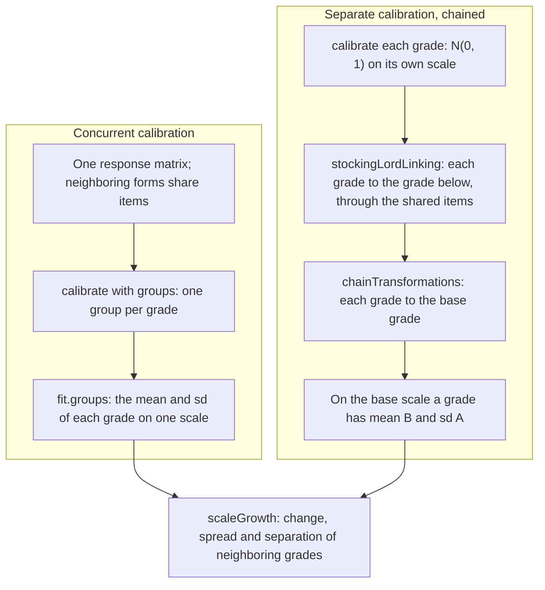

# Vertical scaling

A vertical scale puts the tests of successive grades on one scale, so that a score in grade 5 can be compared with one in
grade 3. Two designs build it, and both end in the same report of growth: the mean change from grade to grade, the
spread of each grade and how far neighboring grades are apart. `chainTransformations` of
`@measurekit/psychometrics/equating` composes the links of the separate design, and `scaleGrowth` of
`@measurekit/psychometrics/scaling` reports growth ([validation](validation.md)).



| Step                    | Function                                                                       | Module                                |
| ----------------------- | ------------------------------------------------------------------------------ | ------------------------------------- |
| Calibrate on one scale  | `calibrate` with `groups` and `latent`                                         | [irt](irt.md)                         |
| Link two calibrations   | `meanMeanLinking`, `meanSigmaLinking`, `haebaraLinking`, `stockingLordLinking` | [equating](equating.md#linking)       |
| Screen the shared items | `robustZ`                                                                      | [equating](equating.md#anchor-screen) |
| Compose the links       | `chainTransformations(links)`                                                  | equating                              |
| Move items and thetas   | `transformItem`, `transformTheta`                                              | equating                              |
| Report growth           | `scaleGrowth(groups)`                                                          | scaling                               |

## Quick start

Three grades take forms of 20 items from a pool of 48. Each form shares 6 items with the form of the grade below. The
persons of grade 3 have theta ~ N(0, 1), those of grade 4 N(0.8, 1.2²) and those of grade 5 N(1.3, 1.1²), 1,000 persons
each. Both designs recover these, and report the growth from the scale of grade 3.

```ts
import {
  buildResponseMatrix,
  calibrate,
  chainTransformations,
  createRandom,
  normalDistribution,
  scaleGrowth,
  simulateItems,
  simulateResponses,
  simulateThetas,
  stockingLordLinking,
  twoParameterLogistic,
} from "@measurekit/psychometrics";

// Three grades take forms of 20 items from a pool of 48; each form shares 6 items with the form of the grade below.
const FORM = 20;
const SHARED = 6;
const random = createRandom(7);
const pool = simulateItems(twoParameterLogistic, 48, random);
const ids = pool.map((_, j) => `q${j + 1}`);
const grades = [
  { group: "grade 3", first: 0, population: normalDistribution(0, 1) },
  { group: "grade 4", first: FORM - SHARED, population: normalDistribution(0.8, 1.2) },
  { group: "grade 5", first: 2 * (FORM - SHARED), population: normalDistribution(1.3, 1.1) },
].map(({ group, first, population }) => ({
  group,
  first,
  responses: simulateResponses(
    pool.slice(first, first + FORM),
    simulateThetas(1000, random, { distribution: population }),
    random,
  ).responses,
}));

// Design 1: one calibration of all grades, each its own group. Grade 3 is N(0, 1); the others' moments are estimated.
const concurrent = calibrate(
  buildResponseMatrix(
    grades.flatMap(({ first, responses }) => responses.map((row) => ids.map((_, j) => row[j - first] ?? null))),
    { itemIds: ids },
  ),
  {
    model: twoParameterLogistic,
    groups: grades.flatMap(({ group, responses }) => responses.map(() => group)),
    latent: { "grade 4": "normal", "grade 5": "normal" },
  },
);
const concurrentScales = concurrent.groups.flatMap(({ group, mean, sd }) =>
  group === null ? [] : [{ group, mean, sd }],
);

// Design 2: a calibration for each grade, each N(0, 1), linked to the grade below through the 6 items they share: the
// first 6 items of a form are the last 6 of the form below. Chaining the links moves each grade to grade 3's scale.
const separate = grades.map(({ first, responses }) =>
  calibrate(buildResponseMatrix(responses, { itemIds: ids.slice(first, first + FORM) }), {
    model: twoParameterLogistic,
  }),
);
const toBelow = separate
  .slice(1)
  .map((fit, g) => stockingLordLinking(fit.items.slice(0, SHARED), (separate[g]?.items ?? []).slice(-SHARED)));
const chainedScales = grades.map(({ group }, g) => {
  const { slope, intercept } =
    g === 0 ? { slope: 1, intercept: 0 } : chainTransformations(toBelow.slice(0, g).reverse());
  // A grade is N(0, 1) on its own scale, so on grade 3's scale its mean is B and its standard deviation A.
  return { group, mean: intercept, sd: slope };
});

scaleGrowth(concurrentScales);
// => [{ from: "grade 3", to: "grade 4", meanChange: 0.887, sdRatio: 1.236, effectSize: 0.789 },
//  { from: "grade 4", to: "grade 5", meanChange: 0.437, sdRatio: 0.872, effectSize: 0.377 }]
scaleGrowth(chainedScales);
// => [{ from: "grade 3", to: "grade 4", meanChange: 0.885, sdRatio: 1.240, effectSize: 0.785 },
//  { from: "grade 4", to: "grade 5", meanChange: 0.413, sdRatio: 0.859, effectSize: 0.357 }]
```

| On the scale of grade 3     | Simulated | Concurrent | Chained |
| --------------------------- | --------- | ---------- | ------- |
| Mean of grade 4             | 0.8       | 0.887      | 0.885   |
| Mean of grade 5             | 1.3       | 1.324      | 1.297   |
| Standard deviation, grade 4 | 1.2       | 1.236      | 1.240   |
| Standard deviation, grade 5 | 1.1       | 1.078      | 1.065   |
| Effect size, 3 to 4         | 0.724     | 0.789      | 0.785   |
| Effect size, 4 to 5         | 0.434     | 0.377      | 0.357   |

The two designs differ only by sampling error. Three things in the sample are worth reading closely:

- Grade 3 fixes the scale. A scale is arbitrary, so which grade is the base changes the numbers of `meanChange` but not
  `sdRatio` or `effectSize`.
- `toBelow[g]` moves grade `g + 4` to the scale of grade `g + 3`, so grade 5 reaches grade 3 by the link of grade 5 to
  grade 4 followed by the link of grade 4 to grade 3: `chainTransformations([toBelow[1], toBelow[0]])`.
- Grade 5 shares no item with grade 3. Only the chain, or the shared parameters of the concurrent design, connect them.

## Chaining links

A link from `a` to `b` is a `ScaleTransformation` `{ slope, intercept }`: θ_b = A θ_a + B. Composing links is the order
in which a person's theta moves from scale to scale.

```ts
import { chainTransformations } from "@measurekit/psychometrics/equating";

// Scale 1 to 2: θ₂ = 2 θ₁ + 1. Scale 2 to 3: θ₃ = 0.5 θ₂ + 3.
chainTransformations([
  { slope: 2, intercept: 1 },
  { slope: 0.5, intercept: 3 },
]); // => { slope: 1, intercept: 3.5 }
```

| Rule          | Definition                                                                                                 |
| ------------- | ---------------------------------------------------------------------------------------------------------- |
| Order         | `links[i]` moves scale `i` to scale `i + 1`; the chain moves the first scale to the last                   |
| Slope         | A = A₁ A₂ … Aₙ                                                                                             |
| Intercept     | B ← B Aᵢ + Bᵢ for each link, from B = 0: the intercept of the first link, carried through the later slopes |
| A single link | The chain is that link                                                                                     |
| Inverse       | A link followed by its inverse { 1 / A, -B / A } is the identity                                           |

`chainTransformations` takes any link: the moment methods, the characteristic curve methods, or a transformation from
elsewhere. The result moves items and thetas as the links do one after another: `transformItem(item, chain)` and
`transformTheta(theta, chain)`.

Each link carries the estimation error of its common items, and the errors of the links accumulate along the chain, so a
long chain is less certain than any one of its links. Consecutive links share the estimates of the form between them,
which treating the links as independent ignores, so adding their errors overstates the error of the chain:
[`linkCovariance`](equating.md#standard-errors-across-separate-calibrations) takes each form's items and covariance and
counts that form once. Keep chains short, give each link enough common items, and screen them for drift with `robustZ`
before linking.

## Reporting growth

`scaleGrowth(groups)` takes the mean and standard deviation of each group on the shared scale, in the order of the scale,
and returns one row for each pair of neighboring groups.

| Field        | Definition                                    | Reads as                                                                       |
| ------------ | --------------------------------------------- | ------------------------------------------------------------------------------ |
| `from`, `to` | The labels of the earlier and the later group |                                                                                |
| `meanChange` | μ_to - μ_from                                 | Growth in scale points; it depends on the units of the scale                   |
| `sdRatio`    | σ_to / σ_from                                 | Spread: above 1 when the groups spread out with grade, below 1 when they close |
| `effectSize` | (μ_to - μ_from) / √((σ²_from + σ²_to) / 2)    | Separation: the change in units of the spread of the two grades                |

The mean change alone does not say whether a gain is large: 0.4 scale points are a large gain between grades that spread
over 0.5 points, and a small one between grades that spread over 2. The effect size relates the change to the spread, so
that it does not depend on the units of a linear scale. A linear rescale of the scale, slope k and any intercept, multiplies `meanChange` by k and leaves `sdRatio`
and `effectSize` unchanged. A nonlinear rescale changes all three: growth statistics describe the scale on which they are
computed (Yen, 1986; Briggs and Betebenner), so report the scale with them.

The groups' moments come from the fitted `groups` of a calibration, as in the sample, or from any other source on one
scale. A `GroupDistribution` has a `group` that is `null` without `groups`, which the `flatMap` of the sample leaves out.

## When each design fits

| Question                            | Concurrent                                                            | Chained                                                                   |
| ----------------------------------- | --------------------------------------------------------------------- | ------------------------------------------------------------------------- |
| What the data must be               | All grades' responses in one matrix, items with the same ids          | A calibration of each grade; shared items between neighbors               |
| What it assumes of the shared items | The same parameters in every grade                                    | Parameters that are linear transformations of each other                  |
| Where the error comes from          | One estimation                                                        | Each calibration, and each link on top of it                              |
| Detecting a shared item that moved  | Calibrate the grades apart and screen as in the chained design        | `robustZ` on the shared items before each link                            |
| Fits when                           | One analyst holds all the data and the items fit one model throughout | Grades were calibrated apart, in different years, or by different parties |
| The scale is fixed by               | A reference group with N(0, 1)                                        | The base grade's own calibration                                          |

Either design needs the forms of neighboring grades to overlap in content as well as in items. A shared item that behaves
differently in two grades, because the curriculum teaches it between them, does not measure the same thing on both
scales and should leave the link.

## Errors

Invalid input throws `DataError` with the value found.

| Cause                                                        | What to do                                                             |
| ------------------------------------------------------------ | ---------------------------------------------------------------------- |
| An empty chain, or `links` that is not an array              | Pass the links in order, at least one                                  |
| A link without a positive finite slope or a finite intercept | Link again; check the common items, or the model, of that link         |
| A chain whose slope or intercept overflows                   | Check the links for slopes near 0 or very large                        |
| Fewer than two groups in `scaleGrowth`                       | Growth needs a pair of grades                                          |
| A group label that is empty or used twice                    | Give each group its own non-empty label                                |
| A mean that is not finite, or a standard deviation of 0      | Take the moments from a calibration of the group; a scale needs spread |

## Not included

| Not included               | Why                                                                                                          |
| -------------------------- | ------------------------------------------------------------------------------------------------------------ |
| Growth curves              | No fit: general statistics applied to scores.                                                                |
| Mixed models               | No fit: general statistics applied to scores; `lme4` fits them.                                              |
| Student growth percentiles | No fit: quantile regression and accountability policy are a wider domain than scaling; `SGP` exists on CRAN. |
| Value-added models         | No fit: accountability policy is a wider domain than scaling.                                                |
| Hieronymus scaling         | No reference: Kolen and Brennan's chapter 9 treats it, and no package on CRAN does.                          |
| Thurstone scaling          | No reference: Kolen and Brennan's chapter 9 treats it, and no package on CRAN does.                          |
| Grade equivalents          | No reference: Kolen and Brennan's chapter 9 treats them, and no package on CRAN does.                        |

## Differences from the references

| Reference             | Difference                                                                                                                                                                                                                        |
| --------------------- | --------------------------------------------------------------------------------------------------------------------------------------------------------------------------------------------------------------------------------- |
| `equateIRT::chainec`  | It takes the direct links by form name and a path, and gives standard errors. `chainTransformations` takes the links in order and gives the point values; `linkCovariance` takes the forms in order and gives the standard errors |
| Growth between grades | No package computes it; the reference is base R, with Yen's effect size as Briggs and Betebenner define it                                                                                                                        |

## References

- Briggs, D. C., & Betebenner, D. W. Is growth in student achievement scale dependent?
  https://web.archive.org/web/2020/https://www.cde.state.co.us/sites/default/files/documents/research/download/pdf/growthscaledependent.pdf
- Kolen, M. J., & Brennan, R. L. (2014). Test equating, scaling, and linking: Methods and practices (3rd ed.). Springer.
- Yen, W. M. (1986). The choice of scale for educational measurement: An IRT perspective. Journal of Educational
  Measurement, 23(4), 299-325.
