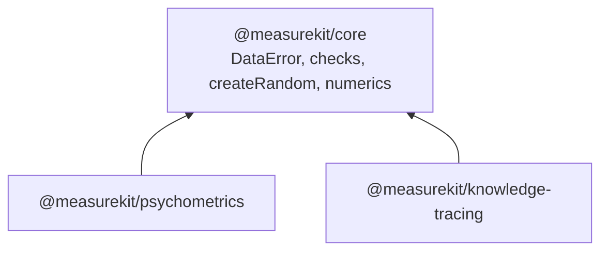

# @measurekit/core

The shared foundation of the measurekit packages: most users
install
[`@measurekit/psychometrics`](https://github.com/measurekit/measurekit/tree/main/packages/psychometrics#readme)
or
[`@measurekit/knowledge-tracing`](https://github.com/measurekit/measurekit/tree/main/packages/knowledge-tracing#readme),
which depend on it and re-export `createRandom`, `Random`, `DataError` and `MeasurekitError`.



It holds the errors the packages throw, the checks of their arguments, a seeded random number generator, the numerics
and the types that both packages use. It has no dependencies and runs in any JavaScript runtime.

```bash
npm install @measurekit/core
```

## API

| Group    | Exports                                                                                                                                                                                                                                                                                                                                                                                                                                                                                                                        |
| -------- | ------------------------------------------------------------------------------------------------------------------------------------------------------------------------------------------------------------------------------------------------------------------------------------------------------------------------------------------------------------------------------------------------------------------------------------------------------------------------------------------------------------------------------ |
| Errors   | `MeasurekitError`, the base class; `DataError`, for invalid input                                                                                                                                                                                                                                                                                                                                                                                                                                                              |
| Random   | `createRandom(seed)`, a seeded xoshiro128\*\* generator, and its interface `Random`; `shuffle`, a uniform permutation in place                                                                                                                                                                                                                                                                                                                                                                                                 |
| Checks   | `describe`; `isNonEmptyString`, `isPositive`, `isRecord`, `isUnitInterval`; `checkRecord`, `checkArray`, `checkOptions`, `checkMethod`, `checkRandom`, `checkBoolean`, `checkChoice`, `checkFinite`, `checkPositive`, `checkNonNegative`, `checkPositiveInteger`, `checkIntegerFrom`, `checkUnitInterval`, `checkSeed`, `checkStopping`                                                                                                                                                                                        |
| Numerics | `normalQuantile`, `logistic`, `logLogistic`, `logisticPair`, `normalizeLogs`, `cholesky`, `bfgs` with `GradientFunction`, `OptimizerOptions` and `OptimizationResult` for minimization, `backtrack` and `ARMIJO` for line searches, `stepAlong` with `DescentPoint` for a step of a descent, `iterateToConvergence` with `Stopping` and `Convergence`, `logGamma`, `chiSquareUpperTail`, `studentLowerTail`, `kappaOfPairs` with `KappaOptions` and `KappaWeights`, `dot`, `largestChange`, `maxAbs`, `mean`, `multiplyVector` |
| Items    | `LogisticItem` and `ThresholdItem`, the parameters of a logistic and of a graded or partial credit item; `logisticProbabilities`, `gradedProbabilities`, `partialCreditProbabilities`, `softmax`; `validAsymptotes`, `orderedThresholds`                                                                                                                                                                                                                                                                                       |
| Types    | `QMatrix`, the attributes or skills of each item by item id; `ThetaDistribution`, nodes of theta with weights that sum to 1                                                                                                                                                                                                                                                                                                                                                                                                    |

A check throws `DataError` with a sentence that names the value and what was expected, such as
`A seed must be a safe integer, found 1.5.`

```ts
import { createRandom, DataError } from "@measurekit/core";

const random = createRandom(42);
random.uniform(); // a draw from [0, 1), the same for every run with seed 42
try {
  createRandom(1.5);
} catch (error) {
  error instanceof DataError; // true
}
```

## License

[Apache-2.0](LICENSE). Copyright Fariz Wakan; see [NOTICE](NOTICE).
