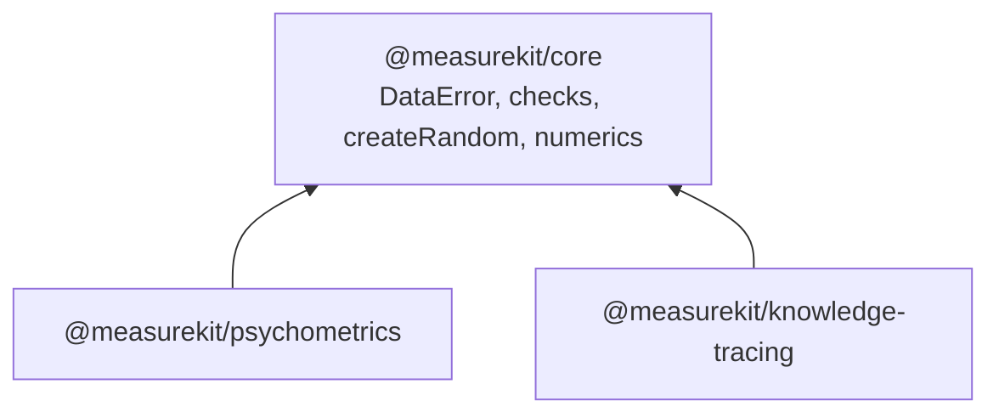

# @measurekit/core

The shared foundation of the measurekit packages: most users
install
[`@measurekit/psychometrics`](https://github.com/measurekit/measurekit/tree/main/packages/psychometrics#readme)
or
[`@measurekit/knowledge-tracing`](https://github.com/measurekit/measurekit/tree/main/packages/knowledge-tracing#readme),
which depend on it and re-export `createRandom`, `Random`, `DataError` and `MeasurekitError`.



It holds the errors the packages throw, the checks of their arguments, a seeded random number generator, the numerics
and the types that both packages use. It has no dependencies and runs in any JavaScript runtime.

```bash
npm install @measurekit/core
```

## API

| Group    | Exports                                                                                                                                                                                                                                                                                                                                                                                                                                                                                                                                                                    |
| -------- | -------------------------------------------------------------------------------------------------------------------------------------------------------------------------------------------------------------------------------------------------------------------------------------------------------------------------------------------------------------------------------------------------------------------------------------------------------------------------------------------------------------------------------------------------------------------------- |
| Errors   | `MeasurekitError`, the base class; `DataError`, for invalid input                                                                                                                                                                                                                                                                                                                                                                                                                                                                                                          |
| Random   | `createRandom(seed)`, a seeded xoshiro128\*\* generator, and its interface `Random`; `shuffle`, a uniform permutation in place                                                                                                                                                                                                                                                                                                                                                                                                                                             |
| Checks   | `describe`; `isNonEmptyString`, `isPositive`, `isRecord`, `isUnitInterval`; `checkRecord`, `checkArray`, `checkOptions`, `checkMethod`, `checkRandom`, `checkBoolean`, `checkChoice`, `checkFinite`, `checkPositive`, `checkNonNegative`, `checkPositiveInteger`, `checkIntegerFrom`, `checkUnitInterval`, `checkSeed`, `checkStopping`                                                                                                                                                                                                                                    |
| Numerics | `normalQuantile`, `logistic`, `logLogistic`, `logisticPair`, `normalizeLogs`, `cholesky`, `bfgs` with `GradientFunction`, `ValueAndGradient`, `OptimizerOptions` and `OptimizationResult` for minimization, `backtrack` with `BacktrackOptions` and `ARMIJO` for line searches, `stepAlong` with `DescentPoint` for a step of a descent, `iterateToConvergence` with `Stopping` and `Convergence`, `logGamma`, `chiSquareUpperTail`, `studentLowerTail`, `kappaOfPairs` with `KappaOptions` and `KappaWeights`, `dot`, `largestChange`, `maxAbs`, `mean`, `multiplyVector` |
| Items    | `LogisticItem` and `ThresholdItem`, the parameters of a logistic and of a graded or partial credit item; `logisticProbabilities`, `gradedProbabilities`, `partialCreditProbabilities`, `softmax` and `stridedSoftmax`; `hasValidAsymptotes`, `hasOrderedThresholds`                                                                                                                                                                                                                                                                                                        |
| Types    | `QMatrix`, the attributes or skills of each item by item id; `ThetaDistribution`, nodes of theta with weights that sum to 1                                                                                                                                                                                                                                                                                                                                                                                                                                                |

A check throws `DataError` with a sentence that names the value and what was expected, such as
`A seed must be a safe integer, found 1.5.`

```ts
import { createRandom, DataError } from "@measurekit/core";

const random = createRandom(42);
random.uniform(); // => 0.66, a draw from [0, 1), the same for every run with seed 42
let refusal: unknown;
try {
  createRandom(1.5);
} catch (error) {
  refusal = error;
}
refusal instanceof DataError; // => true
```

## Why the numerics are written here

The numerics are written here rather than taken from `ml-matrix` 6.15.1 or the `@stdlib/stats-base-dists-*` packages
0.3.1, the libraries closest to them, measured on the same inputs on 2026-11-04, Node.js 26, Apple M5:

| Need                                                                                                        | `@measurekit/core`                                        | `ml-matrix` 6.15.1                                                                      | `@stdlib` 0.3.1                                                                                              |
| ----------------------------------------------------------------------------------------------------------- | --------------------------------------------------------- | --------------------------------------------------------------------------------------- | ------------------------------------------------------------------------------------------------------------ |
| Cholesky factor of a correlation matrix of order 25 to 200                                                  | 0.0034 to 0.32 ms, on one `Float64Array` by rows          | The same factor in 3.3 to 4.2 times the time, on a matrix of one `Float64Array` per row | None                                                                                                         |
| Normal quantile of 10⁶ probabilities                                                                        | 5.4 ms; R's `qnorm` to the last digit at 1e-12 and 1e-300 | None                                                                                    | 15.9 ms; 3.1e-6 from `qnorm` at 1e-12, and `-Infinity` at 1e-300                                             |
| Descent loops that report `converged` and `iterations`: BFGS, Armijo's line search, a fixed-point iteration | `bfgs`, `backtrack`, `iterateToConvergence`               | None                                                                                    | None                                                                                                         |
| Form                                                                                                        | ESM, no dependency, synchronous                           | An ESM entry over a CommonJS build, two dependencies                                    | CommonJS; the distribution function and the quantile of the normal bring 148 `@stdlib` packages and 9 others |

Each routine is held to R within the tolerances of the libraries' validation, which a dependency would have to meet as
well. What one library alone needs, such as an eigendecomposition, stays in its own `math/`
([psychometrics](https://github.com/measurekit/measurekit/blob/main/docs/psychometrics/architecture.md#why-the-numerics-are-written-here)).

## License

[Apache-2.0](LICENSE). Copyright Fariz Wakan; see [NOTICE](NOTICE).
