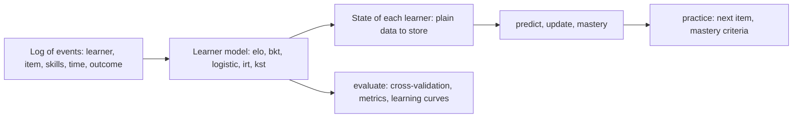

# @measurekit/knowledge-tracing

Knowledge tracing for JavaScript and TypeScript: learner models that estimate what learners know as they practice, with
their evaluation. Bayesian knowledge tracing with pyBKT's extensions, logistic models (AFM, PFA and the features of
logistic knowledge tracing, with fixed or random learner proficiency) and Elo are fitted to a log in batch and update a
learner's state online, one event at a time; IRT updates ability online from calibrated item parameters, and knowledge
space theory tracks the set of skills a learner masters, with prerequisites, adaptive assessment and the basic local
independence model. States and parameters are plain JSON, stored and resumed exactly. Practice ranks the next items by
predicted success and applies mastery criteria. Evaluation covers AUC, RMSE, log-loss, accuracy, R², kappa,
calibration, cross-validation by learner, item or time, a paired test between models, and learning curves with their
power laws and categories. Every statistic is validated against
pyBKT or R. Its only dependency is `@measurekit/core`, which has none; it runs in any JavaScript runtime.



```bash
npm install @measurekit/knowledge-tracing
```

## Example

```ts
import { eventLog } from "@measurekit/knowledge-tracing/data";
import { elo } from "@measurekit/knowledge-tracing/elo";

// One event per attempt: who answered which item, when, and how it went (1 correct, 0 incorrect, or null for a lesson).
const log = eventLog(
  [
    { learner: "ana", item: "q1", time: 1, outcome: 1 },
    { learner: "budi", item: "q1", time: 2, outcome: 0 },
    { learner: "ana", item: "q2", time: 3, outcome: 1 },
    { learner: "budi", item: "q3", time: 4, outcome: 1 },
    { learner: "ana", item: "q3", time: 5, outcome: 0 },
  ],
  { qMatrix: { q1: ["fractions"], q2: ["fractions"], q3: ["decimals"] } },
);

// Batch: replay the log, updating learners and items after each event.
const { model, states } = elo({ skills: true }).fit(log);
model.parameters.items.q1; // { difficulty: 0.09, count: 2 }
states.ana; // { learner: "ana", ability: 0.03, count: 3, skills: { fractions, decimals } }
states.ana?.skills.fractions; // { ability: 0.76, count: 2 }

// Online: predict the next attempt, then update the learner's state with its outcome.
const attempt = { learner: "ana", item: "q2", skills: ["fractions"], time: 6 };
const ana = states.ana ?? model.initialState("ana");
model.predict(ana, attempt); // 0.74, the probability of a correct answer
const next = model.update(ana, { ...attempt, outcome: 1 }); // a new state; JSON.stringify it to store it
```

Bayesian knowledge tracing gives the probability that a learner has mastered each skill:

```ts continues
import { bkt } from "@measurekit/knowledge-tracing/bkt";

// log: the log of the first sample
const tracer = bkt({ forgetting: true }).fit(log).model; // fitted by EM, skill by skill
const budi = tracer.update(tracer.initialState("budi"), {
  learner: "budi",
  item: "q2",
  skills: ["fractions"],
  time: 6,
  outcome: 1,
});
tracer.mastery(budi, "fractions"); // P(L), the probability that budi knows fractions
tracer.opportunitiesToMastery(budi, "fractions"); // further attempts until P(L) is expected to reach 0.95
```

Models are compared by cross-validation on the same folds:

```ts continues
import { createRandom } from "@measurekit/knowledge-tracing";
import { bkt } from "@measurekit/knowledge-tracing/bkt";
import { splitByLearner } from "@measurekit/knowledge-tracing/data";
import { elo } from "@measurekit/knowledge-tracing/elo";
import { compareModels, learningCurve } from "@measurekit/knowledge-tracing/evaluate";
import { afm } from "@measurekit/knowledge-tracing/logistic";

// log: the log of the first sample
const folds = splitByLearner(log, 2, createRandom(1));
compareModels({ elo: elo(), bkt: bkt(), afm: afm({ proficiency: "random" }) }, folds);
// [{ name: "elo", metrics: { count, auc, rmse, logLoss, accuracy }, folds: [...] }, ...]
learningCurve(log).skills.fractions; // [{ opportunity: 1, count: 2, errorRate: 0.5, ... }, ...]
```

## API

| Import                                   | Contents                                                                                                                                                                                                                                                                                                                                                                                                                                        |
| ---------------------------------------- | ----------------------------------------------------------------------------------------------------------------------------------------------------------------------------------------------------------------------------------------------------------------------------------------------------------------------------------------------------------------------------------------------------------------------------------------------- |
| `@measurekit/knowledge-tracing/data`     | `eventLog` with Q-matrices, and events without an outcome; `firstAttempts`; `splitByLearner`, `splitByItem`, `splitByTime`                                                                                                                                                                                                                                                                                                                      |
| `@measurekit/knowledge-tracing/evaluate` | `auc`, `rmse`, `logLoss`, `accuracy`, `rSquared`, `kappa`, `metrics`, `calibration`, `observedPairs`; `crossValidate`, `compareModels`, `compareByLearner`; `learningCurve`, `metricsByOpportunity`, `powerLawFit`, `categorizeCurve`                                                                                                                                                                                                           |
| `@measurekit/knowledge-tracing/elo`      | `elo`: learner-item Elo with Pelánek's uncertainty function, and concept-specific Elo with skill abilities                                                                                                                                                                                                                                                                                                                                      |
| `@measurekit/knowledge-tracing/bkt`      | `bkt`: Bayesian knowledge tracing with forgetting, item guess and slip, resource and pair learning, prior groups, fixed rates and bounds; mastery                                                                                                                                                                                                                                                                                               |
| `@measurekit/knowledge-tracing/logistic` | `afm`, `pfa`, `logistic`, `searchRates`: AFM, PFA, LKT and DAS3H features over skills, items or the learner, intercepts of skills and items, covariates and standard errors, with no, fixed or random proficiency and a ridge; the rates of the features by maximum likelihood                                                                                                                                                                  |
| `@measurekit/knowledge-tracing/irt`      | `irt`: online EAP and MAP ability and the posterior of θ from calibrated 1PL to 4PL, graded response and generalized partial credit items, with an optional drift of θ over time                                                                                                                                                                                                                                                                |
| `@measurekit/knowledge-tracing/kst`      | `kst`: BLIM by ML, MD or MDML, with fixed and equal rates, G², `compareFits` and `identifiability`, and adaptive assessment; `surmiseStructure`, `clauseStructure`, `unionClosure`, `isKnowledgeSpace`, `isLearningSpace`, `isWellGraded`, `forwardGraded`, `backwardGraded`, `fringes`, `neighbourhood`, `learningPaths`, `structureBase`, `structureAtoms`, `structureTrace`, `notions`, `delineate`; `structureValidity`; `iita`, `diffTest` |
| `@measurekit/knowledge-tracing/practice` | `recommend`; `streakMastery`, `thresholdMastery`, `movingAverageMastery`, `windowMastery`, `predictedMastery`; `opportunitiesToStreak`                                                                                                                                                                                                                                                                                                          |
| `@measurekit/knowledge-tracing/sim`      | `simulate`: outcomes drawn from any learner model, seeded, with lessons that draw none                                                                                                                                                                                                                                                                                                                                                          |
| `@measurekit/knowledge-tracing`          | All of the above, the `LearnerModel` interface, `createRandom` (a seeded random number generator), `DataError` and `MeasurekitError`                                                                                                                                                                                                                                                                                                            |

Invalid input throws `DataError`. A statistic that is undefined for the data, such as the AUC of outcomes that are all
correct, is `null` in a table of metrics and a `DataError` from a function that returns only that statistic. Results
never contain `NaN`.

A state or parameters stored by a 1.x release stay readable by every later 1.x release. A new field is optional, and its
absence means the old behavior.

## Documentation

- [Data](https://github.com/measurekit/measurekit/blob/main/docs/knowledge-tracing/data.md): events, with and without an
  outcome, logs, Q-matrices, first attempts, splits by learner, item and time.
- [Evaluation](https://github.com/measurekit/measurekit/blob/main/docs/knowledge-tracing/evaluate.md):
  metrics, calibration, cross-validation, model comparison, learning curves and their analysis.
- [Elo](https://github.com/measurekit/measurekit/blob/main/docs/knowledge-tracing/elo.md): the models, the
  uncertainty function, online and batch use, learner state.
- [Bayesian knowledge tracing](https://github.com/measurekit/measurekit/blob/main/docs/knowledge-tracing/bkt.md):
  the model and its extensions, fitting, online use, mastery.
- [Logistic models](https://github.com/measurekit/measurekit/blob/main/docs/knowledge-tracing/logistic.md): AFM, PFA
  and LKT features, proficiency, ridge, fitting, online use.
- [Item response theory](https://github.com/measurekit/measurekit/blob/main/docs/knowledge-tracing/irt.md):
  online ability from calibrated items, EAP and MAP, scales, drift.
- [Knowledge space theory](https://github.com/measurekit/measurekit/blob/main/docs/knowledge-tracing/kst.md):
  structures, prerequisites, fringes, BLIM, adaptive assessment, IITA.
- [Practice](https://github.com/measurekit/measurekit/blob/main/docs/knowledge-tracing/practice.md): the next
  item, mastery criteria, time to mastery, spaced repetition with ts-fsrs.
- [Simulation](https://github.com/measurekit/measurekit/blob/main/docs/knowledge-tracing/sim.md): learners drawn from
  a model, with known truth, for planning and recovery checks.
- [Storage](https://github.com/measurekit/measurekit/blob/main/docs/knowledge-tracing/storage.md): what an app
  stores, the answer-time path, refits, fitting skill by skill, memory.
- [Validation](https://github.com/measurekit/measurekit/blob/main/docs/knowledge-tracing/validation.md): pyBKT and
  R references, datasets and tolerances.
- [Architecture](https://github.com/measurekit/measurekit/blob/main/docs/knowledge-tracing/architecture.md):
  design principles, layout and the learner model interface, for contributors and for writing a model.
- [API reference](https://measurekit.github.io/measurekit/): every export, generated by TypeDoc.

## License

[Apache-2.0](LICENSE). Copyright Fariz Wakan; see
[NOTICE](NOTICE). [CONTRIBUTING.md](https://github.com/measurekit/measurekit/blob/main/CONTRIBUTING.md) describes how
to contribute.
