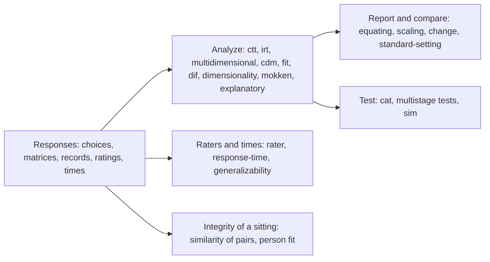

# @measurekit/psychometrics

Psychometrics for JavaScript and TypeScript: classical test theory, item response theory (calibration by marginal and
conditional maximum likelihood, in groups, on sparse data, online and with survey weights; multidimensional and unfolding
models; ability estimation; summed-score tables), cognitive diagnosis, adaptive and multistage testing with exposure
control and form assembly, global, item and person fit, differential item functioning, linking and equating including
kernel equating, score scaling and prediction, gains and reliable change, dimensionality, explanatory models of item
difficulty, generalizability theory, Mokken scale analysis, simulation, standard setting with classification accuracy and
consistency, rater agreement and effects, the evaluation of automated scores, response times, and answer similarity
between pairs of persons for copying and collusion. Every statistic is
validated against R. Its only dependency is `@measurekit/core`, which has none; it runs in any JavaScript runtime. The
guide of each module lists what it leaves out under Not included, with the reason for each method, and shows as recipes
what a few lines over its functions compute, such as plausible values and bootstrap standard errors.



```bash
npm install @measurekit/psychometrics
```

## Example

```ts
import {
  classifyDifficulty,
  classifyDiscrimination,
  cronbachAlpha,
  distractorAnalysis,
  itemStatistics,
  scoreResponses,
  standardErrorOfMeasurement,
} from "@measurekit/psychometrics";

// One row per person, one chosen option per item; null when no option was chosen.
const answers = [
  ["A", "C", "B", "D", "A"],
  ["A", "C", "B", "B", "A"],
  ["A", "B", "B", "D", "C"],
  ["B", "C", "D", "D", "A"],
  ["A", "A", "B", "C", "B"],
  ["C", "B", "A", "D", null],
  ["A", "C", "B", "D", "A"],
  ["B", "A", "C", "A", "B"],
];
const test = scoreResponses(answers, ["A", "C", "B", "D", "A"], { itemIds: ["q1", "q2", "q3", "q4", "q5"] });

itemStatistics(test)[0];
// => { id: "q1", count: 8, mean: 0.625, sd: 0.52, itemTotal: 0.63, itemRest: 0.42, biserial: 0.84,
//   discriminationIndex: 0.53, alphaIfDeleted: 0.69 }
classifyDifficulty(0.625); // => "moderate": the p-value is from 0.30 to 0.70
classifyDiscrimination(0.53); // => "very-good": D is at least 0.40

cronbachAlpha(test); // => 0.72, which is KR-20 for these 0/1 scores
standardErrorOfMeasurement(test); // => 0.94, in points

// Count, share and point-biserial correlation of every option, and its share in the upper and lower 27%.
distractorAnalysis(test)[0]?.options;
```

Already scored data goes into `buildResponseMatrix(rows)`, or `buildResponseMatrixFromColumns(columns)`, as integers
from 0 with `null` for missing responses. Every function takes plain arrays and objects and returns plain objects.

The same scores calibrate an IRT model, which then estimates abilities. With few persons, priors keep the estimates
finite:

```ts continues
import {
  betaPrior,
  calibrate,
  logNormalPrior,
  threeParameterLogistic,
  weightedLikelihoodEstimate,
} from "@measurekit/psychometrics";

const irt = calibrate(test, {
  model: threeParameterLogistic,
  priors: { a: logNormalPrior(0, 0.5), c: betaPrior(5, 17) },
  standardErrors: "hessian",
});
irt.items[0];
// => { id: "q1", parameters: { a: 0.85, b: -0.26, c: 0.20, d: 1 }, standardErrors: { a: 0.43, b: 1.175, c: 0.088 }, ... }
weightedLikelihoodEstimate(irt.items, [1, 0, 1, 1, null]); // => { theta: 0.64, standardError: 1.47 }
```

The calibrated items then make an adaptive test, which selects each next item from the responses so far:

```ts continues
import { createRandom } from "@measurekit/psychometrics";
import { allOf, anyOf, createAdaptiveTest, standardErrorThreshold, testLength } from "@measurekit/psychometrics/cat";

const cat = createAdaptiveTest({
  pool: irt.items,
  stopping: anyOf(testLength(4), allOf(testLength(2), standardErrorThreshold(0.5))),
});
const random = createRandom(1);
let state = cat.start(random); // => { next: "q1", ... }: the first item
state = cat.answer(state, 1, random); // => { items: ["q1"], responses: [1], next: "q2", ... }: next is null at the end
```

## API

| Import                                       | Contents                                                                                                                                                                                                                                                                                                                                                                                                                                                                                                                                                                                                                                                                                                                                                                                                                                                                                                                                                                                                                                                                                                                                                                                                                                                                                                          |
| -------------------------------------------- | ----------------------------------------------------------------------------------------------------------------------------------------------------------------------------------------------------------------------------------------------------------------------------------------------------------------------------------------------------------------------------------------------------------------------------------------------------------------------------------------------------------------------------------------------------------------------------------------------------------------------------------------------------------------------------------------------------------------------------------------------------------------------------------------------------------------------------------------------------------------------------------------------------------------------------------------------------------------------------------------------------------------------------------------------------------------------------------------------------------------------------------------------------------------------------------------------------------------------------------------------------------------------------------------------------------------- |
| `@measurekit/psychometrics/data`             | `buildResponseMatrix`, `buildResponseMatrixFromColumns`, `buildResponseRecords` for sparse data, the `FacetedScore` type, `scoreResponses`                                                                                                                                                                                                                                                                                                                                                                                                                                                                                                                                                                                                                                                                                                                                                                                                                                                                                                                                                                                                                                                                                                                                                                        |
| `@measurekit/psychometrics/ctt`              | `itemStatistics`, `distractorAnalysis`, `cronbachAlpha`, `kr20`, `kr21`, `splitHalf`, `mcdonaldOmega`, `standardErrorOfMeasurement`, `subscoreValue`, `augmentedSubscores`, `classifyDifficulty`, `classifyDiscrimination` and thresholds                                                                                                                                                                                                                                                                                                                                                                                                                                                                                                                                                                                                                                                                                                                                                                                                                                                                                                                                                                                                                                                                         |
| `@measurekit/psychometrics/change`           | `simpleGain`, `residualGain` and `normalizedGain` of two occasions; `differenceReliability` (Lord); `reliableChange` of a person from test scores and `reliableChangeFromTheta` from two ability estimates (Jacobson and Truax)                                                                                                                                                                                                                                                                                                                                                                                                                                                                                                                                                                                                                                                                                                                                                                                                                                                                                                                                                                                                                                                                                   |
| `@measurekit/psychometrics/irt`              | `calibrate` with groups, normal and histogram distributions of theta, a regression of theta on covariates, testlets, priors by parameter or by item, person weights and two kinds of standard errors, `calibrateWithCovariance`, `jointMaximumLikelihood`, `conditionalMaximumLikelihood` of the Rasch, partial credit and rating scale models, `calibrateUnfolding`; the 1PL to 4PL, GRM, GPCM, PCM, RSM, NRM and GGUM models and the `IrtModel` interface; priors; `maximumLikelihoodEstimate`, `weightedLikelihoodEstimate`, `posteriorModeEstimate`, `posteriorMeanEstimate`, `thetaPosterior`, `abilityEstimates`; `summedScoreTable` with testlets; `itemInformation`, `testInformation`, `conditionalStandardError`; `marginalReliability`, `empiricalReliability`                                                                                                                                                                                                                                                                                                                                                                                                                                                                                                                                         |
| `@measurekit/psychometrics/multidimensional` | `calibrateMultidimensional` of the M2PL, M3PL and multidimensional graded models, exploratory and confirmatory, by EM up to three dimensions and by MH-RM in any number, with standard errors, the correlations of the dimensions and, by EM, several groups with their own means and covariances and fixed anchor items; `calibrateBifactor` of bifactor and two-tier models by dimension reduction; `calibrateLongitudinal` for the same persons over two or three occasions; `rotateLoadings` (varimax, oblimin); `multidimensionalPosteriorMeanEstimate`, `multidimensionalPosteriorModeEstimate`, `multidimensionalMaximumLikelihoodEstimate`, `multidimensionalWeightedLikelihoodEstimate`, `multidimensionalEstimates`; `multidimensionalInformation`, `multidimensionalDiscrimination`, `multidimensionalDifficulty`                                                                                                                                                                                                                                                                                                                                                                                                                                                                                      |
| `@measurekit/psychometrics/cat`              | `createAdaptiveTest` with `maximumInformation`, `closestDifficulty`, `expectedInformation`, `likelihoodWeightedInformation`, `posteriorWeightedInformation`, `kullbackLeibler`, `posteriorKullbackLeibler`, `discriminationIndex`, `posteriorDiscriminationIndex`, `expectedPosteriorVariance`, `progressive`, `proportional`, `aStratified` and `randomesque` selection after `startingItems`, content balancing, content bounds (`contentBounds` and `maximumPriorityIndex`), enemy sets, testlets, Sympson-Hetter exposure control and `calibrateExposure`, and `testLength`, `standardErrorThreshold`, `informationThreshold`, `contentMinimumsMet`, `allOf`, `anyOf` stopping, with classification by `classificationThreshold` and `sequentialProbabilityRatio`; `untilMixed`; `createDiagnosticAdaptiveTest` with `gdinaDiscriminationIndex`, `posteriorWeightedKullbackLeibler`, `modifiedPosteriorWeightedKullbackLeibler`, `diagnosticKullbackLeibler` and `shannonEntropy` selection and `posteriorThreshold`, `masteryThreshold` stopping; `createMultidimensionalAdaptiveTest` with `maximumDeterminant` selection; `createMultistageTest` and `multistageCuts`; `simulateAdaptiveTest`, `simulateDiagnosticTest`, `simulateMultidimensionalAdaptiveTest`, `simulateMultistageTest`; `assembleForms` |
| `@measurekit/psychometrics/cdm`              | `calibrateCdm` (G-DINA, DINA, DINO, A-CDM, LLM, R-RUM), `compareItemModels` (a Wald test of each reduced model for every item), `attributeProfiles`, `cdmClassificationAccuracy`, `validateQMatrix`, `cdmModelFit` (M2, RMSEA, SRMSR), `cdmItemFit`, `qMatrixIdentifiability`, `nonparametricClassification`                                                                                                                                                                                                                                                                                                                                                                                                                                                                                                                                                                                                                                                                                                                                                                                                                                                                                                                                                                                                      |
| `@measurekit/psychometrics/fit`              | `itemFit` and `personFit` (infit, outfit, lz), `correctedPersonFit` (lz*), `summedScoreFit` (S-X²), `rootMeanSquareDeviation` (RMSD), `yenQ3` and `yenQ3CriticalValue`, `localDependenceChiSquare`, `limitedInformationFit` (M2, M2*, C2, RMSEA, SRMSR, TLI, CFI), `andersenTest`, `martinLofTest`, `raschWaldTest`; `kernelItemCurves`                                                                                                                                                                                                                                                                                                                                                                                                                                                                                                                                                                                                                                                                                                                                                                                                                                                                                                                                                                           |
| `@measurekit/psychometrics/dif`              | `mantelHaenszel` with ETS categories, `logisticRegressionDif`, `mantelTest` with the standardized mean difference, ETS categories and the Liu-Agresti odds ratio, `ordinalLogisticRegressionDif`, `logisticDiscriminantDif`, all on sparse data and with purification; `lordChiSquare`, `rajuAreaDif`, `irtLikelihoodRatioDif` for items of any model and `sibtest` of items and bundles, purified on request; `differentialFunctioning` (NCDIF, CDIF, DTF)                                                                                                                                                                                                                                                                                                                                                                                                                                                                                                                                                                                                                                                                                                                                                                                                                                                       |
| `@measurekit/psychometrics/dimensionality`   | `polychoricCorrelations` (polychoric and tetrachoric, with thresholds); `parallelAnalysis` of components and factors; `exploratoryFactorAnalysis` by minimum residuals or maximum likelihood, with varimax and oblimin rotation and the fit; `schmidLeiman` and `omegaHierarchical`; `minimumAveragePartial`; `smoothCorrelations`                                                                                                                                                                                                                                                                                                                                                                                                                                                                                                                                                                                                                                                                                                                                                                                                                                                                                                                                                                                |
| `@measurekit/psychometrics/equating`         | `meanMeanLinking`, `meanSigmaLinking`, `haebaraLinking`, `stockingLordLinking`, `chainTransformations`, `transformItem`, `transformTheta`; `linearEquating`, `equipercentileEquating`, `logLinearPresmoothing`, `trueScoreEquating`; `tuckerEquating`, `levineEquating`, `chainedLinearEquating`, `chainedEquipercentileEquating`, `frequencyEstimationEquating`, `bivariateLogLinearPresmoothing`; `irtObservedScoreEquating`; `kernelEquating`, `kernelEquatingDifference`; `bootstrapEquating`, `irtEquatingStandardErrors`, `linkCovariance`, `linkedEquatingErrors`; `robustZ`                                                                                                                                                                                                                                                                                                                                                                                                                                                                                                                                                                                                                                                                                                                               |
| `@measurekit/psychometrics/explanatory`      | `lltm` of dichotomous, partial credit and rating scale items with its test against the Rasch model; `linearChange`, the linear logistic model of change; `itemFeatureRegression` of an item parameter on item features by two-stage REML; `predictItemParameter` for new items                                                                                                                                                                                                                                                                                                                                                                                                                                                                                                                                                                                                                                                                                                                                                                                                                                                                                                                                                                                                                                    |
| `@measurekit/psychometrics/generalizability` | `generalizabilityStudy` of crossed and nested designs by the analysis of variance, with empty cells by Henderson's Method 1; `decisionStudy` for error variances and the generalizability and dependability coefficients                                                                                                                                                                                                                                                                                                                                                                                                                                                                                                                                                                                                                                                                                                                                                                                                                                                                                                                                                                                                                                                                                          |
| `@measurekit/psychometrics/mokken`           | `twoWayImputation` of missing responses; `guttmanErrors` and `personScalability` (normed G, U3, Ht) of persons; `scalability` (H, H_i and H_ij with standard errors); `automatedItemSelection` into Mokken scales; `conditionalAssociation` of items; `monotonicity` and `invariantItemOrdering` checks; `molenaarSijtsmaReliability`                                                                                                                                                                                                                                                                                                                                                                                                                                                                                                                                                                                                                                                                                                                                                                                                                                                                                                                                                                             |
| `@measurekit/psychometrics/scaling`          | `scaleScore`; `conversionTable` by the EAP of the summed score, with testlets, or the true score; `conditionalScaleError`; `scaleConversion`; `percentileRanks`; `normStatistics` with standard errors; both with person weights; `scaleGrowth`; `predictFormScore`, `predictThetaScore`; `drawJointThetas`                                                                                                                                                                                                                                                                                                                                                                                                                                                                                                                                                                                                                                                                                                                                                                                                                                                                                                                                                                                                       |
| `@measurekit/psychometrics/sim`              | `simulateThetas`, `simulateItems` of every built-in model, `simulateResponses` with missingness, `simulateCdmResponses`, `simulateMultidimensionalResponses`; `normalDistribution`, `logNormalDistribution`, `uniformDistribution`                                                                                                                                                                                                                                                                                                                                                                                                                                                                                                                                                                                                                                                                                                                                                                                                                                                                                                                                                                                                                                                                                |
| `@measurekit/psychometrics/standard-setting` | `angoffCutScore`; `orderedItemBooklet`, `bookmarkCutScore`; `hofsteeCutScore`, `beukCutScore`; `contrastingGroupsCutScores` (contrasting groups, Body of Work); `borderlineRegressionCutScores`, `borderlineGroupCutScores` (OSCE stations); `classificationAccuracy` (Rudner), `livingstonLewisClassification`                                                                                                                                                                                                                                                                                                                                                                                                                                                                                                                                                                                                                                                                                                                                                                                                                                                                                                                                                                                                   |
| `@measurekit/psychometrics/rater`            | `exactAgreement`, `adjacentAgreement`; `cohenKappa`, unweighted, linear or quadratic weighted; `fleissKappa`; `intraclassCorrelation`; `ratingCorrelation`; `standardizedMeanDifference`, of a subgroup on the population's SDs; `automatedScoreAgreement`, `validateAutomatedScores`, `automatedScoreDrift`, `routingCurve`, `scoreMapping` and `mappedScore`, `replayShift`: the evaluation of automated scores; `manyFacetRasch` with `manyFacetEstimates`, `manyFacetFit` and `expectedRating`: rater severity, item difficulty, fair scores and the bias of a rater on an item                                                                                                                                                                                                                                                                                                                                                                                                                                                                                                                                                                                                                                                                                                                               |
| `@measurekit/psychometrics/response-time`    | `calibrateResponseTimes` (lognormal model), `speedEstimates`, `responseTimeFit`; `calibrateSpeedAccuracy` and `speedAccuracyEstimates` (the hierarchical model of speed and accuracy); `normativeThresholds`, `responseTimeEffort`, `effortModeratedEstimates`                                                                                                                                                                                                                                                                                                                                                                                                                                                                                                                                                                                                                                                                                                                                                                                                                                                                                                                                                                                                                                                    |
| `@measurekit/psychometrics/similarity`       | `selectPairs` of the persons who share a context (room, school, network, start minute), bounded; `omegaIndex` (Wollack's ω), `generalizedBinomialTest`, `m4Index` (Maynes' M4) and `kIndex` (K, K1, K2, S1, S2) of pairs, for answer copying and collusion                                                                                                                                                                                                                                                                                                                                                                                                                                                                                                                                                                                                                                                                                                                                                                                                                                                                                                                                                                                                                                                        |
| `@measurekit/psychometrics/parameterization` | Conversion to and from mirt's coefficients of every model, multidimensional ones included                                                                                                                                                                                                                                                                                                                                                                                                                                                                                                                                                                                                                                                                                                                                                                                                                                                                                                                                                                                                                                                                                                                                                                                                                         |
| `@measurekit/psychometrics`                  | All of the above, `createRandom` (a seeded random number generator), `DataError` and `MeasurekitError`                                                                                                                                                                                                                                                                                                                                                                                                                                                                                                                                                                                                                                                                                                                                                                                                                                                                                                                                                                                                                                                                                                                                                                                                            |

Invalid input throws `DataError`. A statistic that is undefined for the data, such as the correlation of an item
everyone answered correctly, is `null` in a table of statistics, and a `DataError` from a function that returns only
that statistic. Results never contain `NaN`.

## Documentation

- [Data](https://github.com/measurekit/measurekit/blob/main/docs/psychometrics/data.md): response matrices,
  response records for sparse data, missing responses, scoring against a key.
- [Classical test theory](https://github.com/measurekit/measurekit/blob/main/docs/psychometrics/ctt.md):
  every statistic, its formula, missing data and edge cases, and augmented subscores.
- [Item response theory](https://github.com/measurekit/measurekit/blob/main/docs/psychometrics/irt.md):
  models, calibration, groups and distributions of theta, latent regression, online calibration, testlets, standard
  errors, joint maximum likelihood, ability estimation, summed-score tables, information, reliability, adding a model.
- [Multidimensional item response theory](https://github.com/measurekit/measurekit/blob/main/docs/psychometrics/multidimensional.md):
  compensatory models, exploratory and confirmatory calibration, standard errors, rotation, scoring, information.
- [Cognitive diagnosis](https://github.com/measurekit/measurekit/blob/main/docs/psychometrics/cdm.md): G-DINA, DINA,
  DINO, A-CDM, LLM and R-RUM, attribute mastery, classification accuracy, Q-matrix validation, nonparametric
  classification.
- [Adaptive and multistage testing](https://github.com/measurekit/measurekit/blob/main/docs/psychometrics/cat.md):
  adaptive tests, adaptive cognitive diagnosis and multidimensional adaptive tests, item selection, content balancing,
  enemy sets, testlets, exposure control and its calibration, stopping rules with classification by an interval or the
  SPRT, multistage panels and their routing cuts, simulation, form assembly.
- [Item and person fit](https://github.com/measurekit/measurekit/blob/main/docs/psychometrics/fit.md): infit and
  outfit, S-X², RMSD, lz and lz*, Yen's Q3 and its critical value, the local-dependence chi-square, M2 and its fit
  indices, the Andersen, Martin-Löf and Wald tests, kernel-smoothed item curves.
- [Differential item functioning](https://github.com/measurekit/measurekit/blob/main/docs/psychometrics/dif.md):
  Mantel-Haenszel and the ETS categories, logistic regression, the Mantel test and ordinal logistic regression for
  polytomous items, sparse data, purification, Lord's chi-square.
- [Dimensionality](https://github.com/measurekit/measurekit/blob/main/docs/psychometrics/dimensionality.md):
  polychoric and tetrachoric correlations, parallel analysis, exploratory factors by minres or maximum likelihood with
  their fit, the Schmid-Leiman transformation and omega hierarchical.
- [Linking and equating](https://github.com/measurekit/measurekit/blob/main/docs/psychometrics/equating.md):
  scale linking from common items, observed-score equating with presmoothing, equating through common items,
  kernel equating, IRT true-score and observed-score equating, standard errors by bootstrap and the delta method, also
  across separate calibrations and chains of links, the anchor screen.
- [Simulation](https://github.com/measurekit/measurekit/blob/main/docs/psychometrics/sim.md): thetas, item parameters
  of every model and response matrices, from a seed.
- [Mokken scale analysis](https://github.com/measurekit/measurekit/blob/main/docs/psychometrics/mokken.md):
  two-way imputation, Guttman errors and person fit, scalability coefficients with standard errors, automated item
  selection, conditional association, checks of monotonicity and invariant item ordering, and the reliability of the
  total score.
- [Generalizability theory](https://github.com/measurekit/measurekit/blob/main/docs/psychometrics/generalizability.md):
  variance components of crossed and nested designs, with empty cells too, and decision studies for the generalizability
  and dependability of a measurement procedure.
- [Explanatory item response theory](https://github.com/measurekit/measurekit/blob/main/docs/psychometrics/explanatory.md):
  the linear logistic test model and its test against the Rasch model, the regression of item difficulties and slopes on
  item features, and predictions for new items as calibration priors.
- [Score reporting and prediction](https://github.com/measurekit/measurekit/blob/main/docs/psychometrics/scaling.md):
  scales, conversion tables, conditional errors of scale scores, equated scores, percentile ranks and norms,
  prediction of an official score.
- [Vertical scaling](https://github.com/measurekit/measurekit/blob/main/docs/psychometrics/vertical-scaling.md): grades
  on one scale by concurrent calibration or chained links, and growth from grade to grade.
- [Standard setting](https://github.com/measurekit/measurekit/blob/main/docs/psychometrics/standard-setting.md):
  modified Angoff, Bookmark, Hofstee and Beuk cut scores, contrasting groups and Body of Work, borderline regression and
  the borderline group, classification accuracy by Rudner's and by Livingston and Lewis's method.
- [Rater agreement and effects](https://github.com/measurekit/measurekit/blob/main/docs/psychometrics/rater.md):
  Cohen's and Fleiss' kappa, intraclass correlations, the evaluation of automated scores, the many-facet Rasch model with
  its bias analysis.
- [Response times](https://github.com/measurekit/measurekit/blob/main/docs/psychometrics/response-time.md):
  the lognormal model, speed, aberrant times, the joint model of speed and accuracy, rapid guessing.
- [Change](https://github.com/measurekit/measurekit/blob/main/docs/psychometrics/change.md): gains, the reliability of a
  difference, reliable change from scores and from ability estimates.
- [Parameterization](https://github.com/measurekit/measurekit/blob/main/docs/psychometrics/parameterization.md):
  mirt's coefficients.
- [Validation](https://github.com/measurekit/measurekit/blob/main/docs/psychometrics/validation.md): R
  references, datasets and tolerances.
- [Architecture](https://github.com/measurekit/measurekit/blob/main/docs/psychometrics/architecture.md):
  design principles and layout, for contributors.
- [API reference](https://measurekit.github.io/measurekit/): every export, generated by TypeDoc.

## License

[Apache-2.0](LICENSE). Copyright Fariz Wakan; see
[NOTICE](NOTICE). [CONTRIBUTING.md](https://github.com/measurekit/measurekit/blob/main/CONTRIBUTING.md) describes how
to contribute.
