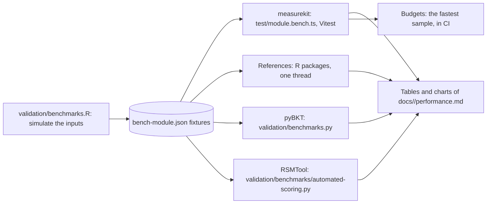

# validation

Scripts that write the reference fixtures in `packages/<package>/test/fixtures/`. Run them from the repository root,
with one BLAS thread (`OPENBLAS_NUM_THREADS=1 OMP_NUM_THREADS=1`): a BLAS of several threads sums in an order that
changes from run to run, which moves the last digits of some fixtures, such as the exploratory cases of
`multidimensional.R` and TAM's estimates in `longitudinal.R`.
References, datasets, versions and tolerances are listed in
[psychometrics](../docs/psychometrics/validation.md) and [knowledge tracing](../docs/knowledge-tracing/validation.md).


## Psychometrics

R scripts in `validation/psychometrics/`:

```bash
Rscript validation/psychometrics/ctt.R               # classical test theory; the value of subscores by subscore's CTTsub
Rscript validation/psychometrics/augmented-subscores.R  # augmented subscores: the subscore package's subscore.Wainer, base R, a simulation with known true subscores
Rscript validation/psychometrics/irt.R               # item response theory: calibration, JML, ability estimation, information
Rscript validation/psychometrics/latent-regression.R # latent regression in `calibrate`: mirt's covdata and formula, TAM's tam.mml(Y = x)
Rscript validation/psychometrics/person-weights.R   # person weights in `calibrate`: mirt's survey.weights, TAM's pweights, base R's weighted likelihood and mirt on repeated persons
Rscript validation/psychometrics/irt-fixed-parameters.R # held parameters in `calibrate`: mirt with est = FALSE on g and a1, and its S-X²
Rscript validation/psychometrics/irt-fixed-error.R  # standard errors with the fixed items' error: base R's V + J Σ Jᵀ, J also by maximizing again
Rscript validation/psychometrics/nested-models.R     # nested-model chi-squares of the recipe: mirt's anova of the 1PL against the 2PL and the PCM against the GPCM
JAVA_HOME=<a JDK> Rscript validation/psychometrics/irt-unfolding.R # the generalized graded unfolding model: the GGUM package, base R for the log-likelihood and the cross-product errors; case names as arguments run only those cases
Rscript validation/psychometrics/dimensionality.R    # polychoric correlations, parallel analysis: psych, polycor
Rscript validation/psychometrics/exploratory-factors.R # minres factors, rotations, minimum average partial test, smoothing: psych, GPArotation and base R
Rscript validation/psychometrics/efa-fit.R           # maximum likelihood factors and the fit of factors: psych's fa and fa.stats, base R
Rscript validation/psychometrics/factor-hierarchy.R  # Schmid-Leiman and omega hierarchical: psych's schmid and omega, base R
Rscript validation/psychometrics/cat.R               # adaptive testing: catR; diagnostic: cdcatR; multidimensional: mirtCAT; testlets: base R and mirtCAT
Rscript validation/psychometrics/cat-stopping.R      # classification stopping: catR's checkStopRule per cut; mirtCAT's SPRT in base R, checked against mirtCAT on one cut; reads cat-3pl.json
Rscript validation/psychometrics/cat-bounds.R        # content bounds: base R replays; the shadow test of mirtCAT with lpSolve, in two processes, about 30 s
Rscript validation/psychometrics/cat-selection.R     # the other selection rules and starting items: catR and base R on the banks of cat.R, about 4 minutes
Rscript validation/psychometrics/form-assembly.R     # assembly of forms: base R replays; highs on 85 blueprints, about 4 minutes
Rscript validation/psychometrics/multistage-cuts.R   # routing cuts of multistage panels: base R over mirt's iteminfo and expected.item
Rscript validation/psychometrics/fit.R               # item and person fit: eRm's infit and outfit, mirt's S-X², Zh and Q3
Rscript validation/psychometrics/fit-global.R        # limited-information fit: mirt's M2, base R where mirt's Δ differs or its 3PL is off; the noncentral chi-square
Rscript validation/psychometrics/fit-residuals.R     # RMSD and local dependence: TAM's IRT.RMSD, base R's mean deviation, mirt's residuals(type = "LD")
Rscript validation/psychometrics/fit-q3-bootstrap.R   # the critical value of Q3: mirt's parametric bootstrap of 1000 replications, about a minute
Rscript validation/psychometrics/fit-person.R        # person fit: PerFit's Gnormed, U3, Ht and lzstar; base R where PerFit rounds, ties or skips; reads mokken.json, fit-residuals.json and cat-3pl.json
Rscript validation/psychometrics/fit-curves.R        # kernel item curves: KernSmoothIRT's ksIRT, Ramsay's standard errors in base R; reads fit-rmsd.json
Rscript validation/psychometrics/dif.R               # differential item functioning: difR's Mantel-Haenszel, logistic, Lord; Mantel and ordinal logistic: base R, lrm, lordif
Rscript validation/psychometrics/dif-lord-purification.R # purified Lord's chi-square: difR's difLord(purify = TRUE); run dif.R first
Rscript validation/psychometrics/dif-sibtest.R       # SIBTEST and the recipes of dif.md: mirt's SIBTEST, difR's difSIBTEST and difStd, sirt's dif.variance; run dif.R first
Rscript validation/psychometrics/dif-irt.R          # IRT DIF: mirt's multipleGroup likelihood ratios, difR's difRaju, DFIT's Ncdif, Cdif and Dtf; run dif.R first
Rscript validation/psychometrics/dif-fixed-parameters.R # DIF of 3PL items with c held: difR's difLord and difRaju with c on mirt calibrations, mirt's multipleGroup with g held
Rscript validation/psychometrics/dif-polytomous-tests.R # Liu-Agresti odds ratio and logistic discriminant function: difR's liu_agresti_ccor, base R's equation 3 and glm; run dif.R first
Rscript validation/psychometrics/rasch-cml.R         # conditional maximum likelihood: eRm's RM, PCM, RSM; base R's conditional likelihood by every pattern
Rscript validation/psychometrics/rasch-tests.R       # Andersen, Martin-Löf and Wald tests: eRm's LRtest, MLoef, Waldtest; base R where eRm's value is not the statistic, about 2 minutes
Rscript validation/psychometrics/equating.R          # linking and equating: equateIRT, equate
Rscript validation/psychometrics/kernel-equating.R   # kernel equating in five designs: kequate; base R's delta method where kequate's counterbalanced errors differ
Rscript validation/psychometrics/linking-errors.R   # errors of links between separate calibrations and of equating through them: equateIRT's direc, chainec and score, numDeriv where equateIRT is not the reference; about 40 seconds
Rscript validation/psychometrics/vertical-scaling.R  # chains of links and growth between grades: equateIRT's chainec, mirt's multipleGroup and base R
Rscript validation/psychometrics/explanatory.R       # item parameters regressed on item features: mirt, metafor and base R
Rscript validation/psychometrics/linear-change.R     # linear logistic change: glm on the persons who changed, base R and eRm's LLRA
Rscript validation/psychometrics/lltm-polytomous.R   # the LLTM of partial credit and rating scale items: base R and TAM
Rscript validation/psychometrics/generalizability.R  # variance components and decision studies of balanced designs: base R aov and lme4
Rscript validation/psychometrics/generalizability-unbalanced.R  # variance components with empty cells: Henderson's Method 1 in base R
validation/psychometrics/.venv/bin/python validation/psychometrics/generalizability-unbalanced.py  # the same components by GeneralizIT
validation/psychometrics/.venv-scoring/bin/python -I validation/psychometrics/automated-scoring.py  # the evaluation of automated scores: RSMTool on PERSUADE 2.0 and ELLIPSE, also with a third double-scored
Rscript validation/psychometrics/rater-scoring.R      # the routing curve, drift windows, mappings and replays of automated scores: base R, isoreg and Iso's pava; run automated-scoring.py first
Rscript validation/psychometrics/mokken.R            # Mokken scale analysis: mokken's coefH, aisp, check.monotonicity and check.iio
Rscript validation/psychometrics/mokken-reliability.R  # Molenaar-Sijtsma reliability: mokken's check.reliability on exact proportions of item steps; shares the data of mokken.R through mokken-data.R
Rscript validation/psychometrics/mokken-steps.R      # Guttman errors and conditional association: mokken's check.errors and check.ca; G+ over the orders of tied steps in base R
Rscript validation/psychometrics/mokken-preparation.R  # two-way imputation and norms: mokken's twoway without its error and check.norms; the delta method in base R
Rscript validation/psychometrics/scaling.R           # score reporting and prediction, joint draws of theta: mirt, equate, mvtnorm and base R
Rscript validation/psychometrics/scaling-weights.R   # percentile ranks and norms with person weights: Hmisc's wtd.Ecdf, numDeriv over the weights, survey's svymean and svyvar
Rscript validation/psychometrics/testlet-tables.R    # summed-score and conversion tables, conditional errors with testlets: base R's enumeration of every pattern and mirt's EAPsum_2.0; reads irt-testlet.json
Rscript validation/psychometrics/plausible-values.R  # plausible values and Rubin's rules of the recipes: mirt's fscores, TAM's tam.pv, their expectation and the rules in base R, about 20 seconds
Rscript validation/psychometrics/standard-setting.R  # Angoff, Bookmark and Hofstee cut scores, classification accuracy: base R, mirt, cacIRT
Rscript validation/psychometrics/cut-scores.R        # contrasting groups and Body of Work by glm per boundary, Beuk, and the recipes of Nedelsky and Ebel: base R
Rscript validation/psychometrics/borderline.R        # borderline regression by lm per station, the covariance of the stations' cuts, and the borderline group: base R
Rscript validation/psychometrics/classification-livingston-lewis.R  # Livingston and Lewis's accuracy and consistency: betafunctions, and the indices by base R's integrate
Rscript validation/psychometrics/rater.R             # rater agreement: irr, psych and effsize; the many-facet Rasch model: base R, with TAM and sirt data
Rscript validation/psychometrics/rater-bias.R        # rater bias analysis: base R and TAM's tam.mml.mfr with the interaction of items and raters
Rscript validation/psychometrics/response-time.R     # response times: nlme, LNIRT, mirt and base R
Rscript validation/psychometrics/similarity.R        # answer similarity: CopyDetect 1.4's omega, generalized binomial test, M4, K, K1, K2, S1 and S2, about a minute
Rscript validation/psychometrics/cdm.R               # cognitive diagnosis: GDINA, NPCD and base R
Rscript validation/psychometrics/cdm-item-comparison.R  # item-level model comparison: GDINA's modelcomp with the Wald test, and its covariance of the success probabilities
Rscript validation/psychometrics/cdm-fit.R           # model and item fit: GDINA's modelfit and itemfit, CDM's modelfit.cor.din, base R's exact sums
Rscript validation/psychometrics/cdm-identifiability.R  # identifiability of the DINA: CDM's din_identifiability
Rscript validation/psychometrics/multidimensional.R  # multidimensional IRT: mirt, GPArotation and base R; case names as arguments run only those cases
Rscript validation/psychometrics/multidimensional-groups.R # multidimensional IRT in several groups, with fixed items: mirt's multipleGroup
Rscript validation/psychometrics/missing-not-at-random.R # responses missing not at random: mirt's two-dimensional 2PL of the responses and their indicators
Rscript validation/psychometrics/bifactor.R           # bifactor and two-tier models: mirt's bfactor; case names as arguments run only those cases
Rscript validation/psychometrics/longitudinal.R      # the same persons over two or three occasions: mirt with one dimension per occasion and tied items; TAM's tam.mml for the Rasch model
Rscript validation/psychometrics/longitudinal-recovery.R # how well mirt recovers the moments of the occasions, which bounds longitudinal-recovery.ts and the number of occasions
Rscript validation/psychometrics/change.R            # gains, reliability of a difference and reliable change: clinicalsignificance and base R
Rscript validation/psychometrics/parameterization.R  # mirt's coefficient forms of every item type, multidimensional ones included
Rscript validation/psychometrics/math.R              # normal, logistic and chi-square functions, Gauss-Hermite rules, eigendecompositions; reads the fixture of exploratory-factors.R
```

They need R with the packages psych, mirt, subscore, effsize, ltm, catR, TAM, eRm, difR, lordif, MASS, rms, equate, equateIRT, irr, cacIRT,
sirt, kequate, betafunctions, KernSmoothIRT, PerFit, nlme, LNIRT, numDeriv, lme4, metafor, statmod, Matrix, mokken, GDINA, alabama, NPCD, CDM, cdcatR, mirtCAT, lpSolve, highs, GPArotation, polycor, mvtnorm, clinicalsignificance, GGUM, CopyDetect and jsonlite;
`common.R` holds their shared helpers, `ltm-items.R` the calibration by ltm that `dif.R` and `dif-lord-purification.R` share, `mokken-data.R` the data that `mokken.R`, `mokken-reliability.R` and `mokken-steps.R` share, and `many-facet-likelihood.R` the many-facet likelihood that `rater.R` and `rater-bias.R` share.

`generalizability-unbalanced.py` checks the fixture that `generalizability-unbalanced.R` writes against GeneralizIT 0.1.2. It
runs in a Python 3.12 environment in `validation/psychometrics/.venv`, which git ignores, and writes nothing:

```bash
uv venv --python 3.12 validation/psychometrics/.venv
uv pip install --python validation/psychometrics/.venv -r validation/psychometrics/requirements.txt
```

`automated-scoring.py` writes `rater-automated-scoring.json` from RSMTool 12.0.0 in a Python 3.11 environment of its own,
as RSMTool and its SKLL pin older versions of scikit-learn and NumPy. It downloads PERSUADE 2.0's training set (about 620 MB, from
Google Drive) and ELLIPSE's raw rater scores into `validation/psychometrics/.data`, which git ignores, checks their SHA-256,
and takes about a minute once they are there:

```bash
uv venv --python 3.11 validation/psychometrics/.venv-scoring
uv pip install --python validation/psychometrics/.venv-scoring -r validation/psychometrics/automated-scoring-requirements.txt
```

`multidimensional.R` takes the cases `m2pl`, `missing`, `m3pl`, `fixed-parameters`, `graded`, `graded3`, `mhrm`, `exploratory`, `rotation`,
`information` and `likelihood` as arguments, and runs all of them without; the exploratory cases take a few minutes, as mirt's EM and
the base R maximum are slow, and `mhrm`, which runs mirt's MH-RM four times on five dimensions, takes about as long. `rotation` reads the fixture that `exploratory` writes, so run `exploratory` first.
`multidimensional-items.R` holds the helper of `multidimensional.R` and `parameterization.R` that sets items in mirt.
GGUM imports xlsx, which needs Java: install rJava against a JDK, with the variables that `R CMD javareconf -e` sets,
and run `irt-unfolding.R` with `JAVA_HOME` set to the JDK. It takes about 3 minutes a seed,
two at a time: `"seed 1"` to `"seed 10"`, `mixed`, `starts` and `"default tolerance"`, which reads seed 1's, as arguments
run only those cases and keep the others of the fixture.
CopyDetect 1.4 is on GitHub only, CRAN having archived 1.3, and exports nothing: `similarity.R` and the benchmark of
similarity call its internal functions. Install it at its commit into a library of its own and name the library:
`git clone https://github.com/jaminsore/CopyDetect.git && git -C CopyDetect checkout 32bdd322fba438b654b4ccc1e78406e208a361ad`,
`R CMD INSTALL --no-test-load -l <library> CopyDetect`, then `R_LIBS=<library> Rscript validation/psychometrics/similarity.R`.
`multidimensional-groups.R` writes one fixture of six cases, two groups of correlated dimensions, the same data with fixed
items, three groups with items missing by design, the graded model, three dimensions, and a group of standard deviations
near 2 with the maximum of its likelihood by BFGS in base R and mirt's likelihood there, and takes about a minute.
`exploratory-factors.R` writes one fixture of ten correlation matrices, simulated, `bfi`, `SAT12`, Harman's tests and a Heywood case,
with their minres solutions in base R and psych, and takes seconds. `factor-solutions.R` holds the base R solutions by
minres and maximum likelihood and their rotations, which it, `efa-fit.R` and `factor-hierarchy.R` share.

`bifactor.R` takes the cases `m2pl`, `long`, `two-tier`, `m3pl`, `graded`, `incomplete` and `recovery` as arguments, and runs
all of them without; it takes about 5 minutes, mirt's EM at `TOL = 1e-10` running 80 to 2,700 cycles, and each fixture records
whether mirt stopped before its limit of 5,000. `recovery` writes the data and the truth only: `bifactor-recovery.ts` reads them.

`longitudinal.R` writes one fixture of five cases, two occasions with persons missing from the second, three occasions, items
that only one occasion has, the graded model and the Rasch model, and takes about three minutes; `longitudinal-mirt.R` holds the
simulation and the mirt model that it, `longitudinal-recovery.R` and the benchmark share. `longitudinal-recovery.R` fits mirt
to 5,000 persons on 4 cores, writes each row as it finishes, takes about ten minutes and stops after 60.

cdcatR imports cdmTools for its nonparametric rules only, and cdmTools needs a Rust compiler through CVXR and clarabel.
`cat.R` runs without them: download the cdcatR source with `download.packages`, remove cdmTools from `Imports` in
`DESCRIPTION` and `import(cdmTools)` from `NAMESPACE`, and run `R CMD INSTALL` on the directory.

### Studies

A study that takes too long for the tests, a recovery at the sizes of the guides or a comparison with a reference that no
test can run in seconds, is a TypeScript script of `validation/<package>/`, run on the build: `pnpm build`, then `node validation/<package>/<study>.ts`. Through `study.ts` it writes `results/<study>.json` beside
it as each fit finishes, with the seeds, the sizes and the bound it shows, and the file is committed; the tests hold the
same rule at a size that runs in seconds. `validation/` is a package of the workspace, so that the studies import the
packages by name and `pnpm typecheck` checks them; no Vitest project and no job of CI runs them. A study exits with 1 when
a fit misses the threshold it states.

| Study                                               | Time             | Its results record                                                                                                                                                                                                                                                                                                                                           |
| --------------------------------------------------- | ---------------- | ------------------------------------------------------------------------------------------------------------------------------------------------------------------------------------------------------------------------------------------------------------------------------------------------------------------------------------------------------------ |
| `psychometrics/bifactor-recovery.ts`                | About 10 seconds | A two-tier model of 80 items and 3,000 persons on 21 nodes, from the data of `bifactor.R`'s `recovery`: the root mean square errors of the primary and the specific slopes against 0.10 and 0.14, and the correlation's error against 0.04                                                                                                                   |
| `psychometrics/irt-error-recovery.ts`               | About 20 minutes | The guide's bootstrap of 400 resamples on 20 seeds: each error against the Hessian's and their root mean square; the coverage of the pretest items' intervals under fixed items calibrated on 150 other persons and on the same 1,000, with their error carried and taken as known                                                                           |
| `psychometrics/ctt-interval-coverage.ts`            | About 2 minutes  | The coverage of the percentile intervals of alpha and omega, 500 samples of 200 persons and 1,000 resamples, against 0.92 to 0.98                                                                                                                                                                                                                            |
| `psychometrics/parallel-analysis-quantiles.ts`      | About 2 minutes  | The means and the 0.95 quantiles of parallel analysis' random eigenvalues against base R's 2,000 permutations of `bfi`, 1,000 replications on 20 seeds, in Monte Carlo errors against 4 and 6                                                                                                                                                                |
| `psychometrics/longitudinal-recovery.ts`            | About 5 minutes  | The moments of 5,000 persons on 2 and 3 occasions at 10 and 40 items, seeds 1 to 3: each fit's errors against 1.5 times mirt's worst, and the worst over the seeds; 40 items on 3 occasions at 15 nodes; the distances between 15, 21 and 31 nodes                                                                                                           |
| `psychometrics/multidimensional-groups-recovery.ts` | About 10 minutes | Three groups of 700, 600 and 600 persons, 40 items on each of 3 dimensions, three seeds at 21 and 15 nodes: each fit's errors of the means and covariances against 0.18 and 0.25, and the worst at each number of nodes                                                                                                                                      |
| `psychometrics/multidimensional-mhrm-recovery.ts`   | About 2 minutes  | 30 items on 5 dimensions by MH-RM, 2,000 persons, three seeds: each fit's largest errors in standard errors against 4 and its slopes' root mean square error against 0.2, and the worst over the seeds                                                                                                                                                       |
| `psychometrics/multidimensional-mhrm-mirt.ts`       | About 4 minutes  | MH-RM on the 25 graded items of `bfi`, 800 persons, 5 dimensions, seeds 1 to 10 of both programs: each fit's largest differences from the mean of mirt's runs against 0.3 and 0.08 and its dimensions reflected; each standard error averaged over the seeds against mirt's, its median against 1 ± 0.1 and its range against 0.6 to 1.6; each seed's ratios |
| `psychometrics/multidimensional-groups-mirt.ts`     | About 10 seconds | Two groups on three dimensions, the case `three` of `multidimensional-groups.json`: the largest differences from mirt's estimates, moments and log-likelihood against 2e-4, 5e-4 and 5e-6                                                                                                                                                                    |
| `psychometrics/cdm-additive-ecpe.ts`                | About 10 seconds | GDINA's additive models on ECPE, 2,922 persons and 28 items: each model's largest differences from GDINA's probabilities, coefficients and proportions against 1e-5, its log-likelihood above GDINA's, iterations and seconds                                                                                                                                |

## Knowledge tracing

R and Python scripts in `validation/knowledge-tracing/`:

```bash
Rscript validation/knowledge-tracing/math.R      # normal quantile, logistic function, forward-backward by enumeration, glm
Rscript validation/knowledge-tracing/bkt-bounds.R # BKT within bounds: the forward likelihood maximized by L-BFGS-B in base R
Rscript validation/knowledge-tracing/data.R      # first attempts by DataShop's convention, in base R
Rscript validation/knowledge-tracing/evaluate.R  # AUC by pROC; RMSE, log-loss, accuracy, calibration and learning curves in base R
Rscript validation/knowledge-tracing/evaluate-models.R  # R² and kappa (irr), the paired test of two models, time splits with unseen skills, metrics by opportunity, power laws and DataShop's categories of curves
Rscript validation/knowledge-tracing/elo.R       # Elo updates written out, held-out predictions, the recovery simulation
Rscript validation/knowledge-tracing/exposures.R # the exposure features, written out in base R, and their fit by glm
Rscript validation/knowledge-tracing/logistic.R  # LKT's features; AFM, PFA and LKT fits by glm, lme4's Laplace approximation, LiblineaR
Rscript validation/knowledge-tracing/logistic-terms.R  # item intercepts, shared coefficients, terms over items and the learner, covariates and standard errors: glm, lme4's Laplace approximation, LiblineaR
Rscript validation/knowledge-tracing/rate-search.R  # decays and exponents of features by maximum likelihood: optim over glm, and their spread over 20 simulated logs
Rscript validation/knowledge-tracing/lkt-features.R  # LKT's other features by computefeatures, and the windows of DAS3H in base R
Rscript validation/knowledge-tracing/practice.R  # mastery criteria over a seeded log, replayed in base R
Rscript validation/knowledge-tracing/irt.R       # the grid posterior and exact mode of θ, against mirt's fscores; with drift, passes in logs and a particle filter
Rscript validation/knowledge-tracing/kst.R       # structures, fringes, BLIM, IITA and assessment by kst, pks and DAKS
Rscript validation/knowledge-tracing/kst-structure.R  # base, atoms, neighbourhoods, paths, traces and closures by kst; clauses in base R
Rscript validation/knowledge-tracing/kst-diagnostics.R  # BLIM with fixed and equal rates, comparison, identifiability, gradedness by pks; validity by kst; the test of a quasi order by the delta method (takes about 6 minutes)
Rscript validation/knowledge-tracing/kst-incomplete.R  # the test of a quasi order on incomplete patterns: base R and numDeriv over the learners' weights, DAKS on complete ones
validation/knowledge-tracing/.venv/bin/python validation/knowledge-tracing/bkt.py  # BKT by pyBKT: inference, EM from given and random starts, recovery; lessons as correct = -1, fixed rates, multipair
validation/knowledge-tracing/.venv/bin/python validation/knowledge-tracing/data-rows.py  # the sequences of outcomes that pyBKT's convert_data makes of the rows of ASSISTments and DataShop exports
```

The R scripts need R with the packages pROC, irr, lme4, LiblineaR, LKT, mirt, kst, pks, DAKS, sets and jsonlite; `common.R`
holds their shared helpers, and stops a script that runs without `OPENBLAS_NUM_THREADS=1 OMP_NUM_THREADS=1`. `irt.R` takes about two minutes, most of them on the grid of 1,921 points; `irt.R abilities`,
`irt.R nominal` or `irt.R drift` runs one part. `bkt.py` needs the Python environment below, and takes under a minute.

### Python

`bkt.py` and `data-rows.py` run in a Python 3.12 environment in `validation/knowledge-tracing/.venv`, which git ignores:

```bash
uv venv --python 3.12 validation/knowledge-tracing/.venv
uv pip install --python validation/knowledge-tracing/.venv -r validation/knowledge-tracing/requirements.txt
```

`requirements.txt` pins pyBKT with the NumPy, pandas and scikit-learn versions it works with.

## Benchmarks

`benchmarks.R` and `benchmarks.py` time the references on the tasks of the benchmarks of measurekit, whose times, ratios
and budgets are on the performance page of each package: [core](../docs/core/performance.md),
[psychometrics](../docs/psychometrics/performance.md) and [knowledge tracing](../docs/knowledge-tracing/performance.md).
Each script of `validation/benchmarks/<package>/` simulates the inputs, writes them to
`packages/<package>/test/fixtures/bench-<module>.json` and times the reference on them with one thread.

They need the packages of the scripts above, and for the tasks of
`validation/benchmarks/` psych, TAM, nlme, metafor, pROC, irr, equate, equateIRT, difR, rms, GDINA, NPCD, catR, cdcatR,
mirtCAT, pks, DAKS, kst, sets, eRm and CopyDetect, installed as above, in its library on `R_LIBS`, as for
`similarity.R`; similarity's references take about 10 minutes. The results go to `validation/benchmarks/results/`, which git ignores.

### Method



Each benchmark times the hot path of a module, and the same task on the same data in the reference implementation that the
validation of each package uses: an R package, base R where no package does the task, or pyBKT. The ratio is
the time of measurekit over the time of the reference, so a ratio above 1 means that measurekit is slower. A ratio above
1.5 is in bold in the tables.

| Part       | How                                                                                                                                                                                                                                                                                                                                                                                                                                                                                                            |
| ---------- | -------------------------------------------------------------------------------------------------------------------------------------------------------------------------------------------------------------------------------------------------------------------------------------------------------------------------------------------------------------------------------------------------------------------------------------------------------------------------------------------------------------- |
| Data       | `validation/benchmarks.R` simulates the inputs with a fixed seed, or takes a public dataset, and writes them to `packages/<package>/test/fixtures/bench-<module>.json`. measurekit and its reference read the same data.                                                                                                                                                                                                                                                                                       |
| measurekit | `packages/<package>/test/<module>.bench.ts`, run by Vitest on Node.js with one thread, against the build of the package, which `pnpm bench` makes first: Vitest's module runner turns each import of a source file into a getter that the compiler cannot inline, so that it times a call of a small function several times as slow as it is for a user. A benchmark takes at least 10 samples, or 5 when it takes a second or more, after a warm-up. The tables give the median of the medians of three runs. |
| References | `validation/benchmarks/<package>/<module>.R`, run with one thread: `OPENBLAS_NUM_THREADS=1` and `OMP_NUM_THREADS=1` set R's BLAS. A task takes 15 samples under a second, 7 under 15 seconds, 3 under a minute and 2 above, after one call to warm up.                                                                                                                                                                                                                                                         |
| pyBKT      | `validation/benchmarks.py`, on the log of `bench-bkt.json`, with its processes off. It times what R does not.                                                                                                                                                                                                                                                                                                                                                                                                  |
| RSMTool    | `validation/benchmarks/automated-scoring.py`, in the environment of `validation/psychometrics/automated-scoring.py`, on the scores of `rater-automated-scoring.json`. It writes `python-scoring.json`, which `table` reads with `python.json`.                                                                                                                                                                                                                                                                 |
| Settings   | A reference runs with the settings that make its work that of measurekit: the same quadrature, convergence tolerance and starts. The notes under a table name where they differ.                                                                                                                                                                                                                                                                                                                               |
| Order      | On a machine shared with other work, the runs of measurekit and of its reference alternate, three of each, so that the load falls on both; the times are the medians of the three.                                                                                                                                                                                                                                                                                                                             |
| Ratio      | The median of measurekit over the median of the reference.                                                                                                                                                                                                                                                                                                                                                                                                                                                     |

An EM calibration stops when its estimates stop changing, so two programs that agree on the criterion can need different
numbers of iterations: the ratio is that of the time to the same answer, not of one iteration. The ability estimators and the
replays compare the work for each person, and the notes say where the reference does less.

### Running

```bash
pnpm install
OPENBLAS_NUM_THREADS=1 OMP_NUM_THREADS=1 Rscript validation/benchmarks.R               # the inputs and the references
validation/knowledge-tracing/.venv/bin/python validation/benchmarks.py                  # pyBKT
validation/psychometrics/.venv-scoring/bin/python -I validation/benchmarks/automated-scoring.py  # RSMTool
pnpm bench                                                                              # measurekit, against the budgets
```

`Rscript validation/benchmarks.R irt mokken` runs the modules named, and `knowledge-tracing/irt` one module of a package.
To refresh the charts and tables, run each package with the JSON reporter three times, with the run number in the name of the
file, after a run of the references each time, whose `results/r.json` is copied to `results/r-1.json` and so on, then
`Rscript validation/benchmarks.R table`, which takes the median of the runs of each side:

```bash
pnpm --filter @measurekit/core bench --reporter json --outputFile validation/benchmarks/results/measurekit-core-1.json
pnpm --filter @measurekit/psychometrics bench --reporter json --outputFile validation/benchmarks/results/measurekit-psychometrics-1.json
pnpm --filter @measurekit/knowledge-tracing bench --reporter json --outputFile validation/benchmarks/results/measurekit-knowledge-tracing-1.json
Rscript validation/benchmarks.R table   # the charts and tables of docs/<package>/performance.md
```

### Budgets

| Rule         | Meaning                                                                                                                                                                                                                                                                                                                                                                                                                                                                      |
| ------------ | ---------------------------------------------------------------------------------------------------------------------------------------------------------------------------------------------------------------------------------------------------------------------------------------------------------------------------------------------------------------------------------------------------------------------------------------------------------------------------- |
| Gate         | A benchmark fails when its fastest sample is above its budget in `packages/<package>/test/budgets.ts`. The fastest sample is the least affected by the other work of a shared machine                                                                                                                                                                                                                                                                                        |
| Time budget  | Five times the fastest sample that the CI runner took over at least five green runs of the `bench` job, rounded up to one significant digit, the one rule of STANDARDS.md section 11; the comment of each `budgets.ts` names the runs. It is absolute, so it holds for the runner's class of machine and for one up to about five times slower; on a slower one only the ratios to the references apply, which are documented and not gated, as R does not run on the runner |
| Ratio budget | The rule gives a ratio to a reference timed in the same process twice the highest ratio measured, rounded up to one significant digit. measurekit gates no ratio, as its references run in R and Python, outside the process of the benchmark                                                                                                                                                                                                                                |
| Noise        | Over the five runs of 2026-11-05 the fastest samples of one benchmark differed by a median of 1.6 times and by up to 3.0 times (`random.uniform`); every budget stands at least 1.7 times above the slowest of them. It is far below the cost of the changes that the budgets exist to catch                                                                                                                                                                                 |
| Change       | A budget changes only with the reason in the commit that changes it                                                                                                                                                                                                                                                                                                                                                                                                          |

## Sizes and peak memory

The performance page of each package gives the sizes of its entry points and the peak memory of its readers of untrusted
input; a test holds each to a budget, and a command prints the numbers of the tables.

|          | Size                                                                                                                        | Peak memory                                                                                                                                                                                                                                                 |
| -------- | --------------------------------------------------------------------------------------------------------------------------- | ----------------------------------------------------------------------------------------------------------------------------------------------------------------------------------------------------------------------------------------------------------- |
| Test     | `scripts/test/entry-sizes.test.ts`                                                                                          | `scripts/test/peak-memory.test.ts`                                                                                                                                                                                                                          |
| Measures | Each entry point bundled alone, minified, with code splitting on, `export *` of the entry and core from its sources         | The readers of `scripts/peak-memory.ts` on their worst inputs within the limits of SECURITY.md: the peak resident memory of a child process that parses the input from JSON and reads it, less that of one that parses it and does not                      |
| Setting  | esbuild; the bytes and modules are those of the entry chunk and the chunks it imports statically                            | Each pair of processes has a bounded heap, twice the least heap in which the reading ended on Node.js 22, 24 and 26 rounded up to 16 MiB, so that a reading that keeps more alive at once fails whenever the collector runs and however busy the machine is |
| Budget   | 1.25 times the gzip size, rounded up to the next 500 bytes, and the modules an entry may hold, in `scripts/size-budgets.ts` | Twice the largest rise measured on Node.js 22 and 24, on macOS and on Linux, rounded up to 10 MB, which bounds what the heap does not hold, the buffers of typed arrays                                                                                     |
| Tables   | `node scripts/entry-sizes.ts`, on Node.js 22, the runner's version                                                          | `node scripts/peak-memory.ts`, the median of three pairs with a heap of 8 GiB, as a host's process collects later than a bounded one; `--heap` prints the least heap of each reading                                                                        |
